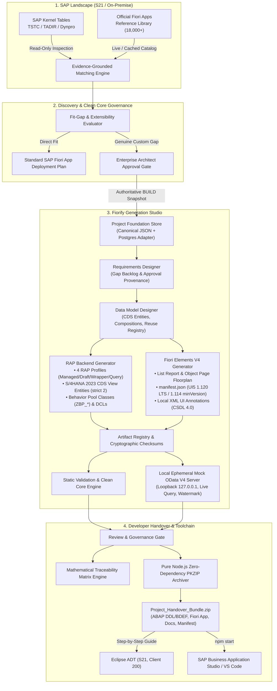

# Fiorify — SAP S/4HANA Modernization & Generation Platform

[-0070f2?style=flat-square&logo=sap)](https://www.sap.com)
[](https://community.sap.com)
[](https://react.dev)
[](https://nodejs.org)
[](docs/17-security-governance.md)
[](#license)

> **"STANDARD SAP FIORI FIRST. CUSTOM BUILD ONLY WHEN A GENUINE GAP EXISTS."**

Fiorify is an enterprise-grade SAP modernization workbench and code generation studio. It bridges the gap between classical SAP GUI dynpro transactions and modern SAP Fiori applications by:
1. **Discovering** standard Fiori replacements grounded in live SAP kernel dictionaries (TSTC, TADIR, dynpros) and the official 18,000+ app SAP Fiori Reference Library.
2. **Governing** transitions through evidence-based fit-gap scoring and Lead Architect approval workflows.
3. **Generating** production-ready ABAP RESTful Application Programming Model (RAP) Business Objects and SAP Fiori Elements V4 applications with instant local ephemeral mock previews.
4. **Handing Over** zero-dependency PKZIP project bundles ready for direct import and activation in Eclipse ABAP Development Tools (ADT) and SAP Business Application Studio (BAS).

---

## 🏛️ Platform Architecture & Data Flow



---

## ⚡ Core Functional Pillars

### Pillar 1: Grounded T-Code Discovery & Inspection
- **Dual-Mode Execution:**
  - **Live SAP S21 Mode:** Connects to SAP S/4HANA 2023 System `S21` (Client `200`) via direct Gateway OData catalog (`/sap/opu/odata/IWFND/CATALOGSERVICE;v=2`) and SAP Fiori Reference Library APIs (`SingleApp.xsodata`).
  - **Local Deterministic Mode:** Uses synthetic repository fixtures for completely offline execution, fast unit testing, and CI pipelines.
- **3-Way Verification:** Correlates SAP Kernel dictionary metadata (TSTC, TADIR), OData service catalogs, and official Fiori app descriptors to eliminate hallucinated app recommendations.

### Pillar 2: Fit-Gap Scoring & Clean Core Governance
- **Strict Extensibility Evaluation:** Evaluates legacy screens, custom table usage (`Z*`/`Y*`), user exits, and BAdI implementations.
- **Clean Core Classification:**
  - **Direct Replacement:** 100% standard Fiori app fit; zero ABAP custom development required.
  - **In-App Extensibility:** Key-user field extensions and custom logic BAdIs.
  - **Side-by-Side Build (BTP / CAP):** Independent extensions decoupled from the SAP core.
  - **Custom RAP Build:** Approved greenfield or wrapper RAP business objects.
- **Governance Gate:** Enforces Enterprise Lead Architect approval before any custom development can enter Generation Studio.

### Pillar 3: Generation Studio (Milestones GEN-02 to GEN-09)
When standard SAP Fiori apps leave genuine functional gaps, Generation Studio generates complete source code packages:
- **RAP Backend Generator (`GEN-05`):**
  - Evaluates 4 architectural profiles: *Managed with Draft*, *Managed Direct*, *Unmanaged / Wrapper*, and *Read-Only Query*.
  - Generates modern CDS View Entities (`define view entity`), Behavior Definitions with `strict ( 2 );`, Behavior Pool Classes (`ZBP_*`), transparent SQL DDL table structures, Access Control DCLs, and Service Definitions.
  - Generates syntactically complete CRUD, draft staging, and `%tky` handling, providing structured `/* TODO: [Developer Implementation Required] */` guidance comments for custom business rules.
- **SAP Fiori Elements V4 Generator (`GEN-06`):**
  - Generates List Report & Object Page (LROP) floorplan conforming to SAP Fiori Design Guidelines.
  - Configures `manifest.json` targeting SAPUI5 1.120 LTS with `minUI5Version: "1.114.0"` for backward compatibility with S/4HANA 2023 initial shipments.
  - Generates local XML UI vocabulary annotations (`UI.LineItem`, `UI.HeaderInfo`, `UI.SelectionFields`, `UI.Facets`, `UI.FieldGroup`).
- **Local Ephemeral Mock OData V4 Runtime (`GEN-07`):**
  - In-process native Node.js HTTP mock server strictly bound to loopback `127.0.0.1` with a 30-minute inactivity reaper.
  - Dynamically synthesizes CSDL 4.0 EDMX `$metadata` from project data models.
  - Evaluates `$filter`, `$select`, `$expand`, `$top`, `$skip`, and `$orderby` expressions, handling in-memory CRUD operations and draft actions (`draftActivate`, `draftDiscard`).
  - Injects an unclosable visual watermark banner: `"MOCK / DRAFT PREVIEW ONLY - NOT CONNECTED TO SAP"`.

### Pillar 4: Packaging & Developer Handover (`GEN-08` / `GEN-09`)
- **Zero-Dependency PKZIP Archiver:** Custom streaming archiver implemented with pure Node.js built-ins (`zlib`, `Buffer`), creating standard `.zip` bundles without bloated external dependencies.
- **Cryptographic Provenance:** Generates `Fiorify-export-manifest.json` recording SHA-256 hashes of every generated file.
- **Bi-Directional Traceability:** Computes strict mathematical requirement coverage percentages linking T-Code requirements $\rightarrow$ CDS entities $\rightarrow$ RAP behaviors $\rightarrow$ Fiori UI fields.
- **Eclipse ADT Handover Guide:** Generates tailored, step-by-step instructions for importing database tables, activating CDS views, pasting BDEFs, and publishing OData V4 service bindings in Eclipse ADT.

---

## 📦 Generated Project Bundle Structure

```text
Project_Handover_Bundle.zip
├── abap/
│   ├── tables/
│   │   ├── ztab_custom.tabl.sql          # Transparent persistence table SQL DDL
│   │   └── ztab_custom_d.tabl.sql        # Draft administrative table SQL DDL
│   ├── cds/
│   │   ├── zi_custom.ddls.asddls         # Basic / Interface CDS View Entity
│   │   └── zc_custom.ddls.asddls         # Consumption / Projection CDS View Entity
│   ├── behavior/
│   │   └── zr_custom.bdef.asbdef         # RAP Behavior Definition (strict 2, draft)
│   ├── behavior_classes/
│   │   └── zbp_r_custom.clas.abap        # ABAP Behavior Pool Class (CCIMP / Local Types)
│   ├── security/
│   │   └── z_r_custom_ac.dcls.asdcls     # CDS Access Control DCL (pfcg_auth)
│   ├── services/
│   │   └── zui_custom.srvd.srvdsrv       # RAP Service Definition
│   └── bindings/
│       └── zui_custom_o4.srvb.json       # RAP Service Binding Proposal (OData V4 UI)
├── fiori/
│   ├── webapp/
│   │   ├── manifest.json                 # SAPUI5 OData V4 Application Descriptor
│   │   ├── Component.js                  # SAP Fiori Elements AppComponent
│   │   ├── index.html                    # Bootstrap with Horizon Theme
│   │   └── annotations/
│   │       └── annotations.xml           # Local CSDL 4.0 UI Annotations
│   ├── ui5.yaml                          # @ui5/cli Tooling Configuration
│   └── package.json                      # NPM Scripts & Dependencies
├── docs/
│   ├── ARCHITECTURE_DECISION.md          # Algorithmic Profile Selection Rationale
│   ├── TRACEABILITY_MATRIX.md            # Forward & Backward Requirement Traceability
│   ├── DEVELOPER_HANDOVER_GUIDE.md       # Step-by-Step Eclipse ADT & BAS Instructions
│   └── README.md                         # Project Summary & Implementation Notes
└── Fiorify-export-manifest.json           # Root Manifest with SHA-256 Checksums
```

---

## 🎯 SAP S/4HANA 2023 Baseline Compatibility Matrix

| Component | Target Baseline (S21) | Fiorify Generator Setting | Compatibility Rationale |
| :--- | :--- | :--- | :--- |
| **SAP System** | SAP S/4HANA 2023 On-Premise | System Connection `S21`, Client `200` | S21 verified target landscape |
| **SAP_BASIS** | 7.58 (ABAP Cloud Foundation) | RAP `strict ( 2 );` | Full ABAP Cloud Clean Core compliance |
| **CDS Syntax** | Modern CDS View Entities | `define [root] view entity` | Obsolete DDIC views strictly avoided |
| **SAP_UI** | 7.58 (SP00 / SP01) | Baseline Matrix Configured | S/4HANA 2023 stack delivery baseline |
| **SAPUI5 Runtime** | 1.114.0 (FPS00) / 1.120.0 (FPS01 LTS) | Target: `1.120.0`, minUI5: `1.114.0` | Forward compatibility with V4 LROP floorplans |
| **OData Version** | OData V4 | RAP Service Binding `OData V4 - UI` | SAP Fiori Elements for OData V4 standard |

---

## 🔒 Security, Isolation & Clean Core Invariants

1. **Role-Based Access Control (Admin Boundary):** Every Generation Studio endpoint enforces session validation requiring `Fiorify.generation.manage` and `Fiorify.artifacts.export`.
2. **Tenant Isolation:** Tenant identity is strictly derived from cryptographically verified session tokens or trusted gateway assertions. Cross-tenant access is rejected with `403 TenantAccessDenied` and audited.
3. **Approval Provenance:** Custom RAP generation requires an authoritative `APPROVED` state from Discovery assessments. Unapproved assessments cannot enter Generation Studio.
4. **Zip Slip & Path Traversal Guards:** The PKZIP archiver normalizes all entry paths, rejecting null bytes, Windows drive prefixes (`C:`), and directory traversal segments (`..`). File extractions verify `fullPath.startsWith(targetRoot)`.
5. **Zero Plaintext Secrets:** Passwords, API tokens, and SAP connection secrets are strictly excluded from source control and generated project exports. Configuration templates are provided as `.env.example`.
6. **No Direct Remote SAP Activation:** Fiorify is a deterministic, offline-capable code synthesis studio. It performs zero unreviewed direct SAP writes, transports, or RFC activations. All code is exported for human ABAP developer review in Eclipse ADT.

---

## 🚀 Quick Start & Installation

### Prerequisites
- **Node.js:** v20.x LTS (Recommended) or v18.x
- **npm:** v10.x or v9.x
- **Git:** v2.40+
- **IDE (Optional for Handover Review):** Eclipse with SAP ABAP Development Tools (ADT 3.38+ / 3.62+), SAP Business Application Studio, or VS Code with SAP Fiori Tools.

---

### 1. Repository Setup

```bash
# Clone the repository
git clone https://github.com/samarth092005/Firorix.git
cd Firorix

# Backend Configuration
cd backend
cp .env.example .env
npm install

# Frontend Configuration
cd ../frontend
cp .env.example .env
npm install
```

---

### 2. Running Locally

#### Start Backend Service
```bash
# In backend/ directory
npm run dev
# Backend starts on http://localhost:4004 (Native Node.js HTTP Server)
```

#### Start Frontend Client
```bash
# In frontend/ directory
npm run dev
# Frontend starts on http://localhost:5173 (Vite + React)
```

Navigate to **[http://localhost:5173](http://localhost:5173)** in your browser.  
Click **"Sign In"** or **"Launch Platform"** to enter with pre-configured Enterprise Architect credentials.

---

### 3. Automated Test Execution

#### Run Generation Studio Backend Tests
```bash
# From workspace root
node --test backend/test/generationStudioPhase1.test.js backend/test/generationStudioMilestone2To4.test.js backend/test/gen05RapArchitectureAndAbapGenerator.test.js backend/test/gen06FioriElementsGenerator.test.js backend/test/gen05Gen06FullVerificationAudit.test.js backend/test/gen07LocalPreviewOData.test.js backend/test/gen08ReviewAndExport.test.js backend/test/gen09ToolchainReadiness.test.js
```
*(66/66 Generation Studio backend tests pass with 100% clean assertions)*

#### Run Generation Studio Frontend Tests
```bash
# From workspace root
npx --prefix frontend vitest run src/features/generation/
```
*(37/37 Generation Studio Vitest tests pass with 100% clean assertions)*

#### Production Frontend Compilation & Typecheck
```bash
npm --prefix frontend run build
# Compiles TypeScript and builds production distribution in dist/ with 0 errors
```

---

## 📚 Technical Audit Documentation

An exhaustive 13-document technical and architectural audit suite is maintained under [`docs/generation-audit/`](docs/generation-audit/):

1. [`GENERATION_STUDIO_EXECUTIVE_AUDIT.md`](docs/generation-audit/GENERATION_STUDIO_EXECUTIVE_AUDIT.md) — High-level audit summary, scorecards, and key findings.
2. [`GENERATION_ARCHITECTURE_AND_DEPENDENCY_MAP.md`](docs/generation-audit/GENERATION_ARCHITECTURE_AND_DEPENDENCY_MAP.md) — Complete 44-module backend and 21-component frontend inventory and dependency graph.
3. [`GENERATION_API_AND_DATABASE_AUDIT.md`](docs/generation-audit/GENERATION_API_AND_DATABASE_AUDIT.md) — Exhaustive matrix of all 52 REST endpoints and JSON/PostgreSQL persistence analysis.
4. [`ABAP_RAP_ARTIFACT_QUALITY_AUDIT.md`](docs/generation-audit/ABAP_RAP_ARTIFACT_QUALITY_AUDIT.md) — S/4HANA 2023 RAP syntax verification, 21 TODO analysis, and ADT file extension conventions.
5. [`FIORI_UI5_GENERATION_AUDIT.md`](docs/generation-audit/FIORI_UI5_GENERATION_AUDIT.md) — Fiori Elements LROP V4 analysis, UI5 version 1.120 vs 1.114 compatibility, and CDN dependencies.
6. [`PREVIEW_AND_MOCK_ODATA_AUDIT.md`](docs/generation-audit/PREVIEW_AND_MOCK_ODATA_AUDIT.md) — Mock OData runtime, query evaluation, visual watermark, and ephemeral lifecycle.
7. [`VALIDATION_AND_CLEAN_CORE_AUDIT.md`](docs/generation-audit/VALIDATION_AND_CLEAN_CORE_AUDIT.md) — Static validation engine rules, Clean Core checks, and heuristic regex limitations.
8. [`SECURITY_AND_GOVERNANCE_AUDIT.md`](docs/generation-audit/SECURITY_AND_GOVERNANCE_AUDIT.md) — Admin RBAC, tenant isolation, Zip Slip protection, secret scanning, and assessment gates.
9. [`ZIP_AND_DEVELOPER_HANDOVER_AUDIT.md`](docs/generation-audit/ZIP_AND_DEVELOPER_HANDOVER_AUDIT.md) — Zero-dependency PKZIP archiver, round-trip CRC-32 testing, and Eclipse ADT handover realism.
10. [`REGRESSION_AND_BROWSER_TEST_REPORT.md`](docs/generation-audit/REGRESSION_AND_BROWSER_TEST_REPORT.md) — Full test execution metrics (466 backend tests, 186 frontend tests) and browser simulation.
11. [`ORIGINAL_REQUIREMENT_TRACEABILITY.md`](docs/generation-audit/ORIGINAL_REQUIREMENT_TRACEABILITY.md) — Bi-directional requirement-to-code traceability engine and sample modernization matrices.
12. [`GENERATION_BLOCKER_REGISTER.md`](docs/generation-audit/GENERATION_BLOCKER_REGISTER.md) — Complete register of all 8 discovered defects with severity, root cause, and remediation plan.
13. [`GENERATION_FINAL_READINESS_REPORT.md`](docs/generation-audit/GENERATION_FINAL_READINESS_REPORT.md) — Final readiness assessment and sprint recommendations.

---

## 📄 License & Confidentiality

This project is proprietary software developed for enterprise SAP modernization initiatives.  
All rights reserved &bull; SAP, SAP S/4HANA, SAP Fiori, SAP BTP, and ABAP are registered trademarks of SAP SE in Germany and other countries.
