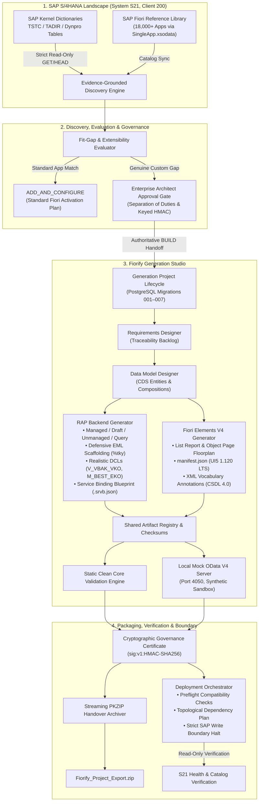

# Fiorify — Enterprise SAP S/4HANA Modernization & Generation Platform

[-0070f2?style=flat-square&logo=sap)](https://www.sap.com)
[](https://community.sap.com)
[](https://react.dev)
[](https://nodejs.org)
[](docs/security/SECURITY_ARCHITECTURE.md)
[](docs/database/DATABASE_DESIGN.md)

> **"STANDARD SAP FIORI FIRST. CUSTOM BUILD ONLY WHEN A GENUINE FUNCTIONAL GAP IS PROVEN."**

Fiorify is an enterprise-grade SAP modernization workbench and full-lifecycle code generation platform. It automates and governs the transformation of classical SAP GUI dynpro transactions into modern, Clean Core-compliant SAP Fiori applications:

1. **DISCOVER**: Inspects live SAP dictionary metadata (TSTC, TADIR, dynpro screens) and correlates with the official 18,000+ app SAP Fiori Apps Reference Library.
2. **EVALUATE & MODERNIZE**: Executes two-outcome governance (`ADD_AND_CONFIGURE` vs. `BUILD`) with 5-dimension fit-gap scoring and Lead Architect sign-off.
3. **SPECIFY & GENERATE**: Authors complete SAP ABAP RAP (RESTful Application Programming Model) business objects and SAP Fiori Elements V4 applications.
4. **VALIDATE & PREVIEW**: Validates Clean Core compliance statically and spins up an ephemeral, in-process mock OData V4 preview server on loopback.
5. **EXPORT & DEPLOY**: Produces cryptographic zero-dependency PKZIP handover bundles and orchestrates deployment up to the explicit SAP Write Boundary.

---

## 🏛️ End-to-End Solution Architecture



---

## ⚡ Core Platform Capabilities

### 1. Grounded SAP Discovery & Two-Outcome Governance
- **Strict Read-Only Directives**: All SAP interactions with S21 execute exclusively via HTTP `GET` or `HEAD`. Zero mutating requests (`POST`, `PUT`, `DELETE`).
- **Compensating Controls for `int_samarth` (SAP_ALL)**: Because the technical user retains `SAP_ALL` due to external project dependencies, Fiorify enforces multi-layer application-level safeguards: path canonicalization, double-decode defense, host allowlists, and the strict SAP Write Boundary.
- **Two-Outcome Governance**: Eliminates legacy `EXTEND` outcomes. Every assessment concludes either in **`ADD_AND_CONFIGURE`** (activate standard Fiori) or **`BUILD`** (governed custom development).
- **Separation of Duties (REM-SEC-01)**: Assessment creators cannot self-approve. Administrative override requires authenticated `ADMIN` or `LEAD_ARCHITECT` privileges and generates an immutable audit record.

### 2. Cryptographic Approval Integrity (REM-SEC-03)
- **Keyed HMAC-SHA256 Signatures**: Deployment plans and specification approvals are signed with keyed HMAC signatures prefixed with key versioning (`sig:v1:<hmac_hex>`).
- **Zero-Downtime Key Rotation**: Multi-key rings allow seamless rotation from `v1` to `v2` without invalidating existing signed artifacts.
- **Fail-Closed in Production**: Production startup requires `FIORIFY_SIGNING_SECRET`; missing credentials abort boot.
- **Timing-Safe Equal Verification**: Comparison uses `crypto.timingSafeEqual` to eliminate side-channel timing leaks.
- **Backward-Compatible Migration**: Historical unkeyed SHA-256 digests are identified, validated, and logged as `UNAUTHENTICATED_LEGACY_DIGEST`.

### 3. Production-Grade RAP & CDS Generation (REM-GEN-01..03)
- **Defensive EML Scaffolding (`REM-GEN-01`)**: Behavior pool classes (`BP_I_*`) feature full Entity Manipulation Language (EML) boilerplate (`READ ENTITIES OF ... IN LOCAL MODE`), transactional key consistency (`%tky`), and error reporting via `failed` and `reported` structures. Marked with `" HANDOVER STATUS: SCAFFOLD GENERATED - DOMAIN LOGIC EXTENSION REQUIRED`.
- **Service Binding Blueprint (`REM-GEN-02`)**: Generates `.srvb.json` configuration blueprints with explicit notices that R3TR SRVB binary objects must be activated in Eclipse ADT or SAP Gateway (`/IWFND/MAINT_SERVICE`).
- **Domain-Realistic DCL Access Control (`REM-GEN-03`)**: Replaces generic placeholders with authentic ERP PFCG authorization objects:
  - **Sales Management (`VA01`)**: `V_VBAK_VKO` (Sales Org: `VKORG`), `ACTVT = '03'`.
  - **Purchasing (`ME21N`)**: `M_BEST_EKO` (Purchasing Org: `EKORG`), `ACTVT = '03'`.
  - **Material Master (`MM01`)**: `M_MATE_WRK` (Plant: `WERKS`), `ACTVT = '03'`.
  - **Financial Accounting (`FB01`)**: `F_BKPF_BUK` (Company Code: `BUKRS`), `ACTVT = '03'`.
  - **Generic Fallback**: `S_TABU_DIS` with explicit security guidance comments.

### 4. Interactive Local Mock Preview & Zero-Write Boundary
- **In-Process Mock OData V4 Engine**: Runs on loopback `127.0.0.1:4050` with CSDL 4.0 metadata, `$filter`, `$select`, `$expand`, and local CRUD state.
- **Prominent Watermark**: Displays persistent banner: `LOCAL MOCK PREVIEW — SYNTHETIC DATA ONLY — NOT CONNECTED TO SAP S21`.
- **Topological Deployment Plan**: Computes a directed acyclic graph (DAG) ordering DDIC tables $\rightarrow$ CDS views $\rightarrow$ Behavior Definitions $\rightarrow$ Implementation Classes $\rightarrow$ Service Definitions $\rightarrow$ Fiori manifests.
- **SAP Write Boundary Guard**: Halts deployment orchestration prior to SAP repository mutations, logging execution boundary reports for human developer sign-off.

---

## 🗄️ Database Architecture & Migrations

Fiorify relies on PostgreSQL 15+ with tenant isolation enforced on every query (`tenant_id` column and multi-tenant repository wrappers).

| Migration | Name | Description | Status |
|---|---|---|---|
| `001` | `001_initial_schema.sql` | Core schema: assessments, candidates, systems, history | Applied & Idempotent |
| `002` | `002_security_audit.sql` | Security audit events and tamper-evident logs | Applied & Idempotent |
| `003` | `003_handoffs_and_approvals.sql` | Modernization handoffs and Lead Architect approvals | Applied & Idempotent |
| `004` | `004_sap_system_registry.sql` | SAP system registry, credentials, and diagnostic logs | Applied & Idempotent |
| `005` | `005_modernization_intelligence.sql` | Fit-gap criteria, scoring models, and candidate caches | Applied & Idempotent |
| `006` | `006_specification_lifecycle.sql` | Specification versions, approvals, and traceability | Applied & Idempotent |
| `007` | `007_deployment_orchestration.sql` | Deployment plans, cryptographic approvals, executions | Applied & Idempotent |

Connection pool configuration (`backend/src/infrastructure/db/pool.js`):
- Maximum Connections: `max: 20`
- Idle Timeout: `30,000 ms`
- Connection Timeout: `5,000 ms`

---

## 🚀 Quick Start & Development Setup

### Prerequisites
- **Node.js**: v20.x LTS or higher
- **PostgreSQL**: 15+ (or embedded test runner)
- **SAP Access (Optional)**: Read-only access to SAP S/4HANA 2023 (e.g. S21 Client 200)

### 1. Installation
```bash
git clone https://github.com/samarth092005/Firorix.git
cd Firorix

# Install backend dependencies
npm install

# Install frontend dependencies
npm --prefix frontend install
```

### 2. Environment Configuration
Copy `.env.example` to `.env` in `backend/`:
```bash
cp backend/.env.example backend/.env
```
Key configuration parameters:
```env
PORT=4000
NODE_ENV=development
FIORIFY_PERSISTENCE=postgres
FIORIFY_ALLOW_EMBEDDED_PG=true
FIORIFY_SIGNING_SECRET=your-secure-keyed-hmac-secret-min-32-chars
FIORIFY_SIGNING_KEY_VERSION=v1
SAP_DESTINATION_NAME=S21
SAP_CLIENT=200
```

### 3. Running Locally
```bash
# Start backend server
node backend/src/server.js

# In a separate terminal, start frontend dev server
npm --prefix frontend run dev
```
Open your browser at `http://localhost:5173`.

### 4. Running Regression Tests
```bash
# Run all backend security, generation, and regression suites
node --test backend/test/s*.test.js backend/test/gen*.test.js

# Run frontend test suite (204 tests)
npm --prefix frontend test -- --run

# Run frontend production build
npm --prefix frontend run build
```

---

## 📚 Technical Documentation Suite

Detailed architectural, technical, operational, and security specifications are organized in `docs/`:

- [System Architecture](docs/architecture/SYSTEM_ARCHITECTURE.md)
- [Backend Architecture](docs/architecture/BACKEND_ARCHITECTURE.md)
- [Frontend Architecture](docs/architecture/FRONTEND_ARCHITECTURE.md)
- [SAP Integration Architecture](docs/architecture/SAP_INTEGRATION_ARCHITECTURE.md)
- [Database Design & Schema](docs/database/DATABASE_DESIGN.md)
- [Entity Relationships](docs/database/ENTITY_RELATIONSHIPS.md)
- [Security Architecture](docs/security/SECURITY_ARCHITECTURE.md)
- [API Reference Manual](docs/api/API_REFERENCE.md)
- [RAP Generation Design](docs/generation/RAP_GENERATION_DESIGN.md)
- [Cloud Foundry Deployment Guide](docs/deployment/CLOUDFOUNDRY_DEPLOYMENT_GUIDE.md)
- [Environment Configuration Inventory](docs/deployment/ENVIRONMENT_CONFIGURATION.md)
- [Rollback & Disaster Recovery](docs/deployment/ROLLBACK_AND_RECOVERY.md)
- [Monitoring & Logging](docs/operations/MONITORING_AND_LOGGING.md)
- [Capacity & Cost Model](docs/operations/CAPACITY_AND_COST_MODEL.md)
- [Consolidated Release Engineering Report](docs/reports/CONSOLIDATED_RELEASE_REPORT.md)

---

## 🔒 Security & Governance Commitments

1. **Zero SAP Modifications**: Fiorify will never send `POST`, `PUT`, `PATCH`, or `DELETE` requests to live SAP systems.
2. **Clean Core Adherence**: Standard SAP Fiori applications are prioritized. Custom development is only initiated upon architectural sign-off.
3. **No Unauthenticated Admin Defaults**: Unauthenticated requests in development receive restricted `VIEWER` access on `DEV-SANDBOX-TENANT`. Production enforces strict authentication.
4. **Keyed Signatures**: All deployment authorizations are secured via HMAC-SHA256 keys with versioning.
5. **Multi-Tenant Isolation**: Tenant boundaries are verified on all database access paths.

---

## 📄 License
Proprietary & Enterprise Confidential. All rights reserved.
