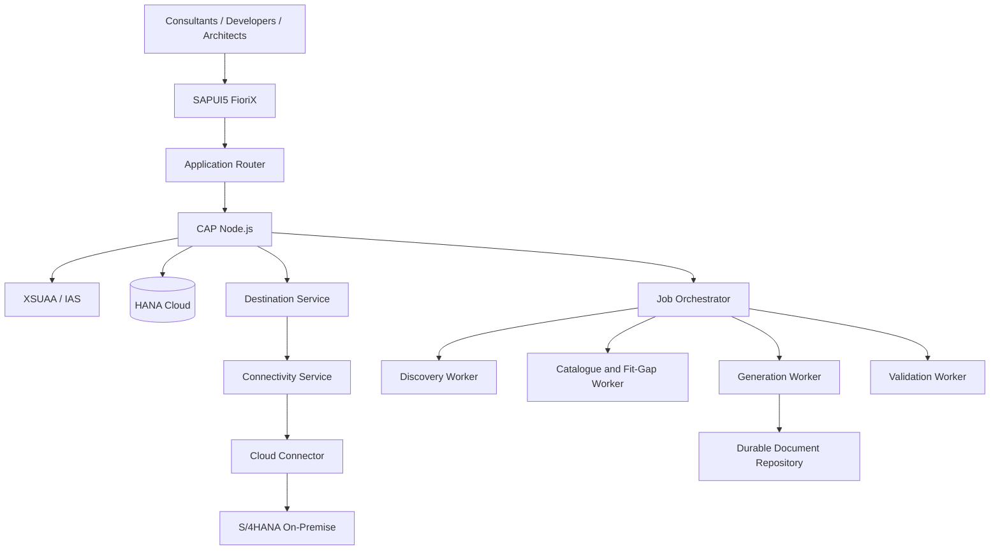

# Solution Architecture
## Architecture style
Modular CAP application plus a small number of isolated background workers. Do not start with a microservice per feature.

CAP owns domain APIs, persistence, authorization and workflow. Workers handle long-running discovery, catalogue processing, generation and validation. HANA stores FioriX metadata; SAP remains source of truth for SAP repository facts. Initial integration is read-only.
