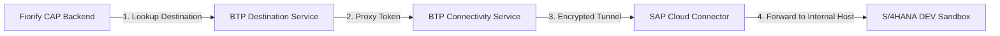

# SAP S/4HANA Integration Architecture
**Document Version:** 2.0.0  
**Status:** ARCHITECTURALLY CONFIRMED  

## 1. Target Landscape Context

- **Target System:** SAP S/4HANA On-Premise (ECC is out of scope).
- **Target Sandbox Environment:** DEV Sandbox (e.g. Client 200, matching existing S21 connectivity configuration).
- **Network Path:** Private enterprise network behind Cloud Connector; zero inbound firewall ports.

---

## 2. Integration Route

1. **BTP Destination Service:** Manages virtual hostname (`s4h-dev.corp.internal:44300`), authentication credentials, and proxy type (`OnPremise`).
2. **BTP Connectivity Service:** Provides local SOCKS5 proxy tokens within the Cloud Foundry runtime.
3. **SAP Cloud Connector:** Installed in customer on-premise DMZ, establishing a persistent reverse TLS tunnel to the BTP subaccount.
4. **URL Whitelisting in Cloud Connector:**
   - Whitelist `/sap/bc/adt` with "Path and all sub-paths" (Read-only ADT discovery).
   - Whitelist `/sap/opu/odata` with "Path and all sub-paths" (OData catalog discovery).
   - Explicitly deny `/sap/bc/rfc`, `/sap/bc/gui`, and `/sap/bc/webdynpro`.

---

## 3. Supported Candidate Interfaces

| Interface Layer | Target URI / Object | Purpose | Security Constraint |
|---|---|---|---|
| **ADT Discovery Handshake** | `/sap/bc/adt/discovery` | Probe active ADT plugin capabilities | `S_ADT_RES` |
| **Program Inspection** | `/sap/bc/adt/programs/programs/{name}` | Extract main program, includes, package | `S_DEVELOP` 03 (Display) |
| **CDS Entity Inspection** | `/sap/bc/adt/ddic/ddls/sources/{name}` | Extract DDL source of released CDS views | `S_DEVELOP` 03 (Display) |
| **Service Catalogs** | `/sap/opu/odata4/iwbep/catalog` | Discover registered OData V4 services | Service Execution |
| **SU24 Authorizations** | Read `USOBX_C`, `USOBT_C` | Extract proposed authorization objects | `S_TABU_DIS` (Display) |
| **Where-Used Cross-References**| `/sap/bc/adt/repository/crossreferences` | Interrogate downstream object usage | Bounded depth limit (max 2) |

---

## 4. Operational & Security Governance

- **Strict Read-Only Execution:** Initial connector implementation is strictly read-only. No arbitrary RFC execution, no generic SQL queries, and no automated transport creation.
- **Local Development Adapter:** In local development, the service layer operates against typed synthetic mock adapters (`services/mock/*`), returning realistic SAP data without requiring a live Cloud Connector tunnel.
- **Error Propagation:** If S/4HANA is unreachable, the connector maps HTTP 502/504 errors into structured OData error responses: `S4_ENDPOINT_UNAVAILABLE` or `SCC_TUNNEL_DISCONNECTED`.

---

## 5. Live Local Network Integration & Evidence Reality (Sprint 6 & 7)

During Sprint 5 through 7, real connectivity was established directly to target SAP S/4HANA System **S21 (Client 200)** from the local development workstation:

1. **Direct LAN Routing vs Cloud Connector:**
   - The official BTP Destination `S21` configures virtual host `http://kbl_fiori:8000` via Cloud Connector (`ProxyType: OnPremise`).
   - Outside of a Cloud Foundry container or official standalone Connectivity Proxy, `kbl_fiori` does not resolve locally on Windows.
   - Live integration uses direct office LAN routing (`192.168.1.55:8000`) injected safely via `.env` (`SAP_URL_OVERRIDE`), establishing direct, authenticated Basic Auth connectivity (`int_samarth`).

2. **Live Gateway Service Discovery (`/sap/opu/odata/IWFND/CATALOGSERVICE;v=2`):**
   - Successfully connects and returns **1,318 active Gateway services** registered on S21.
   - Retrieves full `$metadata` EDMX documents for services (e.g. `ZFAP_PAYMENT_POST_SRV` with 478 EntitySets and 53 operations).

3. **Honest ADT Authorization Discovery (`/sap/bc/adt/discovery`):**
   - Live requests to `/sap/bc/adt/discovery` return **HTTP 403 Forbidden** (`SADT_RESOURCE_003`).
   - The adapter does NOT disguise this as a 404 or missing transaction; it assigns `PARTIALLY_AVAILABLE` and explicitly reports the required Basis authorization objects:
     - `S_ADT_RES` (Activity 03: Display)
     - `S_DEVELOP` (Activity 03: Display for object types `PROG`, `TRAN`, `DEVC`)

4. **Technical Verification vs Functional Equivalence:**
   - Active OData service dependencies on S21 (e.g. `ZFAP_PAYMENT_POST_SRV`) prove **Technical Candidate Viability**.
   - Technical service registration does **not** prove functional equivalence for legacy, highly-customized transactions (e.g. `F-53` Dynpro flows). Detailed functional fit-gap assessment remains necessary in Sprint 8.
