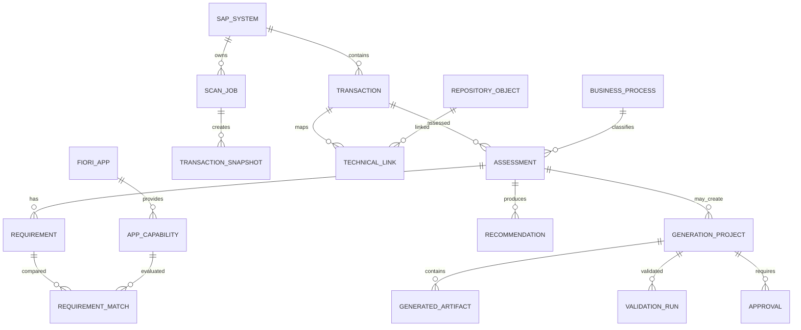

# HANA Cloud Database Model
Store FioriX metadata/workflow, not duplicate SAP business transactions.

Logical entities:
- System: SAP_SYSTEM, SYSTEM_RELEASE, SYSTEM_CAPABILITY.
- Scan: SCAN_JOB, SCAN_SCOPE, SCAN_RESULT.
- Transaction: TRANSACTION, TRANSACTION_SNAPSHOT, ASSESSMENT.
- Technical: REPOSITORY_OBJECT, DATA_OBJECT, OBJECT_RELATIONSHIP, ODATA_SERVICE.
- Evidence: EVIDENCE_SOURCE, DISCOVERY_EVIDENCE.
- Business: BUSINESS_PROCESS, BUSINESS_ACTIVITY, BUSINESS_CONTEXT.
- Requirements: REQUIREMENT, BUSINESS_RULE, REQUIREMENT_SOURCE, REQUIREMENT_REVIEW.
- Catalogue: FIORI_APP, APP_RELEASE, APP_PREREQUISITE, APP_CAPABILITY.
- Fit-gap: REQUIREMENT_MATCH, MATCH_EVIDENCE, RECOMMENDATION, DECISION_REVIEW.
- Generation: GENERATION_PROJECT, APP_SPECIFICATION, TEMPLATE_VERSION, GENERATED_ARTIFACT.
- Validation: VALIDATION_RUN, VALIDATION_FINDING, APPROVAL.
- Security: USER_PROFILE, ROLE, USER_ROLE, SYSTEM_PERMISSION, AUDIT_EVENT.

Physical design in Sprint 4: UUID keys, unique constraints, indexes, foreign keys, version/snapshot strategy, HANA-compatible types and retention. Use JSON only for raw/extensible payloads, not core relationships. Store document references/checksum/size/version in HANA; keep file bytes in durable repository.
