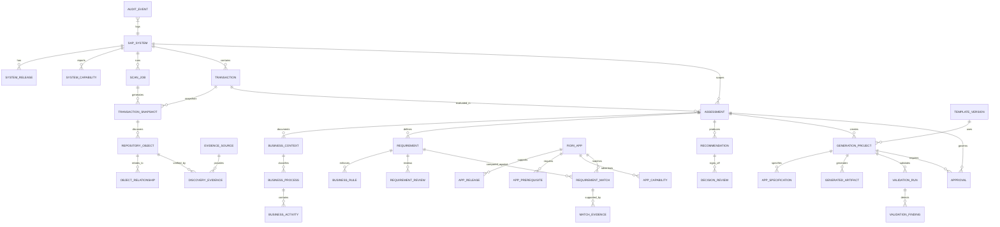

# Database & Relational Data Model (CAP CDS)
**Document Version:** 2.0.0  
**Status:** ARCHITECTURALLY CONFIRMED  

## 1. Principles of Data Modeling in Fiorify

1. **No Duplication of Business Transactions:** Fiorify stores metadata, assessment workflows, requirement comparisons, and audit evidence. It **never replicates SAP business transactions** (such as sales orders, purchase orders, or material master data).
2. **Relational Normalization over JSON Blobs:** Complex relationships (such as requirement-to-app fit-gap matches, technical object dependencies, and authorization objects) are modeled as **first-class relational entities with foreign keys and unique constraints**, not embedded JSON blobs.
3. **Point-in-Time Snapshot Immutability:** Technical discovery data is captured in immutable `TRANSACTION_SNAPSHOT` and `REPOSITORY_OBJECT` records with verifiable checksums, preserving historical evidence even if the on-premise system changes.
4. **Append-Only Auditability:** Audit events and stakeholder approvals are strictly append-only; update and delete operations are prohibited.

---

## 2. Master Entity-Relationship Diagram

---

## 3. Relational Entity Specifications

### 3.1 Landscape Domain
- **`SAP_SYSTEM`**: Master registry of on-premise S/4HANA instances.
  - `ID`: UUID (PK)
  - `alias`: String(30), Unique, Not Null
  - `environment`: Enum (`DEVELOPMENT`, `QUALITY`, `SANDBOX`, `PRODUCTION`)
  - `destinationName`: String(64), Not Null
  - `host`: String(255), Not Null
  - `client`: String(3), Not Null
  - `adtBaseUri`: String(255), Not Null
  - `cloudConnectorSubaccount`: String(64)
  - `connectionStatus`: Enum (`CONNECTED_SIMULATED`, `OFFLINE`, `AUTH_FAILED`, `CONFIG_ERROR`)
  - `lastTestedAt`: Timestamp
- **`SYSTEM_RELEASE`**: S/4HANA component and feature pack versions.
  - `ID`: UUID (PK), `system_ID`: UUID (FK $\rightarrow$ `SAP_SYSTEM`)
  - `s4CoreRelease`: String(10), `sapBasisVersion`: String(10), `fpsLevel`: String(10), `rapProtocolSupported`: Enum (`V2_AND_V4`, `V2_ONLY`)
- **`SYSTEM_CAPABILITY`**: Verified interface availability tags.
  - `ID`: UUID (PK), `system_ID`: UUID (FK $\rightarrow$ `SAP_SYSTEM`)
  - `capabilityTag`: String(50), `isAvailable`: Boolean, `latencyMs`: Integer, `verifiedAt`: Timestamp

### 3.2 Discovery Domain
- **`TRANSACTION`**: Cached T-Code header index.
  - `ID`: UUID (PK), `system_ID`: UUID (FK $\rightarrow$ `SAP_SYSTEM`)
  - `tcode`: String(20), Not Null; Unique with `system_ID`
  - `description`: String(255), `module`: Enum (`SD`, `MM`, `FI`, `CO`, `PP`, `QM`, `CUSTOM`)
  - `type`: Enum (`STANDARD`, `CUSTOM`), `programName`: String(40), `packageName`: String(30)
- **`SCAN_JOB`**: Asynchronous background discovery jobs.
  - `ID`: UUID (PK), `system_ID`: UUID (FK $\rightarrow$ `SAP_SYSTEM`)
  - `jobType`: Enum (`DISCOVERY_SCAN`, `WHERE_USED`, `FIT_GAP_CALCULATION`, `DRAFT_GENERATION`)
  - `targetTCode`: String(20), `status`: Enum (`QUEUED`, `RUNNING`, `COMPLETED`, `FAILED`, `CANCELLED`)
  - `progressPercent`: Integer (0-100), `stageDetails`: String(255), `errorMessage`: String(1000)
- **`TRANSACTION_SNAPSHOT`**: Point-in-time immutable object graph.
  - `ID`: UUID (PK), `transaction_ID`: UUID (FK), `scanJob_ID`: UUID (FK)
  - `snapshotTimestamp`: Timestamp, `objectCount`: Integer, `rawPayloadCache`: LargeString
- **`REPOSITORY_OBJECT`**: Individual discovered programs, tables, views, and CDS entities.
  - `ID`: UUID (PK), `snapshot_ID`: UUID (FK $\rightarrow$ `TRANSACTION_SNAPSHOT`)
  - `objectName`: String(40), Not Null, `objectType`: Enum (`PROGRAM`, `INCLUDE`, `TABLE`, `VIEW`, `CDS_VIEW`, `SERVICE_DEFINITION`, `AUTH_OBJECT`)
  - `packageName`: String(30), `confidenceStatus`: Enum (`VERIFIED`, `INFERRED`, `UNKNOWN`, `NOT_AUTHORIZED`)

### 3.3 Assessment & Requirements Domain
- **`ASSESSMENT`**: Core business entity representing a modernization evaluation.
  - `ID`: UUID (PK), `assessmentNumber`: String(20), Unique, Not Null
  - `title`: String(255), `tcode`: String(20), `system_ID`: UUID (FK $\rightarrow$ `SAP_SYSTEM`)
  - `status`: Enum (`DRAFT`, `DISCOVERY_RUNNING`, `REQUIREMENTS_CONFIRMED`, `FIT_GAP_COMPLETED`, `APPROVED`, `ARCHIVED`)
  - `businessProcess`: String(100), `currentStep`: String(30), `progressPercent`: Integer
  - `ownerId`: String(100), `createdDate`: Timestamp, `updatedDate`: Timestamp
- **`BUSINESS_CONTEXT`**: Process flow, actors, and activities.
  - `ID`: UUID (PK), `assessment_ID`: UUID (FK $\rightarrow$ `ASSESSMENT`)
  - `processArea`: String(100), `businessPurpose`: String(1000), `keyActors`: String(500), `primaryInputs`: String(500), `primaryOutputs`: String(500)
- **`REQUIREMENT`**: Confirmed functional rules and invariants.
  - `ID`: UUID (PK), `assessment_ID`: UUID (FK $\rightarrow$ `ASSESSMENT`)
  - `reqNumber`: String(20), Not Null, `title`: String(255), `statement`: String(1000)
  - `actorRole`: String(100), `priority`: Enum (`MUST`, `SHOULD`, `COULD`)
  - `reviewStatus`: Enum (`DRAFT`, `CONFIRMED`, `REJECTED`), `isConfirmed`: Boolean
  - `acceptanceCriteria`: String(1000), `confirmedBy`: String(100), `confirmedAt`: Timestamp

### 3.4 Fiori Catalogue & Fit-Gap Domain
- **`FIORI_APP`**: Curated standard and custom Fiori apps.
  - `ID`: UUID (PK), `appId`: String(20), Unique, Not Null (e.g. `F1814`)
  - `appName`: String(255), `appType`: Enum (`ELEMENTS`, `FREESTYLE`, `TRANSACTIONAL`, `ANALYTICAL`)
  - `lineOfBusiness`: String(100), `businessRole`: String(255), `extensibilityModel`: Enum (`IN_APP`, `BADI`, `NONE`, `UNKNOWN`)
  - `sourceReferenceUrl`: String(255), `isCustom`: Boolean, `verifiedDate`: Date
- **`REQUIREMENT_MATCH`**: Requirement-to-app comparison record.
  - `ID`: UUID (PK), `requirement_ID`: UUID (FK), `app_ID`: UUID (FK), `assessment_ID`: UUID (FK)
  - `coverageStatus`: Enum (`SUPPORTED`, `PARTIAL`, `UNSUPPORTED`, `UNKNOWN`)
  - `gapExplanation`: String(1000), `evidenceReference`: String(500), `reviewerNotes`: String(1000)
  - Constraint: `UNIQUE(requirement_ID, app_ID)`
- **`RECOMMENDATION`**: Governed architectural decision.
  - `ID`: UUID (PK), `assessment_ID`: UUID (FK $\rightarrow$ `ASSESSMENT`, Unique)
  - `outcome`: Enum (`ADOPT`, `EXTEND`, `BUILD`, `REVIEW`), `rationale`: String(2000)
  - `criticalMetCount`: Integer, `totalCount`: Integer, `approvalStatus`: Enum (`PENDING_REVIEW`, `APPROVED`, `REJECTED`)
  - `reviewerName`: String(100), `decidedAt`: Timestamp

### 3.5 Generation, Validation & Audit Domain
- **`GENERATION_PROJECT`**: Custom application blueprint (created only for approved `BUILD`).
  - `ID`: UUID (PK), `assessment_ID`: UUID (FK $\rightarrow$ `ASSESSMENT`)
  - `projectNumber`: String(30), Unique, `applicationPattern`: Enum (`LIST_REPORT_OBJECT_PAGE`, `WORKLIST`)
  - `targetReleaseProfile`: String(100), `validationStatus`: Enum (`PASS`, `WARNING`, `FAIL`, `NOT_RUN`), `generatedAt`: Timestamp
- **`GENERATED_ARTIFACT`**: Individual draft file metadata.
  - `ID`: UUID (PK), `project_ID`: UUID (FK $\rightarrow$ `GENERATION_PROJECT`)
  - `fileName`: String(100), `filePath`: String(255), `fileType`: Enum (`CDS`, `SRVD`, `SRVB`, `JSON`, `JS`, `XML`)
  - `sizeBytes`: Integer, `checksumSha256`: String(64), `contentLOB`: LargeString
  - Constraint: `UNIQUE(project_ID, filePath)`
- **`VALIDATION_FINDING`**: Compliance finding from Clean Core / security tests.
  - `ID`: UUID (PK), `run_ID`: UUID (FK)
  - `category`: Enum (`CLEAN_CORE`, `ARCHITECTURE`, `SECURITY`, `RELEASE_COMPATIBILITY`), `ruleId`: String(50)
  - `severity`: Enum (`CRITICAL`, `WARNING`, `INFO`), `status`: Enum (`PASS`, `FAIL`), `evidence`: String(1000), `remediation`: String(1000)
- **`AUDIT_EVENT`**: Append-only tamper-evident domain log.
  - `ID`: UUID (PK), `timestamp`: Timestamp, `userId`: String(100), `userRole`: String(100)
  - `actionVerb`: String(50), `entityType`: String(50), `entityId`: String(50), `outcome`: Enum (`SUCCESS`, `FAILURE`, `WARNING`)
  - `details`: String(1000), `correlationId`: String(64)
