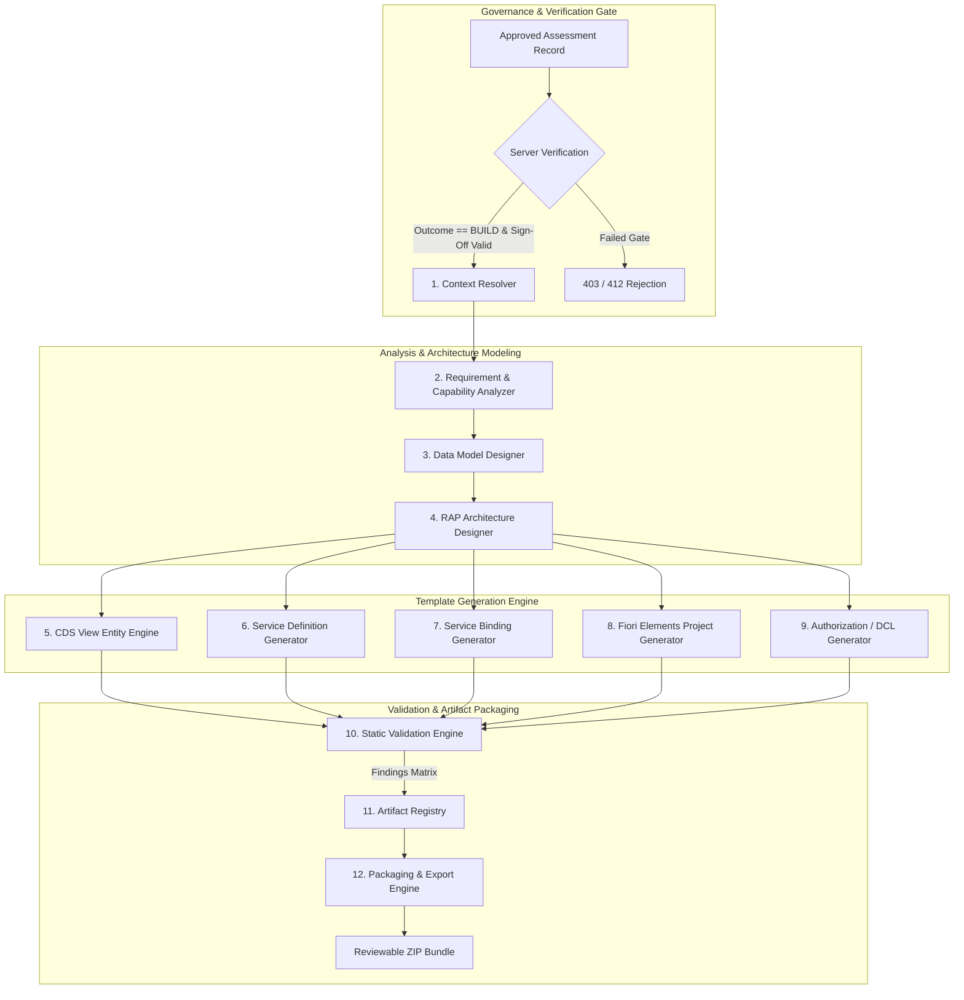
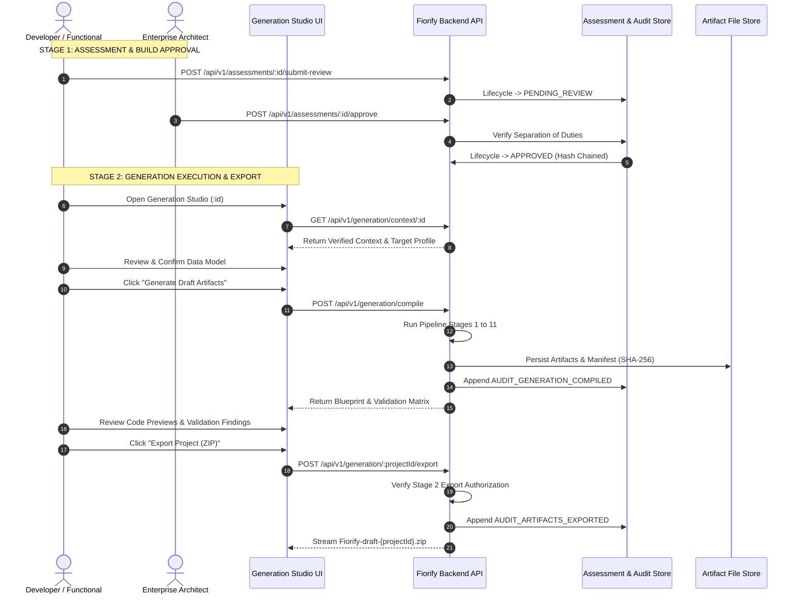

# Fiorify — GENERATION STUDIO ARCHITECTURE & PIPELINE DESIGN

**Document ID:** ARCH-GEN-2026-01  
**Project:** Fiorify — SAP Modernization Platform  
**Status:** ARCHITECTURALLY APPROVED — IMPLEMENTATION BLUEPRINT  
**Target Release:** Fiorify v2.0.0 (Generation Milestone)  
**Author:** Enterprise Solution Architect & ABAP Cloud Architecture Lead  

---

## 1. Architectural Vision & Scope

The **Fiorify Generation Studio** transforms verified SAP assessment findings, business requirements, and DDIC metadata into clean-core, production-grade SAP Fiori application draft packages.

Generation Studio is **not** an uncontrolled code generator. It operates as a **strictly governed developer accelerator** adhering to:
1. **SAP Clean Core Tier 1 Developer Extensibility:** Cloud-ready RAP (RESTful Application Programming) Business Objects and modern SAP Fiori Elements (OData V4).
2. **Deterministic Template Compilation:** Source code is generated using typed, semantic templates rather than non-deterministic black-box LLM hallucinations.
3. **Two-Stage Governance Gating:** Stage 1 (BUILD Decision Approval) and Stage 2 (Draft Artifact Export Authorization).
4. **Draft-Only Boundary:** All generated code is delivered as an offline reviewable project package (ZIP archive with integrity manifest). Fiorify **never** performs automated CTS transport creation, direct database updates, or automated activation on the target SAP system.

---

## 2. Generation Pipeline Architecture

The generation engine is designed as a decoupled, 12-stage sequential pipeline. Each stage is an isolated, independently testable component with strict input/output contracts.



---

## 3. Pipeline Component Specifications

### Stage 1: Assessment Context Resolver
* **Module Path:** `backend/src/generation/context/assessmentContextResolver.js`
* **Input:** `assessmentId: string`, `userContext: UserToken`
* **Function:**
  - Loads authoritative assessment record from `assessmentStore.js`.
  - Verifies that `recommendation.outcome === 'BUILD'`.
  - Verifies that `lifecycleStatus === 'APPROVED'`.
  - Verifies that `governanceReview.approvedBy` is populated and separation-of-duties was respected.
  - Resolves target SAP system, client, release profile, and verified DDIC transaction metadata.
* **Output:** Validated `GenerationExecutionContext`. Rejects with HTTP 412 Precondition Failed if unapproved.

### Stage 2: Requirement and Capability Analyzer
* **Module Path:** `backend/src/generation/analysis/requirementCapabilityAnalyzer.js`
* **Input:** `GenerationExecutionContext`
* **Function:**
  - Filters business requirements, verifying that all `CRITICAL` and `HIGH` requirements have `status === 'CONFIRMED'`.
  - Maps requirements to functional capabilities: CRUD operations, draft handling, calculations, validations, determinations, actions, value helps.
  - Extracts UI intent: search fields, table columns, filter criteria, object page facets.
* **Output:** `VerifiedCapabilityModel`.

### Stage 3: Data Model Designer
* **Module Path:** `backend/src/generation/model/dataModelDesigner.js`
* **Input:** `VerifiedCapabilityModel`, DDIC metadata, legacy screen fields
* **Function:**
  - Designs normalized entity model: Root Entity (Header) and Child Entities (Items, History).
  - Determines primary keys (semantic keys vs. UUID keys with draft enablement).
  - Assigns clean-core ABAP types (e.g. `abap.char(10)`, `abap.dec(15,2)`, `abap.dats`).
  - Identifies standard SAP C1 released views for associations (e.g., `I_Customer`, `I_Product`, `I_CompanyCode`).
  - Supports interactive human review and manual field adjustments via the Studio UX before generation triggers.
* **Output:** `CanonicalEntityModel`.

### Stage 4: RAP Architecture Designer
* **Module Path:** `backend/src/generation/rap/rapArchitectureDesigner.js`
* **Input:** `CanonicalEntityModel`, `targetReleaseProfile`
* **Function:**
  - Formulates the RAP implementation contract:
    - **Scenario:** Managed RAP BO with draft (`managed implementation in class ... unique; with draft; strict(2);`).
    - **Draft Tables:** Proposes draft database tables (`ZTB_..._D`).
    - **Operations:** `create`, `update`, `delete`.
    - **Validations:** Pre-check rules mapped from business criteria (e.g. `validateDates`, `validateAmount`).
    - **Determinations:** Automatic field computation (e.g. `calculateTotalAmount on modify { field NetPrice; }`).
    - **Actions:** Custom state-transition triggers (e.g. `approveDocument`, `rejectDocument`).
* **Output:** `RapArchitectureBlueprint`.

### Stage 5: CDS Template Engine
* **Module Path:** `backend/src/generation/templates/cdsTemplateEngine.js`
* **Input:** `RapArchitectureBlueprint`, `targetReleaseProfile`
* **Function:**
  - Compiles release-compatible ABAP CDS view entities:
    - **Data Definition (Base/Interface):** `define root view entity Z_I_... as select from ...`
    - **Composition Views:** `define view entity Z_I_..._Item as select from ... association to parent ...`
    - **Consumption (Projection) View:** `define root view entity Z_C_... provider contract transactional_query as projection on Z_I_...`
  - Injects mandatory metadata annotations: `@AccessControl.authorizationCheck: #CHECK`, `@EndUserText.label`, `@Semantics.amount.currencyCode`.
* **Output:** Formatted `.cds` source files.

### Stage 6: Service Definition Generator
* **Module Path:** `backend/src/generation/templates/serviceDefinitionGenerator.js`
* **Input:** `RapArchitectureBlueprint`
* **Function:**
  - Generates the RAP Service Definition (`SRVD`):
    ```abap
    @EndUserText.label: 'Service Definition for Manage Sales Disputes'
    define service ZSD_SALES_DISPUTE {
      expose Z_C_SalesDispute as DisputeHeader;
      expose Z_C_SalesDisputeItem as DisputeItem;
      expose I_Customer as CustomerValueHelp;
    }
    ```
* **Output:** `.srvd` source file.

### Stage 7: Service Binding Generator
* **Module Path:** `backend/src/generation/templates/serviceBindingGenerator.js`
* **Input:** `RapArchitectureBlueprint`, Service Definition Name
* **Function:**
  - Generates the Service Binding metadata proposal (`SRVB`):
    - Binding Type: `ODATA_V4`
    - Category: `UI` (UI Service)
    - Service Definition Reference: `ZSD_...`
    - Proposed Service Name: `ZSB_..._V4`
    - Service URL Schema: `/sap/opu/odata4/sap/zsb_..._v4/srvd/sap/zsd_.../0001/`
* **Output:** `.srvb.xml` metadata description proposal.

### Stage 8: Fiori Elements Project Generator
* **Module Path:** `backend/src/generation/templates/ui5ProjectGenerator.js`
* **Input:** `CanonicalEntityModel`, `RapArchitectureBlueprint`
* **Function:**
  - Generates a complete, runnable SAPUI5 Fiori Elements project:
    - `webapp/manifest.json`: SAP Fiori Elements OData V4 descriptor using `sap.fe.templates.ListReport` and `sap.fe.templates.ObjectPage`.
    - `webapp/Component.js`: Standard UIComponent extension.
    - `webapp/i18n/i18n.properties`: UI text strings, column headers, and facet titles.
    - `ui5.yaml`: Modern SAP UI5 tooling configuration.
    - Annotations: `@UI.lineItem`, `@UI.selectionField`, `@UI.facet`, `@UI.identification` embedded in CDS projection or separate local XML annotations.
* **Output:** UI5 web application project tree.

### Stage 9: Authorization Design Generator
* **Module Path:** `backend/src/generation/templates/authorizationGenerator.js`
* **Input:** `CanonicalEntityModel`, `targetReleaseProfile`
* **Function:**
  - Generates ABAP Access Control definitions (`.dcl`):
    ```abap
    @EndUserText.label: 'Access Control for Sales Dispute'
    @MappingRole: true
    define role Z_I_SalesDispute {
      grant select on Z_I_SalesDispute
      where ( CompanyCode ) = aspect pfcg_auth( F_BKPF_BUK, BUKRS, ACTVT = '03' );
    }
    ```
  - Formulates required PFCG Authorization Object catalog recommendations.
* **Output:** `.dcl` source files and authorization catalog matrix.

### Stage 10: Static Validation Engine
* **Module Path:** `backend/src/generation/validation/staticValidationEngine.js`
* **Input:** Entire generated artifact collection
* **Function:**
  - Executes 11 static validation suites (see Validation Matrix):
    - ABAP naming length & prefix rules (`Z_I_*`, `Z_C_*`, `ZSD_*`).
    - Duplicate entity/field collision detection.
    - Association and composition integrity.
    - Clean Core compliance: verification against known released C1 views; zero direct access to unreleased tables.
    - Release profile syntax compatibility (e.g. `strict(2)` requires S/4HANA 2022+).
    - OData V4 manifest descriptor validation.
* **Output:** `ValidationReport` with computed status (`PASS`, `WARNING`, `FAIL`).

### Stage 11: Artifact Registry
* **Module Path:** `backend/src/generation/registry/artifactRegistry.js`
* **Input:** Validated artifacts, `GenerationExecutionContext`
* **Function:**
  - Persists generated blueprint and artifacts to server-side project storage:
    - Path: `backend/data/projects/{projectId}/`
  - Computes cryptographic SHA-256 integrity checksums for every file.
  - Generates `generation-manifest.json` containing metadata provenance, generation timestamp, assessment ID, and checksums.
* **Output:** Persisted project record and immutable audit trail event.

### Stage 12: Project Packaging and Export Engine
* **Module Path:** `backend/src/generation/export/projectPackagingEngine.js`
* **Input:** `projectId: string`, `userContext: UserToken`
* **Function:**
  - Enforces Stage 2 Export Governance sign-off.
  - Streams an offline ZIP archive (`Fiorify-draft-{projectId}.zip`) containing the complete ABAP and UI5 directory tree, the `generation-manifest.json`, and `validation-report.md`.
  - Emits immutable `AUDIT_ARTIFACTS_EXPORTED` event to `assessmentStore.js`.
* **Output:** Binary ZIP file download stream.

---

## 4. Technical Architecture & Technology Stack

The Generation Studio remains aligned with the existing **Node.js/Express** backend and **React/TypeScript** frontend stack. No disruptive frameworks (such as heavy Java or external microservices) are introduced.

### Technology Stack Matrix
| Layer | Technology | Justification |
| :--- | :--- | :--- |
| **Backend Runtime** | Node.js (v20+ LTS) | Native fit with existing Fiorify server architecture; non-blocking I/O for file generation. |
| **Server Framework** | Express / Native Node HTTP | Direct integration into `backend/src/server.js` without architecture fork. |
| **Template Engine** | TypeScript-typed Template Literals / EJS | Deterministic AST generation, zero external compile bloat, verifiable syntax trees. |
| **Archive Creation** | `archiver` (npm) | Standard, streaming ZIP bundle generation with high performance and zero disk bloat. |
| **Cryptography** | `node:crypto` (Native) | Real SHA-256 checksum calculation for every generated artifact and audit event. |
| **Validation Engine** | Custom AST & Rule Evaluator | Zero third-party dependency; tailored to SAP CDS, RAP BDEF, and UI5 manifest schemas. |
| **Frontend UI** | React 18, Vite, TypeScript | Seamless continuation of existing Fiori 3 design system and AppShell layout. |

---

## 5. Security & Governance Architecture

Fiorify strictly enforces the **Two-Stage Governance Gate**:



### Security Invariants
1. **Separation of Duties:** The user triggering generation or export cannot self-approve the underlying assessment unless an explicit administrative audit override is recorded.
2. **Deterministic Checksumming:** Every generated file is hashed (`sha256:hex`). The manifest includes all hashes. Modifying a generated file invalidates the manifest.
3. **No Automatic Target Deployment:** The backend has no capability to invoke CTS RFCs (`TR_REQUEST_CHOICE`, `TMS_UI_IMPORT_TR`) or execute direct table modifications on S/4HANA. All output is strictly reviewable draft source code.

---

## 6. Implementation Milestones

| Milestone | Scope & Deliverables | Target Date |
| :--- | :--- | :--- |
| **M1: Architecture & Audit (Current)** | Readiness audit, pipeline design, API contracts, template specifications, and validation rules. | Completed (Nov 2026) |
| **M2: Core Generation Engine** | Context resolver, capability analyzer, data model designer, CDS & SRVD template compilers, backend endpoints. | Sprint 9 (2 Weeks) |
| **M3: RAP Behavior & UI5 Generator** | RAP managed BDEF compiler, DCL generator, UI5 Fiori Elements manifest and i18n generator. | Sprint 10 (2 Weeks) |
| **M4: Validation & ZIP Export** | 11-rule static validation engine, real `archiver` ZIP streaming, SHA-256 integrity manifest, audit events. | Sprint 11 (2 Weeks) |
| **M5: Generation Studio UX Modernization** | Replace mock `GenerationStudioPage` and `GeneratedArtifactsPage` with 10-step interactive workflow. | Sprint 12 (2 Weeks) |

---

## 7. Technical Risks & Mitigation Strategies

| Risk | Impact | Mitigation Strategy |
| :--- | :--- | :--- |
| **ABAP Syntax Drift Across S/4HANA Releases** | Code generated for 2023 fails to activate on 2020/2021 systems. | Release profiles parameterize the template engine. S/4HANA 2020 uses older projection contracts; 2022+ uses `strict(2)` and `provider contract transactional_query`. |
| **Unreleased SAP Objects in Associations** | Generated CDS associates with non-C1 views, causing ATC Clean Core failure. | Static validation engine checks all referenced associations against the verified C1 Released API catalogue. Unknown views trigger a WARNING. |
| **Corrupted or Incomplete Discovery Context** | Generation triggered on unverified T-Code produces meaningless code. | Stage 1 context resolver rejects generation if TADIR metadata is incomplete or marked `UNVERIFIED_CUSTOM`. |
| **Browser Memory Overhead on Large Projects** | Multiple large CDS and JSON files freeze the client application. | Full artifact compilation and file bundling is executed server-side; frontend only fetches code snippets for active preview tabs. |
