# FIORIX — GENERATION VALIDATION MATRIX & STUDIO UX SPECIFICATION

**Document ID:** VAL-UX-GEN-2026-01  
**Project:** FioriX — SAP Modernization Platform  
**Target Release:** FioriX v2.0.0  
**Status:** SPECIFICATION APPROVED — VALIDATION & UX BLUEPRINT  
**Author:** Quality Assurance Architect & Principal UX Lead  

---

## 1. Generation Validation Philosophy & Boundaries

In accordance with FioriX's core architectural principle of **engineering honesty**:
1. **Never Assign PASS Without Verification:** A generation status of `PASS` is awarded only after all static validation rules execute without critical errors. Unchecked rules are flagged as `NOT_EVALUATED`.
2. **Clear Boundary: Static Validation vs. Target ABAP Activation:** FioriX executes **in-engine static syntax, grammar, naming, and Clean Core consistency validation**. FioriX does *not* claim to execute full ABAP compiler activation or live ATC checks, which require an active SAP kernel compiler. All outputs are explicitly designated as **Reviewable Drafts for Sandbox Import**.
3. **Export Blocking:** Any `CRITICAL` validation error strictly prevents Stage 2 ZIP packaging and export.

---

## 2. Static Validation Rules Matrix

The Validation Engine executes 11 distinct rule suites:

| Rule ID | Category | Rule Title | Severity | Validation Logic & Condition | Failure Impact & Remediation |
| :--- | :--- | :--- | :--- | :--- | :--- |
| **VAL-SYN-01** | Syntax & Naming | ABAP Entity Naming Conventions | `CRITICAL` | Entity names must follow Clean Core naming rules: Root views start with `Z_I_`, projections with `Z_C_`, service definitions with `ZSD_`, bindings with `ZSB_`. Name length must not exceed 30 characters (CDS) or 26 characters (SRVD). | **Blocks Export.** Rename entity to comply with customer development namespace. |
| **VAL-SYN-02** | Syntax & Naming | ABAP Reserved Keywords Check | `CRITICAL` | Field, entity, or association names must not collide with ABAP/SQL reserved words (e.g. `SELECT`, `FROM`, `WHERE`, `TABLE`, `COUNT`, `ORDER`). | **Blocks Export.** Alias field name using an alternative identifier. |
| **VAL-MOD-01** | Data Model | Duplicate Entity or Field Names | `CRITICAL` | No two entities may share the same CDS name. Within an entity, field names must be unique case-insensitively. | **Blocks Export.** Eliminate or rename duplicate properties. |
| **VAL-MOD-02** | Data Model | Missing Primary Key Definition | `CRITICAL` | Every root and composition entity must declare at least one primary key field (`key FieldName`). For draft-enabled RAP, UUID or semantic keys are mandatory. | **Blocks Export.** Define primary key fields in the Data Model Designer. |
| **VAL-DEP-01** | Dependencies | Composition Parent-Child Integrity | `CRITICAL` | If Root declares `composition of Child`, Child must declare matching `association to parent Root` with valid `$projection` join condition. | **Blocks Export.** Align parent-child composition definitions. |
| **VAL-DEP-02** | Dependencies | Association Target Existence | `WARNING` | All associations must target either a generated sibling entity or a known SAP C1 released CDS view (e.g. `I_Customer`, `I_CompanyCode`). Target names not in registry are flagged. | **Requires Acknowledgement.** Verify referenced view exists in target SAP system. |
| **VAL-SEC-01** | Security | DCL Authorization Check Annotation | `CRITICAL` | Every CDS root and projection view must declare `@AccessControl.authorizationCheck: #CHECK` or `#PRIVILEGED_ONLY`. Declaring `#NOT_REQUIRED` triggers a critical security warning. | **Blocks Export.** Attach access control rule or provide documented security justification. |
| **VAL-SEC-02** | Security | Access Control (`.dcl`) File Presence | `CRITICAL` | Every entity marked `#CHECK` must have a corresponding `.dcl` role definition mapping PFCG authorization objects. | **Blocks Export.** Generate access control role file. |
| **VAL-CLN-01** | Clean Core | Unreleased SAP Object Direct Select | `CRITICAL` | CDS entities must NOT select directly from unreleased standard SAP tables (e.g. `VBAK`, `VBAP`, `EKKO`, `MARA`). They must select from custom `z*` tables or C1 released views. | **Blocks Export.** Replace standard table reference with released C1 CDS view. |
| **VAL-ODATA-01**| OData & Binding | Service Definition Consistency | `CRITICAL` | Service definition (`.srvd`) must expose all root and projection entities referenced in the Fiori Elements application descriptor. | **Blocks Export.** Add missing entity exposure in Service Definition. |
| **VAL-ODATA-02**| OData & Binding | Service Name Consistency Across Project | `CRITICAL` | The service URI in `webapp/manifest.json` must match the service name in `.srvd` and `.srvb` (`/sap/opu/odata4/sap/{srvb}/srvd/sap/{srvd}/0001/`). | **Blocks Export.** Synchronize service binding and manifest URI. |
| **VAL-UI5-01** | UI & Annotations | Facet and LineItem Anchor Integrity | `WARNING` | LineItem annotations must not declare duplicate positions. Facets referencing child compositions must point to valid target elements (`targetElement: '_Items'`). | **Requires Acknowledgement.** Correct line item positioning and facet target paths. |
| **VAL-REL-01** | Release Profile | RAP Feature Syntax Compatibility | `CRITICAL` | `strict(2)` and draft features require target release profile `>= S4HANA_2022_FPS02`. S/4HANA 2020 must use `strict` without `(2)`. | **Blocks Export.** Adjust RAP behavior syntax to match target system release. |
| **VAL-TXT-01** | Internationalization | Translatable Text Properties Coverage | `WARNING` | All UI headers, labels, and action descriptions declared in `manifest.json` and `@UI` annotations must have corresponding keys in `i18n.properties`. | **Requires Acknowledgement.** Populate missing translation keys. |

---

## 3. Validation Scoring & Gating Logic

The static validation engine calculates a composite validation score:

$$\text{ValidationScore} = \max\left(0, 100 - (\text{CriticalErrors} \times 50) - (\text{Warnings} \times 10)\right)$$

### Gating Verdicts
* **`PASS` (Score $\ge 90$, 0 Critical Errors, 0-1 Warnings):** Eligible for Stage 2 ZIP Export.
* **`WARNING` (Score $70-89$, 0 Critical Errors, $2-3$ Warnings):** Eligible for Export after the developer explicitly checks: *"I acknowledge outstanding warnings and will verify in SAP sandbox."*
* **`FAIL` (Any Critical Error or Score $< 70$):** **EXPORT DISABLED.** The user must resolve the errors in the Data Model Designer or RAP Architecture Designer before re-compiling.

---

## 4. Generation Studio UX Architecture (10 Screens)

The Generation Studio replaces the static prototype with an intuitive, 10-screen guided modernization workspace:

```mermaid
flowchart LR
    S1[1. Overview] --> S2[2. Context & Requirements]
    S2 --> S3[3. Data Model Designer]
    S3 --> S4[4. RAP Architecture]
    S4 --> S5[5. Service Config]
    S5 --> S6[6. UI Floorplan Config]
    S6 --> S7[7. Code Preview]
    S7 --> S8[8. Validation Engine]
    S8 --> S9[9. Developer Review]
    S9 --> S10[10. Export Project]
```



### Screen 1: Project Overview & Governance Status
* **Purpose:** Displays the incoming assessment brief, verified transaction, target SAP system, and governance approvals.
* **UI Controls:**
  - Header with assessment ID, T-Code, and system provenance.
  - Interactive status badges: **Assessment: APPROVED**, **Outcome: BUILD**, **Approver: {Name}**.
  - Pipeline progress tracker indicating current generation stage.
  - Rejection alert if the assessment is not in `APPROVED` status with outcome `BUILD`.

### Screen 2: Requirement & Business Context
* **Purpose:** Presents confirmed business requirements and acceptance criteria imported from Discovery.
* **UI Controls:**
  - Filterable list of confirmed requirements (`CRITICAL`, `HIGH`, `MEDIUM`).
  - Required capability tags (e.g., "Draft Handling", "Line Item Calculations", "Customer Value Help").
  - Warning banner if any critical requirement remains unconfirmed.

### Screen 3: Interactive Data Model Designer
* **Purpose:** Enables functional and technical leads to review, edit, and refine the proposed business entity hierarchy before code compilation.
* **UI Controls:**
  - Tree view of entities: Root Entity (`Header`) and Composition Entities (`Items`).
  - Editable field grid: Field Name, ABAP Data Type, Length, Key flag, Mandatory flag, Semantic Currency/Unit anchor.
  - Associations panel: Target C1 view selector (`I_Customer`, `I_Product`, etc.), Cardinality selector, Join condition builder.
  - "Requires Sandbox Verification" warning chip for unknown legacy tables.

### Screen 4: RAP Architecture Configuration
* **Purpose:** Configures RESTful Application Programming behavior parameters.
* **UI Controls:**
  - Scenario selector: `Managed with Draft` (Recommended) vs. `Managed without Draft`.
  - Strict syntax level: `strict(2)` (Validated against target release).
  - Validations builder: Checkbox list of proposed validations (e.g. `validateDates`, `validateAmount`).
  - Determinations builder: Trigger events (`on modify`, `on save`).
  - Custom Actions designer: Action name, instance vs. static, result cardinality.

### Screen 5: Service Configuration
* **Purpose:** Configures Service Definition and OData V4 Service Binding.
* **UI Controls:**
  - Service Definition Name input (e.g. `ZSD_SALES_DISPUTE`, max 26 chars).
  - Service Binding Name input (e.g. `ZSB_SALES_DISPUTE_V4`).
  - Protocol selector: `OData V4 - UI` (Pre-selected and locked for modern Fiori Elements).
  - Target package selector (e.g. `Z_FIORI_MODERNIZATION`).

### Screen 6: Fiori Elements UI Configuration
* **Purpose:** Configures List Report filters, table columns, and Object Page sections.
* **UI Controls:**
  - Drag-and-drop table column arranger for the List Report (`@UI.lineItem`).
  - Filter field selector (`@UI.selectionField`).
  - Object Page facet layout builder: General Information, Line Items, Process Flow (`@UI.facet`).
  - Translatable label editor syncing with `i18n.properties`.

### Screen 7: Generated Artifact Preview & Code Inspector
* **Purpose:** Allows developers to inspect every compiled source code file with syntax highlighting before exporting.
* **UI Controls:**
  - File tree explorer showing exact project directory structure (`abap/cds/`, `abap/behavior/`, `ui5/webapp/`).
  - Tabbed code viewer (ABAP CDS, BDEF, DCL, SRVD, JSON manifest, i18n).
  - File size and cryptographic SHA-256 checksum displayed for each file.
  - One-click "Copy Code" button for quick developer inspection.

### Screen 8: Validation Results & Clean Core Scorecard
* **Purpose:** Displays the results of the 11-rule static validation engine.
* **UI Controls:**
  - Composite Validation Scorecard (0–100) with `PASS`, `WARNING`, or `FAIL` status.
  - Categorized findings list: Syntax, Data Model, Clean Core, Security, OData.
  - Detailed remediation guidance for any failing check.
  - Export gate indicator: "Export Authorized" or "Export Blocked (Resolve Errors)".

### Screen 9: Developer Review & Pre-Flight Checklist
* **Purpose:** Formal pre-export checklist confirming developer understanding of draft boundaries.
* **UI Controls:**
  - Checklist of developer responsibilities:
    - [x] "I understand this package is a reviewable draft and requires ADT/abapGit import."
    - [x] "I will perform local syntax checking and ATC execution in my S/4HANA DEV sandbox."
    - [x] "I will assign customer CTS transport requests in the target system."
  - Stage 2 Export Sign-off button.

### Screen 10: Export Project (Real ZIP Archive Download)
* **Purpose:** Delivers the binary ZIP archive and integrity documentation.
* **UI Controls:**
  - "Download Project Archive (ZIP)" button triggering real browser file download (`fiorix-draft-{projectId}.zip`).
  - "Download Validation Report (Markdown)" button.
  - Complete `generation-manifest.json` display with verification instructions:
    ```bash
    # Verification in developer terminal:
    sha256sum -c generation-manifest.json
    ```
  - Audit event logged confirming project export.

---

## 5. Honest UX State & Progress Behavior

1. **Zero Fabricated Progress Indicators:** The UI will never display artificial progress bars (`setTimeout(100)` increments). Network calls will display standard SAP Fiori busy indicators while actual backend compilation executes.
2. **Deterministic Response Times:** Real backend template compilation takes under 250 milliseconds. Once complete, results render immediately.
3. **Draft Boundary Notice:** Every screen reinforces the message:
   > *"FioriX accelerates custom Clean Core development. Draft artifacts must be imported into an isolated SAP DEV sandbox via Eclipse ADT or abapGit for manual review, activation, and testing."*
