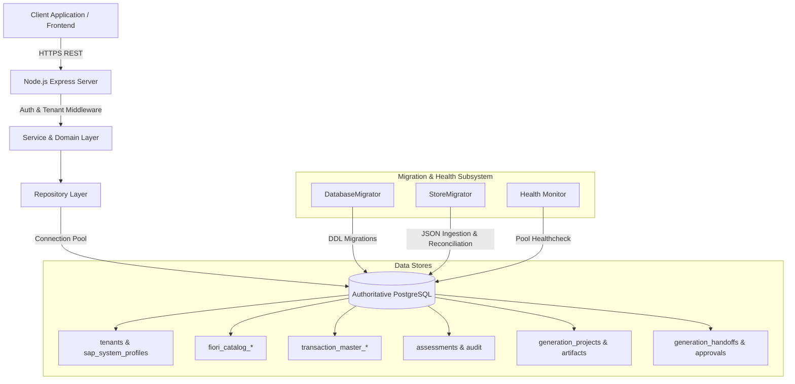
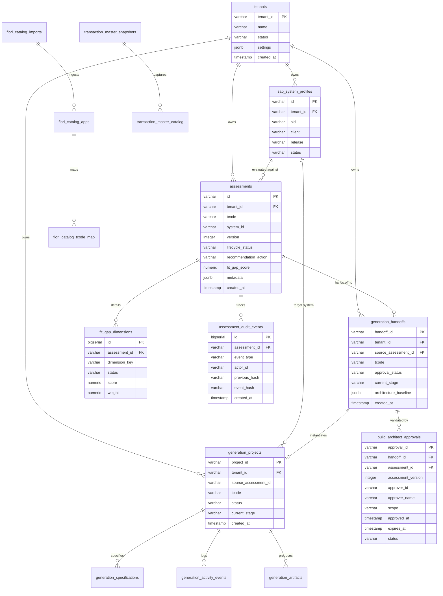

# Fiorify — Authoritative Persistence Architecture
## Sprint S0 + S1 Specification & Operational Runbook

**Status:** APPROVED & IMPLEMENTED  
**System:** Fiorify Modernization Platform  
**Target RDBMS:** PostgreSQL 15+ / AWS RDS PostgreSQL / Azure Flexible Server / Local Embedded PG 18.6  
**Persistence Driver:** `pg` (node-postgres) with connection pooling  

---

## 1. Architectural Overview

Fiorify has transitioned from ad-hoc filesystem-based JSON storage to an enterprise-grade, authoritative relational persistence architecture on PostgreSQL. The persistence layer enforces:

1. **Multi-Tenant Isolation:** Every table partitions records by `tenant_id` (foreign key to `tenants`), ensuring strict data boundaries.
2. **ACID Transactional Guarantees:** Multi-entity operations (e.g. assessment updates + audit logging + fit-gap dimension persistence) are wrapped in atomic database transactions (`BEGIN` ... `COMMIT` / `ROLLBACK`).
3. **Dual-Mode Operational Support:** The application auto-detects database connectivity (`FIORIFY_PERSISTENCE=postgres` or connection strings). In environments without external PostgreSQL, it seamlessly provisions embedded PostgreSQL or falls back safely to read-only JSON stores without data corruption.
4. **Append-Only Cryptographic Audit Chains:** Audit events record `previous_event_hash` and `event_hash` (SHA-256) verifying immutable provenance for SAP compliance.



---

## 2. Entity-Relationship Data Model



---

## 3. Database Schema Migrations

Database migrations are tracked via table `schema_migrations` and executed sequentially:

1. **`001_initial_schema.sql`**: Core enterprise schema including `tenants`, `sap_system_profiles`, `fiori_catalog_apps`, `fiori_catalog_tcode_map`, `transaction_master_catalog`, `assessments`, `fit_gap_dimensions`, `generation_projects`, `generation_specifications`, `generation_activity_events`, and `generation_artifacts`.
2. **`002_security_audit.sql`**: Tamper-evident cryptographic audit chain tables (`assessment_audit_events`), hash chaining triggers, indexes, and immutable constraints.
3. **`003_handoffs_and_approvals.sql`**: Governance handoff registry (`generation_handoffs`) and strict architectural approval records (`build_architect_approvals`), enforcing version-bound approval tracking.

---

## 4. Operational Runbook & Commands

### Running Database Migrations
```bash
# Connect to configured database and run all outstanding migrations
node backend/src/infrastructure/db/scripts/migrateStores.js
```

### Verifying Persistence Reconciliation
```bash
# Runs full data parity check between JSON stores and PostgreSQL
node backend/src/infrastructure/db/scripts/verifyReconciliation.js
```

### Auditing & Quarantining Legacy Handoff Records
```bash
# Inspects, classifies demo fixtures, backs up with SHA-256, and quarantines invalid records
node backend/src/infrastructure/db/scripts/investigateHandoffs.js
```

### Health & Connection Pool Verification
- Health endpoint: `GET /api/v1/health`
- Database diagnostic pool verification:
```javascript
import { DatabasePool } from './backend/src/infrastructure/db/databasePool.js';
const isHealthy = await DatabasePool.healthCheck();
```
