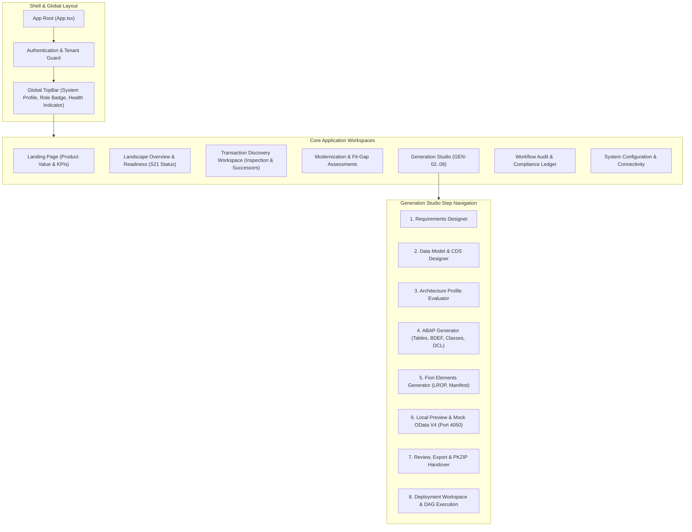

# Fiorify — Frontend Architecture Specification

## 1. Executive Summary

The Fiorify frontend is a modern single-page application (SPA) built with React 18, TypeScript, and Vite. It implements the SAP Horizon visual design system, combining enterprise density with consumer-grade ergonomics.

---

## 2. Component Hierarchy & Navigation Map

---

## 3. State Management & API Integration

### 3.1 Modular Domain Services
Frontend state is organized into domain services under `frontend/src/services/` and feature-specific services under `frontend/src/features/*/services/`:
- **`apiClient.ts`**: Centralized HTTP client providing automatic Bearer token injection, tenant header propagation, and standardized error normalization.
- **`assessmentService.ts`**: Coordinates assessment creation, fit-gap recalculation, and Lead Architect approvals.
- **`generationProjectService.ts`**: Manages generation project state, specification updates, artifact commit logs, and mock preview lifecycle.
- **`systemHealthService.ts`**: Monitors target SAP connectivity (S21 Gateway, ADT, Echo) and surfaces live diagnostic telemetry.

### 3.2 Mock Preview Isolation
The only mock component permitted in the user experience is the **Local Ephemeral Mock OData V4 Preview** within Generation Studio (`PreviewValidationView.tsx`):
- Clearly designated with the high-visibility banner:
  `LOCAL MOCK PREVIEW — SYNTHETIC DATA ONLY — NOT CONNECTED TO SAP S21`
- Runs in-process on `http://127.0.0.1:4050` and is completely decoupled from live SAP core writes.
- Action toolbar provides: Restart, Reset Data, Open Tab, Stop Preview, and Next: Review & Export navigation with strict `white-space: nowrap` layout protection.

---

## 4. Quality & Build Performance

- **Unit & Integration Testing**: 204 unit and integration tests executing under Vitest (`npm --prefix frontend test -- --run`).
- **Production Asset Bundling**: Clean production compilation via Vite (`npm --prefix frontend run build`):
  - 2,067 modules transformed in ~10.5 seconds.
  - Chunk splitting: Vendor React (`207 kB`), Vendor PDF (`391 kB`), Vendor Icons (`36 kB`), and feature routes lazy-loaded.
