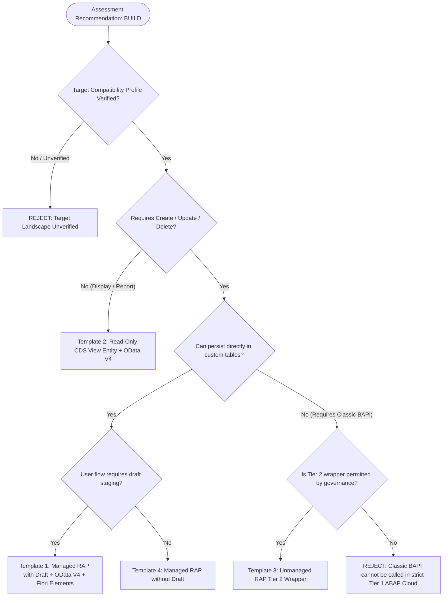

# FIORIX — GENERATION TEMPLATE STRATEGY (SPRINT S0)

**Document Identifier:** STRAT-GEN-TEMPLATE-S0  
**Target Architecture:** Application Generation Strategy for SAP S/4HANA 2023  
**Recommended Baseline:** SAP Fiori Elements List Report + Object Page backed by RAP Business Object  
**Sprint:** SPRINT S0 (Audit and Design Baseline)  
**Status:** ARCHITECTURALLY CONFIRMED DESIGN SPECIFICATION  

---

## 1. Executive Summary & Strategy Overview

The FioriX Generation Studio translates assessments whose governed recommendation is **`BUILD`** into modern, clean-core SAP Fiori application blueprints.

Generating clean-core applications requires supporting distinct architectural patterns based on actual business requirements and verified target system capabilities. Not every legacy SAP GUI transaction requires complex, multi-entity transactional behavior; reporting transactions require simple, high-performance analytical views, while complex legacy transactions require careful bridging between classic BAPIs and modern RAP protocols.

Sprint S0 establishes the **Template Selection and Governance Strategy**. In strict compliance with non-negotiable rules, **no ABAP or UI5 source code files are generated in this sprint**.

---

## 2. Recommended Initial Application Template (Template 1)

### Template 1: SAP Fiori Elements List Report + Object Page backed by Draft-Enabled Managed RAP

```
Floorplan:       SAP Fiori Elements for OData V4 — List Report & Object Page (LROP)
Protocol:        OData V4 (Binding Type: OData V4 - UI)
Backend Model:   ABAP CDS View Entities (Root + Item Compositions)
Behavior:        RAP Managed with Draft Enablement (WITH DRAFT)
Data Governance: Metadata Extensions (MDE) for UI annotations; DCL for row-level authorization
Clean Core Tier: Tier 1 (ABAP Cloud Compatible)
```

#### Why This Is the Recommended Baseline
1. **Standard Modern S/4HANA UX:** The List Report & Object Page floorplan is SAP's primary pattern for managing business objects.
2. **Built-In Enterprise Features:** Draft handling, optimistic locking, message propagation, and field-level control are natively orchestrated by the SAP Fiori Elements V4 runtime and the RAP managed provider.
3. **Clean Core Alignment:** Managed RAP with View Entities complies with Tier 1 ABAP Cloud guidelines, avoiding obsolescence risks in future upgrades.

---

## 3. Comprehensive Evaluation of Application Patterns

FioriX defines four distinct architectural patterns to prevent over-engineering:

### Pattern A: Draft-Enabled Managed RAP (Template 1)
- **Target Use Cases:** Legacy transactional maintenance transactions with Create, Edit, and Delete operations (e.g. custom master data, custom order processing, approval workflows).
- **Backend Architecture:**
  - Root persistent table: `ztb_<entity>_h`
  - Item persistent table: `ztb_<entity>_i`
  - Draft tables: `ztb_<entity>_hd`, `ztb_<entity>_id`
  - CDS View Entities: `Z_I_<Entity>Root`, `Z_I_<Entity>Item`
  - CDS Projections: `Z_C_<Entity>Root`, `Z_C_<Entity>Item`
  - Behavior Definition: `managed implementation in class zbp_c_<entity> unique; with draft;`
  - Service Definition & Binding: `ZSD_<Entity>` / `ZSB_<Entity>_V4` (OData V4 - UI)
- **Frontend Architecture:**
  - Standard Fiori Elements List Report and Object Page (`sap.fe.templates.ListReport`, `sap.fe.templates.ObjectPage`).
  - Annotations drive table columns, filter bars, facets, and field groups via Metadata Extension.

### Pattern B: Read-Only Reporting / Analytical CDS (Template 2)
- **Target Use Cases:** Legacy inquiry and display transactions (e.g. document display, custom reporting lists, status monitors, operational dashboards).
- **Rationale:** These transactions do **not** require transactional state, draft buffers, locks, or behavioral saver routines. Wrapping them in a full RAP managed business object introduces unnecessary runtime complexity and maintenance overhead.
- **Backend Architecture:**
  - CDS View Entity: `Z_I_<Entity>Report` (aggregations, joins to released standard views `I_CompanyCode`, `I_FiscalYear`).
  - Projection: `Z_C_<Entity>Report` with `@Metadata.allowExtensions: true`.
  - Behavior Definition: **None** (Read-Only).
  - Service Definition & Binding: Exposed directly as `OData V4 - UI`.
- **Frontend Architecture:**
  - Fiori Elements List Report with filtering, multi-column sorting, and export to Excel.

### Pattern C: Unmanaged RAP / Cloud-Ready Wrapper (Template 3)
- **Target Use Cases:** Custom transactions that cannot directly write to custom database tables because business rules must execute through standard SAP BAPIs or unreleased legacy function modules (e.g. complex purchase order creation wrapping `BAPI_PO_CREATE1`).
- **Clean Core Classification:** **Tier 2 (Cloud-Ready Classic Wrapper)**.
- **Backend Architecture:**
  - CDS View Entity modeling the business object interface.
  - Behavior Definition: `unmanaged implementation in class zbp_u_<entity> unique;`.
  - Local Saver Class: Developer implements `modify` and `save` methods, explicitly calling classic BAPIs with proper error mapping to the RAP message container.
- **Frontend Architecture:**
  - Fiori Elements List Report & Object Page consuming the unmanaged RAP service.

### Pattern D: Managed RAP Without Draft (Template 4)
- **Target Use Cases:** High-throughput transactional data entry where immediate commit is mandatory and draft intermediate state is undesired.

---

## 4. Protocol Selection: OData V4 vs. OData V2 Fallback

| Architectural Dimension | Preferred Protocol: OData V4 | Fallback Protocol: OData V2 |
| :--- | :--- | :--- |
| **Target Binding Type** | `OData V4 - UI` | `OData V2 - UI` |
| **Payload Efficiency** | High (lean JSON format, minimal metadata overhead) | Medium (Atom/XML or verbose JSON format) |
| **Batch Processing** | Standard `$batch` with cross-entity change sets | Classic `$batch` |
| **Draft Orchestration** | Native integration with UI5 Fiori Elements V4 | Requires specialized draft adaptation or manual handling |
| **Gateway Transaction** | `/IWFND/V4_ADMIN` (Service Groups) | `/IWFND/MAINT_SERVICE` (Service Collection) |
| **ICF Service Node** | `/sap/opu/odata4/sap/<binding>/...` | `/sap/opu/odata/sap/<binding>/...` |
| **Selection Condition** | Selected whenever OData V4 is verified on target system. | Selected only when target Gateway does not support or route OData V4. |

---

## 5. Template Selection & Rejection Decision Matrix

The FioriX Generation Engine applies strict deterministic conditions to select the appropriate template or reject generation entirely:



### 5.1 Deterministic Selection Rules

1. **Select Template 1 (Managed RAP with Draft):**
   - Recommendation outcome is `BUILD`.
   - Transaction requires Create, Edit, or Delete operations.
   - Persistence targets custom tables (`ZTB_*`).
   - Target landscape profile confirms `cdsCapabilities.viewEntitiesSupported` and `rapCapabilities.draftEnabledScenarios` are `VERIFIED_SUPPORTED`.

2. **Select Template 2 (Read-Only CDS):**
   - Recommendation outcome is `BUILD` or `MODERNIZE_REPORT`.
   - Transaction purpose is inquiry, reporting, or status monitoring.
   - Zero modify/save operations required.
   - Avoids generating superfluous `BDEF` and behavior handler classes.

3. **Select Template 3 (Unmanaged RAP Tier 2 Wrapper):**
   - Recommendation outcome is `BUILD` with identified dependency on classic standard BAPIs.
   - Target profile permits Tier 2 wrappers in a classic package.

### 5.2 Deterministic Rejection Rules

Generation **MUST BE REJECTED** under any of the following conditions:

| Rejection Code | Trigger Condition | Architectural Action & Remedy |
| :--- | :--- | :--- |
| **`REJ_LANDSCAPE_UNVERIFIED`** | Target profile status is `UNVERIFIED` or `REJECTED`. | Abort generation. Require pre-flight checklist verification. |
| **`REJ_AUTH_MISSING`** | ADT or developer user lacks `S_DEVELOP` or `S_ADT_RES`. | Abort generation. Output administrator authorization request. |
| **`REJ_GATEWAY_PROTOCOL_UNAVAILABLE`** | Neither OData V4 nor OData V2 is active on target Gateway. | Abort generation. Basis must configure Gateway services. |
| **`REJ_CLEAN_CORE_VIOLATION`** | Assessment specifies direct SQL update to standard SAP table (e.g. `UPDATE VBAK`). | Abort generation. Clean Core strictly forbids direct modification of standard SAP tables. |
| **`REJ_NO_BUILD_APPROVAL`** | Assessment recommendation is not `BUILD` or lacks authorized architect approval. | Abort generation. Handoff to Generation Studio blocked by governance. |

---

## 6. Architecture Structure of Generated Blueprints (GEN-02 Handoff)

When GEN-02 initiates blueprint generation, it will produce an in-memory structured blueprint adhering to the following file-by-file directory hierarchy:

```
project/
├── abap/
│   ├── cds/
│   │   ├── Z_I_<Entity>Root.cds         # Core Data Services Root View Entity
│   │   ├── Z_I_<Entity>Item.cds         # Core Data Services Composition Child Entity
│   │   ├── Z_C_<Entity>Root.cds         # Consumption / Projection View Entity
│   │   └── Z_C_<Entity>Item.cds         # Consumption / Projection Child Entity
│   ├── mde/
│   │   ├── Z_C_<Entity>Root.mde         # Metadata Extension (UI Annotations)
│   │   └── Z_C_<Entity>Item.mde         # Metadata Extension (UI Annotations)
│   ├── dcl/
│   │   └── Z_R_<Entity>Root.dcl         # Access Control (PFCG Authorization Aspect)
│   ├── bdef/
│   │   ├── Z_I_<Entity>Root.bdef        # Base Behavior Definition (Draft, CRUD, Validations)
│   │   └── Z_C_<Entity>Root.bdef        # Projection Behavior Definition (use draft, etc.)
│   ├── clas/
│   │   ├── zbp_i_<entity>root.clas.abap # Behavior Implementation Handler Class
│   │   └── zbp_i_<entity>root.clas.locals_imp.abap # Local Types & Business Logic
│   ├── srvd/
│   │   └── ZSD_<Entity>.srvd            # Service Definition
│   └── srvb/
│       └── ZSB_<Entity>_V4.srvb         # Service Binding (OData V4 - UI)
└── ui5/
    └── webapp/
        ├── manifest.json                # SAP Fiori Elements OData V4 App Descriptor
        ├── Component.js                 # UI5 Component Controller
        └── i18n/
            └── i18n.properties          # Translatable UI Labels
```

*Note: Generating the content of these files will be executed in future generation sprints following the GEN-02 Core Backend Foundation.*
