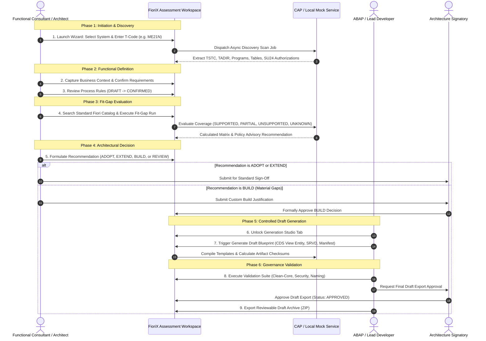
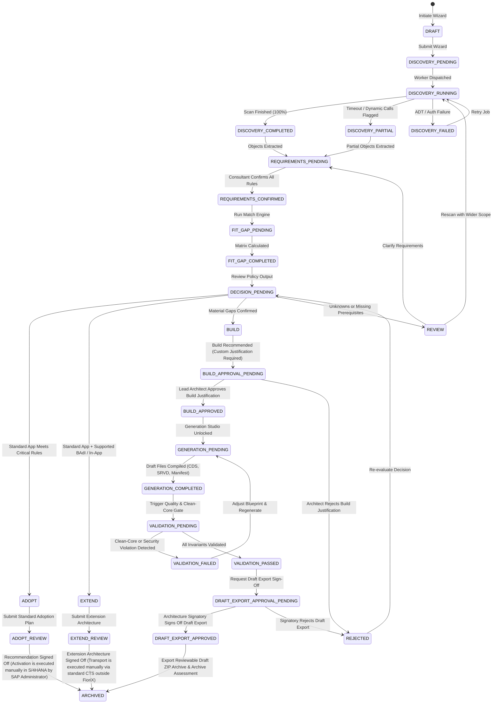
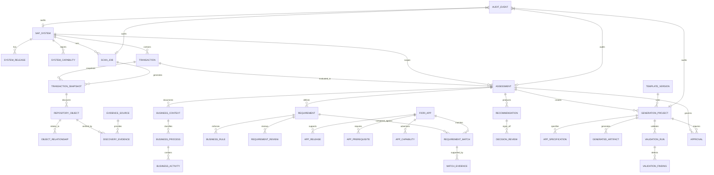
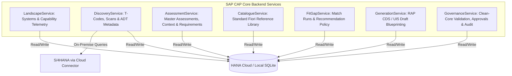
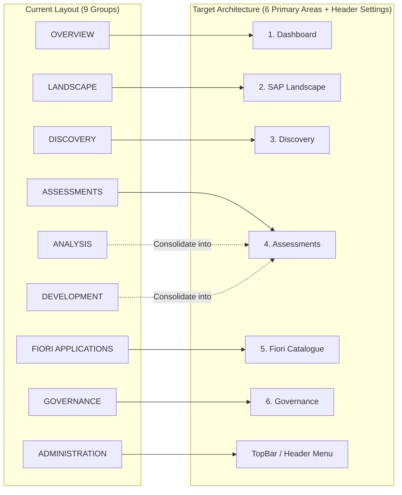

# FioriX Master Architecture Finalisation & Frontend Restructuring Plan
**Document Version:** 2.0.0  
**Phase:** Architecture Finalisation & Implementation Roadmap  
**Date:** November 2026  
**Status:** ARCHITECTURALLY CONFIRMED (Awaiting Implementation Sign-Off)  
**Authors:** Senior SAP Solution Architect, SAP BTP Architect, Product Architect, Senior CAP Developer, Database Architect, Enterprise UX Architect  

---

## 1. Executive Summary & Existing Repository Audit

### 1.1 Existing Project Condition
An exhaustive technical audit of the FioriX repository was performed across both documentation and source code:
- **Root & Documentation Pack:** Contains `README.md`, `FioriX_Master_Specification.md`, and 24 numbered specification documents (`docs/00` to `docs/23`), alongside research reports and initial ADRs (`ADR-0001`, `ADR-0002`).
- **Frontend Stack:** Implemented in `frontend/` using **React 18.3.1**, **TypeScript 5.5.3**, **Vite 5.4.1**, **React Router 6.28.0**, and **Lucide React 0.460.0**. The build passes cleanly (`tsc && vite build`) transforming 1623 modules with zero errors.
- **Backend Directory:** `backend/` currently contains an architectural readiness specification (`backend/README.md`) detailing future SAP CAP Node.js / HANA Cloud service boundaries. No application code has been scaffolded.

### 1.2 Identified Architectural Inconsistencies & Deficiencies
1. **Legacy Framework Mismatch in Documentation:** Older documents (`docs/05`, `docs/06`) previously stated "SAPUI5 freestyle; React not selected". However, the project's actual, verified codebase is built with React + TypeScript + Vite using an authentic SAP Fiori Horizon design system. The architecture must formally reconcile this: FioriX uses React + TypeScript + Vite with SAP Fiori design standards and UI5 Web Components where appropriate.
2. **Navigation Proliferation:** The existing frontend sidebar exposed 9 primary navigation groups (Overview, Landscape, Discovery, Assessments, Fiori Applications, Analysis, Development, Governance, Administration), creating visual clutter and violating the confirmed product decision of **six primary navigation areas**.
3. **Workflow Fragmentation:** Core assessment stages (Business Requirements, Fit-Gap Analysis, Recommendations, and Generation Studio) were exposed as disconnected top-level sidebar items. In SAP enterprise architecture, requirements, fit-gap matrices, and generation blueprints are child entities owned by an Assessment; exposing them as standalone top-level pages breaks domain encapsulation and encourages orphaned records.
4. **Settings Placement:** Settings was positioned as a 9th primary navigation group in the sidebar, whereas enterprise UX standards dictate placement in the application top bar/header.
5. **Database Relational Integrity:** Early data model drafts over-relied on JSON blobs for complex structures (such as fit-gap match details and raw payloads). The final model must be fully normalized using CAP CDS entity relationships across all 28+ domain entities.

---

## 2. Existing Frontend Route & Component Inventory

| File Path | Current Route | Purpose / Content | Audit Classification | Planned Restructuring Action |
|---|---|---|---|---|
| `src/components/layout/AppShell.tsx` | N/A | Global layout with TopBar, Sidebar, and Viewport | **REUSABLE** | Update to bind to restructured 6-area route tree. |
| `src/components/layout/TopBar.tsx` | N/A | Header with brand, `LOCAL DEMO` badge, notifications, and profile | **REUSABLE** | Integrate Settings popover/action; remove redundant global links. |
| `src/components/layout/Sidebar.tsx` | N/A | 9-group sidebar navigation | **REFACTOR** | Consolidate from 9 groups to exactly 6 primary navigation areas. |
| `src/components/status/StatusBadge.tsx`| N/A | Two-tone semantic chips (ADOPT, EXTEND, BUILD, etc.) | **CONFIRMED REUSABLE** | Preserve as-is. High utility and clean styling. |
| `src/components/status/MessageStrip.tsx`| N/A | Fiori info, warning, error, success banners | **CONFIRMED REUSABLE** | Preserve as-is. |
| `src/components/tables/DataTable.tsx` | N/A | Generic typed data table with sorting | **CONFIRMED REUSABLE** | Preserve as-is. |
| `src/components/tables/FilterBar.tsx` | N/A | Search input + multi-dropdown filters | **CONFIRMED REUSABLE** | Preserve as-is. |
| `src/components/dialogs/Modal.tsx` | N/A | Base accessible modal dialog container | **CONFIRMED REUSABLE** | Preserve as-is. |
| `src/components/dialogs/AddSystemDialog.tsx` | N/A | Form for registering S/4HANA destination references | **CONFIRMED REUSABLE** | Preserve as-is. |
| `src/components/dialogs/AddRequirementDialog.tsx` | N/A | Form for capturing functional process rules | **CONFIRMED REUSABLE** | Relocate trigger strictly inside Assessment Workspace. |
| `src/components/dialogs/ConfirmDialog.tsx` | N/A | General purpose confirmation modal | **CONFIRMED REUSABLE** | Preserve as-is. |
| `src/components/dialogs/EvidenceDetailDialog.tsx` | N/A | Inspects raw ADT discovery payload provenance | **CONFIRMED REUSABLE** | Preserve as-is. |
| `src/features/dashboard/DashboardPage.tsx` | `/dashboard` | Executive KPI metrics and recent assessment tables | **CONFIRMED REUSABLE** | Area 1. Maintain clean, restrained enterprise KPIs. |
| `src/features/systems/SystemsPage.tsx` | `/systems` | SAP systems table with simulated connection test | **CONFIRMED REUSABLE** | Area 2 (Landscape). |
| `src/features/systems/SystemDetailPage.tsx` | `/systems/:id` | Deep inspection of Cloud Connector and ADT endpoints | **CONFIRMED REUSABLE** | Area 2 (Landscape Sub-page). |
| `src/features/explorer/ExplorerPage.tsx` | `/explorer` | T-Code search table with module filters | **CONFIRMED REUSABLE** | Area 3 (Discovery). |
| `src/features/explorer/TCodeDetailPage.tsx` | `/explorer/:tcode` | Deep object graph, CDS, and SU24 auth inspector | **CONFIRMED REUSABLE** | Area 3 (Discovery Sub-page). |
| `src/features/jobs/JobsPage.tsx` | `/jobs` | Background discovery scan queue monitor | **CONFIRMED REUSABLE** | Area 3 (Discovery Sub-page). |
| `src/features/assessments/AssessmentsPage.tsx` | `/assessments` | Master assessment register | **CONFIRMED REUSABLE** | Area 4 (Assessments). |
| `src/features/assessments/NewAssessmentPage.tsx` | `/assessments/new` | 5-step guided wizard to create assessments | **CONFIRMED REUSABLE** | Area 4 (Assessment Wizard). |
| `src/features/assessments/AssessmentWorkspacePage.tsx` | `/assessments/:id` | Unified 9-tab workbench | **REFACTOR & REUSE** | Area 4. Consolidate Business Context & Requirements into Tab 3; enforce BUILD lock on Tab 7. |
| `src/features/requirements/RequirementsPage.tsx` | `/requirements` | Standalone requirements list | **DEPRECATE AS TOP-LEVEL** | Remove from sidebar; embed as sub-view or redirect into Assessment Workspace. |
| `src/features/fitgap/FitGapPage.tsx` | `/fit-gap` | Standalone fit-gap matrix | **DEPRECATE AS TOP-LEVEL** | Remove from sidebar; embed inside Assessment Workspace. |
| `src/features/recommendations/RecommendationsPage.tsx` | `/recommendations` | Standalone recommendations list | **DEPRECATE AS TOP-LEVEL** | Remove from sidebar; integrate into Assessment Workspace. |
| `src/features/generation/GenerationStudioPage.tsx` | `/generation` | Standalone blueprint generator | **DEPRECATE AS TOP-LEVEL** | Remove from sidebar; unlock strictly within Assessment Workspace for approved BUILDs. |
| `src/features/generation/GeneratedArtifactsPage.tsx` | `/generation/artifacts` | Standalone artifact list | **RELOCATE** | Accessible via Assessment Workspace Generation tab or Governance review. |
| `src/features/catalogue/CataloguePage.tsx` | `/catalogue` | Curated standard Fiori applications library | **CONFIRMED REUSABLE** | Area 5 (Fiori Catalogue). |
| `src/features/catalogue/AppDetailPage.tsx` | `/catalogue/:id` | Fiori app manifest and prerequisites | **CONFIRMED REUSABLE** | Area 5 (Fiori Catalogue Sub-page). |
| `src/features/validation/ValidationPage.tsx` | `/validation` | Clean-Core and architectural quality checks | **CONFIRMED REUSABLE** | Area 6 (Governance). |
| `src/features/governance/ApprovalsPage.tsx` | `/approvals` | Formal sign-off gate | **CONFIRMED REUSABLE** | Area 6 (Governance). |
| `src/features/audit/AuditPage.tsx` | `/audit` | Immutable audit log trail with correlation IDs | **CONFIRMED REUSABLE** | Area 6 (Governance). |
| `src/features/settings/SettingsPage.tsx` | `/settings` | Density, profile, and demo data reset | **RELOCATE ACCESS** | Remove from primary sidebar; access via TopBar user profile menu. |
| `src/features/notfound/NotFoundPage.tsx` | `*` | 404 error page | **CONFIRMED REUSABLE** | Preserve as-is. |

---

## 3. Final Product Information Architecture

The application shell is organized strictly into **six primary navigation areas**, with secondary access for administration and user profile settings.

```mermaid
flowchart TD
    Shell[FioriX Enterprise Shell]
    TopBar[TopBar: Brand + Environment Badge + Global Search + Notifications + User Menu / Settings]
    Sidebar[Primary Left Sidebar - 6 Confirmed Areas]

    Shell --> TopBar
    Shell --> Sidebar

    Sidebar --> A1[1. Dashboard]
    Sidebar --> A2[2. SAP Landscape]
    Sidebar --> A3[3. Discovery]
    Sidebar --> A4[4. Assessments]
    Sidebar --> A5[5. Fiori Catalogue]
    Sidebar --> A6[6. Governance]

    A1 --> A1_1[Overview KPIs]
    A1 --> A1_2[Recent Assessments]
    A1 --> A1_3[Landscape Health]

    A2 --> A2_1[SAP Systems Registry]
    A2 --> A2_2[System Details & Endpoints]
    A2 --> A2_3[Connection Test History]

    A3 --> A3_1[Transaction Explorer]
    A3 --> A3_2[T-Code Object Details]
    A3 --> A3_3[Discovery Jobs Monitor]

    A4 --> A4_1[All Assessments Registry]
    A4 --> A4_2[New Assessment Wizard]
    A4 --> A4_3[Unified Assessment Workspace]

    A5 --> A5_1[Standard Apps Search]
    A5 --> A5_2[App Manifest & Prerequisites]
    A5 --> A5_3[Customer-Specific Extensions]

    A6 --> A6_1[Validation Centre]
    A6 --> A6_2[Architectural Approvals]
    A6 --> A6_3[Immutable Audit Trail]

    TopBar --> S1[User Profile & Persona Switcher]
    TopBar --> S2[Display Density: Compact / Comfortable]
    TopBar --> S3[Local Demonstration Reset]
```



### 3.1 Primary Navigation Specification
1. **Dashboard (`/dashboard`):** Executive summary. Displays 4 actionable operational metrics, recent assessment status breakdown, landscape connectivity summary, and recent job activity. No decorative non-functional charts.
2. **SAP Landscape (`/landscape` or `/systems`):** Registered S/4HANA systems, target release profiles, Cloud Connector virtual host bindings, and ADT endpoint verifications. Connection testing explicitly reports simulated latency and capability tags (`CONNECTED_SIMULATED`, `OFFLINE`).
3. **Discovery (`/discovery`):** Technical exploration domain. Contains the Transaction Explorer (`/discovery/explorer`), deep T-Code object inspection (`/discovery/explorer/:tcode`), and Asynchronous Scan Job monitor (`/discovery/jobs`).
4. **Assessments (`/assessments`):** Core business domain. Contains master assessment list (`/assessments`), 5-step guided wizard (`/assessments/new`), and the central 9-section Assessment Workspace (`/assessments/:id`).
5. **Fiori Catalogue (`/catalogue`):** Curated standard SAP Fiori catalog search (`/catalogue`) and manifest inspection (`/catalogue/:id`), clearly distinguishing verified official records from customer-specific custom apps.
6. **Governance (`/governance`):** Compliance domain. Houses the Validation Centre (`/governance/validation`), Stakeholder Approvals Gate (`/governance/approvals`), and Append-Only Audit Trail (`/governance/audit`).

---

## 4. Assessment Workflow & State Model

### 4.1 Master End-to-End Workflow



### 4.2 Assessment State Transition Model



> [!IMPORTANT]
> **No Automated SAP Activation or Transport:** FioriX is an assessment, fit-gap analysis, and controlled draft generation platform. It **never** automatically activates Fiori apps, catalogues, or ICF nodes in S/4HANA, nor does it release or import CTS transport requests. All standard app activations and custom code deployments remain strictly manual activities executed by authorized SAP Basis and ABAP administrators through standard SAP tooling.
>
> **Two-Stage Independent Governance:**
> 1. **BUILD Recommendation Approval:** An authoritative architect must review the fit-gap rationale and formally approve the decision to build custom before Generation Studio is unlocked.
> 2. **Draft Artifact Export Approval:** Following draft generation and automated validation, a separate architectural review is required before the generated artifact ZIP archive can be exported. Approval to build is not approval to export.

### 4.3 Assessment Workspace Section Access by Lifecycle State

| Workspace Tab / Section | Target Purpose | Availability by Assessment State |
|---|---|---|
| **1. Overview** | Executive summary, metadata, assigned reviewers, timeline | Always available (read-only in initial states). |
| **2. Technical Analysis** | Discovered programs, includes, DDIC tables, SU24 auths | Unlocked upon `DISCOVERY_COMPLETED` or `DISCOVERY_PARTIAL`. |
| **3. Business Context & Requirements** | Process documentation, business rules, inputs/outputs | Unlocked after discovery. Editing locked once `CONFIRMED`. |
| **4. Fiori Discovery** | Candidate standard SAP Fiori apps from Reference Library | Unlocked upon `REQUIREMENTS_CONFIRMED`. |
| **5. Fit-Gap Analysis** | Requirement-to-app comparison grid | Unlocked upon `FIT_GAP_COMPLETED`. |
| **6. Recommendation** | Adopt / Extend / Build / Review decision workspace | Formulated after Fit-Gap. Immutable once approved. |
| **7. Generation Studio** | ABAP CDS, SRVD, and Fiori Elements blueprint generation | **STRICTLY LOCKED** until Recommendation is `BUILD` AND status is `APPROVED`. |
| **8. Validation** | Clean-Core Tier 1, security, and syntax findings | Active after generation to validate draft artifacts. |
| **9. History & Audit** | Chronological timeline of state transitions and reviews | Always available (append-only). |

---

## 5. Final System Architecture

```mermaid
flowchart TB
    subgraph ClientTier ["Client Tier (Browser - React 18 / Fiori Workbench)"]
        UI[FioriX Frontend: React 18 + TypeScript + Vite]
        UI5Tokens[SAP Fiori Horizon Design System & Tokens]
        Router[React Router 6: 6 Primary Navigation Areas]
        ClientStore[Typed Service Abstraction & State Cache]
        UI --- UI5Tokens
        UI --- Router
        UI --- ClientStore
    end

    subgraph BTPTier ["SAP BTP Cloud Foundry Platform Tier"]
        AppRouter[SAP BTP Managed Application Router]
        XSUAA[SAP Cloud Identity Services / XSUAA (JWT RBAC)]
        CAP[SAP CAP Node.js / TypeScript Core Backend]
        JobQueue[Persistent Database-Backed Job Queue Engine]
        DMS[SAP Document Management Service (DMS / ObjectStore)]
        
        AppRouter -->|Authenticate & Route| CAP
        AppRouter --- XSUAA
        CAP --> JobQueue
        CAP --> DMS
    end

    subgraph DatabaseTier ["Persistence Tier"]
        HANA[(SAP HANA Cloud HDI Container / SQLite Local)]
        CAP -->|OData V4 / CQN| HANA
        JobQueue -->|Optimistic Lock Polling| HANA
    end

    subgraph ConnectivityTier ["BTP Secure Connectivity Tier"]
        Dest[SAP BTP Destination Service]
        Conn[SAP BTP Connectivity Service]
        SCC[SAP Cloud Connector (On-Premise DMZ)]
        
        CAP --> Dest
        Dest --> Conn
        Conn --> SCC
    end

    subgraph SAPTier ["Target SAP Landscape (On-Premise)"]
        S4[SAP S/4HANA On-Premise DEV / Sandbox (e.g. Client 200)]
        ADT[ADT REST Resources: /sap/bc/adt/*]
        Gateway[SAP Gateway OData Catalogs: /sap/opu/odata/*]
        SU24[Authorization Tables: USOBX_C / USOBT_C]
        Tables[Metadata Tables: TSTC, TADIR, DD02L]
        
        SCC --> S4
        S4 --- ADT
        S4 --- Gateway
        S4 --- SU24
        S4 --- Tables
    end

    ClientStore -->|OData V4 Data / REST Job Commands| AppRouter
```

---

## 6. SAP Integration Architecture

### 6.1 Integration Topology & Call Chain
```
FioriX CAP Backend (BTP CF)
  │
  ├── 1. Query Destination ("S4H_DEV_ONPREM") via BTP Destination Service
  │
  ├── 2. Exchange JWT for On-Premise SOCKS5 Proxy Token via Connectivity Service
  │
  ├── 3. Open TLS Reverse Tunnel through Cloud Connector (Virtual Host: s4h-dev.corp.internal:44300)
  │
  └── 4. Execute Read-Only HTTP Request against S/4HANA Internal Endpoints
```

### 6.2 Target SAP Endpoints & Resource Mapping

| Discovery Domain | Target S/4HANA Endpoint | Protocol / Format | Required SAP Authorization | Feasibility Classification |
|---|---|---|---|---|
| **Discovery Handshake** | `/sap/bc/adt/discovery` | HTTP GET / XML | `S_ADT_RES` | **CONFIRMED** |
| **Transaction Header** | Query `TSTC` / `TSTCT` via ADT or Gateway | HTTP GET / JSON | `S_TABU_DIS` (Display) | **PROPOSED** |
| **Program & Includes** | `/sap/bc/adt/programs/programs/{name}` | HTTP GET / XML | `S_DEVELOP` 03 (Display) | **CONFIRMED** |
| **DDIC Tables & Views**| `/sap/bc/adt/ddic/tables/{name}` | HTTP GET / XML | `S_DEVELOP` 03 (Display) | **PROPOSED** |
| **CDS View Entities** | `/sap/bc/adt/ddic/ddls/sources/{name}` | HTTP GET / DDL Text| `S_DEVELOP` 03 (Display) | **CONFIRMED** |
| **SU24 Authorizations**| Read `USOBX_C`, `USOBT_C` | HTTP GET / JSON | `S_TABU_DIS` (Security) | **PROPOSED** |
| **OData V4 Catalogs** | `/sap/opu/odata4/iwbep/catalog` | OData V4 / JSON | Service Execution | **CONFIRMED** |
| **ADT Where-Used** | `/sap/bc/adt/repository/crossreferences` | HTTP POST / XML | `S_ADT_RES` | **REQUIRES R&D** |
| **Source Inspection** | `/sap/bc/adt/programs/programs/{name}/source/main` | HTTP GET / ABAP Text| `S_DEVELOP` 03 (Display) | **REQUIRES R&D** |
| **CTS Transport Write**| Create transport requests (`E070`) | RFC / BAPI | Transport Admin | **STRICTLY EXCLUDED** |

> [!NOTE]
> **Capability- and Permission-Dependent Technical Discovery:**
> All SAP discovery capabilities are strictly conditional upon:
> 1. **Target S/4HANA Release & Kernel:** e.g. CDS View Entities (`DEFINE ROOT VIEW ENTITY`) require S/4HANA 2020+; earlier releases fall back to legacy DDIC-based views (`DEFINE VIEW`).
> 2. **Technical User Roles & Authorizations:** Communication user requires assigned role `Z_FIORIX_DISCOVERY_RO` granting display-only authorizations (`S_ADT_RES`, `S_DEVELOP` ACTVT 03, `S_TABU_DIS` display for TSTC/TADIR/USOBX_C).
> 3. **Endpoint Activation:** If an ADT or Gateway catalog service is inactive in transaction `SICF` / `/IWFND/MAINT_SERVICE` or blocked by Cloud Connector access control, FioriX records the status as `NOT_AUTHORIZED` or `UNKNOWN` with full diagnostic error provenance, **never** assuming unsupported or fabricating results.

---

## 7. Database Architecture & CAP CDS Relational Model

The database stores metadata, assessment workflows, and audit evidence. It **never duplicates transactional business data** (e.g. sales orders or GL items). Unstructured JSON is restricted strictly to raw payload caches.



### 7.1 Detailed Entity Dictionary

```
========================================================================================
1. LANDSCAPE & ENVIRONMENT ENTITIES
========================================================================================
- SAP_SYSTEM
  Purpose: Master registry of target on-premise S/4HANA systems.
  PK: ID (UUID)
  Attributes: alias (String 30, Unique), environment (Enum: DEV, QAS, SBX, PRD),
              destinationName (String 64), host (String 255), client (String 3),
              adtBaseUri (String 255), cloudConnectorSubaccount (String 64),
              connectionStatus (Enum: CONNECTED_SIMULATED, OFFLINE, AUTH_FAILED),
              lastTestedAt (Timestamp), isActive (Boolean).
  Retention: Permanent until decommissioned.

- SYSTEM_RELEASE
  Purpose: Release and patch level tracking.
  PK: ID (UUID) | FK: system_ID -> SAP_SYSTEM(ID)
  Attributes: s4CoreRelease (String 10), sapBasisVersion (String 10), fpsLevel (String 10),
              abapCloudEnabled (Boolean), rapProtocolSupported (Enum: V2_AND_V4, V2_ONLY).

- SYSTEM_CAPABILITY
  Purpose: Specific technical interfaces verified on the system.
  PK: ID (UUID) | FK: system_ID -> SAP_SYSTEM(ID)
  Attributes: capabilityTag (String 50), isAvailable (Boolean), latencyMs (Integer), verifiedAt (Timestamp).

========================================================================================
2. DISCOVERY & REPOSITORY METADATA ENTITIES
========================================================================================
- TRANSACTION
  Purpose: SAP GUI transactions indexed from S/4HANA.
  PK: ID (UUID)
  Attributes: tcode (String 20, Unique per system), system_ID (FK), description (String 255),
              module (Enum: SD, MM, FI, CO, PP, QM, CUSTOM), type (Enum: STANDARD, CUSTOM),
              programName (String 40), packageName (String 30), lastScannedAt (Timestamp).

- SCAN_JOB
  Purpose: Asynchronous background discovery jobs.
  PK: ID (UUID) | FK: system_ID -> SAP_SYSTEM(ID)
  Attributes: jobType (Enum: DISCOVERY_SCAN, WHERE_USED, FIT_GAP_RUN, DRAFT_GEN),
              targetTCode (String 20), status (Enum: QUEUED, RUNNING, COMPLETED, FAILED, CANCELLED),
              progressPercent (Integer), stageDetails (String 255), errorMessage (String 1000),
              startedAt (Timestamp), finishedAt (Timestamp), createdBy (String 100).

- TRANSACTION_SNAPSHOT
  Purpose: Immutable point-in-time snapshot of discovered objects for an assessment.
  PK: ID (UUID) | FK: transaction_ID -> TRANSACTION(ID), scanJob_ID -> SCAN_JOB(ID)
  Attributes: snapshotTimestamp (Timestamp), objectCount (Integer), rawPayloadCache (LargeString).

- REPOSITORY_OBJECT
  Purpose: Discovered ABAP programs, includes, DDIC tables, and CDS views.
  PK: ID (UUID) | FK: snapshot_ID -> TRANSACTION_SNAPSHOT(ID)
  Attributes: objectName (String 40), objectType (Enum: PROG, INCL, TABL, VIEW, DDLS, SRVD, SRVB, CLAS, FUGR, AUTH),
              packageName (String 30), description (String 255), linesOfCode (Integer),
              confidenceStatus (Enum: VERIFIED, INFERRED, UNKNOWN, NOT_AUTHORIZED).

- OBJECT_RELATIONSHIP
  Purpose: Directed dependency graph between discovered objects.
  PK: ID (UUID)
  Attributes: sourceObject_ID (FK), targetObject_ID (FK), relationshipType (Enum: CALLS, INCLUDES, SELECTS_FROM, EXTENDS, CHECKS_AUTH).

- DISCOVERY_EVIDENCE
  Purpose: Verifiable technical provenance for each discovered object.
  PK: ID (UUID) | FK: object_ID -> REPOSITORY_OBJECT(ID)
  Attributes: interfaceUri (String 255), rawPayloadChecksum (String 64), extractedAt (Timestamp), provenanceScore (Decimal).

========================================================================================
3. ASSESSMENT & BUSINESS REQUIREMENTS ENTITIES
========================================================================================
- ASSESSMENT
  Purpose: Central business entity representing one transaction modernization assessment.
  PK: ID (UUID)
  Attributes: assessmentNumber (String 20, Unique), title (String 255), tcode (String 20),
              system_ID (FK), status (Enum: DRAFT, DISCOVERY_RUNNING, REQUIREMENTS_CONFIRMED, FIT_GAP_COMPLETED, APPROVED, ARCHIVED),
              businessProcess (String 100), currentStep (String 30), progressPercent (Integer),
              ownerId (String 100), createdDate (Timestamp), updatedDate (Timestamp).

- BUSINESS_CONTEXT
  Purpose: Business process definition, actors, and activities.
  PK: ID (UUID) | FK: assessment_ID -> ASSESSMENT(ID)
  Attributes: processArea (String 100), subProcess (String 100), businessPurpose (String 1000),
              keyActors (String 500), primaryInputs (String 500), primaryOutputs (String 500).

- REQUIREMENT
  Purpose: Confirmed functional requirements and business rules.
  PK: ID (UUID) | FK: assessment_ID -> ASSESSMENT(ID)
  Attributes: reqNumber (String 20), title (String 255), statement (String 1000),
              actorRole (String 100), priority (Enum: MUST, SHOULD, COULD),
              reviewStatus (Enum: DRAFT, CONFIRMED, REJECTED), isConfirmed (Boolean),
              acceptanceCriteria (String 1000), confirmedBy (String 100), confirmedAt (Timestamp).

- BUSINESS_RULE
  Purpose: Invariants and validation rules linked to requirements.
  PK: ID (UUID) | FK: requirement_ID -> REQUIREMENT(ID)
  Attributes: ruleStatement (String 500), validationLogic (String 1000), exceptionHandling (String 1000).

========================================================================================
4. FIORI CATALOGUE & FIT-GAP ENTITIES
========================================================================================
- FIORI_APP
  Purpose: Curated standard and customer-specific SAP Fiori applications.
  PK: ID (UUID)
  Attributes: appId (String 20, Unique), appName (String 255), appType (Enum: ELEMENTS, FREESTYLE, TRANSACTIONAL, ANALYTICAL),
              lineOfBusiness (String 100), businessRole (String 255), extensibilityModel (Enum: IN_APP, BADI, NONE, UNKNOWN),
              sourceReferenceUrl (String 255), isCustom (Boolean), verifiedDate (Date).

- APP_RELEASE
  Purpose: Release compatibility matrix for catalog apps.
  PK: ID (UUID) | FK: app_ID -> FIORI_APP(ID)
  Attributes: productVersion (String 50), minSoftwareComponent (String 50), isCompatible (Boolean).

- APP_PREREQUISITE
  Purpose: Required software components, OData services, and frontend packages.
  PK: ID (UUID) | FK: app_ID -> FIORI_APP(ID)
  Attributes: prereqType (Enum: SOFTWARE_COMPONENT, ODATA_SERVICE, BUSINESS_ROLE), name (String 100), version (String 30).

- REQUIREMENT_MATCH
  Purpose: Requirement-to-app comparison result.
  PK: ID (UUID) | FK: requirement_ID -> REQUIREMENT(ID), app_ID -> FIORI_APP(ID), assessment_ID -> ASSESSMENT(ID)
  Attributes: coverageStatus (Enum: SUPPORTED, PARTIAL, UNSUPPORTED, UNKNOWN),
              gapExplanation (String 1000), evidenceReference (String 500),
              reviewerNotes (String 1000), reviewedBy (String 100), reviewedAt (Timestamp).
  Constraint: UNIQUE(requirement_ID, app_ID)

- RECOMMENDATION
  Purpose: Formal decision record for an assessment.
  PK: ID (UUID) | FK: assessment_ID -> ASSESSMENT(ID, Unique)
  Attributes: outcome (Enum: ADOPT, EXTEND, BUILD, REVIEW), rationale (String 2000),
              criticalMetCount (Integer), totalCount (Integer), approvalStatus (Enum: PENDING_REVIEW, APPROVED, REJECTED),
              reviewerName (String 100), decidedAt (Timestamp).

========================================================================================
5. GENERATION, VALIDATION & GOVERNANCE ENTITIES
========================================================================================
- GENERATION_PROJECT
  Purpose: Draft application blueprint project (created only for approved BUILDs).
  PK: ID (UUID) | FK: assessment_ID -> ASSESSMENT(ID)
  Attributes: projectNumber (String 30, Unique), applicationPattern (Enum: LIST_REPORT_OBJECT_PAGE, WORKLIST, ANALYTICAL),
              targetReleaseProfile (String 100), generationStatus (Enum: DRAFT_READY, EXPORTED),
              validationStatus (Enum: PASS, WARNING, FAIL, NOT_RUN), generatedAt (Timestamp).

- GENERATED_ARTIFACT
  Purpose: Individual generated file metadata.
  PK: ID (UUID) | FK: project_ID -> GENERATION_PROJECT(ID)
  Attributes: fileName (String 100), filePath (String 255), fileType (Enum: CDS, SRVD, SRVB, JSON, JS, XML),
              sizeBytes (Integer), checksumSha256 (String 64),
              contentLOB (LargeString -- draft preview only; production archive delegates to DMS).
  Constraint: UNIQUE(project_ID, filePath)

- VALIDATION_RUN
  Purpose: Quality and Clean-Core execution run.
  PK: ID (UUID) | FK: project_ID -> GENERATION_PROJECT(ID)
  Attributes: runTimestamp (Timestamp), overallStatus (Enum: PASS, WARNING, FAIL), totalChecks (Integer), passedChecks (Integer).

- VALIDATION_FINDING
  Purpose: Individual compliance finding.
  PK: ID (UUID) | FK: run_ID -> VALIDATION_RUN(ID)
  Attributes: category (Enum: CLEAN_CORE, ARCHITECTURE, SECURITY, RELEASE_COMPATIBILITY),
              ruleId (String 50), title (String 255), severity (Enum: CRITICAL, WARNING, INFO),
              status (Enum: PASS, FAIL), evidence (String 1000), remediation (String 1000).

- APPROVAL
  Purpose: Formal stakeholder sign-off record.
  PK: ID (UUID) | FK: assessment_ID -> ASSESSMENT(ID)
  Attributes: approvalStage (Enum: REQUIREMENT_SIGNOFF, BUILD_DECISION_SIGNOFF, DRAFT_EXPORT_SIGNOFF),
              decision (Enum: APPROVED, REJECTED), rationale (String 1000), signatoryId (String 100), signedAt (Timestamp).

- AUDIT_EVENT
  Purpose: Immutable, append-only domain and security event ledger owned by GovernanceService.
  PK: ID (UUID)
  FK: assessment_ID -> ASSESSMENT(ID, Optional), system_ID -> SAP_SYSTEM(ID, Optional),
      scanJob_ID -> SCAN_JOB(ID, Optional), project_ID -> GENERATION_PROJECT(ID, Optional)
  Attributes: timestamp (Timestamp), userId (String 100), userRole (String 100),
              actionVerb (String 50), entityType (String 50), entityId (String 50),
              outcome (Enum: SUCCESS, FAILURE, WARNING),
              details (String 1000), correlationId (String 64).
```

---

## 8. CRUD & Lifecycle Governance Matrix

| Entity | Allowed Creators | Allowed Readers | Allowed Updaters | Allowed Deleters | Immutability Rule | Audit Event Generated? |
|---|---|---|---|---|---|---|
| `SAP_SYSTEM` | Administrator | All Personas | Administrator | Administrator | Mutable (Credentials never stored) | Yes (`SYSTEM_REGISTERED`, `SYSTEM_UPDATED`) |
| `SCAN_JOB` | Consultant, Architect | All Personas | Worker Process only | Prohibited | Historical records immutable | Yes (`SCAN_DISPATCHED`, `SCAN_COMPLETED`) |
| `TRANSACTION_SNAPSHOT`| System Worker | All Personas | Prohibited | Prohibited | **Strictly Immutable** upon creation | Yes (`SNAPSHOT_CAPTURED`) |
| `REPOSITORY_OBJECT` | System Worker | All Personas | Prohibited | Prohibited | **Strictly Immutable** | No (Linked to Snapshot) |
| `ASSESSMENT` | Consultant, Architect | All Personas | Owner, Architect | Administrator only | Status changes governed by state machine | Yes (`ASSESSMENT_CREATED`, `STATUS_CHANGED`) |
| `REQUIREMENT` | Consultant, Architect | All Personas | Consultant (if DRAFT) | Prohibited if CONFIRMED | **Immutable once CONFIRMED** | Yes (`REQ_CREATED`, `REQ_CONFIRMED`) |
| `FIORI_APP` | Administrator, System | All Personas | Administrator | Prohibited if standard | Standard apps immutable | Yes (`CATALOG_UPDATED`) |
| `REQUIREMENT_MATCH` | Match Engine, Architect | All Personas | Architect (Notes only) | Prohibited | Superseded by versioned run | Yes (`FITGAP_EVALUATED`) |
| `RECOMMENDATION` | Architect, Signatory | All Personas | Prohibited if APPROVED | Prohibited | **Immutable once APPROVED** | Yes (`RECOMMENDATION_RECORDED`, `APPROVED`) |
| `GENERATION_PROJECT` | ABAP / UI5 Developer | All Personas | Developer | Prohibited if exported | Draft project mutable; exported immutable | Yes (`DRAFT_GENERATED`, `DRAFT_EXPORTED`) |
| `GENERATED_ARTIFACT` | Generation Engine | Developer, Architect | Prohibited (New version) | Prohibited | **Immutable per checksum version** | Yes (`ARTIFACT_COMPILED`) |
| `VALIDATION_FINDING` | Validation Engine | All Personas | Prohibited | Prohibited | **Strictly Immutable** per run | Yes (`VALIDATION_COMPLETED`) |
| `APPROVAL` | Authorized Signatory | All Personas | Prohibited | Prohibited | **Strictly Immutable Append-Only** | Yes (`APPROVAL_GRANTED`, `REJECTED`) |
| `AUDIT_EVENT` | System Interceptor | Security, Auditor | **Prohibited** | **Prohibited** | **Strictly Immutable Append-Only** | Self-recording ledger |

---

## 9. Backend Architecture & CAP Service Design

FioriX uses a **modular SAP CAP application** on Node.js/TypeScript with standard CAP CDS definitions. It avoids premature microservices while enforcing clear domain boundaries across 7 core services:



### 9.1 CAP Service Specifications

#### 1. `LandscapeService` (`/odata/v4/landscape`)
- **Entities Exposed:** `Systems`, `Releases`, `Capabilities`.
- **Actions:**
  - `action testConnection(systemId: UUID) returns ConnectionTestResult;`
- **Security:** `@(requires: ['FioriX_Viewer', 'FioriX_Admin'])`. Creation requires `FioriX_Admin`.

#### 2. `DiscoveryService` (`/odata/v4/discovery`)
- **Entities Exposed:** `Transactions`, `ScanJobs`, `Snapshots`, `RepositoryObjects`, `Evidence`.
- **Actions:**
  - `action scheduleScan(systemId: UUID, tcode: String, scope: ScanScope) returns JobReference;`
  - `action cancelScan(jobId: UUID) returns Boolean;`
- **Security:** `@(requires: ['FioriX_Consultant', 'FioriX_Developer', 'FioriX_Architect'])`.

#### 3. `AssessmentService` (`/odata/v4/assessment`)
- **Entities Exposed:** `Assessments`, `BusinessContexts`, `Requirements`, `BusinessRules`.
- **Actions:**
  - `action confirmRequirement(reqId: UUID, rationale: String) returns Requirement;`
  - `action reopenRequirement(reqId: UUID, justification: String) returns Requirement;`
- **Security:** Requirement confirmation restricted to `FioriX_Consultant` and `FioriX_Architect`.

#### 4. `CatalogueService` (`/odata/v4/catalogue`)
- **Entities Exposed:** `FioriApps`, `AppReleases`, `Prerequisites`, `Capabilities`.
- **Read Operations:** Filterable by line of business, release, app type, and role.
- **Security:** Read-only for all authenticated personas.

#### 5. `FitGapService` (`/odata/v4/fitgap`)
- **Entities Exposed:** `RequirementMatches`, `Recommendations`.
- **Actions:**
  - `action calculateFitGap(assessmentId: UUID) returns FitGapSummary;`
  - `action recordRecommendation(assessmentId: UUID, outcome: DecisionOutcome, rationale: String) returns Recommendation;`
- **Business Rule Invariant:** Cannot recommend `BUILD` if critical requirements are `UNKNOWN` or if standard match is 100%.

#### 6. `GenerationService` (`/odata/v4/generation`)
- **Entities Exposed:** `GenerationProjects`, `Artifacts`, `Templates`.
- **Actions:**
  - `action generateDraft(assessmentId: UUID) returns ProjectReference;`
  - `action exportZip(projectId: UUID) returns LargeBinary;`
- **Gating Invariant:** `generateDraft` rejects execution unless linked assessment recommendation is `BUILD` AND `approvalStatus = 'APPROVED'`.

#### 7. `GovernanceService` (`/odata/v4/governance`)
- **Entities Exposed:** `ValidationRuns`, `Findings`, `Approvals`, `AuditEvents`.
- **Actions:**
  - `action runValidation(projectId: UUID) returns ValidationSummary;`
  - `action recordApproval(assessmentId: UUID, stage: ApprovalStage, decision: ApprovalDecision, rationale: String) returns Approval;`
- **Security:** Approvals restricted strictly to `FioriX_Architect` and `FioriX_Lead`.

---

## 10. Security & Role Matrix

| User Role (XSUAA Scope) | Target Persona | Systems & Landscape | T-Code Discovery | Requirements Capture | Confirm Requirements | Fit-Gap Evaluation | Approve BUILD Decision | Generate Draft Files | Run Validation | Export Draft Archive |
|---|---|---|---|---|---|---|---|---|---|---|
| `FioriX_Viewer` | Business Stakeholder | Read Only | Read Only | Read Only | ❌ | Read Only | ❌ | ❌ | Read Only | ❌ |
| `FioriX_Consultant` | SAP Functional Consultant| Read Only | Execute Scan | Create / Edit | **Yes** | Execute | Review Only | ❌ | Read Only | ❌ |
| `FioriX_Developer` | Senior ABAP / UI5 Dev | Read Only | Execute Scan | Read Only | ❌ | Read Only | ❌ | **Yes (if approved)**| Execute | **Yes** |
| `FioriX_Architect` | Enterprise / Lead Arch | Create / Test | Deep Scan | Create / Edit | **Yes** | Execute | **Yes (Authoritative)**| Execute | Execute | **Yes** |
| `FioriX_Admin` | BTP / Platform Admin | Full Admin | Full Admin | Full Admin | Full Admin | Full Admin | ❌ | ❌ | Full Admin | Full Admin |

---

## 11. Frontend Restructuring Plan (File-by-File)

To transition from the current 9-group sidebar to the **confirmed 6-area architecture** while preserving 100% of the useful component code:



### 11.1 File-by-File Restructuring Plan

1. **`src/components/layout/Sidebar.tsx`:**
   - **Action:** Replace 9 navigation groups with the 6 confirmed primary navigation areas:
     - Area 1: `Dashboard` (`/dashboard`)
     - Area 2: `SAP Landscape` (`/systems`)
     - Area 3: `Discovery` (Sub-items: `Transaction Explorer` `/explorer`, `Discovery Jobs` `/jobs`)
     - Area 4: `Assessments` (Sub-items: `All Assessments` `/assessments`, `New Assessment` `/assessments/new`)
     - Area 5: `Fiori Catalogue` (`/catalogue`)
     - Area 6: `Governance` (Sub-items: `Validation Centre` `/validation`, `Approvals` `/approvals`, `Audit Logs` `/audit`)
   - Remove `ANALYSIS`, `DEVELOPMENT`, and `ADMINISTRATION` groups from the sidebar.

2. **`src/components/layout/TopBar.tsx`:**
   - **Action:** Add Settings cog button and User Profile popover leading directly to `/settings`.

3. **`src/app/router.tsx`:**
   - **Action:** Retain deep route definitions for backward compatibility, but remove obsolete top-level sidebar routes:
     - `/requirements` $\rightarrow$ Redirect to `/assessments` with guidance that requirements are managed within an Assessment Workspace.
     - `/fit-gap` $\rightarrow$ Redirect to `/assessments`.
     - `/recommendations` $\rightarrow$ Redirect to `/assessments`.
     - `/generation` $\rightarrow$ Redirect to `/assessments`.

4. **`src/features/assessments/AssessmentWorkspacePage.tsx`:**
   - **Action:** Refactor the 9 workspace tabs into the confirmed structure:
     - Tab 1: **Overview**
     - Tab 2: **Technical Analysis**
     - Tab 3: **Business Context & Requirements** (Combines business context documentation and interactive requirements management into a unified section).
     - Tab 4: **Fiori Discovery**
     - Tab 5: **Fit-Gap Analysis**
     - Tab 6: **Recommendation**
     - Tab 7: **Generation Studio** (Gated: displays locked card with explanation unless recommendation is `BUILD` and `approvalStatus === 'APPROVED'`).
     - Tab 8: **Validation**
     - Tab 9: **History & Audit**

5. **`src/features/generation/GenerationStudioPage.tsx`:**
   - **Action:** Encapsulate its view logic directly into Tab 7 of `AssessmentWorkspacePage.tsx`. Retain standalone component as a dedicated view component consumed by the workspace.

---

## 12. Detailed 16-Sprint Plan (32-Week Baseline)

| Sprint | Focus Domain | Objectives & Key Tasks | Prerequisites & Gating | Deliverables & Exit Criteria |
|---|---|---|---|---|
| **S1** | SAP Landscape & ADT Feasibility | Test Cloud Connector tunnel; probe `/sap/bc/adt/discovery` via Destination; verify DEV sandbox release (S4CORE / BASIS). | S/4HANA DEV Sandbox & Cloud Connector Admin access | ADT Connectivity Proof Report; Verified SPAM Release Matrix. |
| **S2** | Functional Analysis & Catalog R&D | Assemble curated offline FAL export dataset (Sales/Purchasing); define requirement-to-app capability taxonomy. | Official FAL export file | Verified 100-app Catalog Dataset in JSON/HANA format; Taxonomy Guide. |
| **S3** | Generation Feasibility | Prove syntax for ABAP CDS View Entities (`DEFINE ROOT VIEW ENTITY`) and RAP Service Definitions (`SRVD`) for target release. | Confirmed S/4HANA Release Profile from S1 | Validated Reference DDL Templates; Syntax Compatibility Report. |
| **S4** | Architecture Sign-off | Finalize CAP CDS models, OData V4 contracts, DB-backed job queue architecture, and ADR approvals. | S1, S2, S3 results | Approved PRD, Final ERD, Signed ADRs (ADR-0001 to ADR-0010). |
| **S5** | Frontend Restructuring | Implement 6-area navigation; consolidate Assessment Workspace tabs; integrate Settings into header. | Approved UX Architecture | Restructured React frontend running cleanly with 6 primary areas. |
| **S6** | CAP Backend & CDS Data Model | Scaffold `@sap/cds` project in `backend/`; implement 28+ relational entities; test local SQLite compilation. | Node 20 LTS, `@sap/cds-dk` | Functional CAP backend with SQLite persistence and schema tests. |
| **S7** | CRUD & Workflow APIs | Implement CAP OData V4 services (`AssessmentService`, `LandscapeService`); test via CDS REPL. | S6 Data Model | Automated unit/contract tests for all entity mutations. |
| **S8** | SAP Connectivity Proof | Connect local CAP to S/4HANA sandbox via BTP Destination / Cloud Connector; execute read-only ping. | S1 ADT Proof, BTP Subaccount | Live S/4HANA handshake from CAP service with HTTP 200. |
| **S9** | T-Code Discovery Engine | Implement `DiscoveryService`; query `TSTC`, `TADIR`, and `USOBX_C` for pilot T-Code (`ME21N`); persist snapshots. | S8 Connectivity | Live metadata extraction with evidence provenance tracking. |
| **S10**| Business Requirements Management| Wire frontend Assessment Workspace Tab 3 to CAP `RequirementService`; implement confirmation workflow. | S7 APIs, S9 Discovery | Full lifecycle requirement capture, edit, and confirmation gate. |
| **S11**| Fiori Catalogue Integration | Seed curated FAL dataset into HANA Cloud; implement search, filtering, and OData service queries. | S2 Catalog Dataset | Functional Fiori Catalogue search with sub-second response times. |
| **S12**| Fit-Gap & Recommendation Engine | Implement deterministic policy engine; score requirements (SUPPORTED, PARTIAL, UNSUPPORTED, UNKNOWN); compute recommendations. | S10 Requirements, S11 Catalog | Automated fit-gap matrix and advisory recommendation generator. |
| **S13**| Generation Studio Implementation | Wire Generation Studio tab; generate reviewable CDS, SRVD, and Fiori Elements manifest for approved BUILDs. | S3 Templates, S12 Decision | Reviewable draft project generation with SHA-256 checksums and ZIP export. |
| **S14**| Validation & Governance Gate | Implement Clean-Core AST checks, security authorization checks, and stakeholder sign-off workflow. | S13 Draft Generator | Validation finding report and formal approval gate. |
| **S15**| Security & Hardening | Configure XSUAA role collections, Cloud Connector IP whitelisting, input sanitization, and audit logging. | BTP XSUAA Instance | Security audit sign-off; zero High/Critical vulnerabilities. |
| **S16**| End-to-End Pilot Demo | Execute complete pilot journey (ME21N $\rightarrow$ Discovery $\rightarrow$ Fit-Gap $\rightarrow$ Build $\rightarrow$ Draft Export); production gate review. | All previous sprints | End-to-end verified demo, operator runbook, and production release gate. |

---

## 13. Risk, Dependency & Feasibility Register

| Item ID | Category | Description | Feasibility Classification | Technical Mitigation / Contingency Plan |
|---|---|---|---|---|
| **RSK-01** | SAP Landscape | Target S/4HANA release is older than 2020, lacking modern CDS View Entity syntax. | **REQUIRES R&D** | Query `SPAM` in Sprint 1. If < 2020, fall back to legacy `DEFINE VIEW` DDIC-based templates. |
| **RSK-02** | Connectivity | Cloud Connector rejects `/sap/bc/adt` path due to corporate security policy. | **BLOCKED BY ACCESS** | Request narrow URL mapping for `/sap/bc/adt/discovery` and `/sap/bc/adt/programs/*` strictly for DEV. |
| **RSK-03** | Authorization | Technical user lacks `S_DEVELOP` 03 or table display `S_TABU_DIS`. | **BLOCKED BY ACCESS** | Provision custom role `Z_FIORIX_DISCOVERY_RO` strictly scoped to metadata tables (TSTC, TADIR). |
| **RSK-04** | Catalog | Lack of official REST API on `fal.cloud.sap` blocks automated sync. | **CONFIRMED MITIGATION** | Abandon live scraping. Use official FAL curated export (Excel/JSON) seeded into HANA Cloud. |
| **RSK-05** | BTP Quota | SAP Document Management Service (DMS) unentitled in BTP subaccount. | **PROPOSED FALLBACK** | Use HANA Cloud LOB persistence fallback for draft text artifacts (< 10 MB per project). |
| **RSK-06** | Performance | ADT cross-reference where-used search times out on large programs. | **REQUIRES R&D** | Asynchronous execution with bounded depth limit (max 2 levels); tag dynamic calls as `UNKNOWN`. |
| **RSK-07** | Scope Creep | Premature demand for Excel bulk upload and full landscape scanning. | **DEFERRED** | Formally gate bulk scanning to Sprint 14+. Sprint 1–13 strictly bounded to single pilot T-Code. |

---

## 14. Architecture Decision Records (ADRs) Summary

| ADR ID | Title | Status | Core Architectural Decision |
|---|---|---|---|
| **ADR-0001** | Initial Architecture Status & Pre-Dev Gate | **APPROVED** | Established BTP CF, CAP Node.js, HANA Cloud baseline; read-only discovery; draft-only generation. |
| **ADR-0002** | Frontend Architecture Selection | **APPROVED** | Confirmed React 18 + TypeScript + Vite + Fiori Horizon Tokens with typed mock service layer. |
| **ADR-0003** | UI Component & Design System Strategy | **CONFIRMED** | Maintain custom React Fiori Horizon components; adopt `@ui5/webcomponents-react` selectively. |
| **ADR-0004** | Modular CAP Backend Architecture | **CONFIRMED** | Single modular CAP Node.js application (not microservices) with 7 distinct domain services. |
| **ADR-0005** | Database Strategy: SQLite Local / HANA Cloud Prod | **CONFIRMED** | Standard CAP hybrid development: SQLite for instantaneous local tests; HANA Cloud HDI for deployment. |
| **ADR-0006** | API Protocol: OData V4 Core + REST Actions | **CONFIRMED** | OData V4 for all entity querying and UI binding; custom REST actions for asynchronous job dispatch. |
| **ADR-0007** | Durable Artifact Storage & Fallback Strategy | **CONFIRMED** | Primary storage in SAP DMS; fallback to HANA Cloud LOB table with strict 10 MB size quotas. |
| **ADR-0008** | S/4HANA On-Premise Integration Approach | **CONFIRMED** | Standard BTP Destination + Connectivity + Cloud Connector. Read-only metadata extraction. |
| **ADR-0009** | Controlled Custom Fiori Generation Strategy | **CONFIRMED** | Template-driven draft generation. Gated strictly behind approved BUILD decision and human sign-off. |
| **ADR-0010** | Six Primary Navigation Areas & Workspace Consolidation| **CONFIRMED** | Restructure navigation to 6 areas; consolidate Requirements, Fit-Gap, and Generation into Workspace. |

---

## 15. Final Implementation Sequence (Next Steps)

Following user approval of this architecture and planning document, implementation will proceed strictly in the following order:

```
[Phase 1: Frontend Restructuring - Sprint 5]
  1. Restructure Sidebar.tsx to exactly 6 primary navigation areas.
  2. Move Settings access to TopBar.tsx user profile menu.
  3. Consolidate AssessmentWorkspacePage.tsx tabs (combine Business Context & Requirements; gate Generation Studio).
  4. Update router.tsx route mappings and deprecate detached sidebar routes.
  5. Run TypeScript check (tsc) and Vite production build (npm run build) to ensure 0 errors.

[Phase 2: Backend Scaffolding - Sprints 6 & 7]
  6. Initialize backend/ CAP Node.js / TypeScript project (cds init).
  7. Implement 28+ relational entities in db/schema.cds matching Section 7.
  8. Expose LandscapeService, DiscoveryService, AssessmentService in srv/*.cds.
  9. Configure local SQLite persistence and seed initial demo data.
  10. Wire frontend apiClient.ts to local CAP OData V4 endpoints.

[Phase 3: SAP Connectivity & Discovery - Sprints 8 & 9]
  11. Execute standalone Node.js connectivity spike against S/4HANA sandbox via Cloud Connector.
  12. Connect CAP DiscoveryService to live S/4HANA DEV metadata tables for pilot T-Code ME21N.
```
