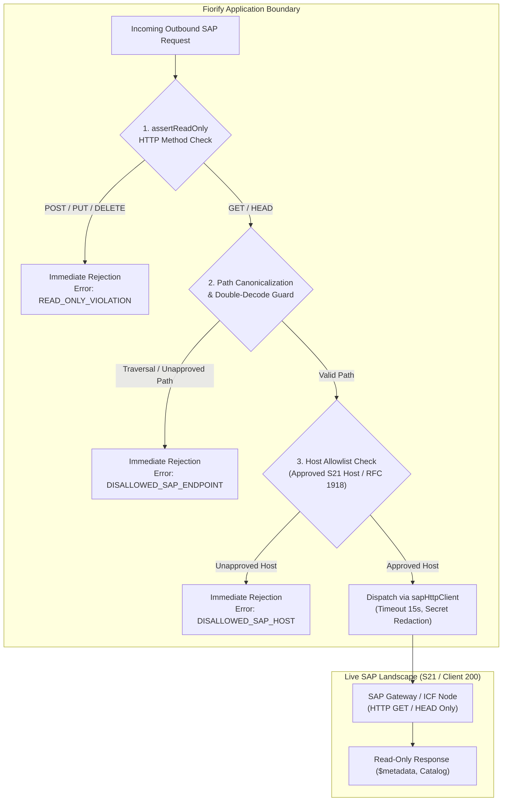

# Fiorify — SAP Integration Architecture Specification

## 1. Landscape Overview: Target System S21

Fiorify connects to SAP S/4HANA 2023 On-Premise systems, with the reference environment being:
- **System ID**: `S21`
- **Default Client**: `200`
- **Architecture**: SAP S/4HANA 2023 FPS00 (Private Edition / Clean Core Baseline)
- **Technical User**: `int_samarth` (Authorized with `SAP_ALL`)

---

## 2. SAP Technical User (`int_samarth`) Safeguards & Compensating Controls

> [!CAUTION]
> The SAP user **`int_samarth`** has administrative privileges (**`SAP_ALL`**) on SAP system `S21` because other enterprise projects share this service account. Fiorify enforces strict application-level compensating controls to guarantee zero accidental modification of SAP DDIC, repository objects, or transactional data.

### Compensating Control Framework

1. **Strict HTTP Method Whitelisting**:
   - Only `GET` and `HEAD` requests are transmitted to SAP endpoints.
   - Any attempt to invoke `POST`, `PUT`, `PATCH`, or `DELETE` throws a `READ_ONLY_VIOLATION` exception before hitting the network.
2. **Path Canonicalization & Directory Traversal Defense (REM-SEC-05)**:
   - Paths are decoded and normalized via `path.posix.normalize()`.
   - Multi-stage decodes detect and block single-encoded (`%2e%2e`), double-encoded (`%252e%252e`), ambiguous separators (`%2f`, `%5c`), and null bytes (`\0`).
3. **Approved Destination Host Filtering**:
   - Outbound connections are restricted to approved destination hosts matching configured SAP landscape hosts or RFC 1918 private subnets.
4. **Zero CTS Transport Generation**:
   - Fiorify never requests, creates, or attaches objects to CTS Workbench or Customizing Transport Requests (`TRKORR`).
5. **Enforced SAP Write Boundary**:
   - Deployment plans generate all artifacts locally. The deployment execution pipeline deliberately halts at the write boundary (`STOPPED_AT_WRITE_BOUNDARY`).

---

## 3. SAP Integration Endpoints

Fiorify integrates exclusively with standard SAP read-only interfaces:

| Interface Type | Endpoint Pattern | Accept Header | Purpose |
|---|---|---|---|
| **Gateway Catalog V2** | `/sap/opu/odata/IWFND/CATALOGSERVICE;v=2/ServiceCollection` | `application/json` | Enumerate registered OData V2 services |
| **Gateway OData V4** | `/sap/opu/odata4/sap/*/$metadata` | `application/xml` | Inspect published OData V4 service schemas |
| **ADT Discovery** | `/sap/bc/adt/discovery` | `application/atomsvc+xml` | Discover ABAP Development Tools capabilities |
| **ICF Echo / Ping** | `/sap/public/bc/icf/ping` | `text/plain` | Verify low-level network and ICF availability |
| **Fiori Reference Library** | `https://fioriappslibrary.hana.ondemand.com/sap/fix/externalViewer/services/SingleApp.xsodata` | `application/json` | Correlate standard Fiori application catalog |

---

## 4. Connection Resilience & Error Taxonomy

Fiorify classifies SAP connectivity responses into a structured error taxonomy (`backend/src/infrastructure/connectivity/sapErrorTaxonomy.js`):
- `AUTHENTICATION_FAILED`: HTTP 401 (invalid credentials, expired password).
- `AUTHORIZATION_MISSING`: HTTP 403 (missing PFCG authorization object, e.g. `S_ADT_RES`, `S_SERVICE`).
- `ENDPOINT_NOT_FOUND`: HTTP 404 (ICF service inactive or unmaintained).
- `CONTENT_NEGOTIATION_MISMATCH`: HTTP 406 (incorrect Accept header, e.g. ADT requires `application/atomsvc+xml`).
- `CONNECTIVITY_TIMEOUT`: Network timeout exceeding 15,000 ms.
