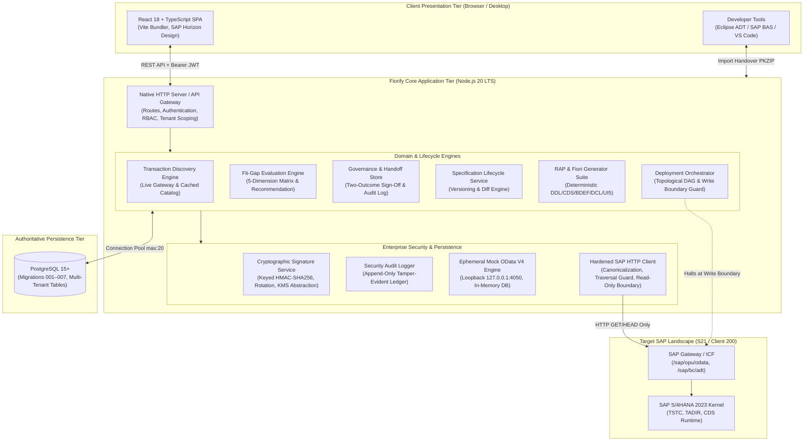
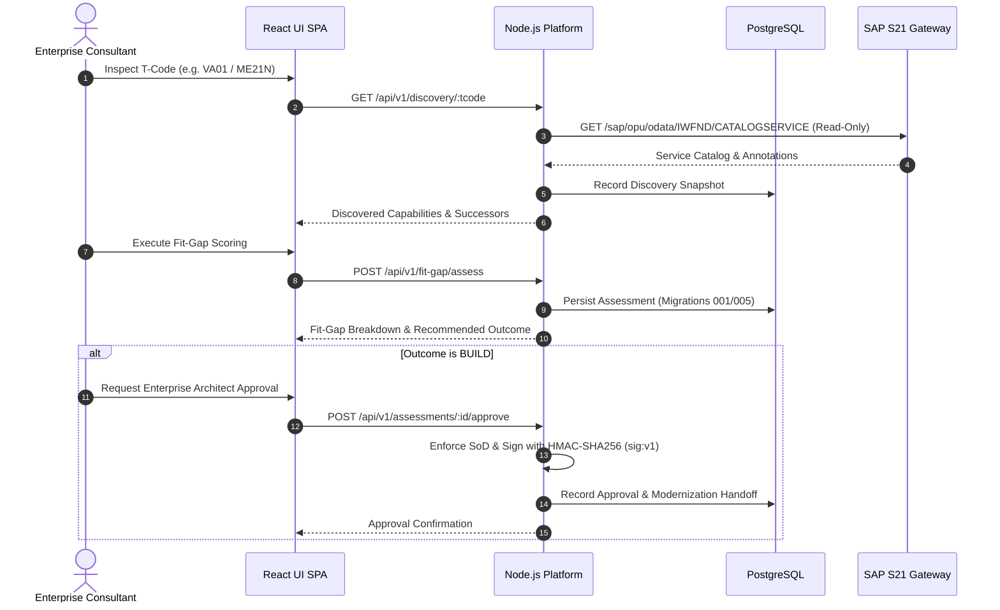

# Fiorify — System Architecture Specification

## 1. Executive Summary

Fiorify is a Clean Core SAP modernization platform designed to transition enterprises from legacy SAP GUI transactions to modern SAP Fiori applications and ABAP RESTful Application Programming Model (RAP) services.

The platform provides end-to-end governance across five core stages:
1. **Discovery & Kernel Inspection**: Grounded in live SAP kernel tables (`TSTC`, `TADIR`, dynpro definitions) and the SAP Fiori Reference Library.
2. **Fit-Gap Assessment**: Multi-dimensional scoring evaluating functional parity, UI requirements, business logic, and extensibility.
3. **Governance & Decision**: Two-outcome governance model strictly enforcing `ADD_AND_CONFIGURE` or `BUILD` with separation of duties.
4. **RAP & Fiori Code Generation**: Deterministic synthesis of modern Clean Core CDS View Entities, Behavior Definitions, Behavior Classes with defensive EML, domain-realistic DCLs, and Fiori Elements V4 applications.
5. **Validation, Preview & Safe Handover**: Local mock preview on loopback and deployment orchestration with an enforced SAP Write Boundary.

---

## 2. High-Level Component Architecture

---

## 3. Core Architectural Principles

### 3.1 Clean Core & Extensibility Model
Fiorify strictly adheres to the SAP Clean Core methodology:
- **Zero Modifications to Core SAP Objects**: Standard SAP code is never modified.
- **ABAP Cloud Language Version**: Generated CDS view entities use `define view entity` (Release State 2) and Behavior Definitions enforce `strict ( 2 );`.
- **Public SAP APIs Only**: Where standard APIs exist, they are leveraged. Standard Fiori apps take precedence over custom development.

### 3.2 Two-Outcome Governance Model
Every transaction evaluation must resolve into one of exactly two approved outcomes:
1. **`ADD_AND_CONFIGURE`**: Standard Fiori replacement app exists. The action plan prescribes activation via `/IWFND/MAINT_SERVICE` and Launchpad configuration.
2. **`BUILD`**: Genuine functional gaps exist. Custom development is authorized, triggering Generation Studio handoff.
*Note: The legacy outcome `EXTEND` is deprecated and eliminated from active workflows.*

### 3.3 Separation of Duties & Cryptographic Integrity
- **Role Separation**: Assessment creators cannot self-approve their own assessments.
- **Administrative Override**: Only authenticated `ADMIN` or `LEAD_ARCHITECT` identities may override governance recommendations.
- **Keyed Signatures**: Approvals use HMAC-SHA256 (`sig:v1:<digest>`), binding plan hashes, manifests, approvers, and timestamps to eliminate replay and forgery risks.

### 3.4 Zero-Mutation SAP Safety Boundary
Fiorify interacts with SAP system `S21` strictly as a read-only client:
- Mutating HTTP methods (`POST`, `PUT`, `PATCH`, `DELETE`) are trapped and rejected at the client layer.
- Deployment planning generates ordered installation instructions but terminates before issuing SAP repository modifications.

---

## 4. Subsystem Interactions

---

## 5. Technology Stack Summary

| Layer | Technology | Version | Purpose |
|---|---|---|---|
| **Frontend Framework** | React | 18.3.1 | Single-Page Application |
| **Language** | TypeScript | 5.3.3 | Type safety and developer contracts |
| **Build Tooling** | Vite | 5.4.21 | Hot module replacement & production bundling |
| **Design Language** | SAP Horizon Theme | Custom CSS | Clean, modern enterprise styling |
| **Backend Runtime** | Node.js LTS | 20.x | High-throughput, non-blocking I/O |
| **Database** | PostgreSQL | 15+ | Relational persistence with JSONB and multi-tenancy |
| **Connection Pool** | pg (node-postgres) | 8.11.3 | Max 20 connections, idle & timeout guards |
| **Crypto** | Node.js `crypto` | Built-in | HMAC-SHA256, timingSafeEqual, PKZIP streaming |
| **SAP Target** | SAP S/4HANA | 2023 On-Premise | S21 Clean Core target landscape |
