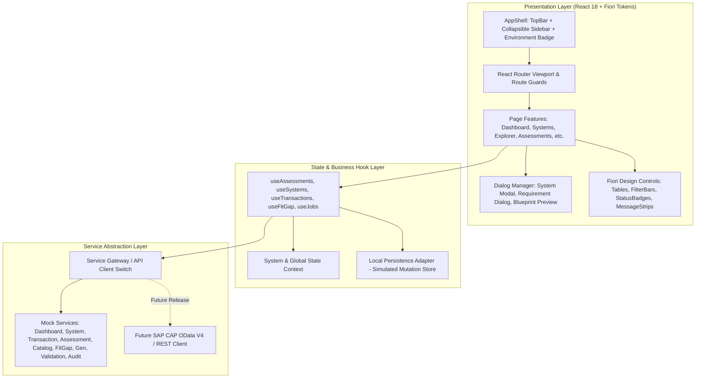

# FioriX Frontend Architecture Specification
**Project:** FioriX — SAP S/4HANA On-Premise Fiori App Discovery, Assessment and Controlled Generation Platform  
**Document Version:** 1.0.0  
**Status:** APPROVED FOR SPRINT 1 FRONTEND IMPLEMENTATION  
**Role:** Principal Frontend Architect & SAP Fiori UX Specialist  

---

## 1. Architectural Mission & Core Principles

FioriX is an enterprise engineering and decision-governance workbench. It is engineered specifically for SAP Functional Consultants, ABAP Developers, and Enterprise Solution Architects.

### Core Architecture Axioms
1. **Standard SAP Fiori First:** Architecture prioritizes standard SAP catalog exploration before any custom build workflow is unlocked.
2. **Deterministic Governance:** UI reflects verified SAP evidence. Missing evidence is explicitly classified as `UNKNOWN`, never conflated with `UNSUPPORTED`.
3. **Enterprise Restraint:** Zero decorative AI hype, sparkles, glowing borders, or conversational chatbot paradigms. The interface is high-density, calm, functional, and grounded in SAP Fiori design standards.
4. **Draft-Only Boundary:** The generation studio produces reviewable blueprints and draft previews. The frontend makes no claims of automated production transport or activation.
5. **Decoupled Service Layer:** The frontend communicates with a typed service abstraction. In this release, mock services provide realistic synthetic demo data with client-side persistence, ready for seamless transition to SAP CAP OData V4 / REST endpoints.

---

## 2. Technology Stack & Tooling

```
+--------------------------------------------------------------------------+
|                          FioriX Frontend Stack                           |
+--------------------------------------------------------------------------+
| Framework:        React 18.3+ with TypeScript 5.5+                       |
| Build Tool:       Vite 5.4+ (ESM, ultra-fast HMR, optimized bundling)    |
| Routing:          React Router 6.28+ (Declarative, nested, type-safe)    |
| UI Design System: SAP Fiori Design Principles & UI5 Web Components tokens|
| Styling:          Scoped CSS Modules + Design Tokens (CSS Custom Props)  |
| State Management: React Context + Custom Hooks + LocalStorage Adapter    |
| Iconography:      SAP Fiori aligned enterprise SVG icon set               |
| Verification:     TypeScript strict mode, Vite production build checks   |
+--------------------------------------------------------------------------+
```

---

## 3. Layered Architectural Decomposition



### 3.1 Presentation Layer
- **AppShell:** Persistent global navigation shell. Left-hand navigation sidebar grouped into logical business domains (Landscape, Discovery, Assessments, Fiori Catalog, Analysis, Development, Governance, Administration). TopBar houses brand, environment badge (`LOCAL DEMO`), global search, notification summary, and active user profile.
- **Views (Page Features):** Self-contained feature folders containing view controllers, localized sub-components, and tab controllers.
- **Reusable Dialogs:** Modals with clear focus trapping, keyboard cancellation (`Escape`), accessible ARIA attributes, and explicit validation feedback.
- **Enterprise Controls:** Filter bars with multi-criteria inputs, responsive data tables with column sorting, contextual status badges, and expandable row details.

### 3.2 State Management & Hook Layer
- **No Heavy Redux/Zustand Overhead:** The initial release utilizes React Context paired with domain-specific custom hooks (`useAssessments`, `useSystems`, `useTransactions`).
- **Local Mutation Persistence:** To enable full demonstration interactivity (e.g. creating a new assessment, editing a requirement, adding an SAP system, triggering a draft generation), a local storage wrapper commits synthetic updates in the browser session without network roundtrips.

### 3.3 Service Layer & Backend Readiness
All data access is mediated through typed interfaces:
- `ISystemService`
- `ITransactionService`
- `IAssessmentService`
- `ICatalogueService`
- `IFitGapService`
- `IGenerationService`
- `IValidationService`
- `IAuditService`

When the SAP CAP Node.js backend is introduced, replacing `mock/` with `api/` requires zero modifications to React components.

---

## 4. Design System & Theme Architecture

The visual theme strictly complies with SAP Fiori Horizon and Quartz design aesthetics:

| Token Name | Value | Purpose |
|---|---|---|
| `--fiori-navy` | `#142C40` | Primary Shell Header & Brand identity |
| `--fiori-teal` | `#28718A` | Accent Blue / Active Selection / Interactive Links |
| `--fiori-bg` | `#F5F7F9` | Canvas background for workspaces |
| `--fiori-surface` | `#FFFFFF` | Cards, Object Pages, Data Tables, Modals |
| `--fiori-text-primary` | `#1D2D3E` | High-contrast body typography |
| `--fiori-text-secondary` | `#667788` | Metadata, subtitles, column headers |
| `--fiori-border` | `#DCE3E8` | Table borders, divider lines, card edges |
| `--fiori-success` | `#107E3E` | Verified, Supported, Adopt, Pass |
| `--fiori-warning` | `#E9730C` | Inferred, Partial, Extend, Warning |
| `--fiori-error` | `#BB0000` | Unsupported, Build, Fail, Error |
| `--fiori-neutral` | `#6A6D70` | Unknown, Not Run, Draft |

---

## 5. Security & Environment Containment
1. **Local Demonstration Isolation:** The frontend operates 100% locally on Vite. No real SAP credentials, destinations, or RFC calls are transmitted.
2. **Prominent Demo Badging:** The TopBar and every page header display an explicit `LOCAL DEMO` badge to prevent any confusion with production landscapes.
3. **Input Sanitization:** Search and form fields prevent script injection and validate inputs against structured regexes (e.g., T-Code format `^[A-Z0-9/_]{1,20}$`).
