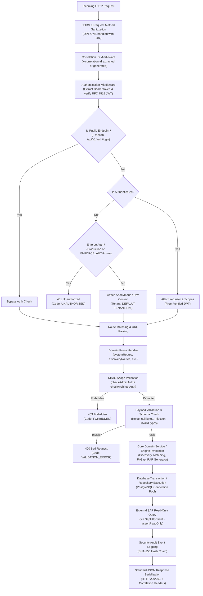

# Backend API Architecture & Request Lifecycle Audit

**Document Reference**: `docs/audit/BACKEND_API_ARCHITECTURE.md`  
**Audit Baseline**: Commit `4c7f9a3` (Branch `test-01`)  
**Architecture Classification**: Node.js Native HTTP Server / Modular Domain Routing / RESTful Architecture

---

## 1. Backend Request Lifecycle

---

## 2. API Endpoint Inventory & Technical Specification

### 2.1 Authentication & System Landscape APIs

#### `POST /api/v1/auth/login`
- **Purpose**: Authenticates user credentials and issues RFC 7519 JWT Bearer token.
- **Request Schema**: `{ identifier: string (email/username), password: string }`
- **Response Schema**: `{ success: true, token: string, user: { id, email, name, role, tenantId, scopes } }`
- **Auth / RBAC**: Public (Unauthenticated).
- **Validation**: Rejects empty identifier or password with HTTP 400.
- **Security Finding**: Passwords validated against single un-salted SHA-256 (**SEC-01**).
- **Database Effects**: None (in-memory user map).
- **Frontend Consumer**: `LoginPage.tsx`.
- **Test Coverage**: `sec01Security.test.js`.

#### `GET /api/v1/systems`
- **Purpose**: Lists registered SAP system landscape profiles with connectivity status and client IDs.
- **Request Schema**: None.
- **Response Schema**: `Array<SapSystemProfile>` (id, systemId, client, release, connectionMode, connectionState).
- **Auth / RBAC**: Public in dev/test; requires `Fiorify.systems.read` when auth enforced.
- **Database Effects**: Reads `sap_system_profiles`.
- **Frontend Consumer**: `OverviewPage.tsx`, `SystemConfigurationPage.tsx`, `TransactionDiscoveryPage.tsx`.
- **Test Coverage**: `s2SapConnectivity.test.js`, `sapLiveAndEnterprise.test.js`.

#### `POST /api/v1/systems/:id/diagnostics`
- **Purpose**: Executes 10-point controlled read-only capability diagnostic probes against SAP landscape.
- **Request Schema**: `{ destinationName?: string, timeoutMs?: number }`
- **Response Schema**: `{ success: boolean, checks: { destinationResolution, gatewayCatalog, adtDiscovery, icfNodes }, connectivityStatus: string }`
- **Auth / RBAC**: Protected: `ADMIN` or `SAP_CONSULTANT` only.
- **SAP Read-Only Boundary**: Calls `SapHttpClient.get()`; mutating methods strictly blocked.
- **Database Effects**: Appends execution record to `sap_system_diagnostic_history`.
- **Test Coverage**: `sapLiveAndEnterprise.test.js`, `s2SapConnectivity.test.js`.

---

### 2.2 Discovery & Matching APIs

#### `POST /api/v1/discovery/transaction`
- **Purpose**: Discovers SAP transaction metadata (T-Code, description, program, package, DDIC tables, Gateway services) and collects technical evidence.
- **Request Schema**: `{ tcode: string, systemId?: string, language?: string, mode?: "LIVE"|"MOCK", useLiveSap?: boolean }`
- **Response Schema**: Canonical Discovery Record containing `transactionIdentity`, `technicalEvidence`, `evidenceConfidence`, `provenance`, and `warnings`.
- **Auth / RBAC**: `Fiorify.discovery.execute` (SAP_CONSULTANT, LEAD_ARCHITECT, ADMIN).
- **Input Validation**: Strictly validates T-Code format (`/^[A-Z0-9_\-\/]{1,20}$/`). Rejects whitespace, special chars, and SQL injection strings with HTTP 400.
- **External SAP Calls**: Probes `/sap/bc/adt/repository/informationsystem/search` and Gateway `/IWFND/CATALOGSERVICE;v=2`.
- **Failure Recovery**: On network timeout, returns HTTP 502 with `statusCode: "CONNECTION_ERROR"`; never fabricates fake records.
- **Database Effects**: Upserts snapshot into `transaction_master_snapshots` and records into `transaction_master_records`.
- **Test Coverage**: `s4TransactionDiscovery.test.js`, `transactionDiscoveryMatching.test.js`.

#### `POST /api/v1/matching/fiori-apps`
- **Purpose**: Matches discovered transaction against canonical SAP Fiori catalogue across 6 dimensions.
- **Request Schema**: `{ transaction: Object, technicalEvidence?: Array, liveGatewayServices?: Array, targetRelease?: string }`
- **Response Schema**: `{ rankedCandidates: Array<FioriCandidate>, bestCandidate: Object, matchClassification: string, candidateComparison: Array }`
- **Auth / RBAC**: Authenticated user.
- **Scoring Logic**: Evaluates T-Code relationship (30%), functional fit (25%), technical fit (25%), business context (10%), release compatibility (10%).
- **Database Effects**: Reads `fiori_catalog_apps` and `fiori_catalog_services`.
- **Test Coverage**: `d3MatchingFitGap.test.js`, `s5MatchingFitGapEngine.test.js`.

---

### 2.3 Fit-Gap & Modernization Assessment APIs

#### `POST /api/v1/fit-gap/assess`
- **Purpose**: Executes 5-dimension classic and 10-dimension granular fit-gap assessment with score coverage normalization.
- **Request Schema**: `{ requirement: Object, candidate: Object, context?: Object }`
- **Response Schema**: Scored assessment containing `overallStatus`, `overallScore`, `scoringBreakdown`, `identifiedGaps`, `cleanCoreAlignment`, and `governedRecommendation`.
- **Governance Guardrails**: Critical functional gaps or release blockers strictly prevent `VERIFIED_FIT` regardless of high technical score.
- **Database Effects**: None (ephemeral evaluation; persisted via `POST /api/v1/assessments`).
- **Test Coverage**: `fitGapAssessmentEngineV2.test.js`, `sprint8FitGapEngine.test.js`.

#### `POST /api/v1/assessments`
- **Purpose**: Persists evaluated fit-gap assessment and initializes cryptographic audit event chain.
- **Request Schema**: Full assessment object.
- **Response Schema**: `{ success: true, assessmentId: string, lifecycleStatus: "DRAFT" }` (HTTP 201 Created).
- **Database Effects**: Inserts into `assessments`, `fit_gap_dimensions`, `assessment_evidence`, and `assessment_audit_events`.
- **Test Coverage**: `assessmentPersistence.test.js`, `s1LivePersistenceIntegration.test.js`.

#### `PUT /api/v1/assessments/:id`
- **Purpose**: Updates assessment lifecycle state (`DRAFT` -> `PENDING_REVIEW` -> `APPROVED` / `REJECTED` -> `ARCHIVED`).
- **Request Schema**: `{ lifecycleStatus: string, reviewComments?: string }`
- **RBAC**: Transition to `APPROVED` or `REJECTED` strictly requires `APPROVER` or `ADMIN` role.
- **Separation of Duties**: Creator cannot approve their own assessment.
- **Database Effects**: Updates `assessments.lifecycle_status` and appends tamper-evident audit event.
- **Test Coverage**: `s13SecurityHardening.test.js` (Scope A tests).

---

### 2.4 Generation Studio APIs

#### `POST /api/v1/generation/projects`
- **Purpose**: Creates a new Clean Core application generation project.
- **Request Schema**: `{ projectName: string, sourceAssessmentId?: string, sourceTransactionCode?: string, targetRelease?: string }`
- **Response Schema**: `{ success: true, project: GenerationProject }` (HTTP 201 Created).
- **Database Effects**: Inserts into `generation_projects`.
- **Test Coverage**: `generationStudioPhase1.test.js`, `s7GenerationSpecificationEngine.test.js`.

#### `POST /api/v1/generation/projects/:id/artifacts`
- **Purpose**: Synthesizes all ABAP RAP (CDS, BDEF, Classes, DCL, SRVD, SRVB) and Fiori Elements artifacts.
- **Request Schema**: `{ architectureOverride?: Object }`
- **Response Schema**: `{ success: true, artifactCount: number, artifacts: Array<GeneratedArtifact>, readinessScore: number }`
- **Database Effects**: Inserts into `generation_artifacts` and creates specification version snapshot in `project_specification_versions`.
- **Test Coverage**: `gen05RapArchitectureAndAbapGenerator.test.js`, `s13ArtifactEngineering.test.js`.

#### `POST /api/v1/generation/projects/:id/preview/start`
- **Purpose**: Launches local mock OData V4 preview server on allocated port (4050–4099).
- **Request Schema**: `{}`
- **Response Schema**: `{ success: true, session: { port, url, previewUrl, status: "RUNNING" } }`
- **Failure Mode**: Fails with `EADDRINUSE` if port 4050 is held by main server (**PERF-01**).
- **Test Coverage**: `gen07LocalPreviewOData.test.js`.

#### `POST /api/v1/generation/projects/:id/export`
- **Purpose**: Generates and downloads enterprise `.zip` package with complete ABAP and Fiori code.
- **RBAC**: Requires `Fiorify.artifacts.export` permission (ADMIN, LEAD_ARCHITECT).
- **Response**: Binary PKZIP stream (`application/zip`) with `Content-Disposition: attachment; filename="..."`.
- **Test Coverage**: `gen08ReviewAndExport.test.js`.

---

### 2.5 Deployment Orchestration APIs

#### `POST /api/v1/generation/projects/:id/deployment-plans`
- **Purpose**: Calculates DAG deployment plan and computes SHA-256 manifest hashes.
- **Auth**: Requires `LEAD_ARCHITECT` or `ADMIN`.
- **Database Effects**: Inserts into `deployment_plans`.
- **Test Coverage**: `s11DeploymentOrchestration.test.js`.

#### `POST /api/v1/generation/deployment-plans/:id/approve`
- **Purpose**: Signs deployment plan using Keyed HMAC-SHA256 signature (`sig:v1:<hex>`).
- **Auth**: Strictly requires `CHIEF_ARCHITECT` or `LEAD_ARCHITECT` role. Rejects non-architect users with HTTP 403.
- **Database Effects**: Inserts into `deployment_approvals` and transitions plan status to `APPROVED`.
- **Test Coverage**: `s13CryptographicApproval.test.js`.

#### `POST /api/v1/generation/deployment-plans/:id/execute`
- **Purpose**: Validates cryptographic signature, executes preflight checks, and halts at SAP Write Boundary.
- **Security Check**: Verifies signature integrity via `timingSafeEqual`.
- **Audit Finding**: Permissively executes on legacy unauthenticated SHA-256 digests with `WARN` log (**SEC-02**).
- **Write Boundary**: Strictly logs `GUARDRAIL: Halting execution at the SAP S/4HANA Write Boundary`; zero mutating calls dispatched.
- **Database Effects**: Records execution trace in `deployment_executions`.
- **Test Coverage**: `s11DeploymentOrchestration.test.js`.

---

## 3. Architecture Strengths & Identified Vulnerabilities

### 3.1 Architectural Strengths
1. **Zero External Heavyweight Frameworks**: Built on native Node.js HTTP and ESM modules, minimizing attack surface and runtime dependencies.
2. **Defensive Input Sanitization**: Centralized URL canonicalization (`SapHttpClient.js`) and T-Code regex normalization across all entry routes.
3. **Traceable Correlation IDs**: Every request carries an `x-correlation-id` passed through logs, database audit records, and downstream responses.
4. **Clean Read-Only Safeguard**: All outbound SAP HTTP calls enforce `assertReadOnly()`, preventing accidental or malicious ERP mutation.

### 3.2 Identified API Vulnerabilities & Flaws
1. **API-01 (Inconsistent Pagination Parameterization)**: Some listing endpoints (`/api/v1/assessments`, `/api/v1/systems`) return full collections without default cursor pagination, presenting memory exhaustion risk under large datasets.
2. **API-02 (Missing Rate Limiting Middleware)**: Authentication and discovery endpoints lack native rate limiting, making them vulnerable to brute-force credential stuffing or discovery denial-of-service.
3. **API-03 (Synchronous File Generation in Export)**: Large project zip archiving executes synchronously on the event loop; should be offloaded to worker threads or streaming pipelines for multi-megabyte exports.
