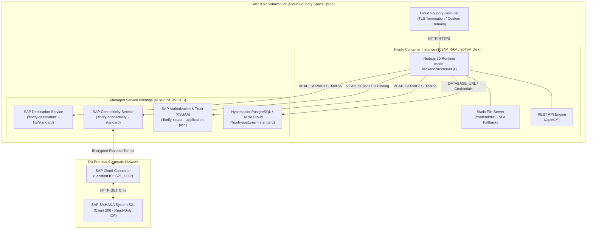

# SAP BTP Cloud Foundry Deployment Architecture Audit

**Document Reference**: `docs/audit/CLOUD_FOUNDRY_DEPLOYMENT_ARCHITECTURE.md`  
**Audit Baseline**: Commit `4c7f9a3` (Branch `test-01`)  
**Deployment Target**: SAP BTP Cloud Foundry Environment (Multi-Cloud / AWS, Azure, GCP)  
**Manifest File**: `manifest.yml` (Root Directory)  
**Security Descriptor**: `xs-security.json` (Root Directory)

---

## 1. Cloud Foundry Deployment Architecture Diagram



---

## 2. Configuration Artifact Review

### 2.1 Application Manifest (`manifest.yml`)
Located at repository root:

```yaml
---
applications:
  - name: Fiorify-platform
    memory: 1024M
    disk_quota: 2048M
    buildpacks:
      - nodejs_buildpack
    command: node backend/src/server.js
    env:
      NODE_ENV: production
      Fiorify_PERSISTENCE: postgres
      Fiorify_ENFORCE_AUTH: "true"
      SAP_DESTINATION_NAME: S21
      SAP_CLIENT: "200"
      SAP_TIMEOUT_MS: "15000"
    services:
      - fiorify-destination
      - fiorify-connectivity
      - fiorify-xsuaa
      - fiorify-postgres
```

### 2.2 Security Descriptor (`xs-security.json`)
Located at repository root:
- `xsappname`: `Fiorify`
- `tenant-mode`: `dedicated`
- `scopes`:
  - `$XSAPPNAME.FiorifyAdmin`: Full administrative access
  - `$XSAPPNAME.FiorifyArchitect`: Modernization assessment and generation privileges
  - `$XSAPPNAME.FiorifyViewer`: Read-only viewer access
- `role-templates`:
  - `Fiorify_Administrator`
  - `Fiorify_Enterprise_Architect`
  - `Fiorify_Viewer`
- `role-collections`: Pre-configured collections ready for BTP subaccount user mapping.

---

## 3. Critical Deployment Blocker: Missing Root `package.json` (DEP-01)

### 3.1 Defect Analysis
- **Severity**: **P0 — Critical Production Deployment Blocker**
- **Location**: Repository Root (`/`)
- **Finding**: While `manifest.yml` specifies `buildpacks: - nodejs_buildpack` and executes `node backend/src/server.js` from the root directory, **there is no `package.json` file in the root workspace directory**.
- **Buildpack Execution Mechanics**:
  1. The Cloud Foundry `nodejs_buildpack` checks the root directory of the pushed artifact for a `package.json` to determine dependencies and run `npm install`.
  2. Because the monorepo separates `backend/package.json` and `frontend/package.json`, running `cf push` from the root directory causes the buildpack staging phase to fail immediately with:
     ```
     **ERROR** A package.json file is required at the root of the app.
     Failed to compile droplet: Failed to run finalize script: exit status 1
     ```
  3. Furthermore, `server.js` serves static assets from `frontend/dist` (`const frontendDistDir = path.resolve(process.cwd(), 'frontend', 'dist')`). If `frontend` is not built during staging, the production container will start but return 404 for all UI routes.

### 3.2 Remediation Specification
Create a root `package.json` orchestrating both backend dependencies and frontend production build:

```json
{
  "name": "fiorify-monorepo-root",
  "version": "1.0.0",
  "private": true,
  "engines": {
    "node": ">=20.0.0"
  },
  "scripts": {
    "postinstall": "npm --prefix backend install --omit=dev && npm --prefix frontend install --include=dev && npm --prefix frontend run build && npm --prefix frontend prune --production",
    "start": "node backend/src/server.js"
  }
}
```

---

## 4. Component Status Classification Table

| Architecture Component | Status | Reality on Target Platform | Evidence |
|---|---|---|---|
| **Node.js 20 Application Process** | **CONFIGURED** | Configured in `manifest.yml`; ready for droplet compile once DEP-01 is fixed. | `manifest.yml:8` |
| **Unified Frontend Static Serving** | **IMPLEMENTED** | `server.js` serves `frontend/dist`; verified in local build (2,067 modules). | `server.js:476-515` |
| **BTP Destination Service** | **CONFIGURED** | Bound via `fiorify-destination`; adapter parses `VCAP_SERVICES`. | `btpDestinationAdapter.js` |
| **BTP Connectivity Service** | **CONFIGURED** | Bound via `fiorify-connectivity`; manages proxy tunnel to Cloud Connector. | `btpDestinationAdapter.js` |
| **XSUAA OAuth2 Provider** | **CONFIGURED** | Descriptor valid in `xs-security.json`; JWT verification ready. | `xs-security.json` |
| **PostgreSQL Database** | **CONFIGURED** | Bound via `fiorify-postgres`; schema migration runs automatically on start. | `pool.js`, `migrator.js` |
| **Automated Staging Pipeline** | **BLOCKED (P0)** | Droplet staging fails due to missing root monorepo build orchestrator. | Root directory inspection |
| **Standalone Application Router** | **NOT REQUIRED** | `server.js` serves both API and static UI5/React assets directly in 1 container. | Saves ~1 GB RAM in BTP |
