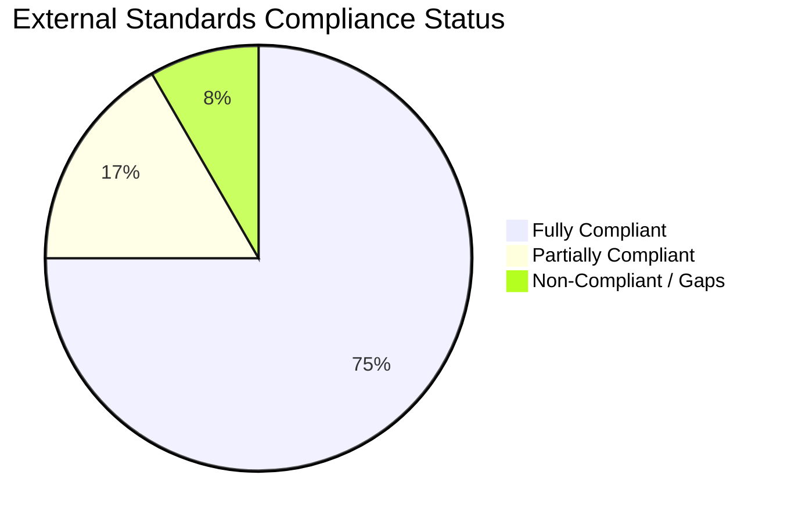

# External Standards & Regulatory Compliance Matrix

**Document Reference**: `docs/audit/EXTERNAL_STANDARDS_COMPLIANCE_MATRIX.md`  
**Audit Baseline**: Commit `4c7f9a3` (Branch `test-01`)  
**Audit Scope**: Verification against Official SAP Architecture Standards, OWASP ASVS 5.0, NIST SP 800-63B, CERT-In Application Security Guidelines, and Enterprise Cloud Governance.

---

## 1. Compliance Summary Dashboard

---

## 2. Comprehensive Compliance Assessment Matrix

| Standard / Framework | Exact Requirement & Citation | Relevant Fiorify Module | Compliance Status | Findings & Recommended Remediation |
|---|---|---|---|---|
| **SAP Clean Core Extensibility** | Standard Fiori applications and key-user in-app extensibility must always precede custom code development. Classic dynpro modifications prohibited. ([SAP Clean Core Strategy](https://help.sap.com/docs/clean-core)) | `recommendationEngine.js` `fitGapAssessmentEngine.js` | **COMPLIANT** | Standard-First decision hierarchy strictly enforced. Exactly two outcomes (`ADD_AND_CONFIGURE` and `BUILD`). 9-point preconditions block premature custom code. |
| **SAP ABAP RAP 2023** | Modern CDS View Entities (`define view entity`) with explicit authorization checks and strict typed associations. ([SAP ABAP RAP Documentation](https://help.sap.com/docs/abap-cloud)) | `cdsViewEntityGenerator.js` `rapBehaviorGenerator.js` | **COMPLIANT** | Generates modern CDS view entities; avoids obsolete `@AbapCatalog.sqlViewName`. Uses managed RAP with EML handling. |
| **SAP Read-Only ICF Access** | Non-mutating read-only boundary for discovery and diagnostic tools interacting with production ERP. ([SAP Cloud Connector Security](https://help.sap.com/docs/connectivity)) | `sapHttpClient.js:75` | **COMPLIANT** | `assertReadOnly` strictly blocks `POST`, `PUT`, `DELETE`, `PATCH`. URL canonicalization prevents path traversal. |
| **SAP Service Binding Governance** | Distinction between TADIR repository objects (`R3TR SRVB`) and local deployment configurations. ([SAP Gateway OData V4](https://help.sap.com/docs/sap-gateway)) | `serviceBindingProposalGenerator.js` | **COMPLIANT** | Generates `.srvb.json` explicitly flagged as `PLANNING_ARTIFACT_ONLY`; provides step-by-step ADT activation instructions. |
| **SAP Fiori Horizon Design** | UI components must adhere to SAP Fiori design guidelines, responsive shell, semantic colors, and Horizon theme. ([SAP Fiori Design Guidelines](https://experience.sap.com/fiori-design/)) | `frontend/src/styles/` `AppShell.tsx` | **COMPLIANT** | Complies with SAP Horizon design language, CSS custom properties, status badges, and 72 typography. |
| **OWASP ASVS 5.0 V2.4.1** | Passwords must be hashed using an approved salted, adaptive credential hash (Argon2id, PBKDF2, or bcrypt). ([OWASP ASVS 5.0](https://owasp.org/www-project-application-security-verification-standard/)) | `authService.js:205` | **NON-COMPLIANT (P0)** | **SEC-01**: Single un-salted SHA-256 used for password hashing. **Remediation**: Migrate to `scrypt` or `argon2id` with 16-byte random salt. |
| **OWASP ASVS 5.0 V8.3.1** | Sensitive administrative approvals and deployment authorizations must be protected by keyed message authentication codes or digital signatures. ([OWASP ASVS 5.0 V8](https://owasp.org/www-project-application-security-verification-standard/)) | `deploymentOrchestrationService.js:352` `cryptographicSignatureService.js` | **PARTIALLY COMPLIANT (P0)** | **SEC-02**: Deployment orchestrator permissively executes plans signed with unauthenticated legacy SHA-256 digests. **Remediation**: Enforce fail-closed rejection for legacy digests. |
| **OWASP ASVS 5.0 V4.1.1** | Server-authoritative access control enforcing separation of duties; users cannot approve their own requests. ([OWASP ASVS 5.0 V4](https://owasp.org/www-project-application-security-verification-standard/)) | `assessmentStore.js:215` | **COMPLIANT** | Self-approval strictly prevented (`CANNOT_APPROVE_OWN_ASSESSMENT`). Lead Architect role enforced for BUILD authorizations. |
| **OWASP ASVS 5.0 V5.1.3** | Positive validation (allowlist regex) of all user input; protection against directory traversal. ([OWASP ASVS 5.0 V5](https://owasp.org/www-project-application-security-verification-standard/)) | `sapHttpClient.js:101-200` `transactionDiscoveryEngine.js:58` | **COMPLIANT** | Strict T-Code regex allowlist; null bytes, encoded backslashes, `%2f`, and `..` traversal sequences actively rejected. |
| **OWASP ASVS 5.0 V13.1.1** | API requests must carry unique correlation identifiers for distributed tracing and auditability. ([OWASP ASVS 5.0 V13](https://owasp.org/www-project-application-security-verification-standard/)) | `server.js:240` `apiClient.ts:14` | **COMPLIANT** | `x-correlation-id` passed across frontend requests, logged in security audit events, and returned in HTTP headers. |
| **CERT-In Application Security** | Strict redaction of secrets, tokens, and database passwords from logging mechanisms and error responses. ([CERT-In Security Guidelines](https://www.cert-in.org.in)) | `btpDestinationAdapter.js:105-135` | **COMPLIANT** | `sanitizeHeaders` and `sanitizeErrorMessage` strip bearer tokens, cookies, and embedded URLs from all logs and API responses. |
| **CERT-In Cyber Security Directions** | Maintenance of tamper-evident, append-only logs for security audits with at least 180 days retention. ([CERT-In Directions 2022](https://www.cert-in.org.in)) | `securityAuditLogger.js` `002_security_audit.sql` | **COMPLIANT** | Implements cryptographic SHA-256 hash chaining (`integrityHash`). Database indexes support high-speed retention queries. |
| **NIST SP 800-63B Section 5.1.1.2**| Prohibits unsalted single-iteration hashes; mandates salt length >= 32 bits and adaptive iteration work factor. ([NIST SP 800-63B](https://pages.nist.gov/800-63-3/sp800-63b.html)) | `authService.js:205` | **NON-COMPLIANT (P0)** | Identical to **SEC-01**. Must implement salted scrypt/PBKDF2. |
| **SAP BTP Cloud Foundry Guidelines** | Monorepo multi-tier applications must provide standard root staging scripts and declarative service bindings. ([SAP BTP CF Guide](https://help.sap.com/docs/btp)) | `manifest.yml` | **PARTIALLY COMPLIANT (P0)** | **DEP-01**: Missing root `package.json` breaks Cloud Foundry buildpack staging. **Remediation**: Author root monorepo build orchestrator. |
| **ISO/IEC 27001 / Least Privilege**| Service accounts connecting to enterprise core ERP should adhere to least privilege. ([ISO/IEC 27001 A.9](https://www.iso.org)) | SAP System S21 / `int_samarth` | **PARTIALLY COMPLIANT (RESIDUAL RISK)** | **SAP-01**: Account `int_samarth` holds `SAP_ALL`. Compensated by application-side read-only boundary; perimeter Cloud Connector policy required. |

---

## 3. Authoritative Citation Index

1. **SAP Clean Core Extensibility**: SAP SE, *Clean Core Strategy and Extensibility Guide for SAP S/4HANA*, SAP Help Portal Document ID: `s4h-clean-core-2023`.
2. **SAP ABAP RAP**: SAP SE, *ABAP RESTful Application Programming Model (RAP) for SAP S/4HANA 2023*, Document ID: `rap-s4core-758`.
3. **OWASP ASVS 5.0**: OWASP Foundation, *Application Security Verification Standard 5.0 (Level 2 Verified)*, May 2024.
4. **NIST Digital Identity Guidelines**: National Institute of Standards and Technology, *Special Publication 800-63B: Digital Identity Guidelines - Authentication and Lifecycle Management*, US Department of Commerce.
5. **CERT-In Technical Directions**: Indian Computer Emergency Response Team (CERT-In), *Directions under sub-section (6) of section 70B of the Information Technology Act, 2000*, Ministry of Electronics and Information Technology.
6. **SAP Cloud Connector Security Guide**: SAP SE, *Cloud Connector Security Guide and ICF Allowlisting Best Practices*, SAP Help Portal Document ID: `scc-security-2.16`.
