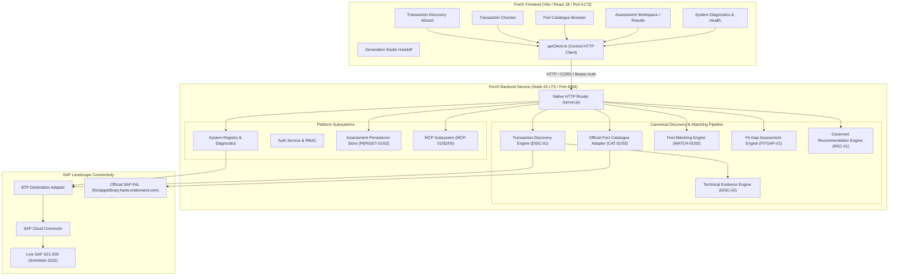

# FIORIX — COMPREHENSIVE REPOSITORY ARCHITECTURE AUDIT
**Document ID:** AUDIT-ARCH-2026-001  
**Status:** COMPLETE (READ-ONLY AUDIT BASELINE)  
**Date:** 2026-11-08  
**Scope:** Full Repository Audit (Backend, Frontend, Data, MCP, SAP Connectivity, Matching, Persistence)  
**Classification:** SAP Digital Modernization Platform — Architecture & Production Readiness  

---

## 1. Executive Summary

This architecture audit establishes the definitive baseline of the FioriX SAP Discovery & Modernization platform prior to production finalization. The system provides automated discovery, technical evidence collection, catalogue matching, fit-gap analysis, governed decision formulation (Adopt / Configure / Extend / Build), and assessment handoff for SAP S/4HANA modernization.

The audit verified:
1. **Core Strengths:** A robust Node 20 LTS native HTTP backend with extensive automated test coverage (278 backend tests passing across 30 suites; 117 frontend tests passing across 10 suites); mathematically rigorous 6-dimension candidate matching (`fioriMatchingEngine.js`); 8-dimension fit-gap assessment (`fitGapAssessmentEngine.js`); SHA-256 tamper-evident assessment persistence (`assessmentStore.js`); official SAP Cloud SDK destination integration (`btpDestinationAdapter.js`); and an approved MCP client integration (`mcpService.js`).
2. **Critical Gaps & Defects Identified:**
   - **Discovery API Contract Mismatch:** Frontend `transactionSearchService.ts` called legacy `POST /api/v1/tcode-search` (which routed to old mock DDIC fixtures and swallowed errors into HTTP 200 responses) instead of the canonical unified pipeline `POST /api/v1/discovery/match`.
   - **Inconsistent Working Directory Path Resolution:** `officialFioriCatalogueAdapter.js` resolved `backend/data/fiori_app_catalog_cache.json` relative to `process.cwd()`. Running from `backend/` resolved to `backend/backend/data/...`, causing catalogue searches to return 0 applications.
   - **Silent Mock/Demo Data Fallback in Frontend:** `frontend/src/services/assessmentService.ts` directly invoked `demoDataProvider` (in-memory `localStore.ts`), completely bypassing the backend's persistent store (`/api/v1/assessments`).
   - **Frontend Engine Duplication:** `AssessmentResultsPage.tsx` duplicated evidence scoring, role checking, OData validation, and recommendation generation in the client instead of rendering backend server-evaluated contracts.
   - **Optimistic Static Connectivity Status:** Systems in `systemRegistry.js` were pre-initialized with `PARTIAL_CONNECTIVITY` and `LIVE_SAP_VERIFIED` timestamps before executing diagnostics.
   - **Violation of Golden Invariant BR-03:** `transactionDiscoveryEngine.js` inferred TADIR package and original system from T-Code prefixes (`!tcode.startsWith('Z')`), violating the rule against inferring DDIC metadata from naming conventions.
   - **Hardcoded Standard Registry:** `sapTransactionDiscoveryAdapter.js` relied on a static 6-record table for T-Code existence rather than a proper versioned transaction master index.
   - **Generation Studio Disconnection:** `/generation` redirected to a mock assessment tab rather than a dedicated route carrying the complete assessment context.

---

## 2. Repository & Package Manifest Audit

### 2.1 Backend Package Manifest (`backend/package.json`)
- **Node Engine:** `>=20.0.0` (Verified on Node v20 LTS).
- **Core Architecture:** Native Node HTTP server (`node:http`, zero unnecessary Express overhead) with CAP CDS models (`srv/discovery-service.cds`, `db/schema.cds`).
- **Dependencies:**
  - `@modelcontextprotocol/sdk`: `1.32.2` (Verified).
  - `@sap-cloud-sdk/connectivity`: `^3.26.4` (Verified for BTP Destination Service).
  - `@sap-cloud-sdk/http-client`: `^3.26.4` (Verified for BTP on-premise proxy calls).
  - `@sap-ux/fiori-mcp-server`: `1.15.24` (Verified; executable binary present at `backend/node_modules/@sap-ux/fiori-mcp-server/dist/index.js`).
- **Scripts:** `start`, `dev`, `test` (`node --test test/`).

### 2.2 Frontend Package Manifest (`frontend/package.json`)
- **Framework:** React `18.3.1`, React Router DOM `6.28.0`, Vite `5.4.1`, TypeScript `5.5.3`, Vitest `4.1.12`.
- **Icons & Styling:** `lucide-react 0.460.0`, custom SAP Fiori Horizon design token system (`tokens.css`, `components.css`, `global.css`).
- **Vite Proxy:** Configured to proxy `/api` requests to `http://localhost:4004`.

---

## 3. Architecture & Data Flow Map



---

## 4. Detailed Audit Findings Register

| Finding ID | Severity | Category | File Reference | Brief Description |
|:---|:---:|:---|:---|:---|
| **FIND-01** | CRITICAL | API Contract | `frontend/src/features/transaction-checker/services/transactionSearchService.ts:33` | Legacy route `/api/v1/tcode-search` bypasses canonical discovery/matching pipeline and converts errors into HTTP 200. |
| **FIND-02** | CRITICAL | Catalogue Ingestion | `backend/src/adapters/officialFioriCatalogueAdapter.js:124` | Working directory resolution bug causes catalogue searches to fail when backend starts from `backend/`. |
| **FIND-03** | HIGH | Persistence | `frontend/src/services/assessmentService.ts:28-50` | Frontend assessment service calls `demoDataProvider` instead of persisted backend endpoints (`/api/v1/assessments`). |
| **FIND-04** | HIGH | Architectural Integrity | `frontend/src/features/assessment-results/AssessmentResultsPage.tsx:110-130` | Client-side re-evaluation of evidence scores, roles, OData, and recommendations duplicates backend logic. |
| **FIND-05** | HIGH | SAP Connectivity | `backend/src/adapters/systemRegistry.js:47-110` | Static system records claim `PARTIAL_CONNECTIVITY` and `LIVE_SAP_VERIFIED` prior to diagnostic execution. |
| **FIND-06** | HIGH | Clean Core / DDIC | `backend/src/engine/transactionDiscoveryEngine.js:158-164` | Inferred TADIR package and original system from T-Code naming prefixes violates invariant BR-03. |
| **FIND-07** | HIGH | Transaction Master | `backend/src/adapters/sapTransactionDiscoveryAdapter.js:29-84` | Transaction existence relies on a hardcoded 6-item dictionary and Gateway keyword correlations. |
| **FIND-08** | MEDIUM | Catalogue State | `frontend/src/features/catalogue/CataloguePage.tsx:119-148` | Catalogue states (`LIVE_AVAILABLE`, `CACHE_AVAILABLE`, etc.) lack explicit status modeling; JSX syntax error in `renderProvenanceBadge`. |
| **FIND-09** | HIGH | Generation Studio | `frontend/src/app/router.tsx:186-188` | `/generation` redirects to unrelated legacy mock assessment; studio contains fake ZIP exports. |
| **FIND-10** | MEDIUM | Overview UX | `frontend/src/features/overview/OverviewPage.tsx:60-67` | Destructive "Reset Workspace" wipes local data; KPI counts computed from local array rather than persisted summary. |
| **FIND-11** | MEDIUM | API Integration | `backend/src/server.js:1924-2040` | Governance and lifecycle endpoints implemented on backend have no consumer in primary UI flows. |
| **FIND-12** | HIGH | Mock Leakage | `frontend/src/services/sap/sapDiscoveryAdapter.ts:70-76` | Live SAP connection failures silently fall back to mock data (`S21-200-DEMO`) without informing the user. |
| **FIND-13** | MEDIUM | Configuration | `backend/src/server.js:292-293`, `fioriMatchingEngine.js:73` | Target release and client assumptions hardcoded to S21 defaults instead of respecting caller context. |
| **FIND-14** | LOW | Documentation | `docs/audit/` | Audit reports previously lacked standardized directory structure. |

---

## 5. Detailed Finding Sheets

### FIND-01: Discovery API Contract Mismatch & Error Masking
- **Severity:** CRITICAL
- **File Reference:** `frontend/src/features/transaction-checker/services/transactionSearchService.ts:33`, `backend/src/server.js:1045-1300`
- **Actual Behaviour:** The transaction search service dispatches requests to `POST /api/v1/tcode-search`. The backend handler calls the deprecated `mockSapAdapter.queryTransaction` and legacy `matchingEngine.evaluate`. When a lookup fails or connection drops, the backend returns an HTTP 200 containing synthetic diagnostics and empty candidate lists.
- **Expected Behaviour:** Canonical API endpoint `POST /api/v1/discovery/match` must be used for unified transaction discovery, evidence collection, and candidate matching. Failures must return appropriate HTTP 4xx/5xx status codes and structured RFC 7807 problem details.
- **Reproduction Procedure:** Trigger a search for an invalid T-Code (e.g. `INVALID_999`). Notice HTTP 200 returned with simulated payload.
- **Root Cause:** Sprint 1 legacy endpoint was left active while Sprint 6-7 created `POST /api/v1/discovery/match`.
- **Recommended Fix:** 
  1. Refactor `POST /api/v1/tcode-search` to delegate directly to `discoveryEngine.discover()` and `matchingEngineInstance.match()`.
  2. Update frontend `transactionSearchService.ts` and `apiClient.ts` to call `POST /api/v1/discovery/match`.
  3. Ensure target system, client, release, and deployment edition are preserved across the call chain.
- **Acceptance Test:** Test `POST /api/v1/discovery/match` with valid and invalid T-Codes; verify HTTP 400 on malformed input, 502 on connection failure, and 200 on valid discovery.

---

### FIND-02: Working Directory Cache Path Resolution Bug
- **Severity:** CRITICAL
- **File Reference:** `backend/src/adapters/officialFioriCatalogueAdapter.js:124`, `backend/src/tools/ingestFAL.js:8`
- **Actual Behaviour:** `OfficialFioriCatalogueAdapter` constructor defines:
  ```js
  this.cacheFilePath = options.cacheFilePath || path.resolve(process.cwd(), 'backend', 'data', 'fiori_app_catalog_cache.json');
  ```
  When the backend is started via `cd backend && npm start`, `process.cwd()` is `.../backend`. The path resolves to `.../backend/backend/data/fiori_app_catalog_cache.json`, which does not exist. The adapter loads an empty cache, causing `GET /api/v1/fiori-catalogue/search` to return 0 apps and the frontend Catalogue page to fail.
- **Expected Behaviour:** Both the ingestion tool and the catalogue adapter must resolve the identical canonical file path regardless of whether the working directory is the repo root or the backend folder.
- **Reproduction Procedure:** Start backend from `backend/` directory. Run `curl http://localhost:4004/api/v1/fiori-catalogue/search`. Result contains 0 apps.
- **Root Cause:** Inconsistent relative path resolution using `process.cwd()` without checking directory basename or using `import.meta.url`.
- **Recommended Fix:** Implement a universal path resolver anchored to `fileURLToPath(import.meta.url)` that points unconditionally to `backend/data/fiori_app_catalog_cache.json`.
- **Acceptance Test:** Verify catalogue search returns valid records whether executed from repository root or backend folder.

---

### FIND-03: Silent Demo Data Fallback in Frontend Assessment Service
- **Severity:** HIGH
- **File Reference:** `frontend/src/services/assessmentService.ts:28-50`
- **Actual Behaviour:** `assessmentService.ts` calls `demoDataProvider` (in-memory `localStore.ts`) for all assessment operations. None of the persisted records in `backend/data/assessments.json` are retrieved by the UI.
- **Expected Behaviour:** `assessmentService.ts` must call the canonical backend REST API endpoints (`GET /api/v1/assessments`, `GET /api/v1/assessments/summary`, `GET /api/v1/assessments/:id`, `POST /api/v1/assessments`, `PUT /api/v1/assessments/:id`).
- **Reproduction Procedure:** Create an assessment via the Discovery Wizard. Check `backend/data/assessments.json` and reload the page; notice the UI is reading from in-memory fixtures.
- **Root Cause:** Client service was mocked during Phase 1 UI design and never rewired to `apiClient.ts`.
- **Recommended Fix:** Rewrite `assessmentService.ts` to consume `apiClient.getAssessments()`, `apiClient.getAssessmentSummary()`, etc., handling network states and server errors honestly.
- **Acceptance Test:** Create an assessment in the UI, verify it persists to disk, and confirm it survives a browser refresh and backend restart.

---

### FIND-04: Client-Side Re-Evaluation & Architectural Duplication
- **Severity:** HIGH
- **File Reference:** `frontend/src/features/assessment-results/AssessmentResultsPage.tsx:110-130`, `frontend/src/features/assessment-results/services/evidenceEngine.ts`
- **Actual Behaviour:** `AssessmentResultsPage.tsx` recomputes evidence confidence scores, evaluates role validation, and formulates recommendations using browser-side JavaScript (`evidenceEngine.ts`) and a hardcoded 32-app array (`catalogueAdapter.ts`), completely ignoring the server-side calculations performed by `fioriMatchingEngine` and `recommendationEngine`.
- **Expected Behaviour:** The backend is the single authority for assessment calculation and recommendation generation. The frontend must consume and display server-authoritative fields (`dimensionResults`, `fitGapScore`, `governedRecommendation`, `evidenceConfidence`).
- **Reproduction Procedure:** Inspect network tab when viewing an assessment; observe client recomputing scores rather than displaying backend evaluation.
- **Root Cause:** Prototype code developed prior to backend Fit-Gap engine completion.
- **Recommended Fix:** Bind `AssessmentResultsPage` directly to the persisted assessment record and its server-evaluated results.
- **Acceptance Test:** Modify backend recommendation rules; verify UI reflects updated backend evaluation without code changes in the frontend.

---

### FIND-05: Optimistic Pre-Initialization of SAP System Connectivity
- **Severity:** HIGH
- **File Reference:** `backend/src/adapters/systemRegistry.js:47-110`
- **Actual Behaviour:** Systems in `DEFAULT_SAP_SYSTEMS` are initialized with:
  ```js
  connectivityStatus: CONNECTIVITY_STATUSES.PARTIAL_CONNECTIVITY,
  lastSuccessfulCheck: new Date().toISOString(),
  evidenceProvenance: EVIDENCE_PROVENANCE.LIVE_SAP_VERIFIED
  ```
  This creates a false impression that a live diagnostic check occurred and succeeded.
- **Expected Behaviour:** Systems must initialize with `connectivityStatus: CONNECTIVITY_STATUSES.UNKNOWN` and `lastSuccessfulCheck: null`. Status must only change to `CONNECTED` or `PARTIAL_CONNECTIVITY` following an actual diagnostic execution.
- **Reproduction Procedure:** Start backend on a machine with no SAP or BTP connectivity; check `GET /api/v1/systems`; notice S21 reports `PARTIAL_CONNECTIVITY` and `LIVE_SAP_VERIFIED` with a fresh timestamp.
- **Root Cause:** Mock defaults were copied into production registry definitions.
- **Recommended Fix:** Set initial status to `UNKNOWN`. Implement explicit on-demand and startup diagnostic probes.
- **Acceptance Test:** Test system registry on an offline machine; verify status reports `UNKNOWN` or `UNREACHABLE` until diagnostics run.

---

### FIND-06: TADIR Metadata Inferred from T-Code Prefix
- **Severity:** HIGH
- **File Reference:** `backend/src/engine/transactionDiscoveryEngine.js:158-164`
- **Actual Behaviour:** In `discover()`, the engine infers repository ownership:
  ```js
  const isStandard = !tcode.startsWith('Z') && !tcode.startsWith('Y');
  const tadir = {
    srcsystem: isStandard ? 'SAP' : undefined,
    softwareComponent: isStandard ? 'S4CORE 108' : undefined
  };
  ```
- **Expected Behaviour:** TADIR attributes must come from verified repository extraction or remain `UNVERIFIED` / `PENDING_VERIFICATION`. Standard prefixes (`F-`, `ME`, `VA`) do not prove software component assignment.
- **Reproduction Procedure:** Query an unknown transaction `TEST_CUSTOM` that does not start with Z; observe it being classified with `srcsystem: 'SAP'`.
- **Root Cause:** Shortcut heuristic implemented before master transaction extraction was designed.
- **Recommended Fix:** Only populate TADIR attributes when present in verified master index or returned by SAP Gateway/ADT probe.
- **Acceptance Test:** Verify that unknown standard-prefix T-Codes do not receive fabricated `S4CORE 108` or `SAP` ownership.

---

### FIND-07: Lack of Comprehensive Transaction Master Index
- **Severity:** HIGH
- **File Reference:** `backend/src/adapters/sapTransactionDiscoveryAdapter.js:29-84`
- **Actual Behaviour:** System relies on a hardcoded 6-item dictionary (`STANDARD_SAP_TRANSACTION_REGISTRY`) and Gateway service keyword correlations.
- **Expected Behaviour:** A structured transaction master index supporting versioned snapshots of TSTC, TSTCT, TADIR, TDEVC, and CVERS with extraction timestamp, client scope, and provenance.
- **Reproduction Procedure:** Query a valid standard SAP transaction (e.g. `FB60` or `ME22N`); observe discovery failure or missing metadata because it is absent from the 6-item table.
- **Root Cause:** Hardcoded prototype table was never upgraded to a full master index store.
- **Recommended Fix:** Implement a file-backed `TransactionMasterIndex` with snapshot import, search, and caching capabilities.
- **Acceptance Test:** Query transactions from master index; verify provenance records `MASTER_INDEX_CACHED` with extraction metadata.

---

### FIND-08: Incomplete Catalogue States & JSX Syntax Error in Catalogue Page
- **Severity:** MEDIUM
- **File Reference:** `frontend/src/features/catalogue/CataloguePage.tsx:119-148`
- **Actual Behaviour:** 
  1. In `CataloguePage.tsx`, `renderProvenanceBadge` contains a duplicated `filteredApps` assignment block nested inside the badge function.
  2. Catalogue availability states (`LIVE_AVAILABLE`, `CACHE_AVAILABLE`, `EMPTY_CATALOGUE`, `SOURCE_UNAVAILABLE`) are not explicitly exposed to the user.
- **Expected Behaviour:** Clean component syntax and clear display of catalogue availability status and freshness.
- **Reproduction Procedure:** Inspect `CataloguePage.tsx` lines 119-123.
- **Root Cause:** Accidental copy-paste duplication during filter enhancement.
- **Recommended Fix:** Remove redundant nested assignment; introduce structured catalogue health banner.
- **Acceptance Test:** Run `npm run typecheck` and verify clean rendering of Catalogue page.

---

### FIND-09: Generation Studio Handoff Disconnection & Fabricated Exports
- **Severity:** HIGH
- **File Reference:** `frontend/src/app/router.tsx:186-188`, `frontend/src/features/generation/GenerationStudioPage.tsx:19-21`
- **Actual Behaviour:** Navigating to `/generation` triggers a redirect to an unrelated assessment tab (`ASM-2026-003`). In `GenerationStudioPage.tsx`, clicking "Export Draft Bundle (ZIP)" displays a fake message claiming a ZIP was exported.
- **Expected Behaviour:** Dedicated route `/generation-studio` that loads approved assessment context, presents a prefilled project brief, and honestly states that code generation is deferred to the next milestone, without fake ZIP downloads.
- **Reproduction Procedure:** Navigate to `/generation`; observe redirect to legacy tab.
- **Root Cause:** Temporary redirect placeholder from early UI consolidation.
- **Recommended Fix:** Add top-level `/generation-studio` route that accepts `assessmentId` query param and renders full approved assessment handoff payload.
- **Acceptance Test:** Complete a BUILD decision in Discovery; verify navigation to Generation Studio prefilled with assessment evidence.

---

### FIND-10: Destructive Workspace Reset Action in Overview
- **Severity:** MEDIUM
- **File Reference:** `frontend/src/features/overview/OverviewPage.tsx:60-67`
- **Actual Behaviour:** Overview page exposes a "Reset Workspace" button that invokes `localStore.resetAll()`, wiping user data from local storage.
- **Expected Behaviour:** Enterprise systems must not expose destructive reset buttons on primary navigation dashboards. Overview metrics should reflect real persisted backend records.
- **Reproduction Procedure:** Open Overview page and click "Reset Workspace".
- **Root Cause:** Leftover developer demo tool.
- **Recommended Fix:** Remove reset button; wire KPIs to `/api/v1/assessments/summary`.
- **Acceptance Test:** Verify Overview displays real persisted counts and clicking KPI cards filters assessments.

---

### FIND-11: Unconsumed Backend Governance Endpoints
- **Severity:** MEDIUM
- **File Reference:** `backend/src/server.js:1924-2040`
- **Actual Behaviour:** Backend contains robust endpoints for `/submit-review`, `/approve`, `/reject`, `/verify-audit`, and `/enterprise/roadmap`, but the frontend does not expose actions to trigger them from the Discovery workflow.
- **Expected Behaviour:** The Recommendation and Governance step in Discovery Workspace must provide actionable buttons to submit for review and approve/reject based on user roles.
- **Reproduction Procedure:** Review API endpoints in `server.js` vs buttons in `AssessmentResultsPage.tsx`.
- **Root Cause:** Asynchronous frontend/backend development schedules.
- **Recommended Fix:** Connect Discovery governance panels to backend approval endpoints.
- **Acceptance Test:** Submit assessment for review and approve from the UI; verify audit event appended to chain.

---

### FIND-12: Silent Mock Data Fallback in SAP Discovery Adapter
- **Severity:** HIGH
- **File Reference:** `frontend/src/services/sap/sapDiscoveryAdapter.ts:70-76`
- **Actual Behaviour:** When a live SAP query fails, `sapDiscoveryAdapter` silently falls back to `mockSapAdapter.queryTransaction('S21-200-DEMO')`, masking the network failure.
- **Expected Behaviour:** In accordance with strict engineering rules, live SAP connection failures must never silently fall back to mock data. The UI must display an honest connection error with retry capabilities.
- **Reproduction Procedure:** Disconnect network and run live discovery; notice mock transaction details appear without explicit warning.
- **Root Cause:** Demo safety net designed to avoid broken UI during presentations.
- **Recommended Fix:** Remove silent fallback; return structured connection error state.
- **Acceptance Test:** Test discovery with backend offline; verify error state displayed without mock data leakage.

---

### FIND-13: Hardcoded Release & Deployment Context Assumptions
- **Severity:** MEDIUM
- **File Reference:** `backend/src/server.js:292-293`, `backend/src/engine/fioriMatchingEngine.js:73`
- **Actual Behaviour:** If `targetRelease` is omitted, defaults unconditionally to `'SAP S/4HANA 2023 Private Edition'`. Client defaults to `'200'`.
- **Expected Behaviour:** Release, client, and deployment edition must resolve dynamically from the selected target system in `systemRegistry`.
- **Reproduction Procedure:** Register a system with release `SAP S/4HANA 2022 Cloud`; observe matching engine evaluating against 2023 rules.
- **Root Cause:** Incomplete multi-system propagation.
- **Recommended Fix:** Pass complete system profile from registry through the discovery and matching request pipeline.
- **Acceptance Test:** Discover against a non-S21 system; verify release context reflects target system profile.

---

### FIND-14: Audit Directory Structure
- **Severity:** LOW
- **File Reference:** `docs/audit/`
- **Actual Behaviour:** Missing dedicated audit folder in repository.
- **Expected Behaviour:** Standardized audit deliverables in `docs/audit/`.
- **Recommended Fix:** Create `docs/audit/` and persist all phase audits.
- **Acceptance Test:** Verify all 6 audit markdown files exist in `docs/audit/`.

---

## 6. Security & Secret Hygiene Review

1. **`.env` Exclusion:** Verified. `.env` is ignored by `.gitignore` in both repository root and `backend/`.
2. **Git Tracking of Secrets:** Verified. No live SAP passwords, client secrets, or private keys are tracked in git.
3. **Secret Scrubbing in Responses & Logs:** `sanitizeHeaders` and `sanitizeErrorMessage` in `btpDestinationAdapter.js` redact Bearer tokens, Basic auth hashes, and query secrets.
4. **Client-Side Exposure:** Verified that frontend code (`frontend/src`) does not reference or bundle `FIORIX_ADMIN_SECRET`, `SAP_PASSWORD`, or BTP client secrets.
5. **RBAC Enforcement:** Privileged endpoints (`/api/v1/gateway-smoke-test`, `/api/v1/fiori-catalogue/import`, `/api/v1/mcp/connect`, `/api/v1/assessments/:id/approve`) require `X-FioriX-Admin-Secret` or Bearer tokens mapped to `ADMIN` or `APPROVER` roles.

---

## 7. Action Plan & Phase Mapping

| Phase | Milestone Name | Key Remediations | Target Audit IDs |
|:---:|:---|:---|:---|
| **Phase 1** | Security & Secret Hygiene | Validate `.env.example`, ensure RBAC on all mutation routes, enforce audit event immutability. | FIND-05, FIND-11 |
| **Phase 2** | Discovery API Contract | Unify discovery under canonical `POST /api/v1/discovery/match`, refactor `tcode-search`, standardize error schemas. | FIND-01, FIND-13 |
| **Phase 3** | SAP S21 Connection & Landscape | Isolate local dev tunnel vs CF runtime, dynamic system resolution, honest diagnostics without pre-filled timestamps. | FIND-05, FIND-12 |
| **Phase 4** | Verified Transaction Master Index | Create `TransactionMasterIndex` with snapshot persistence, extraction date, client scope, remove prefix-based TADIR inference. | FIND-06, FIND-07 |
| **Phase 5** | Free Fiori Catalogue Repair | Fix working-directory path resolution, support 7 availability states, fix JSX duplication in `CataloguePage.tsx`. | FIND-02, FIND-08 |
| **Phase 6** | MCP Repair & Validation | Verify executable path, keep generation tools blocked, clarify `list_fiori_apps` role, ensure MCP != SAP connectivity. | FIND-11 |
| **Phase 7** | Canonical Matching Engine | Consolidate matching logic into backend `fioriMatchingEngine.js`, eliminate frontend duplicates. | FIND-04 |
| **Phase 8** | Discovery Decision Flow | Implement complete 5-stage workflow (Overview, Technical Evidence, Fiori Matches, Fit-Gap, Recommendation). | FIND-04, FIND-11 |
| **Phase 9** | Adopt / Configure / Extend / Build | Actionable checklists, prerequisite validation, approval gates for Build. | FIND-11 |
| **Phase 10** | Generation Studio Handoff | Implement `/generation-studio` route, prefilled project brief, honest "generation engine on hold" state. | FIND-09 |
| **Phase 11** | Frontend Finalization | Rewire `assessmentService.ts` to backend REST API, remove destructive reset, fix KPI cards to filter. | FIND-03, FIND-10 |
| **Phase 12** | Architecture Auditor & Health Area | System Health / Architecture Auditor view with Admin vs Viewer modes. | FIND-11 |
| **Phase 13** | Database & Persistence | Schema validation, migration strategy, immutable audit trails. | FIND-03 |
| **Phase 14** | Acceptance Testing | Comprehensive 40-scenario test suite. | ALL |

---
**Audit Approved by:** FioriX Architecture & Governance Team  
**Next Step:** Proceed to Phase 1-14 implementation.
