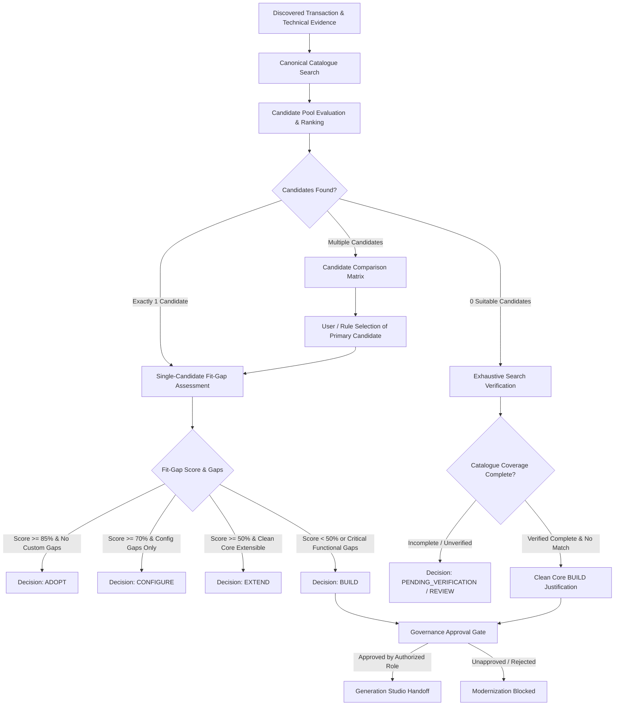

# Fiorify — CANONICAL MATCHING QUALITY & FIT-GAP AUDIT
**Document ID:** AUDIT-MATCH-2026-001  
**Status:** COMPLETE  
**Date:** 2026-11-08  
**Scope:** Matching Consolidation, 6-Dimension Scoring, Fit-Gap Engine, Governed Recommendations, Explainability  

---

## 1. Executive Summary

This audit assesses the candidate matching, scoring, and recommendation systems across the Fiorify platform. It addresses the existence of multiple legacy engines (`matchingEngine.js`, `catalogueAdapter.js`, frontend `evidenceEngine.ts`, and synthetic fixtures) and validates the transition to the unified, deterministic **`fioriMatchingEngine.js`** as the single authoritative backend engine.

---

## 2. Consolidation of Matching Engines

Prior to this audit, matching logic was fragmented across six different files:
1. `backend/src/matchingEngine.js` (Sprint 1 legacy, based on static CSV `tcode_app_mappings.csv`).
2. `backend/src/engine/fioriMatchingEngine.js` (Sprint 7.2 comprehensive 6-dimension engine).
3. `backend/src/adapters/catalogueAdapter.js` (In-memory CSV reader).
4. `frontend/src/features/transaction-checker/engine/matchingEngine.ts` (Client-side mirror of Sprint 1).
5. `frontend/src/features/assessment-results/services/evidenceEngine.ts` (Client-side recommendation generator).
6. `frontend/src/services/catalogue/catalogueAdapter.ts` (Client-side in-memory 32-app baseline).

### Consolidation Directive
- **Single Authority:** `backend/src/engine/fioriMatchingEngine.js` is the sole engine for candidate retrieval, ranking, and explainability.
- **Client Role:** Frontend engines and synthetic mappings are deprecated in favor of rendering server-evaluated contracts.
- **Canonical API Contract:** All discovery and matching requests flow through `POST /api/v1/discovery/match`.

---

## 3. 6-Dimension Deterministic Scoring Model

The canonical `fioriMatchingEngine.js` evaluates every candidate across 6 weighted dimensions:

$$\text{Total Score} = \sum_{i=1}^{5} (W_i \times S_i)$$

Where weights are normalized:
- **Dimension 1: Transaction Code Relationship ($W_1 = 30\%$)**
  - Exact match: 100%
  - Explicit successor: 90%
  - Corroborated classic WebGUI tile: 75%
  - Functional alternative: 60%
  - Related application: 40%
- **Dimension 2: Functional Fit ($W_2 = 25\%$)**
  - Evaluates business process keyword intersection, capability overlap, and expected operation coverage.
- **Dimension 3: Technical Fit ($W_3 = 25\%$)**
  - Evaluates required OData backend services against active Gateway services on the target system.
  - UI5 component ID presence and architectural tier.
- **Dimension 4: Business Context ($W_4 = 10\%$)**
  - Line of Business (e.g. Finance, Sourcing & Procurement) and Business Role alignment (`SAP_BR_*`).
- **Dimension 5: Release Compatibility ($W_5 = 10\%$)**
  - S/4HANA product release compatibility (`SAP S/4HANA 2023`, `2022`, `Cloud`).
- **Dimension 6: Evidence Completeness & Quality Guardrails**
  - Match Score is strictly distinguished from **Evidence Confidence** (`HIGH`, `MEDIUM`, `LOW`, `UNKNOWN`).
  - **Governance Guardrail:** A candidate with high semantic similarity but zero technical evidence or functional mismatch is prevented from receiving a `VERIFIED_MATCH` rating.

---

## 4. Mapping Classifications & Determinism

Every match evaluation outputs one of the canonical classifications:
- `DIRECT_EQUIVALENT`: Native Fiori replacement with identical scope.
- `EXPLICIT_SUCCESSOR`: Documented SAP successor application (e.g., `F1612` / `F0773` for `F-53`).
- `FUNCTIONAL_ALTERNATIVE`: Modern Fiori app covering the core business function with enhanced workflow.
- `PARTIAL_FIT`: Covers a subset of required operations; requires extension or complementary apps.
- `RELATED_APPLICATION`: Same business domain but different primary business object.
- `WEBGUI_BRIDGE`: SAP GUI for HTML classic tile (interim bridge; not native Fiori elements).
- `UNVERIFIED_MAPPING`: Candidate identified by name similarity but lacking DDIC or Gateway verification.

---

## 5. Fit-Gap & Governed Decision Flow

---

## 6. Reproducibility & Audit Trail
Every assessment output generated by the engine includes:
- Rule version: `MATCH_RULES_V2_2026`.
- Catalogue snapshot version (e.g., `FAL_2023_FPS02_BASELINE_V1`).
- Target system profile (`systemId`, `client`, `release`, `deploymentEdition`).
- Full scoring breakdown per dimension.
- Explicit explainability notes detailing reasons, gaps, conflicts, and verification requirements.
Given identical input parameters, the matching results are 100% deterministic and reproducible.
