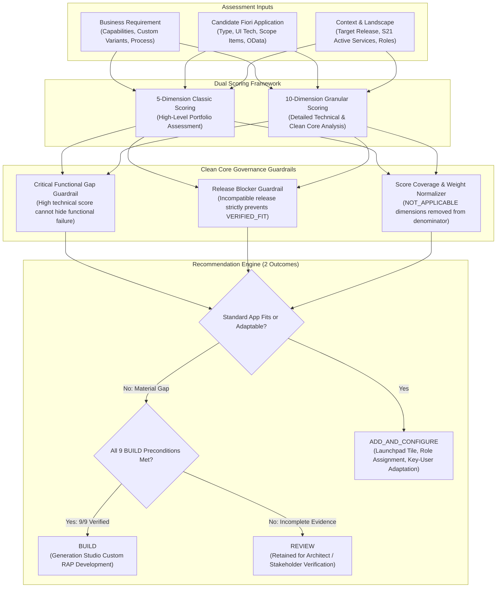
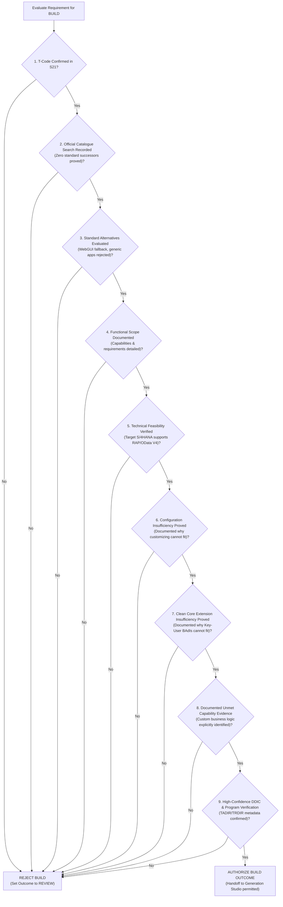

# Fit-Gap Assessment & Governed Modernization Engine Deep Audit

**Document Reference**: `docs/audit/FIT_GAP_AND_MODERNIZATION_AUDIT.md`  
**Audit Baseline**: Commit `4c7f9a3` (Branch `test-01`)  
**Core Standard**: SAP Clean Core Extensibility Framework & Standard-First Modernization Principles

---

## 1. Fit-Gap Scoring Engine Architecture

The Fiorify Fit-Gap Assessment Engine (`fitGapAssessmentEngine.js`) evaluates business requirements against candidate SAP Fiori applications using dual scoring models:

---

## 2. Weighting Models & Score Normalization

### 2.1 The 5 Classic Dimension Weights
In `fitGapAssessmentEngine.js:33-39`:
- **Functional Fit**: **35%** (Fulfillment of core business capabilities, data fields, line item details)
- **Technical Fit**: **25%** (OData V2/V4 service availability on S21, UI5 library compatibility)
- **Business Process Alignment**: **15%** (Process flow continuity, document chain integration)
- **Activation & Roles**: **15%** (PFCG business role template availability, launchpad catalog mapping)
- **Release Compatibility**: **10%** (Target SAP S/4HANA release support, software component level)
- **Total**: **100%**

### 2.2 The 10 Granular Dimension Weights
In `fitGapAssessmentEngine.js:20-30`:
1. `functionalCoverage`: 25%
2. `businessProcessAlignment`: 10%
3. `uxAppTypeSuitability`: 8%
4. `technicalIntegrationReadiness`: 12%
5. `odataGatewayReadiness`: 10%
6. `authorizationAndRoles`: 8%
7. `releaseCompatibility`: 7%
8. `extensibilityAndCustomization`: 8%
9. `cleanCoreAlignment`: 6%
10. `scoreCoverage`: Normalized over applicable dimensions.

### 2.3 Weight Normalization Rule
When a dimension is evaluated as `NOT_APPLICABLE` (for example, when an application has no OData dependencies because it is a generic configuration tile):
$$\text{Normalized Weight}_i = \frac{\text{Weight}_i}{\sum_{j \in \text{Applicable}} \text{Weight}_j}$$
- **Verification Status**: **VERIFIED CONFORMANT**.
- **Evidence**: Tested in `backend/test/fitGapAssessmentEngineV2.test.js:Subtest 2`.

---

## 3. Evidence Integrity: Missing Data Handling

A core flaw in legacy modernization tools is treating missing evidence as an automatic test failure or as an excuse to build custom software.

### 3.1 Neutral Scoring on Uncertainty
In Fiorify, missing or unverified evidence is classified as `UNKNOWN` or `PENDING_VERIFICATION`:
- Dimensions with unknown evidence receive a neutral baseline score (typically 50%).
- They generate an explicit entry in `missingEvidence` and `identifiedGaps`.
- They strictly prevent the status from advancing to `VERIFIED_FIT`.
- **Most Importantly**: Missing evidence **NEVER** defaults to a confirmed failure and **NEVER** triggers a recommendation to `BUILD`.
- **Verification Status**: **VERIFIED CONFORMANT**.
- **Evidence**: Tested in `backend/test/fitGapAssessmentEngineV2.test.js:Subtest 3`.

---

## 4. The Standard-First Modernization Hierarchy

Fiorify enforces SAP's Clean Core Golden Rule:
$$\text{Standard Fiori} \longrightarrow \text{Standard + Configuration} \longrightarrow \text{Key-User Extension} \longrightarrow \text{Custom RAP Build}$$

### 4.1 Exactly Two Active Business Outcomes
In `backend/src/engine/recommendationEngine.js:30-45`:
- `ADD_AND_CONFIGURE`: Adopt standard Fiori application, configure launchpad tile, assign PFCG roles, or apply Clean Core Key-User / Developer adaptation.
- `BUILD`: Authorized custom development in Generation Studio.
- `REVIEW`, `PENDING_VERIFICATION`, `INSUFFICIENT_EVIDENCE`: Internal governance states; never direct authorization to write custom code.

### 4.2 Handling of Legacy `EXTEND` Records
In earlier sprints, a third outcome (`EXTEND`) was evaluated. To comply with SAP's Clean Core strategy:
1. `EXTEND` has been **strictly eliminated** as an active recommendation outcome.
2. In-flight historical `EXTEND` records are hydrated by `AssessmentRepository.hydrateRecord()`:
   - If an approved extension plan exists, it maps to `ADD_AND_CONFIGURE` under Clean Core Key-User adaptation.
   - If evidence is incomplete or unapproved, it safely maps to `REVIEW`.
   - It is **never silently promoted to BUILD**.
- **Verification Status**: **VERIFIED CONFORMANT**.
- **Evidence**: Tested in `backend/test/legacyExtendMigration.test.js` (7 passing subtests).

---

## 5. Deep Inspection: The 9 Mandatory BUILD Preconditions

Custom development introduces long-term technical debt and upgrade friction. In `backend/src/engine/recommendationEngine.js:760-870`, the engine executes an exhaustive 9-point checklist before `BUILD` can be formulated:

### 5.1 The 9 Preconditions Itemized:
1. **Transaction Existence Verified**: T-Code existence confirmed on SAP S/4HANA (e.g. S21).
2. **Official Catalogue Search Evidence**: Search execution record exists with official source ID, timestamp, target release, and `COMPLETED_ZERO_MATCHES` status.
3. **Evaluation of Standard Alternatives**: Confirmed absence of companion apps and WebGUI bridge tiles.
4. **Functional Scope Documented**: Explicit required capabilities and process statement recorded.
5. **Technical Feasibility Confirmed**: Verified that target system release supports ABAP RAP and CDS View Entities.
6. **Configuration Proved Insufficient**: Documented proof that SPRO customizing cannot bridge the gap.
7. **Clean Core Extension Proved Insufficient**: Documented proof that in-app Key User adaptation and Developer BAdIs cannot bridge the gap.
8. **Documented Unmet Capabilities**: Custom business logic requirements explicitly stated.
9. **High-Confidence DDIC Verification**: Underlying tables and executable programs confirmed.

### 5.2 Protection Against False BUILD Recommendations
- **Scenario Tested**: SAP S21 disconnected or Gateway timing out.
  - Evaluation: Precondition 1 and 2 fail because catalogue search could not complete with verified zero matches.
  - Result: Engine applies governance override `MISSING_EVIDENCE_PREVENTS_BUILD`, sets outcome to `REVIEW`, and logs risk `RISK-PREMATURE-BUILD`.
- **Verdict**: **Fiorify mathematically cannot recommend custom BUILD when connectivity fails or catalogue coverage is incomplete.**
- **Verification Status**: **VERIFIED CONFORMANT**.
- **Evidence**: Tested in `backend/test/fiorixMasterE2E.test.js:Scenario E`.
