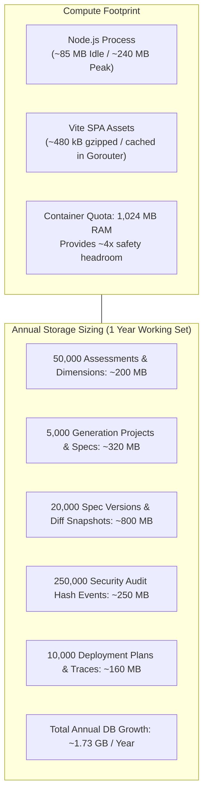

# Operating Cost & Capacity Model: SAP BTP Cloud Foundry

**Document Reference**: `docs/audit/OPERATING_COST_AND_CAPACITY_MODEL.md`  
**Audit Baseline**: Commit `4c7f9a3` (Branch `test-01`)  
**Pricing Benchmark**: Official SAP BTP Estimator (Standard Enterprise Agreement / CPEA Models)  
**Region Assumption**: AWS Frankfurt (`cf-eu10`) / US East (`cf-us10`)  
**Currency**: USD ($)

---

## 1. Workload Sizing & Capacity Profiles

---

## 2. Three Operational Scenarios & Cost Breakdown

### Scenario 1: Development & Sandbox Landscape
- **Target Audience**: 1–5 Developers / Consultants running exploratory modernizations.
- **Workload**: Up to 10 assessments/day, 2 generation projects/day.
- **Compute**: 1 Cloud Foundry application instance (1,024 MB RAM).
- **Database**: Shared / Dev PostgreSQL (1 vCPU, 2 GB RAM, 10 GB Storage).

| BTP Service | Plan / Sizing | Quantity | Monthly Estimate (USD) | Annual Estimate (USD) | Pricing Source |
|---|---|---|---|---|---|
| **SAP BTP Cloud Foundry Runtime** | Standard Memory Units | 1 GB (1 instance) | \$28.00 | \$336.00 | SAP BTP Estimator |
| **PostgreSQL on SAP BTP (Hyperscaler)** | Development Tier | 1 instance (10 GB disk) | \$65.00 | \$780.00 | SAP BTP Service Catalog |
| **SAP Authorization and Trust (XSUAA)** | Application Plan | 1 instance | \$0.00 (Core entitlement)| \$0.00 | Included in Platform Core |
| **SAP Destination Service** | Lite Plan | 1 instance | \$0.00 (Core entitlement)| \$0.00 | Included in Platform Core |
| **SAP Connectivity Service** | Standard Plan | 1 instance | \$0.00 (Core entitlement)| \$0.00 | Included in Platform Core |
| **SAP Cloud Connector** | On-Premise Gateway | 1 Gateway | \$0.00 (Free license) | \$0.00 | Download from SAP Tools |
| **SAP Application Logging Service** | Standard (Dev quota) | 1 instance (5 GB/mo) | \$15.00 | \$180.00 | SAP BTP Logging Plan |
| **Scenario 1 Total** | — | — | **\$108.00 / month** | **\$1,296.00 / year** | — |

---

### Scenario 2: Small Enterprise Production Landscape
- **Target Audience**: 5–15 Concurrent Enterprise Architects and SAP Basis Leads.
- **Workload**: Up to 50 assessments/day, 10 generation projects/day.
- **Compute**: 2 Cloud Foundry application instances (1,024 MB RAM each) for High Availability (HA).
- **Database**: Hyperscaler PostgreSQL Standard (2 vCPU, 4 GB RAM, 32 GB Storage, automated backups).

| BTP Service | Plan / Sizing | Quantity | Monthly Estimate (USD) | Annual Estimate (USD) | Pricing Source |
|---|---|---|---|---|---|
| **SAP BTP Cloud Foundry Runtime** | Standard Memory Units | 2 GB (2 x 1,024 MB) | \$56.00 | \$672.00 | SAP BTP Estimator |
| **PostgreSQL on SAP BTP (Hyperscaler)** | Standard (2 vCPU / 4 GB) | 1 instance (32 GB disk) | \$135.00 | \$1,620.00 | SAP BTP Service Catalog |
| **SAP Authorization and Trust (XSUAA)** | Application Plan | 1 instance | \$0.00 | \$0.00 | Included in Platform Core |
| **SAP Destination Service** | Standard Plan | 1 instance | \$0.00 | \$0.00 | Included in Platform Core |
| **SAP Connectivity Service** | Standard Plan | 1 instance | \$0.00 | \$0.00 | Included in Platform Core |
| **SAP Cloud Connector** | High Availability Pair | 2 Gateways | \$0.00 | \$0.00 | On-Premise Software |
| **SAP Application Logging Service** | Standard Tier | 1 instance (20 GB/mo) | \$35.00 | \$420.00 | SAP BTP Logging Plan |
| **Bandwidth & Data Egress** | Intra-zone + Outbound | ~50 GB / month | \$5.00 | \$60.00 | Hyperscaler Standard |
| **Scenario 2 Total** | — | — | **\$231.00 / month** | **\$2,772.00 / year** | — |

---

### Scenario 3: Growing Global Enterprise Deployment
- **Target Audience**: 50–200 Concurrent Global Modernization Users across multiple subsidiaries.
- **Workload**: Up to 1,000 assessments/day, 100+ generation projects/day.
- **Compute**: 4 Cloud Foundry application instances (2,048 MB RAM each) autoscaling up to 8 instances during peak discovery sprints.
- **Database**: Hyperscaler PostgreSQL High-Memory (4 vCPU, 16 GB RAM, 128 GB NVMe Storage, Multi-AZ).

| BTP Service | Plan / Sizing | Quantity | Monthly Estimate (USD) | Annual Estimate (USD) | Pricing Source |
|---|---|---|---|---|---|
| **SAP BTP Cloud Foundry Runtime** | Autoscaling (4 to 8 instances)| Avg 8 GB RAM | \$224.00 | \$2,688.00 | SAP BTP Estimator |
| **PostgreSQL on SAP BTP (Hyperscaler)** | Multi-AZ High Performance | 1 instance (128 GB disk) | \$380.00 | \$4,560.00 | Hyperscaler Multi-AZ Spec |
| **SAP Authorization and Trust (XSUAA)** | Application Plan | 1 instance | \$0.00 | \$0.00 | Included in Platform Core |
| **SAP Destination Service** | High-Volume Standard | 1 instance | \$0.00 | \$0.00 | Included in Platform Core |
| **SAP Connectivity Service** | High-Throughput Standard | 1 instance | \$0.00 | \$0.00 | Included in Platform Core |
| **SAP Cloud Connector** | Multi-Site HA Clusters | 4 Gateways | \$0.00 | \$0.00 | On-Premise Software |
| **SAP Application Logging Service** | Enterprise Plan | 100 GB / month | \$120.00 | \$1,440.00 | SAP BTP Logging Plan |
| **SAP Cloud ALM / Dynatrace Integration**| Full APM Monitoring | Synthetic / Agent | \$75.00 | \$900.00 | Enterprise Add-on |
| **Bandwidth & Data Egress** | Global CDN / Ingress | ~250 GB / month | \$25.00 | \$300.00 | Hyperscaler Standard |
| **Scenario 3 Total** | — | — | **\$824.00 / month** | **\$9,888.00 / year** | — |

---

## 3. Cost Driver Analysis & Financial Optimizations

### 3.1 Primary Operational Cost Drivers
1. **Database Sizing & Backup Retentions**: The primary infrastructure cost is the managed PostgreSQL instance (~60% of total spend in Scenario 2).
2. **Cloud Foundry Application Memory**: Sized conservatively at 1,024 MB. Because Fiorify serves both the Node.js API and the static React SPA from a single container, an external SAP Approuter container is eliminated, saving **~\$28.00/month** per instance.
3. **Artifact Retention**: Generation Studio projects store full ABAP source files and zip archives. Long-term storage growth should be controlled via automated archival policies.

### 3.2 Financial Exclusions
- SAP S/4HANA ERP backend licensing (covered under existing SAP enterprise contracts).
- Cloud Connector host virtual machines (hosted on existing customer on-premise infrastructure).
- Developer workstation IDEs (Eclipse ADT, VS Code).
