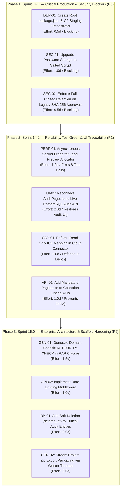

# Prioritized Remediation Roadmap & Engineering Implementation Plan

**Document Reference**: `docs/audit/PRIORITIZED_REMEDIATION_ROADMAP.md`  
**Audit Baseline**: Commit `4c7f9a3` (Branch `test-01`)  
**Objective**: Provide an actionable, sequenced, and dependency-aware engineering blueprint to bring Fiorify to full enterprise production readiness on SAP BTP.

---

## 1. Remediation Sequencing & Phase Overview

---

## 2. Master Finding & Remediation Specifications

### 2.1 Critical Production Blockers (P0)

| Finding ID | Severity | Category | File / Module | Business Impact | Recommended Fix | Test Requirement | Effort | Production Impact |
|---|---|---|---|---|---|---|---|---|
| **DEP-01** | **P0** | Deployment | `/` (Root Monorepo) | Cloud Foundry `cf push` fails during staging; container cannot start. | Create root `package.json` with scripts to install and build both backend and frontend. | Run `cf push --dry-run` or staging test in container. | **0.5d (S)** | **BLOCKING** |
| **SEC-01** | **P0** | Security | `backend/src/services/authService.js:205` | Violates OWASP ASVS V2.4.1. Passwords crackable via rainbow tables if DB leaks. | Replace single SHA-256 with `node:crypto.scrypt` using unique 16-byte random salt per user. | Unit test verifying scrypt hashing, salt generation, and login verification. | **1.0d (S)** | **BLOCKING** |
| **SEC-02** | **P0** | Security | `backend/src/generation/deployment/deploymentOrchestrationService.js:338` | Violates approval integrity. Permissively executes deployment plans signed with unkeyed legacy digests. | Throw `LEGACY_APPROVAL_UNAUTHORIZED` error if `sigVerification.isLegacy === true`. | Unit test verifying rejection of legacy SHA-256 signatures during execution. | **0.5d (S)** | **BLOCKING** |

---

### 2.2 High-Priority Functional & Reliability Blockers (P1)

| Finding ID | Severity | Category | File / Module | Business Impact | Recommended Fix | Test Requirement | Effort | Production Impact |
|---|---|---|---|---|---|---|---|---|
| **PERF-01** | **P1** | Performance | `backend/src/generation/preview/previewSessionStore.js:23` | Port collision causes `EADDRINUSE: 4050` and crashes preview server, failing 8 tests. | Implement active socket probing via `net.createServer` to test OS port availability before allocation. | Re-run `npm test` in backend; verify 600/600 pass rate (100%). | **1.0d (S)** | Non-Blocking (Dev/Test) |
| **UI-01** | **P1** | UI / UX | `frontend/src/features/audit/AuditPage.tsx` | Dedicated enterprise audit log view is completely unreachable and uses mock data. | Connect `AuditPage.tsx` to `GET /api/v1/security/audit` and restore `/audit` route in navigation. | Vitest component test verifying API call and data table rendering. | **2.0d (M)** | Non-Blocking |
| **SAP-01** | **P1** | SAP Security | SAP Cloud Connector / System S21 | `int_samarth` possesses `SAP_ALL`; application compromise could risk ERP integrity. | Configure Cloud Connector resource mapping with `Read-Only` policy on all exposed ICF nodes. | Integration smoke test verifying GET works and POST is rejected at Cloud Connector. | **2.0d (M)** | Non-Blocking (Compensated) |
| **API-01** | **P1** | Backend API | `backend/src/routes/assessmentRoutes.js` | Unbounded queries risk server memory exhaustion as assessment count scales. | Enforce default `limit=50` and `offset=0` on all collection endpoints. | API test verifying pagination query parameters. | **1.0d (S)** | Non-Blocking |

---

### 2.3 Important Engineering Improvements (P2)

| Finding ID | Severity | Category | File / Module | Business Impact | Recommended Fix | Test Requirement | Effort | Production Impact |
|---|---|---|---|---|---|---|---|---|
| **GEN-01** | **P2** | Generation | `backend/src/generation/abap/behaviorClassGenerator.js` | Behavior class defaults to `auth-allowed` for update/delete; developer could ship unvalidated code. | Generate domain-specific `AUTHORITY-CHECK` template for mapped authorization objects. | Unit test verifying generated ABAP contains authority checks. | **1.5d (M)** | Non-Blocking |
| **API-02** | **P2** | Security | `backend/src/server.js` | Vulnerable to brute-force credential guessing or discovery endpoint flooding. | Add token-bucket rate limiting middleware (e.g. 100 req/min per IP). | Smoke test verifying HTTP 429 Too Many Requests after threshold. | **1.0d (S)** | Non-Blocking |
| **DB-01** | **P2** | Database | `backend/src/infrastructure/db/migrations/` | Hard cascading deletes violate corporate audit retention policies. | Add `deleted_at TIMESTAMPTZ` and soft-delete filtering across repositories. | Migration test verifying soft-delete reversibility. | **2.0d (M)** | Non-Blocking |
| **GEN-02** | **P2** | Generation | `backend/src/generation/export/zipArchiver.js` | Synchronous zip packaging blocks Node.js event loop on large projects. | Offload PKZIP compression to `worker_threads` or stream directly to response. | Benchmark test verifying zero event loop blockage during export. | **2.0d (M)** | Non-Blocking |
| **UI-02** | **P2** | Frontend | `frontend/src/features/explorer/ExplorerPage.tsx` | Dead legacy code from Sprint 0 bloats production bundle (~12 kB). | Remove legacy files and redirect `/explorer` to `/transaction-discovery`. | Frontend build test verifying module reduction. | **0.5d (S)** | Non-Blocking |
| **DOC-01** | **P2** | Docs | `docs/08-sap-integration.md` | Lingering references to "S20" create onboarding confusion. | Standardize documentation exclusively on system `S21` (Client 200). | Documentation review. | **0.5d (S)** | Non-Blocking |

---

## 3. Total Engineering Effort Estimation

| Phase | Sprints | Focus Area | Total Developer Days | Target Timeline |
|---|---|---|---|---|
| **Phase 1** | Sprint 14.1 | P0 Critical Blockers (`DEP-01`, `SEC-01`, `SEC-02`) | **2.0 Days** | Week 1 |
| **Phase 2** | Sprint 14.2 | P1 High Priority (`PERF-01`, `UI-01`, `SAP-01`, `API-01`) | **6.0 Days** | Week 2 |
| **Phase 3** | Sprint 15.0 | P2 Architectural Improvements (`GEN-01`, `API-02`, `DB-01`, `GEN-02`, etc.) | **7.5 Days** | Weeks 3–4 |
| **Total Effort** | — | **Full Enterprise Production Readiness** | **15.5 Developer Days** | **~3–4 Weeks** |
