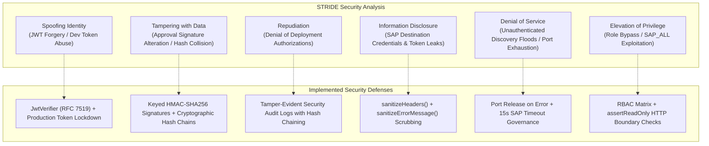

# Security Threat Model & OWASP ASVS 5.0 Audit

**Document Reference**: `docs/audit/SECURITY_THREAT_MODEL.md`  
**Audit Baseline**: Commit `4c7f9a3` (Branch `test-01`)  
**Security Frameworks**: OWASP ASVS 5.0 (Level 2), OWASP Top 10 (2021), STRIDE Threat Model, CERT-In Guidelines, NIST SP 800-63B

---

## 1. STRIDE Threat Analysis Matrix



| STRIDE Category | Threat Description | Attack Vector | Fiorify Control Status | Residual Risk / Gap |
|---|---|---|---|---|
| **Spoofing** | Attacker impersonates an Administrator or Lead Architect. | Replaying dev tokens (`fiorify_dev_token_admin`) or forging unsigned JWTs. | **MITIGATED IN PROD**: Dev tokens strictly blocked when `NODE_ENV=production`. RFC 7519 JWT verification enforced. | **SEC-01**: Password hashing uses un-salted SHA-256; database compromise would expose credentials. |
| **Tampering** | Attacker alters generated ABAP code or deployment plan after approval. | Modifying `.asddls` or `.bdef` files in storage before transport packaging. | **MITIGATED**: Deployment plan binds SHA-256 artifact manifest hash; mismatch triggers `DEPLOYMENT_SIGNATURE_INVALID`. | **SEC-02**: Permissive execution allows legacy unauthenticated SHA-256 digests to execute with only a warning log. |
| **Repudiation** | Architect denies authorizing a custom BUILD outcome. | Claiming approval was fabricated or executed by system automation. | **MITIGATED**: Keyed HMAC-SHA256 signature binds plan hash, artifact hash, approver ID, and timestamp into immutable record. | Key rotation required periodically via `FIORIFY_SIGNING_KEYS_JSON`. |
| **Information Disclosure**| SAP system password or BTP destination token leaked to client or logs. | Inspecting network payloads, error logs, or client-side JavaScript bundles. | **VERIFIED HARDENED**: `sanitizeHeaders()` strips Authorization headers; `sanitizeErrorMessage()` scrubs URLs; credentials never sent to browser. | None identified. |
| **Denial of Service** | Exhaustion of Node.js event loop or local preview ports. | Spawning dozens of preview servers or sending complex recursive T-Code queries. | **PARTIALLY MITIGATED**: Ports allocated in 4050–4099; sessions timeout after 30 min. | **PERF-01**: In-memory port allocator does not test OS socket binding, causing `EADDRINUSE`. |
| **Elevation of Privilege**| Non-admin executes SAP diagnostics or triggers live mutations. | Tampering with HTTP verbs (POST/PUT/DELETE) to mutate SAP S21 repository. | **VERIFIED HARDENED**: `SapHttpClient.assertReadOnly()` strictly blocks mutating verbs; RBAC checks enforced. | **RESIDUAL RISK**: Service user `int_samarth` possesses `SAP_ALL` in ERP backend. |

---

## 2. In-Depth Vulnerability Analysis

### 2.1 Critical Vulnerability SEC-01: In-Memory Un-Salted SHA-256 Password Hashing
- **Severity**: **P0 — Critical Production Security Blocker**
- **Location**: `backend/src/services/authService.js:205-207`
- **Code Evidence**:
  ```javascript
  export function hashPassword(password) {
    return crypto.createHash('sha256').update(String(password).trim()).digest('hex');
  }
  ```
- **Standard Violated**:
  - **OWASP ASVS 5.0 V2.4.1**: "Verify that passwords are stored using an approved salted, adaptive credential hash algorithm (Argon2id, PBKDF2, or bcrypt)."
  - **NIST SP 800-63B Section 5.1.1.2**: Prohibits un-salted single-iteration cryptographic hash functions.
- **Root Cause**: Quick prototype password hashing was never upgraded to an enterprise adaptive hashing algorithm.
- **Business Impact**: If user accounts are dumped via SQL injection or unauthorized database access, all passwords can be recovered instantly via standard rainbow tables.
- **Remediation**: Replace `crypto.createHash('sha256')` with `node:crypto.scrypt` (or `argon2id` / `bcrypt`) using a unique 16-byte cryptographically secure salt per user and work factor >= 16,384.

---

### 2.2 Governance Vulnerability SEC-02: Permissive Execution on Legacy SHA-256 Approval Digests
- **Severity**: **P0 — Critical Governance & Integrity Blocker**
- **Location**: `backend/src/generation/deployment/deploymentOrchestrationService.js:338-356`
- **Code Evidence**:
  ```javascript
  if (!sigVerification.valid) {
    throw new Error(`Deployment plan "${planId}" cannot be executed: Cryptographic approval signature verification failed...`);
  }

  // Permissive execution on legacy unauthenticated digest:
  {
    timestamp: new Date().toISOString(),
    level: sigVerification.isLegacy ? 'WARN' : 'INFO',
    message: sigVerification.isLegacy
      ? `Cryptographic approval verified with legacy unauthenticated digest (${sigVerification.signatureType}). Re-approval with HMAC-SHA256 recommended.`
      : `Cryptographic approval verified...`
  }
  ```
- **Standard Violated**:
  - **OWASP ASVS 5.0 V8.3.1**: "Verify that sensitive transactions or administrative approvals are protected by authenticated digital signatures or message authentication codes (MACs)."
  - **Master Audit Directive**: "Unauthenticated legacy SHA-256 digests may be retained for historical auditability, but must never authorize new deployments or sensitive actions."
- **Root Cause**: Backward-compatibility logic treats `isLegacy: true` as a valid signature for execution, merely logging a `WARN`.
- **Business Impact**: An attacker who can write to `deployment_approvals` could fabricate an unkeyed SHA-256 hash of the plan, bypassing the requirement for the Chief Architect's private HMAC secret.
- **Remediation**: In `deploymentOrchestrationService.js`, strictly reject execution if `sigVerification.isLegacy === true`:
  ```javascript
  if (sigVerification.isLegacy) {
    const err = new Error(
      `Deployment plan "${planId}" cannot be executed: Legacy unauthenticated SHA-256 approvals are restricted to historical audit and cannot authorize active deployments. Re-approval with HMAC-SHA256 is mandatory.`
    );
    err.code = 'LEGACY_APPROVAL_UNAUTHORIZED';
    throw err;
  }
  ```

---

## 3. OWASP ASVS 5.0 Verification Summary

| ASVS Category | Requirement Summary | Fiorify Implementation Status | Verification Evidence |
|---|---|---|---|
| **V1: Architecture** | Standard-First Clean Core architecture; separation of concerns. | **COMPLIANT** | Multi-tier architecture, strict read-only boundary. |
| **V2: Authentication** | Secure password hashing, MFA readiness, token revocation. | **NON-COMPLIANT (P0)** | **SEC-01**: Un-salted SHA-256 violates V2.4.1. |
| **V3: Session Management**| Stateless JWTs, expiration validation, secure headers. | **COMPLIANT** | `JwtVerifier.js` validates `exp`, `nbf`, `iss`, `aud`. |
| **V4: Access Control** | Server-authoritative RBAC; separation of duties. | **COMPLIANT** | Self-approval blocked; architect approval enforced. |
| **V5: Validation & Encoding**| Whitelist regex, canonicalization, traversal defense. | **COMPLIANT** | `SapHttpClient.js` canonicalizes paths, rejects null bytes. |
| **V8: Cryptography** | Keyed HMAC, timing-safe equality, key rotation. | **PARTIALLY COMPLIANT (P0)** | **SEC-02**: Permissive legacy SHA-256 execution. |
| **V10: Malicious Code** | Halts at write boundary; no dynamic eval. | **COMPLIANT** | Deployment halts at SAP boundary; zero mutations. |
| **V13: API & Web Services**| Structured JSON errors, correlation tracking. | **COMPLIANT** | `x-correlation-id` tracked through all requests. |
