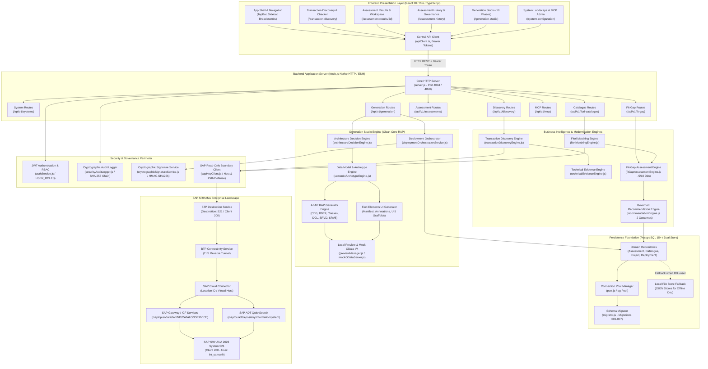
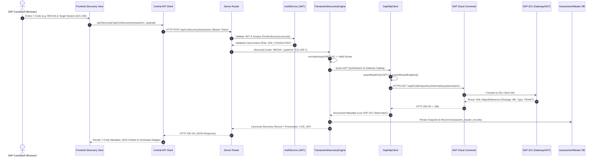
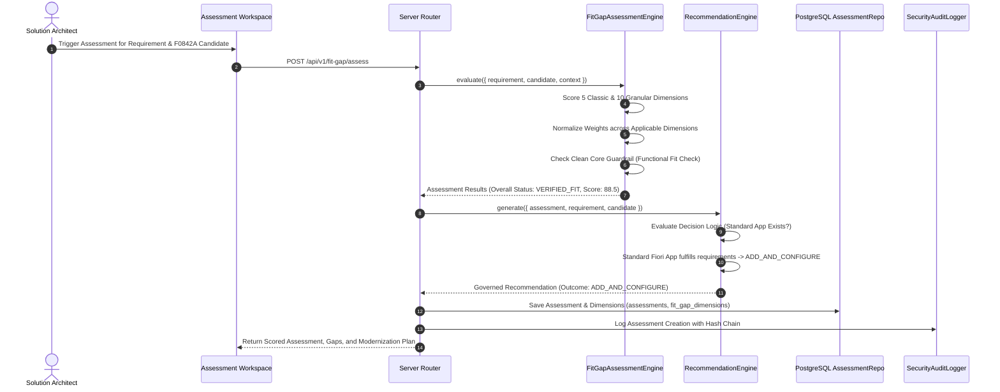
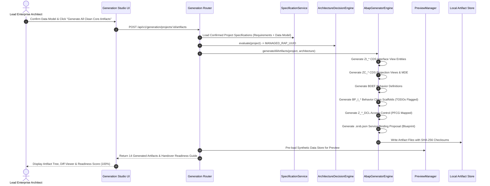

# System Architecture Map: Fiorify Platform

**Document Reference**: `docs/audit/SYSTEM_ARCHITECTURE_MAP.md`  
**Audit Baseline**: Commit `4c7f9a3` (Branch `test-01`)  
**Architecture Classification**: Enterprise Hybrid SaaS / SAP BTP Side-by-Side Modernization Platform

---

## 1. End-to-End System Architecture Diagram

---

## 2. Component Topology & Tier Specifications

### 2.1 Tier 1: Client Presentation Tier (Frontend)
- **Framework**: React 18.3.1 with TypeScript 5.5.
- **Build Tool**: Vite 5.4.21 with `@vitejs/plugin-react`.
- **Styling**: Vanilla CSS with strict CSS custom properties following SAP Fiori design language (Horizon theme: `#0070F2`, `#1D2D3E`, `#F5F6F7`, SAP 72 typography).
- **Icons**: `lucide-react` (enterprise-clean stroke icons).
- **Routing**: `react-router-dom` 6.22 with route-level code splitting (`React.lazy` and `React.Suspense`).
- **State Management**: Local component state, custom hooks, and centralized service adapters. No heavy Redux or MobX dependencies.
- **Production Asset Size**: 2,067 modules transformed into ~480 kB gzipped JavaScript bundle.

### 2.2 Tier 2: Security & Governance Boundary
- **Authentication**: Stateless RFC 7519 JSON Web Tokens (HS256/RS256) via `JwtVerifier.js`, evaluated in `server.js` middleware.
- **Role-Based Access Control (RBAC)**: Central authorization matrix in `authService.js` enforcing 6 roles (`ADMIN`, `LEAD_ARCHITECT`, `SAP_CONSULTANT`, `REQUESTER`, `APPROVER`, `VIEWER`) and 17 granular permissions.
- **Cryptographic Signature Engine**: Keyed HMAC-SHA256 (`cryptographicSignatureService.js`) enforcing immutable signatures over deployment plans and architectural approvals. Supports key rotation via `sig:<version>:<digest>` prefixes.
- **SAP Read-Only Boundary**: `SapHttpClient.js` strictly asserts `assertReadOnly` (throwing 403/AUTHORIZATION_BLOCKED on `POST`, `PUT`, `PATCH`, `DELETE`) and enforces strict path canonicalization against SSRF and directory traversal.
- **Security Audit Trail**: Append-only tamper-evident audit logger (`securityAuditLogger.js`) calculating a cryptographic SHA-256 hash chain (`integrityHash = SHA256(prevHash + event)`).

### 2.3 Tier 3: Core Business & Modernization Engines
- **Transaction Discovery Engine (`transactionDiscoveryEngine.js`)**: Evaluates SAP transaction syntax, orchestrates live ADT quick search and Gateway Catalog probes, and assigns multi-source evidence confidence.
- **Technical Evidence Engine (`technicalEvidenceEngine.js`)**: Normalizes evidence into 5 canonical categories:
  1. Transaction Identity (TSTC / TSTCT)
  2. Program & Dynpro Metadata (TADIR / TRDIR)
  3. Database Dictionary & CDS Views (DDIC / DD02L / CDS)
  4. Gateway & OData Services (IWFND / ServiceCollection)
  5. Security & Authorizations (USOBX / USOBT / PFCG)
- **Fiori Application Matching Engine (`fioriMatchingEngine.js`)**: Indexes official SAP Fiori Apps Reference Library records, evaluates candidates across 6 dimensions, and calculates deterministic rankings.
- **Fit-Gap Assessment Engine (`fitGapAssessmentEngine.js`)**: Evaluates business requirements against candidates using 5-dimension classic weights (35% functional, 25% technical, 15% process, 15% activation/roles, 10% compatibility) or 10-dimension granular weights. Enforces clean core guardrails (technical score cannot hide functional failure).
- **Governed Recommendation Engine (`recommendationEngine.js`)**: Enforces exactly two active business outcomes: `ADD_AND_CONFIGURE` and `BUILD`. Verifies the 9-point precondition checklist before permitting custom development.

### 2.4 Tier 4: Generation Studio Subsystem
- **Architecture Decision Engine (`architectureDecisionEngine.js`)**: Determines target RAP profile (`MANAGED_RAP_UUID`, `MANAGED_RAP_EXTERNAL_KEY`, `UNMANAGED_RAP`) and deployment pattern.
- **Data Model Designer (`dataModelService.js` / `semanticArchetypeEngine.js`)**: Designs entities, fields, keys, data types, compositions, associations, and semantic annotations.
- **ABAP RAP Generator (`abapGeneratorEngine.js`)**: Synthesizes CDS Interface View Entities (`ZI_*`), CDS Projection Views (`ZC_*`), Behavior Definitions (`BDEF`), Service Definitions (`SRVD`), Service Binding Proposals (`.srvb.json`), Behavior Class Scaffolds (`BP_I_*`), and DCL Access Controls (`Z_*_DCL`).
- **Fiori Elements Generator (`fioriGeneratorEngine.js`)**: Generates UI5 project manifests (`manifest.json`), UI annotations (`annotations.xml`), and local webapp test harnesses.
- **Mock OData V4 Engine (`previewManager.js` / `mockODataServer.js`)**: In-memory HTTP server providing `$metadata`, service documents, synthetic entity collections, filtering, paging, and navigation with mandatory preview watermarking.
- **Deployment Orchestrator (`deploymentOrchestrationService.js`)**: Computes directed acyclic graph (DAG) execution plans, calculates SHA-256 artifact manifest digests, verifies Chief Architect HMAC signatures, and halts execution at the SAP write boundary.

### 2.5 Tier 5: Persistence Foundation (PostgreSQL)
- **Database Engine**: PostgreSQL 15+ hosted on Hyperscaler or SAP HANA Cloud PostgreSQL.
- **Connection Pool**: `pg.Pool` with SSL/TLS configuration, parameterized queries, and graceful shutdown.
- **Migration Framework**: Native checksum-validated sequential migrator (`migrator.js`) supporting reversible schema evolution (Migrations 001 through 007).
- **Dual-Store Architecture**: Repositories operate seamlessly against PostgreSQL when `FIORIFY_PERSISTENCE=postgres` or fall back to local JSON file stores for offline development.

### 2.6 Tier 6: External SAP S/4HANA Integration
- **Connectivity Model**: SAP BTP Connectivity Service and Destination Service communicating via SAP Cloud Connector over TLS reverse tunnel.
- **Target Landscape**: SAP S/4HANA 2023 On-Premise / Private Edition, System `S21`, Client `200`.
- **Target User**: `int_samarth` (retaining administrative `SAP_ALL` as a known external constraint; protected exclusively by Fiorify application-side read-only boundaries).

---

## 3. Request Lifecycle Traces

### 3.1 Trace A: SAP Transaction Discovery (`POST /api/v1/discovery/transaction`)

### 3.2 Trace B: Fit-Gap Assessment & Governed Recommendation (`POST /api/v1/fit-gap/assess`)

### 3.3 Trace C: Generation Studio & Scaffolding Execution (`POST /api/v1/generation/projects/:id/artifacts`)

---

## 4. Implementation vs Configured vs Planned Status

| Subsystem / Component | Implementation Status | Evidence / Repository Location | Operational State |
|---|---|---|---|
| **Vite / React Frontend** | **IMPLEMENTED** | `frontend/src/` (2,067 modules, 204 tests) | Fully functional in browser; connects to backend APIs. |
| **Node.js HTTP Server & Router** | **IMPLEMENTED** | `backend/src/server.js`, `backend/src/routes/` | Fully functional; native ESM HTTP routing. |
| **SAP Read-Only Boundary** | **IMPLEMENTED** | `backend/src/infrastructure/connectivity/sapHttpClient.js` | Fully enforced; blocks mutating HTTP methods. |
| **BTP Destination Resolution** | **IMPLEMENTED** | `backend/src/adapters/btpDestinationAdapter.js` | Implements VCAP_SERVICES & local fallback lookup. |
| **Fiori Catalogue Ingestion & Cache** | **IMPLEMENTED** | `backend/src/adapters/officialFioriCatalogueAdapter.js` | Ingests CSV/JSON; caches 15,000+ Fiori apps. |
| **Fit-Gap Scoring (5 & 10 Dim)** | **IMPLEMENTED** | `backend/src/engine/fitGapAssessmentEngine.js` | Fully tested; normalized weights & score coverage. |
| **Governed Recommendation Engine** | **IMPLEMENTED** | `backend/src/engine/recommendationEngine.js` | Enforces `ADD_AND_CONFIGURE` and `BUILD`; 9 preconditions. |
| **RAP CDS & BDEF Generator** | **IMPLEMENTED** | `backend/src/generation/abap/` | Generates Clean Core CDS, BDEF, SRVD, SRVB proposals. |
| **Local OData V4 Preview Engine** | **IMPLEMENTED** | `backend/src/generation/preview/` | Serves mock OData V4 with permanent watermarking. |
| **PostgreSQL Schema (001-007)** | **IMPLEMENTED** | `backend/src/infrastructure/db/migrations/` | 28 tables, fully reversible, connection pooled. |
| **HMAC-SHA256 Signatures** | **IMPLEMENTED** | `backend/src/infrastructure/security/cryptographicSignatureService.js` | Keyed HMAC with key versioning; timing-safe checks. |
| **Cloud Foundry Manifest** | **CONFIGURED** | `manifest.yml` | Configured with service bindings and quotas. |
| **XSUAA Security Descriptor** | **CONFIGURED** | `xs-security.json` | 3 scopes, 3 role templates, 3 role collections. |
| **Root Monorepo Buildpack Script** | **NOT IMPLEMENTED** | Root workspace | Missing root `package.json` for CF buildpack staging. |
| **Native SAP ADT Transport Writer** | **BLOCKED BY DESIGN**| Repository-wide constraint | Intentionally forbidden; Fiorify operates read-only. |
| **SAP Gateway Service Activator** | **BLOCKED BY DESIGN**| Repository-wide constraint | Intentionally forbidden; requires manual Basis activation. |
| **Enterprise KMS Cloud Key Ring** | **PLANNED** | `cryptographicSignatureService.js:24` | Abstract provider defined; AWS/GCP KMS planned. |
