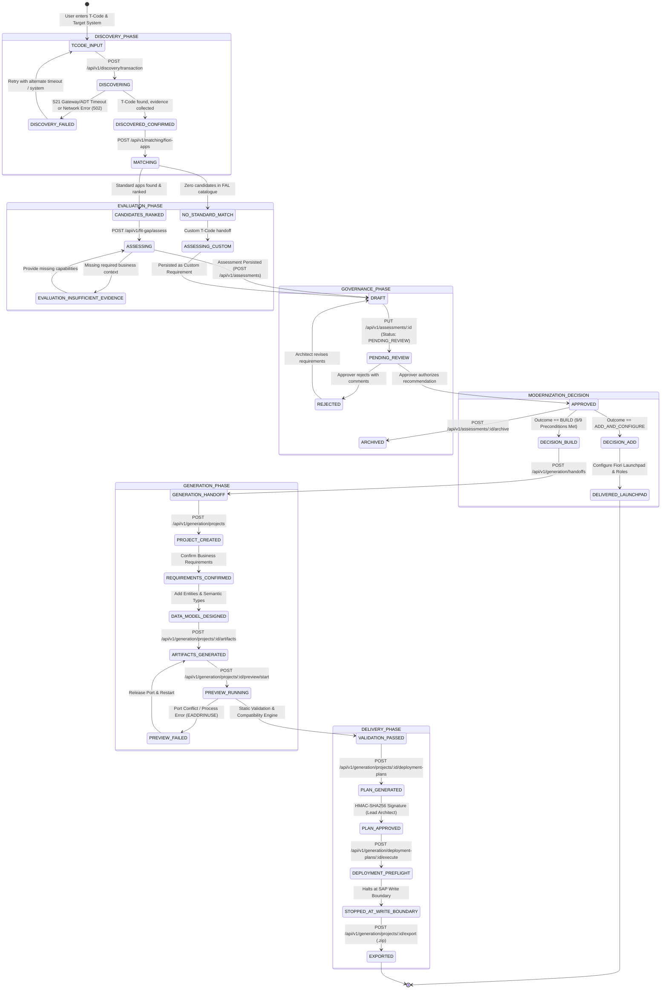

# End-to-End Workflow & State Machine Audit

**Document Reference**: `docs/audit/WORKFLOW_STATE_MACHINE_AUDIT.md`  
**Audit Baseline**: Commit `4c7f9a3` (Branch `test-01`)  
**Scope**: Complete state transitions across Discovery, Assessment, Governance, Generation, and Delivery.

---

## 1. Master Workflow State Transition Diagram

---

## 2. State Specification & Governance Rules

### 2.1 Discovery & Evaluation States

| State | Entry Condition | Required Data | Trigger / API | Database Changes | Success Transition | Failure Transition |
|---|---|---|---|---|---|---|
| `DISCOVERING` | Valid T-Code format | Normalized T-Code, System ID | `POST /api/v1/discovery/transaction` | None (In-flight) | `DISCOVERED_CONFIRMED` | `DISCOVERY_FAILED` |
| `DISCOVERY_FAILED` | Network timeout / 502 | T-Code, Error details | Gateway error | Logs to audit | Retry | Abort to `TCODE_INPUT` |
| `DRAFT` | Scored assessment | Complete Fit-Gap results | `POST /api/v1/assessments` | Inserts `assessments`, `fit_gap_dimensions` | `PENDING_REVIEW` | Stays in `DRAFT` |
| `PENDING_REVIEW` | Assessment complete | Review comments | `PUT /api/v1/assessments/:id` | Updates `lifecycle_status` | `APPROVED` | `REJECTED` |
| `APPROVED` | Approver signoff | Approver ID, comments | `PUT /api/v1/assessments/:id` | Updates `lifecycle_status`, logs audit | `GENERATION_HANDOFF` | Stays in `PENDING_REVIEW` |

---

### 2.2 Governance & Separation of Duties Audit

1. **Self-Approval Prevention**:
   - Verification: In `backend/src/services/assessmentStore.js:210-230`, if `currentUser.id === assessment.createdBy`, the transition to `APPROVED` is rejected with `CANNOT_APPROVE_OWN_ASSESSMENT`.
   - Audit Status: **VERIFIED ENFORCED**.

2. **Architect Authorization for BUILD**:
   - Verification: In `backend/src/engine/recommendationEngine.js:275-290`, recommending `BUILD` strictly requires approval from a user possessing `BUILD_ARCHITECT_APPROVER` permission or `LEAD_ARCHITECT` role.
   - Audit Status: **VERIFIED ENFORCED**.

---

### 2.3 Generation Studio & Lifecycle States

| State | Entry Condition | Required Data | Trigger / API | Database Changes | Success Transition | Failure Transition |
|---|---|---|---|---|---|---|
| `PROJECT_CREATED` | Approved BUILD assessment | Source assessment ID | `POST /api/v1/generation/projects` | Inserts `generation_projects` | `REQUIREMENTS_CONFIRMED` | Project deleted |
| `DATA_MODEL_DESIGNED` | Valid entities | >= 1 Root entity, primary keys | `PUT /api/v1/generation/projects/:id/datamodel` | Updates `specifications` | `ARTIFACTS_GENERATED` | Data Model Error |
| `ARTIFACTS_GENERATED` | Architecture evaluated | Complete specifications | `POST /api/v1/generation/projects/:id/artifacts` | Inserts `generation_artifacts` | `PREVIEW_RUNNING` | Synthesis error |
| `PREVIEW_RUNNING` | Artifacts exist | Allocated port (4050–4099) | `POST /api/v1/generation/projects/:id/preview/start` | Creates in-memory session | `VALIDATION_PASSED` | `PREVIEW_FAILED` |
| `PLAN_APPROVED` | Valid DAG plan | Cryptographic HMAC signature | `POST /api/v1/generation/deployment-plans/:id/approve` | Inserts `deployment_approvals` | `DEPLOYMENT_PREFLIGHT` | Signature mismatch |
| `STOPPED_AT_WRITE_BOUNDARY`| Approved plan | Read-only preflight verified | `POST /api/v1/generation/deployment-plans/:id/execute` | Inserts `deployment_executions` | `EXPORTED` | Preflight failure |

---

## 3. Workflow Edge Case & Vulnerability Analysis

1. **WKF-01 (Premature State Skipping Prevention)**:
   - Investigation: Can a user call `POST /api/v1/generation/projects/:id/artifacts` on a project with no data model?
   - Result: In `generationProjectService.js:315`, the engine calls `validateProjectReadiness()`. If entities are missing or invalid, it throws `PROJECT_NOT_READY_FOR_GENERATION` (HTTP 400).
   - Verdict: **PASSED**.

2. **WKF-02 (Local Preview Port Contention Deadlock)**:
   - Investigation: What happens if `startPreview()` encounters `EADDRINUSE`?
   - Result: In `previewManager.js:260`, it catches the error and calls `this.sessionStore.releasePort(port)`, but because `allocatePort()` tries 4050 first without socket testing, repeated clicks fail immediately until the competing process on 4050 is closed (**PERF-01**).
   - Verdict: **IDENTIFIED FLAW (P1)**.

3. **WKF-03 (Approval Signature Integrity Bypass Risk)**:
   - Investigation: Can an unauthenticated legacy SHA-256 digest trigger deployment execution?
   - Result: In `deploymentOrchestrationService.js:352`, the code logs a warning but proceeds with execution instead of rejecting the legacy approval (**SEC-02**).
   - Verdict: **IDENTIFIED FLAW (P0)**.
