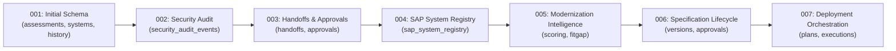

# Fiorify — Database Design & Schema Specification

## 1. Overview & Persistence Architecture

Fiorify uses PostgreSQL 15+ as its authoritative persistence engine.
All migrations are strictly managed through sequential forward SQL scripts (`*.sql`) paired with complete rollback scripts (`*.down.sql`).

Persistence is configured via `backend/src/infrastructure/db/pool.js` with:
- Connection pool size: `max: 20`
- Connection idle timeout: `30,000 ms`
- Connection lease timeout: `5,000 ms`
- Mandatory multi-tenant scoping (`tenant_id` column present and indexed on every tenant-scoped table).

---

## 2. Migration Registry (001 through 007)



### Migration Inventory

| Migration | Up Script | Down Script | Primary Tables Managed |
|---|---|---|---|
| **001** | `001_initial_schema.sql` | `001_initial_schema.down.sql` | `assessments`, `fiori_app_catalog`, `discovered_transactions`, `systems`, `assessment_history` |
| **002** | `002_security_audit.sql` | `002_security_audit.down.sql` | `security_audit_events` |
| **003** | `003_handoffs_and_approvals.sql` | `003_handoffs_and_approvals.down.sql` | `modernization_handoffs`, `modernization_approvals` |
| **004** | `004_sap_system_registry.sql` | `004_sap_system_registry.down.sql` | `sap_system_registry`, `sap_diagnostic_logs` |
| **005** | `005_modernization_intelligence.sql` | `005_modernization_intelligence.down.sql` | `fitgap_scoring_criteria`, `candidate_similarity_cache` |
| **006** | `006_specification_lifecycle.sql` | `006_specification_lifecycle.down.sql` | `project_specification_versions`, `project_specification_approvals`, `generation_projects` |
| **007** | `007_deployment_orchestration.sql` | `007_deployment_orchestration.down.sql` | `deployment_plans`, `deployment_approvals`, `deployment_executions` |

---

## 3. Core Table Schemas

### 3.1 `assessments`
Stores the modernization assessment evaluation and recommended outcome:
- `id` (VARCHAR PK): Unique assessment identifier (e.g. `ASSESS-VA01-20261114`).
- `tenant_id` (VARCHAR NOT NULL): Tenant isolation key.
- `transaction_code` (VARCHAR NOT NULL): Evaluated SAP T-Code (e.g. `VA01`, `ME21N`).
- `recommended_outcome` (VARCHAR NOT NULL): `ADD_AND_CONFIGURE` or `BUILD`.
- `status` (VARCHAR NOT NULL): `DRAFT`, `PENDING_REVIEW`, `APPROVED`.
- `scoring_breakdown` (JSONB): 5-dimension score breakdown.
- `created_by`, `created_at`, `updated_at`.

### 3.2 `security_audit_events`
Immutable, append-only security log for compliance and tamper verification:
- `event_id` (BIGSERIAL PK).
- `tenant_id` (VARCHAR NOT NULL).
- `actor` (VARCHAR NOT NULL): Identity of user or service principal.
- `action` (VARCHAR NOT NULL): e.g. `ADMIN_OVERRIDE_APPROVED`, `DEPLOYMENT_PLAN_APPROVED`.
- `resource` (VARCHAR NOT NULL): Affected resource identifier.
- `outcome` (VARCHAR NOT NULL): `SUCCESS`, `DENIED`, `STOPPED_AT_WRITE_BOUNDARY`.
- `details` (JSONB): Signatures, expiration, hashes, and context.
- `timestamp` (TIMESTAMP WITH TIME ZONE DEFAULT CURRENT_TIMESTAMP).

### 3.3 `deployment_plans` & `deployment_approvals`
Tracks topological deployment packages and cryptographic authorizations:
- `deployment_plans`:
  - `id` (VARCHAR PK): `DEP-PLAN-*`.
  - `project_id` (VARCHAR NOT NULL).
  - `tenant_id` (VARCHAR NOT NULL).
  - `status` (VARCHAR NOT NULL): `DEPLOYMENT_PLANNED`, `APPROVED`, etc.
  - `plan_hash` (VARCHAR(64) NOT NULL): SHA-256 hash of DAG operations.
  - `artifact_manifest_hash` (VARCHAR(64) NOT NULL): SHA-256 hash of all generated files.
  - `plan_details` (JSONB): Ordered artifact execution sequence.
- `deployment_approvals`:
  - `id` (BIGSERIAL PK).
  - `plan_id` (VARCHAR NOT NULL REFERENCES deployment_plans(id)).
  - `tenant_id` (VARCHAR NOT NULL).
  - `decision` (VARCHAR NOT NULL): `APPROVED`, `REJECTED`.
  - `approver` (VARCHAR NOT NULL).
  - `approver_role` (VARCHAR NOT NULL).
  - `signature_hash` (VARCHAR NOT NULL): `sig:v1:<hmac_hex>` or legacy 64-char hex digest.
  - `approved_at`, `expires_at` (TIMESTAMP WITH TIME ZONE).

---

## 4. Multi-Tenant Scoping & Indexing Strategy

1. **Mandatory Tenant Predicates**:
   All database queries generated by repository classes explicitly bind `tenant_id`:
   ```sql
   SELECT * FROM assessments WHERE id = $1 AND tenant_id = $2;
   ```
2. **Compound Indexes**:
   - `idx_assessments_tenant_tcode`: `(tenant_id, transaction_code)`
   - `idx_projects_tenant_lifecycle`: `(tenant_id, lifecycle_status)`
   - `idx_deployment_plans_tenant`: `(tenant_id, status)`
   - `idx_audit_tenant_timestamp`: `(tenant_id, timestamp DESC)`
