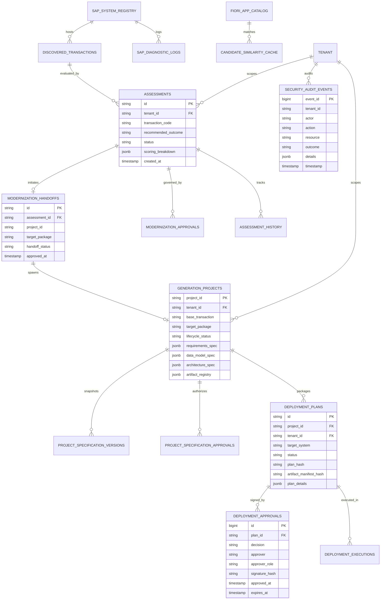

# Fiorify — Entity Relationship Specification

## 1. Relational Data Model

The Fiorify persistence layer links discovered SAP transactions, modernization assessments, generation projects, specification versions, and deployment approvals.

---

## 2. Entity-Relationship Diagram

---

## 3. Key Referential Integrity Rules

1. **Cascade Delete Protections**:
   - `deployment_approvals` and `deployment_executions` cascade on plan deletion.
   - Deleting an assessment is blocked if an active `modernization_handoff` or `generation_project` references it.
2. **Audit Permanence**:
   - `security_audit_events` has no foreign key cascade delete dependencies and cannot be truncated by tenant-level operations.
3. **Specification Immutability**:
   - `project_specification_versions` rows are immutable once committed (`status = 'APPROVED'`). Subsequent edits generate a new incremented version.
