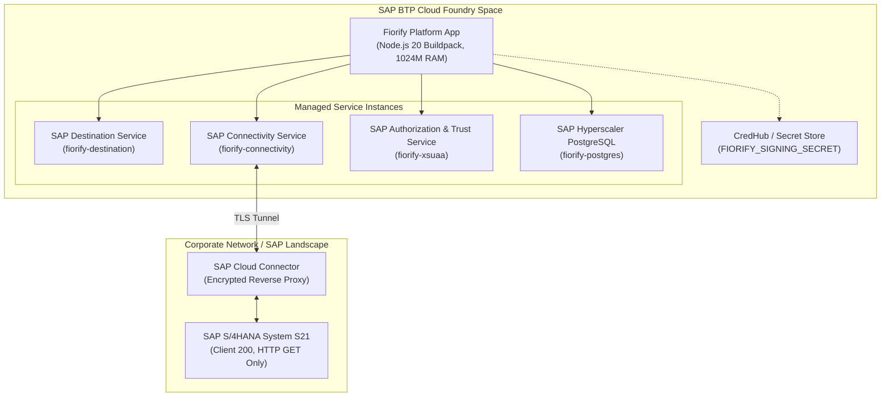

# Fiorify — Cloud Foundry Deployment Guide

## 1. Overview & Scope

This guide defines the deployment architecture, configuration prerequisites, service bindings, and validation steps for deploying Fiorify to SAP BTP Cloud Foundry environment.

> [!IMPORTANT]
> **Audit & Readiness Directive**: In accordance with enterprise release constraints, do NOT execute automated Cloud Foundry deployment (`cf push`) from autonomous agents. This guide establishes and verifies full deployment readiness through configuration audit.

---

## 2. Cloud Foundry Deployment Topology



---

## 3. Application Manifest (`manifest.yml`)

The platform deployment configuration is defined in the root `manifest.yml`:

```yaml
---
applications:
  - name: Fiorify-platform
    memory: 1024M
    disk_quota: 2048M
    buildpacks:
      - nodejs_buildpack
    command: node backend/src/server.js
    env:
      NODE_ENV: production
      Fiorify_PERSISTENCE: postgres
      Fiorify_ENFORCE_AUTH: "true"
      FIORIFY_SIGNING_KEY_VERSION: "v1"
      SAP_DESTINATION_NAME: S21
      SAP_CLIENT: "200"
      SAP_TIMEOUT_MS: "15000"
    services:
      - Fiorify-destination
      - Fiorify-connectivity
      - Fiorify-xsuaa
      - Fiorify-postgres
```

---

## 4. Pre-Deployment Verification Checklist

Before executing `cf push`, the release engineer must verify:

1. **BTP Service Instances Provisioned**:
   - `cf service Fiorify-destination` returns `create succeeded`.
   - `cf service Fiorify-connectivity` returns `create succeeded`.
   - `cf service Fiorify-xsuaa` returns `create succeeded` with security descriptor `xs-security.json`.
   - `cf service Fiorify-postgres` returns `create succeeded`.
2. **PostgreSQL Migrations Applied**:
   - Run `npm run db:migrate` against the staging/production database to apply migrations `001` through `007`.
3. **Cryptographic Signing Secret Configured**:
   - Securely set `FIORIFY_SIGNING_SECRET` via `cf set-env Fiorify-platform FIORIFY_SIGNING_SECRET <32+ char secret>` or BTP CredHub.
4. **Cloud Connector Handshake**:
   - Subaccount bound to Cloud Connector.
   - Virtual host for `S21` mapped to internal SAP gateway port with ICF paths `/sap/opu/odata`, `/sap/opu/odata4`, `/sap/bc/adt` enabled as prefix.
5. **Frontend Production Build**:
   - `npm --prefix frontend run build` completed cleanly, generating `/dist` bundle for static hosting.

---

## 5. Deployment Execution (Manual Release Engineer Procedure)

```bash
# 1. Login to Cloud Foundry
cf login -a https://api.cf.<region>.hana.ondemand.com -o <org> -s <space>

# 2. Build production assets
npm --prefix frontend run build

# 3. Apply database migrations
DATABASE_URL="<connection_string>" node backend/src/infrastructure/db/scripts/migrateStores.js

# 4. Push application with zero-downtime rolling update
cf push Fiorify-platform --strategy rolling
```
