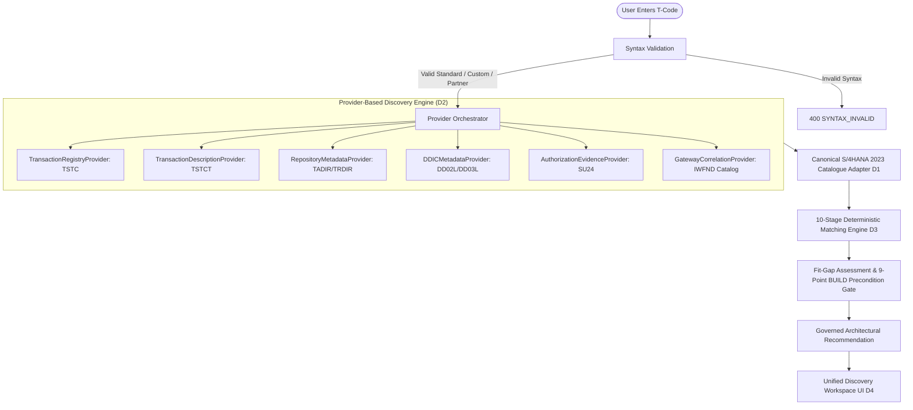

# Fiorify — Complete SAP Fiori Discovery Architecture (D1 + D2 + D3 + D4)

## 1. Architectural Mission & Clean Core Mandate
Fiorify is the enterprise modernization platform specifically designed for **SAP S/4HANA 2023 On-Premise** (System `S21`, Client `200`). The Discovery subsystem delivers an evidence-based, deterministic pipeline to discover any SAP transaction code, retrieve verified DDIC and repository facts, cross-reference standard SAP Fiori applications, evaluate functional and technical compatibility, and formulate governed recommendations adhering strictly to standard-first principles:

$$\text{ADOPT} \longrightarrow \text{CONFIGURE} \longrightarrow \text{EXTEND} \longrightarrow \text{BUILD}$$

Under no circumstances does Fiorify recommend `BUILD` without fulfilling rigorous 9-point preconditions and verifying confirmed material functional gaps.

## 2. Decoupled Provider-Based Transaction Discovery Architecture
To eliminate brittle single-point registries, transaction discovery is decoupled into six independent providers:

1. **`TransactionRegistryProvider`**: Evaluates existence in the authoritative SAP S/4HANA 2023 DDIC snapshot (`transaction_master_snapshot.json`) and probes live SAP via ADT/RFC.
2. **`TransactionDescriptionProvider`**: Resolves official descriptions in language `EN` or `DE`, with provenance tracking.
3. **`RepositoryMetadataProvider`**: Discovers ABAP program (`TRDIR`), package (`TADIR`), software component (`CVERS`), and classification (`STANDARD`, `CUSTOM`, `PARTNER`).
4. **`DDICMetadataProvider`**: Resolves screen numbers, Dynpro attributes, and dictionary tables.
5. **`AuthorizationEvidenceProvider`**: Identifies SU24 authorization objects (`M_BEST_EKO`, `F_BKPF_BUK`, `V_VBAK_VKO`, etc.).
6. **`GatewayCorrelationProvider`**: Correlates live OData services from `/sap/opu/odata/IWFND/CATALOGSERVICE;v=2`.

## 3. Honest System Probing & Non-Conflation Invariants
- **Invariant 1**: A failed HTTP connection or timeout is reported as `LIVE_CONNECTION_FAILED` (HTTP 502) and is **NEVER** conflated with a nonexistent transaction.
- **Invariant 2**: When ADT returns HTTP 403 Forbidden due to restricted permissions on S21, the system marks metadata as `PARTIAL_METADATA` / `PENDING_VERIFICATION` and documents Basis authorizations (`S_ADT_RES`, `S_DEVELOP`, `S_TABU_DIS`). It **NEVER** declares the transaction `NOT_FOUND`.
- **Invariant 3**: Missing from the local catalogue snapshot is **NEVER** treated as proof of non-existence in SAP.
- **Invariant 4**: WebGUI tiles (`SAP GUI for HTML`) are strictly treated as transitional bridges (`WEBGUI_BRIDGE`) and are ranked below modern Native Fiori Elements apps.
