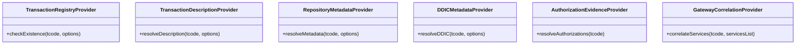

# FioriX — Transaction Discovery Provider Specification (Workstream D2)

## 1. Provider Pattern Overview
The Transaction Discovery subsystem decouples transaction fact retrieval from single-source registries through six specialized providers implemented in `backend/src/services/transactionDiscoveryProviders.js`:

## 2. Syntax Validation Engine
Every transaction code is validated against official SAP naming rules before any backend or network call:

| Transaction Type | Regex Pattern | Valid Examples |
|---|---|---|
| **Standard SAP** | `^[A-Z0-9_\-]{1,20}$` | `ME21N`, `F-53`, `VA01`, `FB50`, `MIGO`, `BP`, `FS00` |
| **Customer Custom** | `^[ZY][A-Z0-9_]{1,19}$` | `ZPURCHASE`, `ZMM_PO_CREATE`, `YFIN_LEDGER` |
| **Partner Namespace** | `^\/[A-Z0-9_]+\/[A-Z0-9_]{1,16}$` | `/CPD/PWS_WS`, `/UI2/FLP`, `/OPT/VIM_7X1` |

Transactions with whitespace, lowercase characters (prior to auto-trim), special symbols (e.g. `@`, `$`, `!`), or length exceeding 20 characters are rejected at the `VALIDATING` phase with HTTP 400 (`SYNTAX_INVALID`).

## 3. Provider Responsibilities & Data Contracts

### 3.1 TransactionRegistryProvider
- **Authoritative Source**: `backend/data/transaction_master_snapshot.json` (21 verified baseline records).
- **States**: `CONFIRMED_REGISTERED`, `PARTIALLY_AVAILABLE`, `PENDING_VERIFICATION`, `CONFIRMED_NON_EXISTENT`, `LIVE_CONNECTION_FAILED`, `SYNTAX_INVALID`.
- **ADT 403 Invariant**: If ADT returns HTTP 403 Forbidden, the transaction state is set to `PENDING_VERIFICATION` with status `PARTIAL_METADATA`. It is **never** declared `NOT_FOUND`.

### 3.2 TransactionDescriptionProvider
- **Multilingual Support**: Supports German (`DE`) and English (`EN`) standard texts (e.g. `ME21N` -> "Bestellung anlegen" / "Create Purchase Order").
- **Fallback**: Resolves from snapshot, Gateway correlation, or neutral fallback.

### 3.3 RepositoryMetadataProvider
- Discovers `program` (`TRDIR`), `screenNumber`, `packageName` (`TADIR`), `softwareComponent` (`S4CORE 108`), `originalSystem` (`SAP` or `S21`), and `classification` (`STANDARD`, `CUSTOM`, `PARTNER`).

### 3.4 DDICMetadataProvider
- Resolves screen number, Dynpro structure, and referenced dictionary tables (`TSTC`, `TSTCT`, `TADIR`, `TDEVC`, `CVERS`).

### 3.5 AuthorizationEvidenceProvider
- Resolves verified SU24 authorization objects (e.g., `M_BEST_EKO`, `M_BEST_BSA` for `ME21N`; `F_BKPF_BUK` for `F-53`; `V_VBAK_VKO` for `VA01`).

### 3.6 GatewayCorrelationProvider
- Matches target T-Code against active S21 Gateway catalog services (`/sap/opu/odata/IWFND/CATALOGSERVICE;v=2`).
