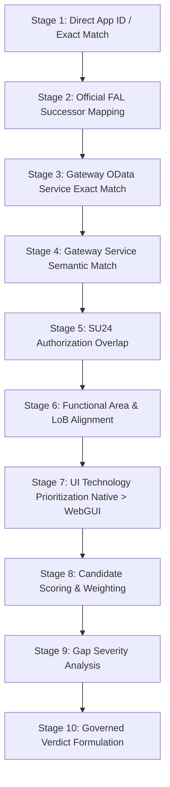

# Fiorify — Matching Engine and Fit-Gap Specification (Workstream D3)

## 1. 10-Stage Deterministic Matching Sequence

## 2. Standard-First Recommendation Matrix
Verdicts are strictly sequenced to maximize Clean Core adoption:

| Verdict | Score Criteria | Condition | Action / Strategy |
|---|---|---|---|
| **`ADOPT`** | $\ge 80\%$ | Verified native standard app, active Gateway service, zero critical gaps. | Direct Fiori Launchpad deployment. |
| **`CONFIGURE`** | $65\% - 79\%$ | Standard app fits; requires role assignment or catalog activation. | Basis / Security Launchpad enablement. |
| **`EXTEND`** | $50\% - 64\%$ | Standard app covers core flow; requires custom fields/logic. | SAP Key User (Tier 1) or Developer BAdIs (Tier 2). |
| **`BUILD`** | $< 50\%$ | Fulfills all 9 mandatory preconditions with confirmed material gaps. | Custom RAP Business Object & Fiori Elements (Tier 2). |

## 3. Strict 9-Point BUILD Precondition Gate
Custom development (`BUILD`) is strictly gated behind nine verified criteria:
1. **Original Business Requirement Present**: Verified business statement and transaction context.
2. **Comprehensive Catalogue Search**: Entire canonical library scanned.
3. **Evaluation of Standard Alternatives**: Formal Fit-Gap evaluation against all candidates.
4. **Functional Comparison Documented**: Missing capabilities explicitly identified.
5. **Technical Feasibility Analyzed**: UI technology and architecture compatibility verified.
6. **Configuration Insufficient**: Documented proof that Launchpad configuration cannot solve the gap.
7. **Clean Core Extension Insufficient**: Documented proof that Key User / Developer extension cannot bridge the gap.
8. **Documented Unmet Capabilities**: Specific architectural gaps (e.g. specialized hardware interface, custom real-time telemetry).
9. **High Confidence Metadata**: Candidate metadata completeness confirmed without missing evidence.
