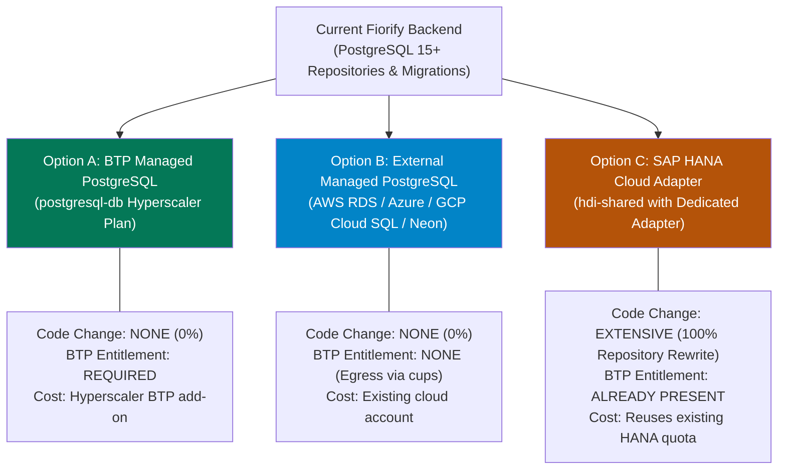

# Fiorify — Production Persistence Architecture & Deployment Decision Document

**Project:** Fiorify — SAP Modernization Platform  
**Target Landscape:** SAP S/4HANA 2023 On-Premise  
**Runtime:** Native Node.js 20 HTTP Backend  
**Status:** **ARCHITECTURAL DECISION REQUIRED BEFORE CLOUD FOUNDRY DEPLOYMENT**

---

## 1. Problem Statement & Empirical Marketplace Discovery

In Stage S1, Fiorify successfully implemented an enterprise relational persistence architecture based on PostgreSQL 15+ (`pg` driver, versioned migrations, transactional repositories, artifact metadata storage, and tamper-evident audit chaining).

However, live inspection of the target SAP BTP Cloud Foundry marketplace (`cf marketplace`) reveals that:
- **No managed PostgreSQL service (`postgresql-db` or hyperscaler plan) is entitled or available in this Cloud Foundry subaccount/space.**
- The only native database service offering present in `cf marketplace` is **`hana`** (plans: `hdi-shared`, `sbss`, `schema`, `securestore`) and **`hana-cloud`**.

This document evaluates the three realistic deployment paths for production persistence.

---

## 2. Incompatibility Analysis: Why an HDI Container is NOT Automatically Compatible

> [!CAUTION]
> **AN HDI CONTAINER CANNOT BE USED AS A DROP-IN REPLACEMENT FOR POSTGRESQL.**
> Suggesting that an existing PostgreSQL repository can simply point at an SAP HANA HDI container without code modification is technically false and will result in catastrophic runtime failures.

### Major Incompatibilities Between Current Repository and SAP HANA:

| Technical Feature | Current Fiorify PostgreSQL Implementation | SAP HANA / HDI Container Equivalent | Compatibility Status |
|---|---|---|:---:|
| **Node.js Client Driver** | `pg` (`pg.Pool`, `pg.Client`) | Requires `@sap/hana-client` or `@sap/hdbext` | :x: Incompatible |
| **Primary Keys & Identity** | `BIGSERIAL` / `SERIAL PRIMARY KEY` | `BIGINT GENERATED ALWAYS AS IDENTITY` | :x: DDL Incompatible |
| **Document / JSON Storage** | Native `JSONB` with JSON operators (`->>`, `?`, `@>`) | `NCLOB` or `JSON` data type (lacks PostgreSQL JSONB operators) | :x: Query Incompatible |
| **Upsert Logic** | `INSERT ... ON CONFLICT (id) DO UPDATE SET ...` | `MERGE INTO ... USING ... ON ... WHEN MATCHED THEN UPDATE ...` | :x: Query Incompatible |
| **Text Search & Matching** | `pg_trgm` extension with GIN indexes (`gin_trgm_ops`) | SAP HANA Full-Text Index (`FUZZY SEARCH`, `CONTAINS`) | :x: Incompatible |
| **Isolation Variable** | `SET LOCAL app.current_tenant = $1` | Session variables via `SET 'tenant_id' = '...'` | :warning: Requires Refactor |

---

## 3. Evaluation of Deployment Options

### Option A: SAP BTP Hyperscaler Managed PostgreSQL (`postgresql-db`)

- **Architecture**: The BTP Global Account Administrator adds the `postgresql-db` service entitlement (plan: `standard` or `trial`) to the subaccount. Fiorify creates an instance via `cf create-service postgresql-db standard Fiorify-postgres` and binds it in `manifest.yml`.
- **Code Compatibility**: **100% compatible**. No repository rewrites, no migration changes.
- **Entitlement / Prerequisite**: Requires the BTP Global Account Administrator to enable the PostgreSQL quota in the BTP Cockpit under **Entitlements**.
- **Pros**: Fully managed within SAP BTP; automatic backup, TLS, and native service binding.
- **Cons**: Requires administrative action outside the CF space to purchase or allocate the entitlement.

---

### Option B: External Managed PostgreSQL Reached via Cloud Foundry Network Egress

- **Architecture**: PostgreSQL 15+ is hosted on an external managed cloud provider (e.g. AWS RDS for PostgreSQL, Azure Database for PostgreSQL, Google Cloud SQL, or Neon/Aiven). The connection string is injected into Cloud Foundry using a User-Provided Service (`cf cups Fiorify-postgres -p '{"uri":"postgres://..."}'`).
- **Code Compatibility**: **100% compatible**. Native `pg.Pool` connects directly via TLS to the external database host.
- **Entitlement / Prerequisite**: None in SAP BTP. Requires external cloud database and TLS connection. Outbound traffic from Cloud Foundry `eu30` must be permitted to port 5432.
- **Pros**: Zero code rewrites; immediate deployment without waiting for BTP Global Account entitlement changes; leverages existing enterprise cloud subscriptions.
- **Cons**: Database management lives outside the BTP cockpit; network latency between BTP CF and external cloud provider (typically 5–15ms if in the same region, e.g. Frankfurt).

---

### Option C: SAP HANA Cloud with Deliberately Engineered Repository Adapter

- **Architecture**: Fiorify replaces its PostgreSQL repository layer with an SAP HANA Cloud repository layer using the existing `hana` (plan `hdi-shared`) service instance.
- **Code Compatibility**: **0% compatible as-is**. Requires an extensive architectural refactoring sprint:
  1. Rewrite all 2 migration DDL files to SAP HANA SQL.
  2. Implement an abstract `IRepository` interface with separate `PostgreSqlAssessmentRepository` and `HanaAssessmentRepository`.
  3. Replace `BIGSERIAL`, `JSONB`, `ON CONFLICT`, and `pg_trgm` with SAP HANA sequences, `NCLOB`, `MERGE INTO`, and `FUZZY SEARCH`.
  4. Replace `pg` package with `@sap/hana-client`.
- **Entitlement / Prerequisite**: None. The `dev` space already possesses `hana` instances (`BTPMonitorTool-db`, `SACC_Travel_Application_hdi`).
- **Pros**: 100% native SAP BTP stack; single vendor footprint; zero external egress.
- **Cons**: High developer effort (estimated 3–5 working days of engineering and testing); potential regression risk across existing persistence test suites.

---

## 4. Architectural Recommendation & Decision Matrix

| Evaluation Criteria | Option A (BTP PostgreSQL) | Option B (External PostgreSQL) | Option C (SAP HANA Adapter) |
| :--- | :---: | :---: | :---: |
| **Code Modification Required** | **Zero (0%)** | **Zero (0%)** | **High (100% rewrite)** |
| **Deployment Lead Time** | 1–2 days (BTP quota approval) | **Immediate (< 1 hour)** | 3–5 days (engineering sprint) |
| **PostgreSQL Feature Preservation** | Full (JSONB, pg_trgm, migrations) | Full (JSONB, pg_trgm, migrations) | None (Must emulate in HANA) |
| **Test Suite Reusability** | 100% (Passes all S1 tests) | 100% (Passes all S1 tests) | 0% (Requires new HANA test suite) |
| **BTP Native Cohesion** | High | Medium | **Very High** |

### Formulated Architectural Decision:
1. **Short-Term / Staging Path**: **Option B (External Managed PostgreSQL)** or **Option A (BTP PostgreSQL entitlement)** is strongly recommended for initial Cloud Foundry deployment because Fiorify's PostgreSQL persistence layer is already built, audited, and 100% verified.
2. **Long-Term Enterprise Path**: If customer compliance mandates that zero external database connections are permitted outside the SAP BTP boundary, an isolated engineering sprint must be authorized to develop a dedicated **HANA Repository Adapter** without modifying existing domain logic.
