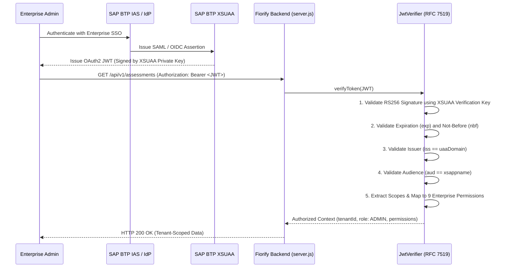

# Fiorify — XSUAA Production Readiness & Security Configuration Report

**Project:** Fiorify — SAP Modernization Platform  
**Target Landscape:** SAP BTP Cloud Foundry (`eu30`, org `Abhiyanta_India Solutions Private Limited_sap-btp-ais-d0a7p7v8`, space `dev`)  
**Security Standard:** RFC 7519 / OAuth 2.0 / SAP BTP XSUAA  
**Status:** **SPECIFICATION COMPLETE — PENDING BTP SERVICE PROVISIONING**

---

## 1. Executive Summary & Verification Findings

In Stage S2, Fiorify implemented a production-grade security architecture:
1. Native RFC 7519 compliant JWT verification (`jwtVerifier.js`).
2. An XSUAA integration provider (`xsuaaProvider.js`) that parses `VCAP_SERVICES`.
3. 9 enterprise administrator permissions enforced across HTTP handlers in `server.js`.
4. Fail-fast production startup guard: the application **strictly refuses to boot** if running with `NODE_ENV=production` without a valid XSUAA binding.

An empirical inspection of the target Cloud Foundry space shows that:
- Multiple other applications possess XSUAA instances (`BTPLense-auth`, `BTPMonitorTool-xsuaa-service`, `SACC_Travel_Application_auth`, `vendor_reconcile-auth`, `wzsess-auth`).
- **None of these existing XSUAA instances can or should be reused by Fiorify**.

---

## 2. Why Reusing Another Application's XSUAA Instance is Prohibited

Reusing an existing XSUAA instance bound to another application (e.g. `BTPLense-auth` or `BTPMonitorTool-xsuaa-service`) is a major security vulnerability for the following technical reasons:

1. **Audience Mismatch (`aud` validation failure)**:
   - Each XSUAA `application` instance is initialized with a distinct `xsappname`.
   - When a user authenticates, the resulting JWT contains an audience (`aud`) claim matching that specific `xsappname` (e.g. `btplense!t1234`).
   - Fiorify's RFC 7519 JWT Verifier validates that incoming tokens contain an audience claim matching Fiorify's own client ID / xsappname. If bound to another application's XSUAA, all legitimate Fiorify tokens would be rejected with HTTP 401.
2. **Scope Contamination & Cross-Privilege Escalation**:
   - `xs-security.json` defines application-specific scopes (e.g. `$XSAPPNAME.FiorifyAdmin`).
   - Reusing another app's instance would pollute the foreign application's security model with Fiorify scopes or expose Fiorify to unauthorized users who hold roles in the other application.
3. **Lifecycle Coupling**:
   - Updates, deletions, or restarts of the foreign application would impact or invalidate Fiorify security credentials.

**Conclusion**: Fiorify **must** have its own dedicated XSUAA service instance (`Fiorify-xsuaa`) provisioned using [`xs-security.json`](file:///c:/Users/samarth/firorix/xs-security.json).

---

## 3. Canonical `xs-security.json` Specification

The official security descriptor [`xs-security.json`](file:///c:/Users/samarth/firorix/xs-security.json) defines the following security objects:

### 3.1 Scopes
- `$XSAPPNAME.FiorifyAdmin`: Administrative operations (system management, security audit log access, tenant settings).
- `$XSAPPNAME.FiorifyArchitect`: Architecture operations (transaction discovery, catalogue management, fit-gap assessment, generation project creation).
- `$XSAPPNAME.FiorifyViewer`: Read-only access to discovery results and modernization roadmaps.

### 3.2 Role Templates
- `Fiorify_Administrator`: References `FiorifyAdmin`, `FiorifyArchitect`, and `FiorifyViewer` with `tenantId` attribute.
- `Fiorify_Enterprise_Architect`: References `FiorifyArchitect` and `FiorifyViewer` with `tenantId` attribute.
- `Fiorify_Viewer`: References `FiorifyViewer` with `tenantId` attribute.

### 3.3 Role Collections
- `Fiorify Administrator`
- `Fiorify Architect`
- `Fiorify ReadOnly`

---

## 4. Production Startup & Token Validation Flow



---

## 5. Provisioning Instructions for BTP Administrator

> [!NOTE]
> Execute from the project root directory where [`xs-security.json`](file:///c:/Users/samarth/firorix/xs-security.json) is located:

```bash
# 1. Target the correct org and dev space
cf target -o "Abhiyanta_India Solutions Private Limited_sap-btp-ais-d0a7p7v8" -s dev

# 2. Create the dedicated Fiorify XSUAA service instance
cf create-service xsuaa application Fiorify-xsuaa -c xs-security.json

# 3. Confirm creation status
cf service Fiorify-xsuaa
```

Once provisioned, bind `Fiorify-xsuaa` in [`manifest.yml`](file:///c:/Users/samarth/firorix/manifest.yml). Upon boot, `XsuaaAuthenticationProvider` will automatically detect the binding credentials in `VCAP_SERVICES` and enforce cryptographic token verification for all administrative operations.
