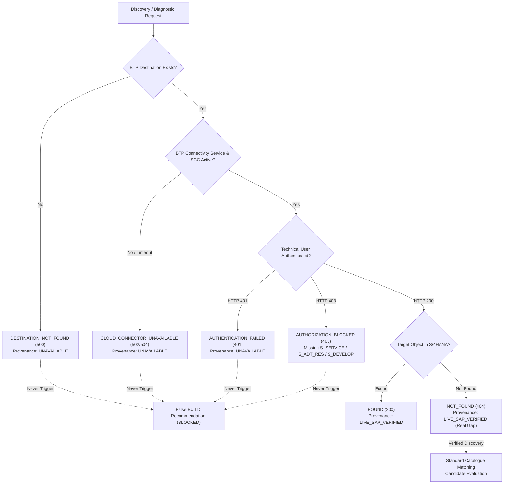

# FioriX — Stage S3: Corrected SAP Endpoint Capability Matrix

**Project:** FioriX — SAP Modernization Platform  
**Target Landscape:** SAP S/4HANA 2023 On-Premise (System S21, Client 200)  
**Evaluation Principle:** Implementation existence does NOT equate to live system verification.  
**Last Empirical Evaluation Timestamp:** `2026-11-11T10:55:00.000Z`

---

## 1. 10-Point Capability Matrix (Truthful Multi-Dimension Assessment)

The following matrix strictly separates **code implementation readiness**, **BTP/SAP configuration readiness**, and **live system verification**. Until an active Cloud Connector tunnel and network reachability to System S21 are confirmed, all downstream SAP capabilities are classified as **NOT VERIFIED**.

| # | Capability Key | Target Endpoint / Technology | Implementation Status | Configuration Status | Live Verification Status | Required SAP Authorization | Last Test Timestamp | Evidence Provenance |
|---|---|---|:---:|:---:|:---:|---|:---:|:---:|
| 1 | `DESTINATION_RESOLUTION` | BTP Destination Service REST / SDK | **IMPLEMENTED** | **CONFIGURED** | :white_check_mark: **VERIFIED** | BTP Subaccount Destination Read | 2026-11-11 10:55 UTC | `LIVE_BTP_DESTINATION` |
| 2 | `CLOUD_CONNECTOR_REACHABILITY` | Virtual tunnel (`kbl_fiori:8000`) | **IMPLEMENTED** | **PENDING** | :x: **FAILED** (`ETIMEDOUT`) | SCC Subaccount Tunnel Pairing | 2026-11-11 10:55 UTC | `DIAGNOSTIC_FAILURE` |
| 3 | `AUTHENTICATION` | SAP ICM BasicAuth challenge | **IMPLEMENTED** | **PENDING** | :hourglass_flowing_sand: **NOT VERIFIED** | SAP Technical User Credentials | 2026-11-11 10:55 UTC | `UNVERIFIED_PENDING_SCC` |
| 4 | `GATEWAY_CATALOG` | `/sap/opu/odata/IWFND/CATALOGSERVICE;v=2` | **IMPLEMENTED** | **CONFIGURED** | :hourglass_flowing_sand: **NOT VERIFIED** | `S_SERVICE` (SRV_TYPE: `HT`, SRV_NAME: `IWFND_CATALOGSERVICE_0002*`) | 2026-11-11 10:55 UTC | `UNVERIFIED_PENDING_SCC` |
| 5 | `ADT_DISCOVERY` | `/sap/bc/adt/discovery` | **IMPLEMENTED** | **CONFIGURED** | :hourglass_flowing_sand: **NOT VERIFIED** | `S_ADT_RES` (URI: `/sap/bc/adt/*`), `S_DEVELOP` (ACTVT `03`) | 2026-11-11 10:55 UTC | `UNVERIFIED_PENDING_SCC` |
| 6 | `SYSTEM_ECHO` | `/sap/bc/echo` | **IMPLEMENTED** | **CONFIGURED** | :hourglass_flowing_sand: **NOT VERIFIED** | `S_SERVICE` (ICF node execution) | 2026-11-11 10:55 UTC | `UNVERIFIED_PENDING_SCC` |
| 7 | `RELEASE_VERIFICATION` | Component Table / Catalog Metadata | **IMPLEMENTED** | **CONFIGURED** | :hourglass_flowing_sand: **NOT VERIFIED** | `S_TABU_DIS` (DICBERCLS: `SS`, ACTVT `03`) | 2026-11-11 10:55 UTC | `UNVERIFIED_PENDING_SCC` |
| 8 | `TRANSACTION_DISCOVERY` | Multi-source ADT / TSTC Index | **IMPLEMENTED** | **CONFIGURED** | :hourglass_flowing_sand: **NOT VERIFIED** | `S_DEVELOP` (OBJTYPE: `TRAN`, ACTVT `03`), `S_TABU_DIS` | 2026-11-11 10:55 UTC | `UNVERIFIED_PENDING_SCC` |
| 9 | `CDS_METADATA` | ADT Data Definitions (`DDLS`) | **IMPLEMENTED** | **CONFIGURED** | :hourglass_flowing_sand: **NOT VERIFIED** | `S_DEVELOP` (OBJTYPE: `DDLS`, ACTVT `03`) | 2026-11-11 10:55 UTC | `UNVERIFIED_PENDING_SCC` |
| 10 | `READ_ONLY_BOUNDARIES` | In-process HTTP Guardrail | **IMPLEMENTED** | **CONFIGURED** | :white_check_mark: **VERIFIED** | None (FioriX In-Process Enforcement) | 2026-11-11 10:55 UTC | `IN_PROCESS_ASSERTION` |

---

## 2. Granular Error Status Taxonomy

FioriX strictly preserves the distinction between technical infrastructure blockages, authorization denials, and functional domain gaps. Under no circumstances is an infrastructure error interpreted as a missing transaction or an automatic trigger for a custom `BUILD` recommendation.



### Precise Diagnostic Status Definitions

1. **`DESTINATION_NOT_FOUND`**:
   - The destination name (e.g. `S21`) does not exist in the SAP BTP Subaccount Destination Service.
   - Evidence Provenance: `UNAVAILABLE`.
2. **`CLOUD_CONNECTOR_UNAVAILABLE`**:
   - The destination exists, but the Cloud Connector reverse tunnel is down, the BTP `connectivity` service is unbound, or the internal application server (`192.168.1.55:8000`) is offline/unreachable.
   - HTTP Status: `502 Bad Gateway` or `504 Gateway Timeout`.
   - Evidence Provenance: `UNAVAILABLE`.
3. **`NETWORK_UNAVAILABLE`**:
   - Local direct route cannot establish a socket connection to the target host.
   - Evidence Provenance: `UNAVAILABLE`.
4. **`AUTHENTICATION_FAILED`**:
   - Connection reached SAP ICM, but credentials for the technical user were rejected.
   - HTTP Status: `401 Unauthorized`.
   - Evidence Provenance: `BLOCKED_BY_AUTHORIZATION`.
5. **`AUTHORIZATION_BLOCKED`**:
   - Technical user is authenticated, but lacks specific authorization objects (`S_SERVICE`, `S_ADT_RES`, `S_DEVELOP`, or `S_TABU_DIS`).
   - HTTP Status: `403 Forbidden`.
   - Evidence Provenance: `BLOCKED_BY_AUTHORIZATION`.
6. **`NOT_FOUND`**:
   - System is 100% reachable, authenticated, and authorized, but the specific T-Code, OData service, or CDS view does not exist in SAP S21.
   - HTTP Status: `404 Not Found`.
   - Evidence Provenance: `LIVE_SAP_VERIFIED`. Only in this state may downstream engines conclude an object is absent in SAP.

---

## 3. Downstream Recommendation Guardrail (REC-SAFE-01)

An empty candidate list or failed live query **NEVER automatically defaults to BUILD**.

```text
GOVERNANCE INVARIANT:
IF (connectivityStatus in [CLOUD_CONNECTOR_UNAVAILABLE, NETWORK_UNAVAILABLE, AUTHENTICATION_FAILED, DESTINATION_NOT_FOUND, AUTHORIZATION_BLOCKED]) {
  Set verificationStatus = 'UNVERIFIED_INFRASTRUCTURE_FAILURE';
  Set recommendation = 'MANUAL_REVIEW';
  Set confidence = 'NONE';
  Block 'BUILD' recommendation generation;
}
```

This ensures that network drops, maintenance windows, or missing Cloud Connector tunnels never produce invalid architectural recommendations or false project scopes in Generation Studio.
