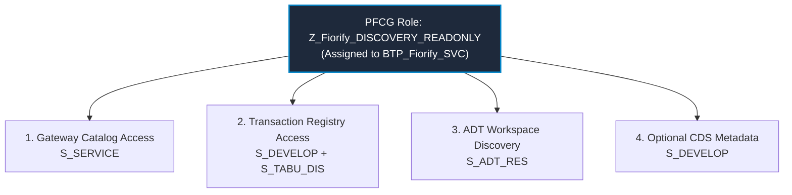

# Fiorify — Stage S3: Least-Privilege SAP Basis Authorization Matrix

**Project:** Fiorify — SAP Modernization Platform  
**Target Landscape:** SAP S/4HANA 2023 On-Premise (System S21, Client 200)  
**Security Standard:** Principle of Least Privilege (Zero Unsafe Wildcards, Zero Mutating Rights)  
**Governance Requirement:** Explicit Basis Administrator approval required for every role and authorization object.

---

## 1. Cloud Connector Resource Allowlist (Restricted Endpoints)

Under the virtual host mapping `kbl_fiori:8000` in SAP Cloud Connector, **unsafe wildcard sub-paths are strictly forbidden**. 

### 1.1 Permitted Accessible Resources

| # | Exact URL Path | Cloud Connector Access Mode | Justification & Scope | Security Boundary |
|---|---|---|---|---|
| 1 | `/sap/bc/echo` | Path only | ICM network ping and latency diagnostic. | Zero business or technical data access. |
| 2 | `/sap/opu/odata/IWFND/CATALOGSERVICE;v=2` | Path and all sub-paths | Gateway registered OData service discovery. | Read-only catalog inspection. Cannot invoke business services. |
| 3 | `/sap/bc/adt/discovery` | Path only | ABAP Development Tools feature workspace negotiation. | Read-only XML capability document. |
| 4 | `/sap/bc/adt/repository/nodestructure` | Path only | Structural inspection of standard packages and object trees. | Display only. No source code or table modification. |
| 5 | `/sap/bc/adt/programs/programs` | Path only | Program name verification for classic transactions. | Display metadata only. |

### 1.2 Prohibited Cloud Connector Wildcard Paths

> [!CAUTION]
> The following paths must **NEVER** be opened in SAP Cloud Connector for Fiorify:
> - **`/sap/opu/odata` (Path and all sub-paths)**: Opening the root OData path exposes thousands of transactional and financial business services across S/4HANA.
> - **`/sap/bc/adt` (Path and all sub-paths)**: Opening the root ADT path exposes code modification, transport creation, and debugger services.
> - **`/sap/bc/gui`**: GUI for HTML interactive webdynpro.
> - **`/sap/bc/webdynpro`**: Administrative web applications.

---

## 2. SAP Backend Least-Privilege Authorization Matrix

The technical communication user (e.g. `BTP_Fiorify_SVC`, User Type: `B - System User` or `C - Communication User`) must be assigned a single custom PFCG role (e.g. `Z_Fiorify_DISCOVERY_READONLY`).

Under no circumstances may `SAP_ALL`, `SAP_NEW`, `S_A.SYSTEM`, or broad wildcards (`*`) be assigned.

### 2.1 Categorized Authorization Objects

#### Category 1: Gateway Catalogue Access
*Purpose: Allows Fiorify to discover which standard and custom OData services are registered in the S/4HANA Gateway Hub.*

| Authorization Object | Field | Permitted Value | Unsafe Value (Forbidden) | Basis Approval Required |
|---|---|---|---|:---:|
| `S_SERVICE` | `SRV_TYPE` | `HT` (HTTP Service) | `*` | Yes |
| | `SRV_NAME` | `IWFND_CATALOGSERVICE_0002*` | `*` | Yes |

#### Category 2: Transaction Registry Access
*Purpose: Allows Fiorify to verify whether a T-Code (e.g. `ME21N`, `VA01`) exists in the ABAP Repository and fetch its standard description and associated package.*

| Authorization Object | Field | Permitted Value | Unsafe Value (Forbidden) | Basis Approval Required |
|---|---|---|---|:---:|
| `S_DEVELOP` | `OBJTYPE` | `TRAN` (Transaction), `PROG` (Program) | `*` | Yes |
| | `OBJNAME` | `*` (or restricted namespace e.g. `Z*`, `Y*`, `/SAP/*`) | `*` without ACTVT restriction | Yes |
| | `DEVCLASS` | Restricted packages (e.g. `ME`, `VA`, `FBAS`, `$TMP`, `Z*`) | `*` without ACTVT restriction | Yes |
| | `ACTVT` | **`03` (Display)** | `01` (Create), `02` (Change), `06` (Delete) | Yes |
| `S_TABU_DIS` | `DICBERCLS` | Specific auth group for transaction table (`SS` for system tables) | `*` (All Table Groups) | Yes |
| | `ACTVT` | **`03` (Display)** | `02` (Change) | Yes |

#### Category 3: ADT Discovery & Structure Access
*Purpose: Probes the ABAP Development Tools discovery workspace to identify system capabilities.*

| Authorization Object | Field | Permitted Value | Unsafe Value (Forbidden) | Basis Approval Required |
|---|---|---|---|:---:|
| `S_ADT_RES` | `URI` | `/sap/bc/adt/discovery*`, `/sap/bc/adt/repository/nodestructure*` | `*` | Yes |
| | `ACTVT` | **`03` (Display)** | `01`, `02`, `06` | Yes |

#### Category 4: Optional CDS View Metadata Extraction
*Purpose: Allows Fiorify to inspect Core Data Services (CDS) view definitions and annotations during technical evidence collection.*

| Authorization Object | Field | Permitted Value | Unsafe Value (Forbidden) | Basis Approval Required |
|---|---|---|---|:---:|
| `S_DEVELOP` | `OBJTYPE` | `DDLS` (Data Definition Language Source) | `*` | Yes |
| | `DEVCLASS` | Restricted CDS packages | `*` | Yes |
| | `ACTVT` | **`03` (Display)** | `01`, `02`, `06` | Yes |

---

## 3. RFC Authorization Notice

> [!WARNING]
> **RFC Execution is NOT inherently read-only.**
> Granting `S_RFC` with `ACTVT: 16 (Execute)` authorizes the caller to run any function module inside the specified function group. If a function module performs database commits, creates spool files, or triggers background jobs, `ACTVT: 16` will permit execution.
> 
> **Fiorify Policy for S/4HANA 2023**:
> 1. RFC execution is **DISABLED BY DEFAULT**.
> 2. Fiorify uses modern HTTP REST and OData catalog services through ICM/SAP Gateway, not RFC.
> 3. If RFC is ever requested for legacy diagnostic adapters, the Basis administrator must restrict `S_RFC` specifically to:
>    - `RFC_TYPE`: `FUGR`
>    - `RFC_NAME`: `SYST`, `RFC1` (System diagnostics only; no business function groups)
>    - `ACTVT`: `16` (Execute)

---

## 4. Basis Sign-Off Protocol

Before live connection testing:
1. Basis Administrator creates role `Z_Fiorify_DISCOVERY_READONLY` matching the exact specifications above.
2. User `BTP_Fiorify_SVC` is created in client `200` with user type `System` (`B`) and assigned only `Z_Fiorify_DISCOVERY_READONLY`.
3. In transaction `SUIM`, Basis verifies that user `BTP_Fiorify_SVC` contains zero authorizations with `ACTVT: 01`, `ACTVT: 02`, or `ACTVT: 06`.
4. Sign-off recorded with date, SAP System ID, and Basis administrator user ID.
