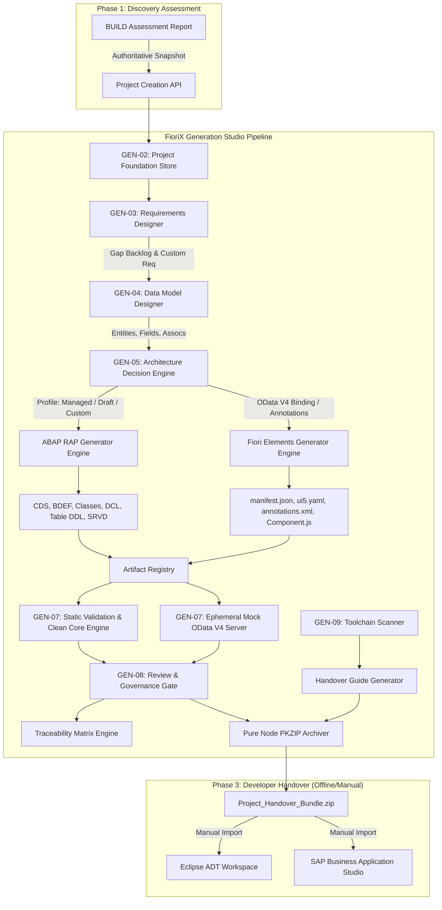

# Generation Studio: Architecture & Dependency Map
**Document ID:** `GEN-AUDIT-ARCH-01`  
**Audit Context:** `GEN-COMPLETE-AUDIT-01`  
**Target Landscape:** SAP S/4HANA 2023 On-Premise (S21, Client 200, SAP_BASIS 7.58, SAP_UI 7.58)  
**Classification:** Technical Architecture Audit

---

## 1. Executive Architectural Overview

FioriX Generation Studio is structured as an end-to-end, local-first code synthesis pipeline designed to bridge SAP discovery assessments with enterprise-grade SAP S/4HANA 2023 ABAP RESTful Application Programming Model (RAP) and SAP Fiori Elements development.

The system strictly adheres to the principle:
> **"STANDARD SAP FIORI FIRST. CUSTOM BUILD ONLY WHEN A GENUINE GAP EXISTS."**

The architecture consists of:
1. **Frontend Layer:** React 18, TypeScript, TailwindCSS, Lucide icons, Vitest. Located in `frontend/src/features/generation/`.
2. **REST API & Dispatch Layer:** Node.js native HTTP server router (`backend/src/generation/routes/generationRoutes.js`) mounting 52 distinct endpoints under `/api/generation/`.
3. **Domain & Orchestration Services:** 12 specialized backend subsystems covering Project Lifecycle, Requirements Engineering, CDS Data Modeling, RAP Architecture Decision Engine, ABAP Code Generation, Fiori Elements Code Generation, Local OData V4 Mock Server, Static Validation & Clean Core Verification, Governance & Packaging, and Toolchain Diagnostics.
4. **Persistence Layer:** Dual-model architecture featuring Canonical JSON Store (`backend/data/generation-projects/<id>/project.json` with `.bak` redundancy and advisory file locking) alongside PostgreSQL migration hooks (`backend/src/infrastructure/repositories/generationProjectRepository.js`).

---

## 2. Component Inventory

### 2.1 Backend Subsystems (`backend/src/generation/`)

| Subsystem / Directory | File | Size (Bytes) | Role & Responsibility |
| :--- | :--- | :--- | :--- |
| **Routes** | `routes/generationRoutes.js` | 43,686 | Central HTTP dispatcher for all 52 Generation Studio REST endpoints. Enforces Admin auth and tenant headers. |
| **Projects (GEN-02)** | `projects/generationProjectStore.js` | 29,503 | Filesystem persistence, advisory locking, atomic write, `.bak` backup, JSON validation. |
| | `projects/generationProjectService.js` | 16,278 | Project CRUD, transition validation, assessment snapshot extraction, workspace integrity. |
| | `projects/generationProjectLifecycle.js` | 6,939 | State machine lifecycle manager (DRAFT -> MODELING -> GENERATED -> EXPORTED -> ARCHIVED). |
| | `projects/generationProjectValidator.js` | 4,960 | Structural contract validator for project payloads. |
| | `contracts/generationProjectContract.js` | 5,886 | Canonical TypeScript/JSDoc interface schemas for project models. |
| **Requirements (GEN-03)**| `requirements/requirementsService.js` | 18,423 | Gap import from Discovery BUILD assessments, custom requirement authoring, approval enforcement. |
| | `requirements/requirementsContract.js` | 5,817 | Data structures for requirements, gap categories, priority and approval metadata. |
| **Data Model (GEN-04)** | `datamodel/dataModelService.js` | 19,029 | Business entity modeling, field typing, primary/foreign key linking, composition trees. |
| | `datamodel/dataModelValidator.js` | 19,665 | SAP CDS naming conventions, ABAP dictionary types, circular composition prevention. |
| | `datamodel/cdsReuseRegistry.js` | 7,701 | Registry of standard S/4HANA CDS views (I_BusinessPartner, I_Product, I_SalesOrder, etc.). |
| | `datamodel/dataModelContract.js` | 9,403 | Entity, Field, Association, and Composition schemas. |
| **Architecture (GEN-05)**| `architecture/architectureDecisionEngine.js`| 9,409 | Algorithmic selection between 4 RAP profiles (Managed, Unmanaged, Draft-enabled, Read-only). |
| | `architecture/architectureService.js` | 4,470 | Architecture state persistence, rationale recording, and manual override handling. |
| | `architecture/architectureContract.js` | 1,793 | Architecture decision contracts and profile enums. |
| **ABAP RAP (GEN-05)** | `abap/abapGeneratorEngine.js` | 5,556 | Master orchestrator for generating complete RAP artifact bundles. |
| | `abap/cdsViewEntityGenerator.js` | 12,060 | Generates Basic/Interface CDS View Entities (`R_`), Consumption Views (`C_`), and MDEs. |
| | `abap/rapBehaviorGenerator.js` | 9,145 | Generates RAP Behavior Definitions (`BDEF`) with managed/unmanaged draft capabilities. |
| | `abap/behaviorClassGenerator.js` | 11,659 | Generates ABAP Behavior Pool Class Definitions and Implementations (`BP_` / `CCIMP`). |
| | `abap/persistenceTableGenerator.js`| 5,297 | Generates transparent SQL DDL persistence table definitions (`ztab_*`). |
| | `abap/serviceDefinitionGenerator.js`| 1,617 | Generates RAP Service Definitions (`SRVD`) exposing consumption entities. |
| | `abap/serviceBindingProposalGenerator.js`| 2,917 | Generates Service Binding instructions and XML definitions (`SRVB`). |
| | `abap/dclAccessControlGenerator.js` | 1,757 | Generates CDS Access Control (DCL) policies with aspect pfcg_auth. |
| | `abap/abapDocumentationGenerator.js`| 4,542 | Generates ABAP doc comments and Markdown architecture handover docs. |
| | `abap/abapArtifactContract.js` | 1,994 | Artifact metadata schemas and type definitions. |
| **Artifacts** | `artifacts/artifactRegistry.js` | 6,507 | In-memory and persisted registry of generated artifact hashes, types, and paths. |
| **Fiori (GEN-06)** | `fiori/fioriGeneratorEngine.js` | 3,226 | Coordinates SAP Fiori Elements application artifact synthesis. |
| | `fiori/manifestGenerator.js` | 5,238 | Generates SAPUI5 `manifest.json` conforming to SAP Fiori Elements V4 standards. |
| | `fiori/fioriAnnotationGenerator.js`| 5,213 | Generates local XML UI annotations (`LineItem`, `SelectionFields`, `HeaderInfo`, `FieldGroup`). |
| | `fiori/fioriProjectStructureGenerator.js`| 6,405 | Generates standard SAPUI5 project tree (`Component.js`, `index.html`, `ui5.yaml`, `package.json`). |
| | `fiori/fioriArtifactContract.js` | 1,942 | Fiori artifact manifest contracts. |
| **Preview & Mock (GEN-07)**| `preview/previewManager.js` | 10,341 | Lifecycle supervisor for ephemeral local mock servers and session allocations. |
| | `preview/mockODataServer.js` | 39,329 | Native HTTP OData V4 mock server runtime serving static assets, $metadata, and CRUD. |
| | `preview/mockODataMetadata.js` | 6,116 | Dynamic EDMX $metadata generator converting CDS models to CSDL XML. |
| | `preview/mockODataQuery.js` | 5,577 | OData V4 query expression evaluator ($filter, $select, $expand, $top, $skip, $orderby). |
| | `preview/mockODataMutation.js` | 4,116 | In-memory CRUD handler for draft actions, entity creation, update, and deletion. |
| | `preview/previewSessionStore.js` | 3,362 | In-memory session tracking, TTL reaper, and port allocation set. |
| | `preview/previewSecurity.js` | 3,406 | Origin validation, local loopback binding enforcement, watermark injection. |
| **Validation (GEN-07)** | `validation/staticValidationEngine.js`| 13,850 | Heuristic static analysis checking Clean Core C1 rules, syntax patterns, and naming conventions. |
| **Review & Export (GEN-08)**| `export/exportManager.js` | 14,584 | Release gatekeeper, checksum generation, project bundle manifest creation. |
| | `export/traceabilityEngine.js` | 10,070 | End-to-end forward/reverse traceability matrix synthesizer (T-Code -> Gap -> CDS -> UI). |
| | `export/zipArchiver.js` | 11,789 | Pure Node.js zero-external-dependency PKZIP archiver with streaming DEFLATE support. |
| **Toolchain (GEN-09)** | `toolchain/toolchainScanner.js` | 10,549 | Local developer environment detector (Node, Git, Java, Eclipse, ADT, SAP GUI, CLIs). |
| | `toolchain/handoverGuideGenerator.js`| 7,119 | Generates customized step-by-step developer onboarding guides for Eclipse ADT. |

---

## 3. End-to-End Generation Studio Data Flow

---

## 4. Architectural Analysis & Dependencies

### 4.1 Dependency Philosophy: Zero-Heavyweight Dependencies
A notable strength of the backend generation engine is its **minimalist dependency profile**:
- **Zip Packaging:** Utilizes `backend/src/generation/export/zipArchiver.js` written in pure Node.js using native `zlib` (DEFLATE algorithm) and raw byte buffers for the PKZIP format. It avoids heavy NPM dependencies such as `archiver` or `adm-zip`.
- **HTTP Routing:** Integrated directly into the existing native Node HTTP dispatcher without pulling in monolithic web frameworks.
- **OData Mocking:** Implements an in-process native HTTP server dynamically parsing EDMX metadata and dispatching OData V4 JSON payloads using pure JavaScript string manipulation and JSON structures.

### 4.2 Decoupling & Isolation
- **No Remote SAP Coupling:** The generation process requires **zero** live connectivity to SAP S21 during generation, ensuring deterministic, reproducible builds even in disconnected environments.
- **Strict Read-Only Boundary:** The generation modules contain no SAP write RFCs, no BAPI commit calls, no CTS transport creation, and no ADT activation endpoints. All generation produces local draft source code intended exclusively for human review.
