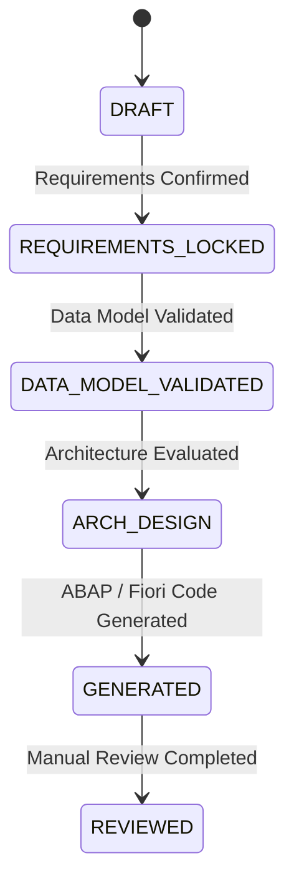

# GEN-05 & GEN-06: REST API Contract Specification
## Endpoint Catalog, Request/Response Payloads & Lifecycle Status Transitions

### 1. Base Paths & Architecture Overview

All generation APIs are mounted on the native Node.js HTTP router under:
`/api/v1/generation/projects/:id`

Authentication and tenant isolation strictly enforce:
- Valid session / authenticated Admin identity.
- Single-tenant compatibility (`DEFAULT-TENANT-S21`).
- Deterministic project updates without data loss.

---

### 2. Detailed Endpoint Catalog

#### 2.1 RAP Architecture Designer Endpoints

##### `POST /api/v1/generation/projects/:id/architecture/evaluate`
- **Purpose:** Analyzes project requirements and entities to determine the optimal RAP architecture pattern and draft strategy.
- **Request Body:** Optional overrides `{ pattern?: string, draftEnabled?: boolean }`.
- **Response `200 OK`:**
  ```json
  {
    "success": true,
    "architecture": {
      "specVersion": 1,
      "selectedProfile": "MANAGED_RAP_DRAFT",
      "rationale": "Transactional editing requires draft preservation",
      "persistenceApproach": "NEW_TABLES_WITH_DRAFT",
      "draftDecision": {
        "enabled": true,
        "draftTableName": "ZPAY_HEADER_D",
        "reason": "Draft preservation for multi-step approval"
      },
      "cleanCoreImplications": {
        "tier": "TIER_2",
        "guideline": "ABAP Cloud Language Version 5"
      }
    },
    "lifecycleStatus": "ARCH_DESIGN"
  }
  ```

##### `GET /api/v1/generation/projects/:id/architecture`
- **Purpose:** Fetches the current architecture specification.
- **Response `200 OK`:** `{ "success": true, "architecture": { ... }, "lifecycleStatus": "ARCH_DESIGN" }`

##### `PATCH /api/v1/generation/projects/:id/architecture`
- **Purpose:** Updates user-selected architecture settings.
- **Request Body:** Partial `ArchitectureSpec`.

---

#### 2.2 ABAP Code Generator Endpoints

##### `POST /api/v1/generation/projects/:id/abap/generate`
- **Purpose:** Synthesizes the full suite of ABAP Clean Core Tier 2 artifacts and registers them in the shared registry.
- **Request Body:** `{ overwrite?: boolean, preserveManualEdits?: boolean }`.
- **Response `201 Created`:**
  ```json
  {
    "success": true,
    "totalGenerated": 9,
    "artifacts": [
      {
        "artifactId": "art-tabl-01",
        "filePath": "abap/tables/zpay_header.tabl.xml",
        "artifactType": "TABLE_DEFINITION",
        "objectName": "zpay_header",
        "language": "ABAP",
        "manualEditStatus": "ORIGINAL",
        "checksum": "e3b0c44..."
      }
    ],
    "runRecord": {
      "runId": "RUN-20261111-001",
      "phase": "ABAP_GENERATION",
      "result": "SUCCESS"
    }
  }
  ```

---

#### 2.3 SAP Fiori Elements Generator Endpoints

##### `POST /api/v1/generation/projects/:id/fiori/generate`
- **Purpose:** Synthesizes the complete SAP Fiori Elements OData V4 application.
- **Request Body:**
  ```json
  {
    "floorplan": "ListReportObjectPage",
    "namespace": "fiorix.payment",
    "appTitle": "Manage Payments S21",
    "description": "Modernized Payment Management Application"
  }
  ```
- **Response `201 Created`:**
  ```json
  {
    "success": true,
    "totalGenerated": 8,
    "artifacts": [ ... ],
    "runRecord": { ... }
  }
  ```

---

#### 2.4 Artifact Registry & Manual Edits Endpoints

##### `GET /api/v1/generation/projects/:id/artifacts`
- **Query Params:** `?type=abap` or `?type=fiori`.
- **Response `200 OK`:** `{ "success": true, "count": 17, "artifacts": [ ... ], "version": 2 }`

##### `PATCH /api/v1/generation/projects/:id/artifacts/:artifactId`
- **Purpose:** Saves developer manual edits to an artifact while preserving the baseline template diff.
- **Request Body:** `{ "content": "updated code..." }`.
- **Response `200 OK`:** `{ "success": true, "artifact": { ..., "manualEditStatus": "MODIFIED" } }`

##### `POST /api/v1/generation/projects/:id/artifacts/:artifactId/restore`
- **Purpose:** Reverts a modified artifact back to its generated baseline template.
- **Response `200 OK`:** `{ "success": true, "artifact": { ..., "manualEditStatus": "ORIGINAL" } }`

---

#### 2.5 Validation & Traceability Endpoints

##### `POST /api/v1/generation/projects/:id/validate-generation`
- **Purpose:** Executes the multi-stage static validation engine.
- **Response `200 OK`:**
  ```json
  {
    "success": true,
    "validationReport": {
      "status": "VALID",
      "isValid": true,
      "totalFindings": 0,
      "errorsCount": 0,
      "warningsCount": 0,
      "findings": []
    }
  }
  ```

##### `GET /api/v1/generation/projects/:id/traceability`
- **Purpose:** Retrieves the requirements-to-artifacts traceability matrix.
- **Response `200 OK`:** `{ "success": true, "traceabilityMatrix": [ ... ] }`

---

### 3. Project Lifecycle State Transitions


