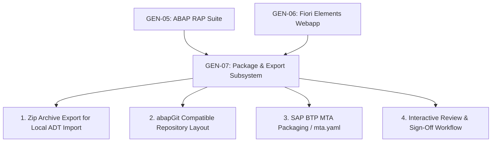

# GEN-05 & GEN-06: Generator Boundaries, Limitations & Next Steps
## Technical Boundaries, S/4HANA 2023 Considerations & Handoff to GEN-07

### 1. Architectural Boundaries & Non-Negotiable Constraints

In strict accordance with the Fiorify Protection Rules:
1. **Strictly Local Draft Artifacts:** GEN-05 and GEN-06 do not write directly to the SAP dictionary (`DDIC`), perform RFC/ADT activations, or create Transport Requests (`CTS`).
2. **Draft Persistence Staging:** The current RAP behavior generator targets `MANAGED_RAP_DRAFT` and `MANAGED_RAP_NON_DRAFT`. Complex unmanaged BAPI transactions (`UNMANAGED_RAP`) require manual implementation of the `save` and `cleanup` methods in ABAP.
3. **Target System Compatibility:** The synthesized code targets **SAP S/4HANA 2023 FPS00 (ABAP Cloud Language Version 5)**. Running against legacy NetWeaver 7.50 or ERP 6.0 EHP8 would fail due to the usage of `define view entity` and RAP `strict ( 2 );`.

---

### 2. Known Generator Limitations

1. **Complex Custom Value Helps (`@Consumption.valueHelpDefinition`):**
   - Value helps currently bind to standard released views (e.g., `I_CompanyCode`, `I_Currency`). Multi-field composite value helps require manual adjustment in the projection view.
2. **Multi-Level Deep Compositions Beyond 2 Levels:**
   - The generator supports 2 levels (Header -> Items). Hierarchies with 3+ nested children (Header -> Item -> SubItem -> Schedule) require manual association chaining in the BDEF.
3. **Numbering Strategies:**
   - Default is `numbering: managed` (UUID primary key). Semantic external numbering ranges require developer implementation of an unmanaged determination for key assignment.
4. **Fiori Custom Action Formatting:**
   - Fiori Elements annotations configure standard CRUD, Draft actions, and basic UI actions. Complex dialog parameters for RAP actions require custom fragment extensions in UI5.

---

### 3. Handoff to GEN-07: Review, Export & Packaging

With GEN-05 and GEN-06 complete and validated, the foundation is prepared for **GEN-07 (Review, Export & Packaging)**:

#### Key Capabilities for GEN-07:
1. **abapGit Repository Serialization:** Format all ABAP files into abapGit folder structure with `.abapgit.xml` for direct push to GitHub / SAP git repository.
2. **Project ZIP Bundle Download:** One-click download of the complete ABAP + UI5 project bundle from the Generation Studio UI.
3. **MTA (Multi-Target Application) Build:** Scaffolding `mta.yaml` bundling the Fiori app for deployment to SAP BTP Cloud Foundry HTML5 Application Repository.
4. **Formal Review & Sign-Off Record:** Admin sign-off gate before marking the project `COMPLETED`.
