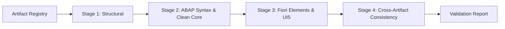

# GEN-05 & GEN-06: Static Validation Matrix
## Multi-Stage Validation Rules, Severity, Rationale & Repair Actions

### 1. Engine Architecture

The **Static Validation Engine** (`backend/src/generation/validation/staticValidationEngine.js`) executes across four stages to ensure generated code can be parsed and activated cleanly in an SAP S/4HANA 2023 environment before any developer touches ADT.

---

### 2. Validation Rule Catalog

| Rule ID | Category | Severity | Description | SAP S/4HANA Rationale | Auto-Correction / Remediation |
| :--- | :--- | :--- | :--- | :--- | :--- |
| **`VAL-STRUCT-001`** | Structural | `ERROR` | Missing mandatory file path or empty content | An artifact without file path or content cannot be serialized or exported to ADT. | Regenerate artifact or restore template. |
| **`VAL-STRUCT-002`** | Structural | `WARNING` | Checksum mismatch in unmodified artifact | Hash does not match stored baseline, indicating out-of-band mutation. | Recompute hash or verify file integrity. |
| **`VAL-ABAP-TABL-001`** | ABAP DDIC | `ERROR` | Transparent table name exceeds 16 characters | SAP DDIC table names in classic customer namespace are restricted to 16 characters. | Truncate and sanitize table name. |
| **`VAL-ABAP-TABL-002`** | ABAP DDIC | `ERROR` | Table missing client field `client : abap.clnt` | Client-dependent business tables require client key field for tenant/client isolation. | Prepend `client` key column. |
| **`VAL-ABAP-CDS-001`** | Clean Core CDS | `ERROR` | Legacy `@AbapCatalog.sqlViewName` present | In SAP S/4HANA 2023+, CDS View Entities (`define view entity`) replace obsolete DDIC SQL views. | Remove `@AbapCatalog.sqlViewName` annotation. |
| **`VAL-ABAP-CDS-002`** | Clean Core CDS | `ERROR` | Missing `@AccessControl.authorizationCheck` | Every view entity in Clean Core requires explicit authorization check specification. | Add `@AccessControl.authorizationCheck: #CHECK`. |
| **`VAL-ABAP-BDEF-001`** | RAP Behavior | `ERROR` | Strict mode level missing or below `strict ( 2 );` | RAP in S/4HANA 2023 requires `strict ( 2 );` for Clean Core compatibility and compiler checks. | Enforce `strict ( 2 );` statement. |
| **`VAL-ABAP-BDEF-002`** | RAP Behavior | `ERROR` | Draft table missing in draft-enabled behavior | When `with draft;` is declared, every entity must specify a persistent `draft table`. | Provide valid draft table name (`Z*_D`). |
| **`VAL-ABAP-METH-001`** | ABAP OO | `ERROR` | Local method name exceeds 30 characters | ABAP OO compiler throws syntax error for method identifiers exceeding 30 characters. | Slug and truncate method name using `toAbapMethodName`. |
| **`VAL-FIORI-MAN-001`** | Fiori Elements | `ERROR` | `webapp/manifest.json` invalid JSON syntax | UI5 runtime fails to bootstrap if descriptor cannot be parsed. | Re-serialize descriptor to valid JSON. |
| **`VAL-FIORI-MAN-002`** | Fiori Elements | `ERROR` | Minimum UI5 version unsupported | Target version must be `1.120.0` or higher for S/4HANA 2023 OData V4 features. | Update `minUI5Version` to `1.120.0`. |
| **`VAL-FIORI-XML-001`** | Fiori Annotations | `ERROR` | `annotations.xml` malformed XML | Browser XML parser fails to parse malformed XML schema. | Ensure closing tags and XML header are well-formed. |
| **`VAL-CROSS-ENT-001`** | Cross-Artifact | `ERROR` | Entity exposed in Service Definition missing CDS View | Service definition attempts to expose non-existent CDS projection view. | Synchronize service definition with projection view names. |
| **`VAL-CROSS-SRV-001`** | Cross-Artifact | `ERROR` | Fiori manifest dataSource URI mismatches SRVD | Fiori app calls OData V4 endpoint path inconsistent with service definition name. | Synchronize manifest `uri` with service definition name. |

---

### 3. Scoring & Acceptance Thresholds

The static validation engine calculates an overall quality score:
- **`100`**: Zero errors and zero warnings.
- **`90 - 99`**: Zero errors, non-blocking UI warnings (e.g., missing `@UI.lineItem` qualifier).
- **`< 90`**: Blocking errors present; lifecycle cannot advance to `REVIEWED`.
