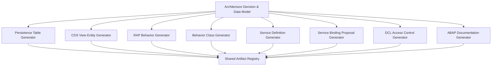

# GEN-05: RAP Architecture Designer & ABAP Generator Engine
## Technical Architecture, Rules & Clean Core Specification

### 1. Architectural Mission & Executive Summary

The **GEN-05 RAP Subsystem** translates confirmed business requirements, entity models, and transactional semantics into a Clean Core (Tier 2 Cloud Development Model) RESTful Application Programming (RAP) backend artifact suite tailored specifically for **SAP S/4HANA 2023 On-Premise (FPS00 / Feature Pack Stack 0)**.

In strict adherence to the **Non-Negotiable Protection Rules**:
- **Zero SAP Writes / No Remote CTS Deployment:** All generated artifacts are produced locally as editable draft source files within the FioriX Generation Project persistence workspace.
- **Strictly Deterministic Generation:** Identical inputs yield identical AST representations, DDL statements, and checksums.
- **Manual Edit Preservation:** Artifacts modified by an ABAP architect are preserved across subsequent regeneration runs, with template baseline diffs tracked.

---

### 2. RAP Architecture Decision Engine

The `ArchitectureDecisionEngine` (`backend/src/generation/architecture/architectureDecisionEngine.js`) evaluates project metadata, entity compositions, transactional operations, and non-functional requirements to select the target RAP profile.

#### 2.1 Profile Selection Matrix

| Profile | Selected When | Persistence Mechanism | Draft Capability | Lock & ETag Strategy |
| :--- | :--- | :--- | :--- | :--- |
| **`MANAGED_RAP_DRAFT`** | Project contains CUD (Create/Update/Delete) operations, multi-step editing, approval workflows, or composition children. | Transparent database tables (`Z*`) + Draft staging tables (`Z*_D`) | Draft table (`Z*_D`) with `with draft;` syntax | Optimistic concurrency via `total etag` and instance `last_changed_at` |
| **`MANAGED_RAP_NON_DRAFT`** | Direct transactional persistence where single-step commit is required without draft staging. | Transparent database table (`Z*`) | None | Direct optimistic lock via ETag |
| **`UNMANAGED_RAP`** | Complex legacy BAPI encapsulation or integration with non-standard commit cycles. | Custom ABAP table / BAPI delegate | Optional custom draft table | Custom unmanaged lock object |
| **`READ_ONLY_QUERY`** | Pure analytical reporting or read-only operational dashboard. | Existing CDS views or database views | None | None |

#### 2.2 Table & Entity Name Normalization

SAP Dictionary transparent table names cannot exceed 16 characters in on-premise environments, and custom artifacts must reside in the customer namespace (`Z` or `Y`).
1. **Root Table (`rootTableName`):** Sanitized entity name prefixed with `Z`, truncated to 16 characters (e.g., `ZPAY_HEADER`).
2. **Draft Table (`draftTableName`):** Derived by appending `_D` or replacing the final characters to fit within 16 characters (e.g., `ZPAY_HEADER_D`).
3. **Child Tables:** Truncated and indexed with child suffixes (e.g., `ZPAY_ITEM`, `ZPAY_ITEM_D`).

#### 2.3 Clean Core Tier 2 Classification

In SAP S/4HANA 2023, custom code extending standard business processes adheres to **Tier 2 (Cloud Development Model on Core Platform)**:
- Syntax conforms to **ABAP Cloud Language Version 5**.
- Relational joins exclusively reference **Released CDS Interface Views** (e.g., `I_CompanyCode`, `I_Currency`).
- Database accesses use Open SQL / ABAP SQL with strict field projection lists.
- Obsolete statements (e.g., `CALL FUNCTION ... IN UPDATE TASK`, `SELECT *`, direct database writes) are strictly excluded.

---

### 3. ABAP Generator Modules & Code Synthesis

The generation pipeline coordinates eight specialized generator modules:

#### 3.1 Persistence Table Generator (`persistenceTableGenerator.js`)
- Generates transparent table DDL with `@EndUserText.label`, technical settings (`@AbapCatalog.tableCategory : #TRANSPARENT`, `@AbapCatalog.deliveryClass : #A`), client handling (`MANDT : abap.clnt`), administrative audit fields (`created_by`, `created_at`, `last_changed_by`, `last_changed_at`, `local_last_changed_at`).
- Generates corresponding draft tables with `%admin` field structures required by SAP draft administration.

#### 3.2 CDS View Entity Generator (`cdsViewEntityGenerator.js`)
- Utilizes modern SAP S/4HANA 2023 `define view entity` syntax (no DDIC SQL view generation via `@AbapCatalog.sqlViewName`).
- Generates three distinct CDS layers:
  1. **Interface View (`ZI_*`):** Encapsulates core persistence table with administrative associations and conversions.
  2. **Consumption/Projection View (`ZC_*`):** Defines user-facing projections, `@Search.searchable : true`, `@ObjectModel.semanticKey`, and exposes draft actions.
  3. **Metadata Extension (`.mde.asddls`):** Decouples UI annotations (`@UI.headerInfo`, `@UI.facet`, `@UI.lineItem`, `@UI.identification`) from core CDS logic.

#### 3.3 RAP Behavior Definition Generator (`rapBehaviorGenerator.js`)
- Produces `managed implementation in class bp_i_* unique;` with `strict ( 2 );`.
- Features `with draft;` block with draft actions (`Edit`, `Activate`, `Discard`, `Resume`, `Prepare`).
- Configures field characteristics (`readonly`, `mandatory`, `numbering: managed`).
- Maps business requirements to validations (`validate*`), determinations (`calculate*`), and actions.

#### 3.4 Behavior Class Generator (`behaviorClassGenerator.js`)
- Produces ABAP OO Local Handler class (`LCL_BUFFER`, `LHC_ROOT`) definitions and implementations.
- ABAP method names are constrained to a maximum of 30 characters using the deduplicated slug engine (`toAbapMethodName`).
- Generates typed method signatures: `FOR VALIDATION`, `FOR DETERMINATION`, `FOR MODIFY`, and `FOR READ`.
- Inserts requirement traceability headers and developer guidance comments.

#### 3.5 Service Definition & Service Binding Proposal
- **Service Definition (`SRVD`):** Exposes root and child projection views (`expose ZC_PaymentHeader as PaymentHeader;`).
- **Service Binding Proposal (`.srvb.json`):** Generates planning metadata for an `ODATA_V4_UI` binding, complete with step-by-step ADT activation instructions.

#### 3.6 DCL Access Control Generator (`dclAccessControlGenerator.js`)
- Enforces row-level security using ABAP CDS Access Control syntax:
  `define role ZI_PaymentHeader { grant select on ZI_PaymentHeader where ( CompanyCode ) = aspect pfcg_auth( F_BKPF_BUK, BUKRS, ACTVT = '03' ); }`.

---

### 4. Traceability & Verification

Every generated ABAP artifact registers its requirement origins:
- Header metadata includes `sourceRequirementIds` and `sourceEntityIds`.
- Method comments in behavior classes link directly to the functional requirement (e.g., `// [REQ-001] Calculate Discount Due Date`).
- Full bidirectional traceability is exposed via `GET /api/v1/generation/projects/:id/traceability`.
