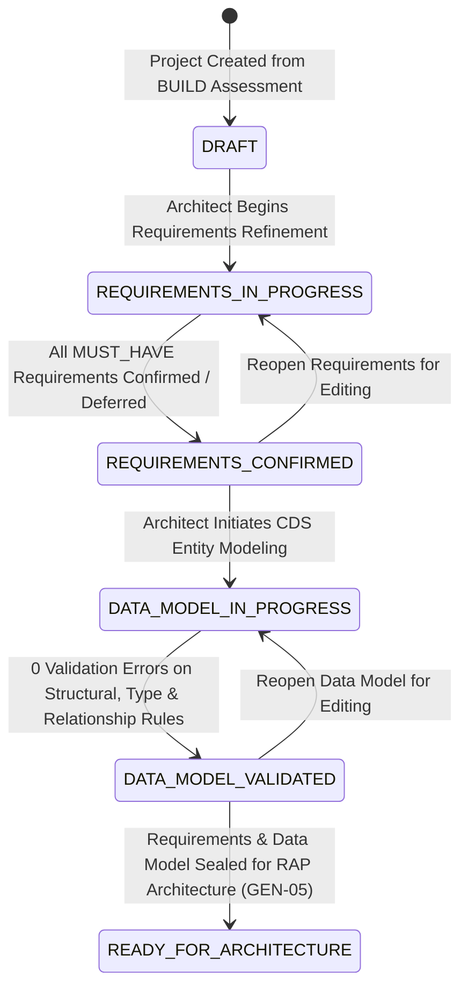

# Fiorify GENERATION STUDIO — LIFECYCLE & STATE MACHINE SPECIFICATION
## Comprehensive Lifecycle Gating, Transitions & Validation Thresholds

**Version:** 1.0.0  
**Status:** Approved & Implemented  
**Component:** `backend/src/generation/projects/generationProjectLifecycle.js`

---

## 1. Lifecycle Overview

Generation Studio coordinates an 8-stage lifecycle to enforce strict architectural governance over Clean Core ABAP RAP development. Each state transition requires verification that all upstream deliverables satisfy their contractual validation gates.



---

## 2. Formal Transition Matrix

The authoritative transition map in `backend/src/generation/projects/generationProjectLifecycle.js`:

```javascript
export const ALLOWED_PROJECT_TRANSITIONS = {
  [PROJECT_LIFECYCLE_STATUS.DRAFT]: [
    PROJECT_LIFECYCLE_STATUS.REQUIREMENTS_IN_PROGRESS,
    PROJECT_LIFECYCLE_STATUS.ARCHIVED
  ],
  [PROJECT_LIFECYCLE_STATUS.REQUIREMENTS_IN_PROGRESS]: [
    PROJECT_LIFECYCLE_STATUS.REQUIREMENTS_CONFIRMED,
    PROJECT_LIFECYCLE_STATUS.DRAFT,
    PROJECT_LIFECYCLE_STATUS.ARCHIVED
  ],
  [PROJECT_LIFECYCLE_STATUS.REQUIREMENTS_CONFIRMED]: [
    PROJECT_LIFECYCLE_STATUS.DATA_MODEL_IN_PROGRESS,
    PROJECT_LIFECYCLE_STATUS.DATA_MODEL_VALIDATED,
    PROJECT_LIFECYCLE_STATUS.REQUIREMENTS_IN_PROGRESS,
    PROJECT_LIFECYCLE_STATUS.ARCHIVED
  ],
  [PROJECT_LIFECYCLE_STATUS.DATA_MODEL_IN_PROGRESS]: [
    PROJECT_LIFECYCLE_STATUS.DATA_MODEL_VALIDATED,
    PROJECT_LIFECYCLE_STATUS.REQUIREMENTS_CONFIRMED,
    PROJECT_LIFECYCLE_STATUS.ARCHIVED
  ],
  [PROJECT_LIFECYCLE_STATUS.DATA_MODEL_VALIDATED]: [
    PROJECT_LIFECYCLE_STATUS.READY_FOR_ARCHITECTURE,
    PROJECT_LIFECYCLE_STATUS.DATA_MODEL_IN_PROGRESS,
    PROJECT_LIFECYCLE_STATUS.ARCHIVED
  ],
  [PROJECT_LIFECYCLE_STATUS.READY_FOR_ARCHITECTURE]: [
    PROJECT_LIFECYCLE_STATUS.DATA_MODEL_VALIDATED,
    PROJECT_LIFECYCLE_STATUS.ARCHIVED
  ]
};
```

---

## 3. Transition Gate Criteria

### 3.1 DRAFT → REQUIREMENTS_IN_PROGRESS
- Trigger: Automatic upon adding/importing the first requirement or explicit architect action.
- Preconditions:
  - Source assessment provenance must be verified.
  - Project record must be persisted.

### 3.2 REQUIREMENTS_IN_PROGRESS → REQUIREMENTS_CONFIRMED
- Trigger: Evaluation in `computeRequirementsSummary()`.
- Gating Rule:
  $$\text{Gate Satisfied} \iff (\text{mustHaveUnconfirmed} = 0) \land (\text{inReviewCount} = 0) \land (\text{totalRequirements} > 0)$$
- Blocking conditions:
  - Any `MUST_HAVE` requirement in `DRAFT` or `IN_REVIEW`.
  - Any `CONFIRMED` requirement missing acceptance criteria.
  - Any `DEFERRED` requirement missing a documented deferral reason.

### 3.3 REQUIREMENTS_CONFIRMED → DATA_MODEL_IN_PROGRESS
- Trigger: Architect adds an entity or modifies the data model schema.

### 3.4 DATA_MODEL_IN_PROGRESS → DATA_MODEL_VALIDATED
- Trigger: Execution of `POST /api/v1/generation/projects/:projectId/datamodel/validate`.
- Gating Rule:
  $$\text{Validation Succeeded} \iff (\text{errorCount} = 0) \land (\text{hasRootEntity} = \text{true})$$
- Error findings that strictly block validation:
  - Missing ROOT entity.
  - Entity missing primary keys.
  - Composition cycle detected.
  - Unresolved relationship target entities.
  - Currency amount (`abap.curr`) missing valid currency reference (`cukyField` or `currencyRef`).
  - Quantity amount (`abap.quan`) missing valid unit reference (`unitField` or `unitRef`).

### 3.5 DATA_MODEL_VALIDATED → READY_FOR_ARCHITECTURE
- Trigger: Preparation for Milestone GEN-05 (RAP Behavior & CDS Generation).
- Gating Rule: Both Requirements Gate and Data Model Validation are green.

---

## 4. Rollback and Reopening Safety

If business requirements evolve:
1. Reopening requirements (`REQUIREMENTS_CONFIRMED` → `REQUIREMENTS_IN_PROGRESS`) shifts downstream status back to `DATA_MODEL_IN_PROGRESS` if schema changes are introduced.
2. Reopening data model (`DATA_MODEL_VALIDATED` → `DATA_MODEL_IN_PROGRESS`) allows editing fields, entities, and associations, re-requiring validation before proceeding to architecture definition.
3. Complete audit history is retained across all state movements.
