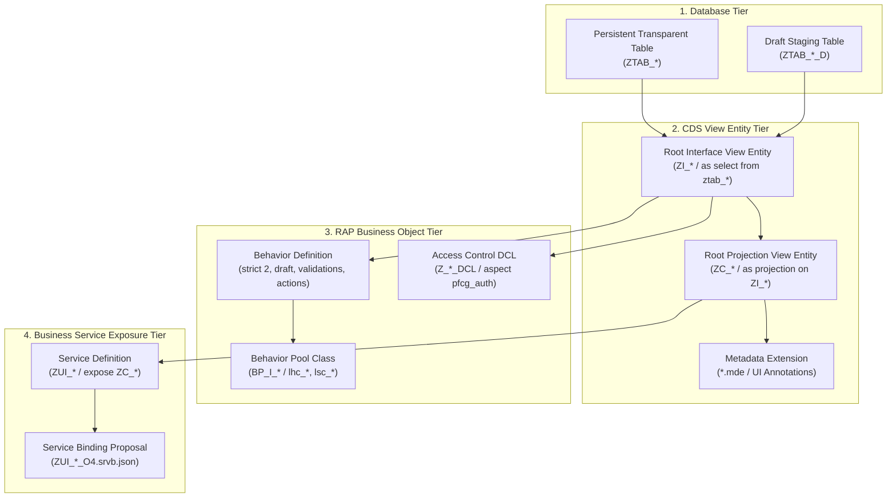

# Fiorify — RAP Generation Design Specification

## 1. Overview & Clean Core Compatibility

Fiorify synthesizes ABAP RESTful Application Programming Model (RAP) artifacts tailored for **SAP S/4HANA 2023 Clean Core** architectures. All generated code adheres to:
- **ABAP Cloud Language Version**: Release State 2 (`strict ( 2 );`).
- **CDS View Entities**: `define view entity` (replacing deprecated CDS DDIC-based views).
- **Transactional Staging**: Managed RAP with draft tables (`_d`) or direct managed storage.
- **Defensive EML Scaffolding**: Structured error handling via `failed` and `reported` structures.

---

## 2. Generated Artifact Topology



---

## 3. Detailed Artifact Specifications

### 3.1 Behavior Pool Classes (`BP_I_*`) with Defensive EML (REM-GEN-01)
Generated under `src/classes/bp_i_<entity>.clas.abap`:
- **Instance Authorizations (`get_instance_authorizations`)**:
  ```abap
  " HANDOVER STATUS: SCAFFOLD GENERATED - DOMAIN LOGIC EXTENSION REQUIRED
  LOOP AT keys ASSIGNING FIELD-SYMBOL(<ls_key>).
    APPEND VALUE #( %tky = <ls_key>-%tky
                    %update = if_abap_behv=>auth-allowed
                    %delete = if_abap_behv=>auth-allowed ) TO result.
  ENDLOOP.
  ```
- **Validation Scaffolding (`validate<Requirement>`)**:
  ```abap
  " HANDOVER STATUS: SCAFFOLD GENERATED - DOMAIN LOGIC EXTENSION REQUIRED
  READ ENTITIES OF zi_<entity> IN LOCAL MODE
    ENTITY <entity>
    ALL FIELDS WITH CORRESPONDING #( keys )
    RESULT DATA(lt_entities)
    FAILED DATA(lt_read_failed).

  LOOP AT lt_entities ASSIGNING FIELD-SYMBOL(<ls_entity>).
    IF <ls_entity>-%tky IS INITIAL.
      APPEND VALUE #( %tky = <ls_entity>-%tky ) TO failed-<entity>.
      APPEND VALUE #( %tky = <ls_entity>-%tky
                      %msg = new_message_with_text(
                               severity = if_abap_behv_message=>severity-error
                               text     = 'Mandatory entity key is unassigned.' )
                    ) TO reported-<entity>.
    ENDIF.
  ENDLOOP.
  ```
- **Artifact Metadata**:
  - `requiresDeveloperCompletion: true`
  - `developerCompletionMethods`: Array of method names requiring custom developer logic.

### 3.2 Service Binding Blueprint (`.srvb.json`) (REM-GEN-02)
Generated under `src/srvb/zui_<entity>_o4.srvb.json`:
- Explicit architectural clarification: `.srvb.json` is a **planning and deployment proposal**, NOT a TADIR-activatable binary object (R3TR SRVB).
- Activation and publication must occur via Eclipse ADT or SAP Gateway (`/IWFND/MAINT_SERVICE`).
- Includes comprehensive manual activation guide for both ADT and SAP GUI.

### 3.3 Domain-Realistic Access Control (DCL) (REM-GEN-03)
Generated under `src/dcl/z_<entity>_dcl.dcls.asdcls`:
- Matches standard enterprise PFCG authorization objects:
  - **Sales Order (`VA01` / SD)**: `V_VBAK_VKO` (Sales Org `VKORG`), `ACTVT = '03'`.
  - **Purchase Order (`ME21N` / MM-PUR)**: `M_BEST_EKO` (Purchasing Org `EKORG`), `ACTVT = '03'`.
  - **Material Master (`MM01` / MM-IM)**: `M_MATE_WRK` (Plant `WERKS`), `ACTVT = '03'`.
  - **Journal Entry (`FB01` / FI-GL)**: `F_BKPF_BUK` (Company Code `BUKRS`), `ACTVT = '03'`.
  - **Generic Fallback**: `S_TABU_DIS` with explicit comments indicating manual PFCG mapping required.
- Artifact metadata reflects `authorizationMappingStatus` (`REALISTIC_DOMAIN_MAPPED` vs. `GENERIC_FALLBACK_REQUIRES_MAPPING`).
