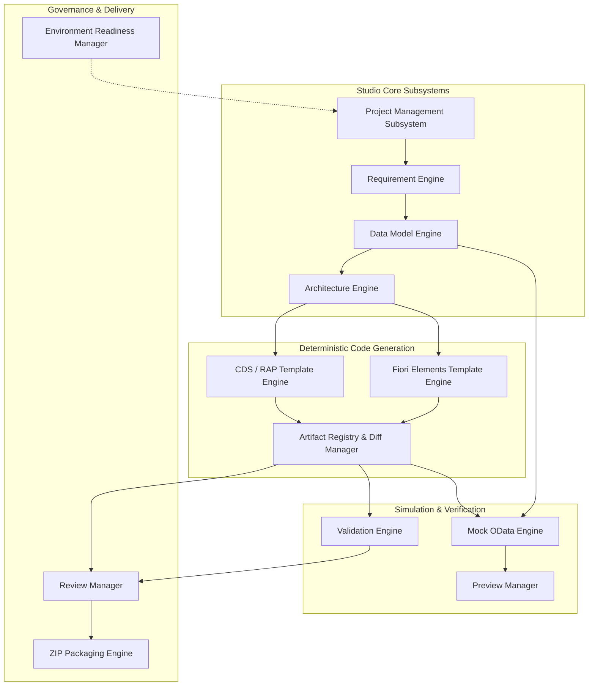

# FIORIX GENERATION ENGINE — SUBSYSTEM ARCHITECTURE & TEMPLATE SPECIFICATION
**Document ID:** ARCH-GEN-ENG-2026-01  
**Project:** FioriX — SAP Modernization Platform  
**Target Release:** FioriX v2.0.0  
**Status:** COMPLETE ARCHITECTURAL SPECIFICATION  
**Author:** Principal ABAP Cloud Architect & Systems Lead  

---

## 1. Engine Subsystems Architecture

The generation engine is designed as a set of decoupled, modular subsystems executing within the native Node.js HTTP runtime without external framework overhead (no CAP/Express dependency required).



---

## 2. Detailed Subsystem Responsibilities

### 2.1 Project Management Subsystem (`PMS`)
- **Location:** `backend/src/generation/project/`
- **File Storage:** `backend/data/generationProjects.json`
- **Operations:** Atomic CRUD on projects, write locking, `.bak` file recovery, activity history logging, and handoff association.

### 2.2 Requirement & Data Model Engines (`RE` & `DME`)
- **Location:** `backend/src/generation/model/`
- **Responsibilities:**
  - Validates entity names against SAP naming conventions (Max 30 chars, uppercase/underscore).
  - Enforces primary keys and parent composition relationships.
  - Generates released SAP C1 view associations (e.g. `I_Customer`, `I_Plant`).

### 2.3 CDS & RAP Template Engine (`CRTE`)
- **Location:** `backend/src/generation/templates/abap/`
- **Design Pattern:** Pure, deterministic TypeScript/JavaScript template functions taking typed specifications and outputting canonical ABAP Cloud code.

### 2.4 Fiori Elements Template Engine (`FETE`)
- **Location:** `backend/src/generation/templates/fiori/`
- **Generates:** `manifest.json` (OData V4 ListReport & ObjectPage layout), `ui5.yaml`, local `annotations.xml`, and mock JSON entities.

### 2.5 Artifact Registry & Diff Manager (`AR`)
- **Location:** `backend/src/generation/registry/`
- **Responsibilities:** Computes SHA-256 hashes, tracks user modifications (`isManuallyEdited`), and guards against accidental template overwrites.

### 2.6 Local Mock OData Engine & Preview Manager (`MODE` & `PM`)
- **Location:** `backend/src/generation/preview/`
- **Responsibilities:** Serves `$metadata` (EDMX V4) and entity sets with filtering (`$filter`), sorting (`$orderby`), pagination (`$top`, `$skip`), and simulated CRUD over in-memory JSON state.

### 2.7 Validation Engine (`VE`)
- **Location:** `backend/src/generation/validation/`
- **Responsibilities:** Analyzes generated ASTs and schemas against 20+ Clean Core, RAP, and UI5 compliance rules.

### 2.8 Review Manager & ZIP Packaging Engine (`RM` & `ZPE`)
- **Location:** `backend/src/generation/export/`
- **Responsibilities:** Produces a standardized ZIP archive conforming to standard SAP ADT project file trees with an embedded `ExportManifest.json`.

---

## 3. Supported Architecture Profiles

The engine supports 3 distinct architectural generation profiles based on business requirements:

1. **Profile A: RAP Managed with Draft (`RAP_MANAGED_DRAFT`) [Default]**
   - *Best for:* Standard transactional business objects with complete create, edit, draft save, and delete workflows.
   - *ABAP Elements:* Managed BDEF with draft tables (`_D`), lock master, total ETag, draft actions (`Activate`, `Discard`, `Resume`, `Edit`).
2. **Profile B: RAP Unmanaged (`RAP_UNMANAGED`)**
   - *Best for:* Complex legacy transactions requiring integration with existing BAPIs or legacy posting functions.
   - *ABAP Elements:* Unmanaged BDEF with custom save and lock implementation in ABAP classes.
3. **Profile C: Analytical / Read-Only CDS Entity (`RAP_READ_ONLY`)**
   - *Best for:* Reporting, dashboards, and inquiry transactions (e.g., `ME23N`, `FBL1N`).
   - *ABAP Elements:* Read-only CDS View Entity with UI annotations exposed directly via OData V4 without draft or edit behavior.

---

## 4. Deterministic ABAP Cloud Templates

### 4.1 Root CDS View Entity Template (`ZR_<Entity>TP.asddls`)
```sql
@AccessControl.authorizationCheck: #CHECK
@EndUserText.label: '${entity.description}'
@Metadata.allowExtensions: true
define root view entity ${entity.cdsViewName}
  as select from ${entity.databaseTableName}
  /* Associations to child composition entities */
  ${compositionAssociations}
  /* Standard SAP Released C1 associations */
  ${standardAssociations}
{
  key ${keyFieldsDefinition},
  ${nonKeyFieldsDefinition},
  
  /* Administrative Clean Core Fields */
  @Semantics.user.createdBy: true
  created_by            as CreatedBy,
  @Semantics.systemDateTime.createdAt: true
  created_at            as CreatedAt,
  @Semantics.user.lastChangedBy: true
  last_changed_by       as LastChangedBy,
  @Semantics.systemDateTime.lastChangedAt: true
  last_changed_at       as LastChangedAt,
  @Semantics.systemDateTime.localInstanceLastChangedAt: true
  local_last_changed_at as LocalLastChangedAt,
  
  /* Compositions */
  ${compositionProjections}
}
```

---

### 4.2 Behavior Definition Template (`ZR_<Entity>TP.bdef`)
```sql
managed implementation in class ${behaviorClass} unique;
strict ( 2 );
with draft;

define behavior for ${entity.cdsViewName} alias ${entity.entityId}
persistent table ${entity.databaseTableName}
draft table ${entity.draftTableName}
lock master
total etag LastChangedAt
authorization master ( instance )
etag master LocalLastChangedAt
{
  create;
  update;
  delete;

  draft action Edit;
  draft action Activate optimized;
  draft action Discard;
  draft action Resume;
  draft determine action Prepare;

  /* Custom Business Actions */
  ${actionsDefinition}

  /* Validations */
  ${validationsDefinition}

  /* Determinations */
  ${determinationsDefinition}

  mapping for ${entity.databaseTableName}
  {
    ${fieldMappings}
  }
}
```

---

### 4.3 Service Definition Template (`ZUI_<Entity>_V4.srvd`)
```sql
@EndUserText.label: 'Service Definition for ${entity.description}'
define service ${serviceDefinitionName} {
  expose ${entity.projectionViewName} as ${entity.entityId};
  ${childEntitiesExposures}
  ${valueHelpExposures}
}
```

---

## 5. Deterministic Fiori Elements Templates

### 5.1 Fiori Elements `manifest.json` Template
```json
{
  "_version": "1.59.0",
  "sap.app": {
    "id": "${appId}",
    "type": "application",
    "i18n": "i18n/i18n.properties",
    "title": "{{appTitle}}",
    "description": "{{appDescription}}",
    "dataSources": {
      "mainService": {
        "uri": "/sap/opu/odata4/sap/${serviceBindingName}/srvd/sap/${serviceDefinitionName}/0001/",
        "type": "OData",
        "settings": {
          "annotations": ["annotation"],
          "odataVersion": "4.0"
        }
      },
      "annotation": {
        "type": "ODataAnnotation",
        "uri": "annotations/annotation.xml",
        "settings": {
          "localUri": "annotations/annotation.xml"
        }
      }
    }
  },
  "sap.ui5": {
    "dependencies": {
      "minUI5Version": "1.118.0",
      "libs": {
        "sap.m": {},
        "sap.fe.templates": {}
      }
    },
    "routing": {
      "routes": [
        {
          "name": "${entity.entityId}List",
          "pattern": ":?query:",
          "target": "${entity.entityId}List"
        },
        {
          "name": "${entity.entityId}ObjectPage",
          "pattern": "${entity.entityId}({key}):?query:",
          "target": "${entity.entityId}ObjectPage"
        }
      ],
      "targets": {
        "${entity.entityId}List": {
          "type": "Component",
          "id": "${entity.entityId}List",
          "name": "sap.fe.templates.ListReport",
          "options": {
            "settings": {
              "contextPath": "/${entity.entityId}",
              "navigation": {
                "${entity.entityId}": {
                  "detail": { "route": "${entity.entityId}ObjectPage" }
                }
              }
            }
          }
        },
        "${entity.entityId}ObjectPage": {
          "type": "Component",
          "id": "${entity.entityId}ObjectPage",
          "name": "sap.fe.templates.ObjectPage",
          "options": {
            "settings": {
              "contextPath": "/${entity.entityId}"
            }
          }
        }
      }
    }
  }
}
```

---

## 6. Naming Conventions & Namespace Standards

To guarantee collision-free import into SAP customer namespaces (`Z*` or `Y*`):

| Object Type | Standard Naming Pattern | Example (Purchase Order) | Max Length |
| :--- | :--- | :--- | :--- |
| **Root Data Model CDS** | `ZR_<Entity>TP` | `ZR_PurchaseOrderTP` | 30 chars |
| **Child Data Model CDS**| `ZR_<Parent><Child>TP` | `ZR_PurchaseOrderItemTP` | 30 chars |
| **Projection View (Root)**| `ZC_<Entity>TP` | `ZC_PurchaseOrderTP` | 30 chars |
| **Behavior Definition** | `ZR_<Entity>TP` | `ZR_PurchaseOrderTP` | 30 chars |
| **Behavior Implementation** | `ZBP_R_<Entity>TP` | `ZBP_R_PurchaseOrderTP` | 30 chars |
| **Service Definition** | `ZUI_<Entity>_V4` | `ZUI_PurchaseOrder_V4` | 30 chars |
| **Service Binding** | `ZUI_<Entity>_V4_O4` | `ZUI_PurchaseOrder_V4_O4` | 30 chars |
| **Metadata Extension** | `ZC_<Entity>TP.mde` | `ZC_PurchaseOrderTP.mde` | 30 chars |
| **Draft Table** | `Z<PREFIX>_<Entity>_D` | `ZDT_PO_HDR_D` | 16 chars |
| **Fiori App Namespace** | `customer.<tcode_lower>` | `customer.me21n` | 40 chars |
