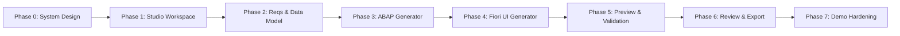

# FIORIX GENERATION STUDIO — PHASE ROADMAP & 70% DEMONSTRATION SCORECARD
**Document ID:** PLAN-GEN-ROADMAP-2026-01  
**Project:** FioriX — SAP Modernization Platform  
**Target Milestone:** FioriX v2.0.0 Generation Studio  
**Status:** APPROVED STRATEGIC ROADMAP  
**Author:** Principal Enterprise Solution Architect & Program Director  

---

## 1. 70% Demonstration Scope & Evidence-Based Scorecard

To maintain absolute transparency and eliminate subjective claims, Generation Studio milestones are evaluated against an **evidence-based scorecard**. 

A capability earns percentage credit **ONLY** when its automated unit, integration, and UI acceptance tests pass with verified assertions. Placeholder screens, dummy buttons, or hardcoded strings earn **0% credit**.

```
+-----------------------------------------------------------------------------------+
|               FIORIX GENERATION STUDIO — 70% TARGET SCORECARD                     |
+------------------------------------+-----------+----------------------------------+
| Functional Capability Area         | Weight    | Verification Evidence Required   |
+------------------------------------+-----------+----------------------------------+
| 1. Project Creation & Persistence  | 10%       | Automated CRUD + Backend File DB |
| 2. Requirements & Data Model       | 15%       | Interactive Visual/Grid Modeling |
| 3. Architecture Specification      | 10%       | RAP Profile & Clean Core Matrix  |
| 4. Deterministic ABAP Generation   | 15%       | Real CDS/BDEF/SRVD Syntax Tests  |
| 5. Deterministic Fiori UI Gen      | 15%       | Valid manifest.json + Annotations|
| 6. Local Mock Preview Subsystem    | 15%       | Running Mock OData Server + UI   |
| 7. Static Validation Suite         | 10%       | 20 Real AST/Schema Rules Passed  |
| 8. Developer Review & ZIP Export   | 10%       | Valid ZIP with SHA-256 Manifest  |
+------------------------------------+-----------+----------------------------------+
| TOTAL PROTOTYPE TARGET COMPLETION  | 100%      | Complete Local-First Studio      |
+------------------------------------+-----------+----------------------------------+
```

*Note: Live SAP remote activation, CTS transport requests, and production deployment represent the remaining 30% of full enterprise capabilities and are strictly excluded from this prototype milestone.*

---

## 2. Comprehensive Multi-Phase Implementation Plan



---

### Phase 0: System Design & Environment Audit (CURRENT PHASE)
- **Objective:** Establish the complete architectural blueprint, versioned data contracts, UI/UX specifications, mock engine design, and inspect host environment readiness without modifying code.
- **Key Deliverables:** 9 comprehensive architectural specifications in `docs/generation/design/` and `docs/audit/`.
- **Exit Conditions:** Full system design and host readiness findings formally reviewed and signed off.

---

### Phase 1: Generation Studio Workspace & Persistence
- **Objective:** Build the core Generation Studio layout shell, 9-tab sub-navigation, and backend project persistence engine.
- **Files/Modules:**
  - `frontend/src/features/generation/GenerationStudioPage.tsx`
  - `frontend/src/features/generation/components/StudioNavigation.tsx`
  - `frontend/src/features/generation/components/ProjectsDashboard.tsx`
  - `backend/src/generation/project/generationProjectStore.js`
  - `backend/src/server.js` (Project CRUD routes)
- **APIs:**
  - `POST /api/v1/generation/projects`
  - `GET /api/v1/generation/projects`
  - `GET /api/v1/generation/projects/:id`
  - `PUT /api/v1/generation/projects/:id`
  - `DELETE /api/v1/generation/projects/:id`
- **UI Screens:** Screen 1 (`GS-01` Projects Dashboard) & Studio App Header.
- **Acceptance Criteria:**
  - Projects can be created from approved Assessment Handoff records or created from scratch.
  - Project state persists across page reloads and backend server restarts.
  - Sub-navigation switches smoothly between all 9 screens while preserving active project ID.
- **Test Plan:** Node.js backend integration test (`generationProjectPersistence.test.js`) and Vitest frontend test (`projectsDashboard.test.ts`).

---

### Phase 2: Requirements & Data Model Designer
- **Objective:** Enable visual and tabular authoring of functional requirements, business entities, fields, and CDS associations.
- **Files/Modules:**
  - `frontend/src/features/generation/components/RequirementsDesigner.tsx`
  - `frontend/src/features/generation/components/DataModelDesigner.tsx`
  - `frontend/src/features/generation/components/ArchitectureDesigner.tsx`
  - `backend/src/generation/model/dataModelValidator.js`
- **APIs:**
  - `PUT /api/v1/generation/projects/:id/requirements`
  - `PUT /api/v1/generation/projects/:id/data-model`
  - `PUT /api/v1/generation/projects/:id/architecture`
- **UI Screens:** Screen 2 (`GS-02`), Screen 3 (`GS-03`), Screen 4 (`GS-04`).
- **Acceptance Criteria:**
  - User can add entities, define key and non-key fields, and choose ABAP data types.
  - User can link standard SAP released C1 views (e.g. `I_Customer`).
  - Architecture options (RAP Managed with Draft, Unmanaged, Read-Only) configure project settings.
- **Test Plan:** Unit tests for model consistency validation and schema round-trip serialization.

---

### Phase 3: ABAP Generator Subsystem
- **Objective:** Deterministic generation of production-ready ABAP Cloud artifacts conforming to S/4HANA 2023 Clean Core standards.
- **Files/Modules:**
  - `backend/src/generation/templates/abap/cdsEntityTemplate.js`
  - `backend/src/generation/templates/abap/projectionViewTemplate.js`
  - `backend/src/generation/templates/abap/behaviorDefinitionTemplate.js`
  - `backend/src/generation/templates/abap/behaviorImplementationTemplate.js`
  - `backend/src/generation/templates/abap/serviceDefinitionTemplate.js`
  - `backend/src/generation/templates/abap/serviceBindingTemplate.js`
  - `backend/src/generation/engine/abapGenerationEngine.js`
  - `frontend/src/features/generation/components/AbapGeneratorView.tsx`
- **APIs:**
  - `POST /api/v1/generation/projects/:id/generate/abap`
  - `GET /api/v1/generation/projects/:id/artifacts`
- **UI Screens:** Screen 5 (`GS-05` ABAP Generator).
- **Acceptance Criteria:**
  - Generates valid CDS View Entities, Projection Views, BDEF, and Service Definitions.
  - Emits proper SAP administrative fields and draft tables (`_D`).
  - Code viewer displays formatted code with syntax highlighting and copy button.
- **Test Plan:** Deterministic string assertion tests comparing generated code against gold-standard ABAP Cloud references.

---

### Phase 4: Fiori UI Generator Subsystem
- **Objective:** Generate complete SAP Fiori Elements List Report and Object Page frontend configurations and synthetic mock datasets.
- **Files/Modules:**
  - `backend/src/generation/templates/fiori/manifestTemplate.js`
  - `backend/src/generation/templates/fiori/ui5YamlTemplate.js`
  - `backend/src/generation/templates/fiori/annotationXmlTemplate.js`
  - `backend/src/generation/templates/fiori/mockDataGenerator.js`
  - `backend/src/generation/engine/fioriGenerationEngine.js`
  - `frontend/src/features/generation/components/FioriUiGeneratorView.tsx`
- **APIs:**
  - `POST /api/v1/generation/projects/:id/generate/fiori`
  - `PUT /api/v1/generation/projects/:id/mock-data`
- **UI Screens:** Screen 6 (`GS-06` Fiori UI Generator).
- **Acceptance Criteria:**
  - Generates valid `manifest.json`, `ui5.yaml`, `annotations.xml`, and mock JSON entities.
  - UI visualizer allows rearranging table columns and filter fields.
- **Test Plan:** JSON schema validation against UI5 manifest schema and XML structure validation.

---

### Phase 5: Local Preview & Static Validation
- **Objective:** Deliver the interactive local preview powered by the embedded mock OData V4 server, accompanied by the 20-rule static validation engine.
- **Files/Modules:**
  - `backend/src/generation/preview/mockODataServer.js`
  - `backend/src/generation/preview/previewManager.js`
  - `backend/src/generation/validation/staticValidationEngine.js`
  - `backend/src/generation/validation/rules/*.js`
  - `frontend/src/features/generation/components/PreviewValidationView.tsx`
- **APIs:**
  - `POST /api/v1/generation/projects/:id/preview/start`
  - `POST /api/v1/generation/projects/:id/preview/stop`
  - `POST /api/v1/generation/projects/:id/validate`
- **UI Screens:** Screen 7 (`GS-07` Preview & Validation).
- **Acceptance Criteria:**
  - Mock OData server binds to ephemeral port and responds to OData V4 requests.
  - Embedded iframe renders the Fiori Elements application with permanent `MOCK DATA` banner.
  - Static validation executes and displays structured findings with severity and line citations.
- **Test Plan:** HTTP mock protocol test suite simulating `$metadata`, `$filter`, and draft mutations; validation rule unit tests.

---

### Phase 6: Review, Diffing & ZIP Export
- **Objective:** Provide a developer review gate, manual code modification tracking, SHA-256 package checksumming, and one-click ZIP archive export.
- **Files/Modules:**
  - `backend/src/generation/registry/artifactRegistry.js`
  - `backend/src/generation/export/zipPackagingEngine.js`
  - `frontend/src/features/generation/components/ReviewExportView.tsx`
  - `frontend/src/features/generation/components/CodeDiffModal.tsx`
- **APIs:**
  - `PUT /api/v1/generation/projects/:id/artifacts/:artifactId` (Save manual edit)
  - `POST /api/v1/generation/projects/:id/review`
  - `GET /api/v1/generation/projects/:id/export/zip`
- **UI Screens:** Screen 8 (`GS-08` Review & Export).
- **Acceptance Criteria:**
  - Tracks manual edits (`isManuallyEdited`) and prevents silent template overwrites.
  - Computes individual file and master package SHA-256 hashes.
  - Generates downloadable ZIP bundle structured for direct import into Eclipse ADT.
- **Test Plan:** ZIP file integrity tests, checksum verification tests, and overwrite collision tests.

---

### Phase 7: Demonstration Hardening & Environment Verification
- **Objective:** Complete end-to-end integration polishing, comprehensive error handling, and developer environment dashboard.
- **Files/Modules:**
  - `frontend/src/features/generation/components/EnvironmentToolchainView.tsx`
  - `backend/src/generation/env/environmentDiagnosticService.js`
  - End-to-end regression test suite
- **APIs:**
  - `GET /api/v1/generation/environment/status`
- **UI Screens:** Screen 9 (`GS-09` Environment & Toolchain).
- **Acceptance Criteria:**
  - Complete, unassisted user workflow from handoff intake to preview and ZIP download.
  - Zero console errors, zero unhandled promise rejections, zero mock hallucinations.
- **Test Plan:** Master end-to-end test suite simulating the full Generation Studio lifecycle.
