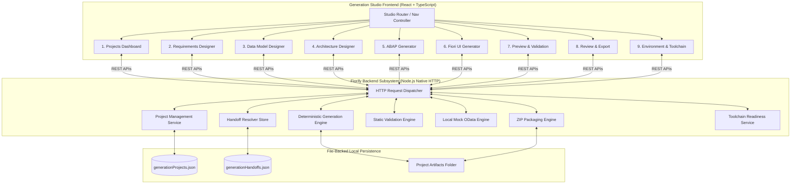
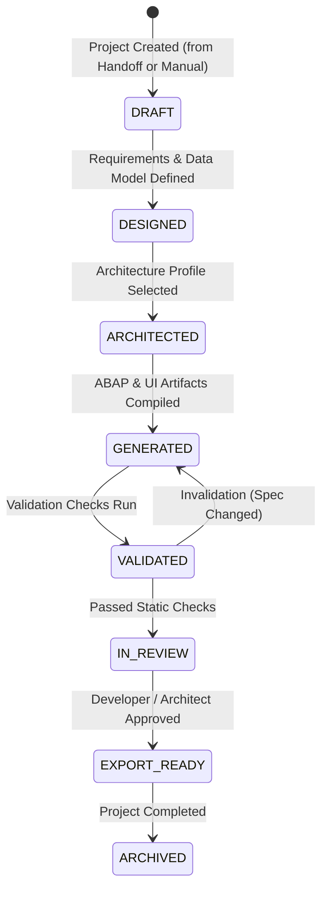

# Fiorify GENERATION STUDIO — COMPLETE SYSTEM DESIGN SPECIFICATION
**Document ID:** SPEC-GEN-SYS-2026-01  
**Project:** Fiorify — SAP Modernization Platform  
**Target Milestone:** Phase 0: System Design (70% Target Scope)  
**Status:** ARCHITECTURALLY APPROVED — NORMATIVE DESIGN  
**Date:** November 10, 2026  
**Author:** Enterprise Solution Architect & Clean Core Lead  

---

## 1. Executive Summary & Product Objective

The **Fiorify Generation Studio** is an integrated, local-first workbench designed to accelerate the modernization of legacy SAP ERP transactions into clean-core SAP Fiori applications for **SAP S/4HANA 2023 On-Premise**.

### Target Demonstration Scope (70% Product Target)
The generation studio supports genuine developer capabilities without requiring live SAP deployment:
1. **Intake & Project Management:** Create and manage generation projects linked to approved Discovery BUILD handoffs or standalone modernization blueprints.
2. **Requirements Engineering:** Formulate, refine, and prioritize functional and technical requirements.
3. **Data Model Design:** Visually model CDS entities, composition hierarchies, fields, types, and released C1 view associations.
4. **Architecture Design:** Configure RAP behavior profiles (Managed with Draft, Unmanaged, Read-Only), OData V4 service contracts, and Clean Core tiers.
5. **Deterministic ABAP Generation:** Generate CDS View Entities, Behavior Definitions (BDEF), Service Definitions (SRVD), Service Bindings (SRVB), and Behavior Implementation classes.
6. **Deterministic Fiori UI Generation:** Generate SAP Fiori Elements List Report and Object Page applications including `manifest.json`, `ui5.yaml`, annotations, and mock data.
7. **Local Mock Preview:** Launch and interact with the generated Fiori application using a built-in mock OData V4 service without remote SAP connectivity.
8. **Static Validation & Verification:** Run syntax, Clean Core, and architectural consistency checks with clear severities and remediation guidance.
9. **Developer Review & Export:** Inspect code diffs, verify SHA-256 integrity checksums, and export a complete, reviewable ZIP bundle ready for ADT import.

### Explicit Scope Boundaries & Non-Goals
* **No Remote SAP Activation:** Generation Studio does not connect via RFC or ADT to compile, check, or activate objects in the S21 sandbox.
* **No CTS Transports:** Transport requests (`TRKORR`), tasks, and package assignments in live SAP systems are strictly out of scope.
* **No Modification of Upstream Modules:** Discovery assessments, Fit-Gap analyses, and recommendation rules remain strictly read-only.
* **No Arbitrary Shell Execution:** The system forbids arbitrary execution of OS commands from the browser.

---

## 2. End-to-End System Architecture

---

## 3. Internal Generation Studio Navigation & Screen Responsibilities

All 9 screens are contained entirely within the Generation Studio module layout (`/generation-studio`). The user navigates seamlessly via an internal studio sub-navigation bar and step breadcrumbs while preserving project context.

### 3.1 Screen Inventory & Responsibilities

| Screen ID | Screen Name | Key Responsibilities | User Actions & Interactions |
| :--- | :--- | :--- | :--- |
| **GS-01** | **Projects Dashboard** | Overview of all active and archived generation projects; displays project status, source T-Code, target release, last updated timestamp, and artifact counts. | - Create New Project (from approved handoff or scratch) - Open existing project - Clone project - Archive / Delete project |
| **GS-02** | **Requirements Designer** | Decompose business needs into structured functional criteria; tag requirements with priority (Must/Should/Could), type (CRUD, Calculation, Action), and target entity. | - Add / Edit / Remove requirements - Map requirements to entities - Mark requirements as Confirmed - Reorder priority |
| **GS-03** | **Data Model Designer** | Visual and tabular modeling of data entities; define root entity (Header), child entities (Items, Logs), primary keys, ABAP data types, and released C1 CDS associations (e.g., `I_Customer`). | - Add entities and composition links - Define fields, technical types, lengths, and labels - Configure foreign key value helps - Validate model consistency |
| **GS-04** | **Architecture Designer** | Selection and configuration of technical architecture patterns: RAP Managed with Draft, RAP Unmanaged, or Read-Only; define OData V4 exposure parameters and Clean Core tier. | - Select implementation scenario - Configure draft handling - Define actions (e.g., Approve, Escalate) - Select Clean Core tier (Tier 1/Tier 2) |
| **GS-05** | **ABAP Generator** | Execution and inspection of deterministic ABAP Cloud artifact generation; generates CDS View Entities, Projection Views, Behavior Definitions (BDEF), Implementation Classes, and Service Definitions. | - Trigger ABAP generation - View syntax-highlighted code - Compare code against template rules - Revert manual changes |
| **GS-06** | **Fiori UI Generator** | Generation of SAP Fiori Elements frontend; builds `manifest.json`, `ui5.yaml`, local annotations (`annotations.xml`), list report columns, object page facets, and mock data records. | - Trigger UI generation - Customize table columns and filters - Preview floorplan structure - Configure mock business records |
| **GS-07** | **Preview & Validation** | Embedded local preview of the generated Fiori application powered by the local mock OData service; simultaneous execution of static validation checks with severity ratings. | - Start / Stop local mock preview - Test List Report filtering and search - Test Object Page navigation and drilldown - View automated validation findings |
| **GS-08** | **Review & Export** | Final governance and packaging gate; displays artifact tree with SHA-256 checksums, specification traceability matrix, and provides one-click ZIP package download. | - Review complete project file tree - Verify checksums and licenses - Download deployable project ZIP bundle - Generate developer handoff readme |
| **GS-09** | **Environment & Toolchain** | Developer machine readiness inspection; monitors local Node.js, Java, Eclipse, SAP GUI, and provides official step-by-step ADT setup instructions. | - Check installed CLI tools - Inspect local port availability - View step-by-step ADT guide - Run environment diagnostics |

---

## 4. Generation Project State Machine

A generation project transitions through well-defined lifecycle states. State changes are persisted server-side with audit timestamps.

### State Definitions & Rules
1. **`DRAFT`:** Project initialized; requirements and data model specifications can be edited freely.
2. **`DESIGNED`:** Data model and requirements confirmed; ready for architecture configuration.
3. **`ARCHITECTED`:** RAP profile, OData protocol, and Clean Core tier locked; generation engines unlocked.
4. **`GENERATED`:** Artifacts generated and registered in the project artifact registry with SHA-256 hashes.
5. **`VALIDATED`:** Validation suite executed. Must have zero `CRITICAL` findings to proceed to review.
6. **`IN_REVIEW`:** Code diffs and manifests ready for peer inspection.
7. **`EXPORT_READY`:** Governed export permitted; ZIP bundle generated.

---

## 5. Specification Invalidation & Overwrite Protection

A fundamental engineering principle of Generation Studio is that **source code is deterministic but developers may customize generated code**.

### Invalidation Logic
When an upstream specification changes (e.g. adding a new field in Data Model Designer or changing the RAP scenario):
1. **Hash Verification:** The engine compares the current file content hash against the `contentHash` recorded at generation time.
2. **Unedited Artifacts (`isManuallyEdited: false`):** Automatically re-generated and updated with new specification version.
3. **Edited Artifacts (`isManuallyEdited: true`):** The engine **flags a conflict** and creates a staging file (`.generated_new`) rather than silently overwriting developer edits. The user is presented with a side-by-side diff in the Studio.

---

## 6. Error Handling Strategy

| Failure Scenario | Engine Behavior | User Guidance & UI Response |
| :--- | :--- | :--- |
| **Invalid Handoff Context** | Backend rejects with HTTP 412 (Precondition Failed). | Studio presents error banner with links back to Discovery Assessment to resolve required approvals. |
| **Template Syntax Error** | Generator catches parsing/rendering error and preserves previous valid artifact state. | Studio displays exact template line error and marks project validation as `FAIL`. |
| **Mock Server Port Conflict** | Mock engine dynamically scans for next free ephemeral port (e.g., 4050–4090). | Studio updates iframe URL transparently; logs port assignment. |
| **ZIP Packaging I/O Failure** | Transaction rollback; deletes partial temporary archive files. | Displays detailed OS error message and retry prompt. |
