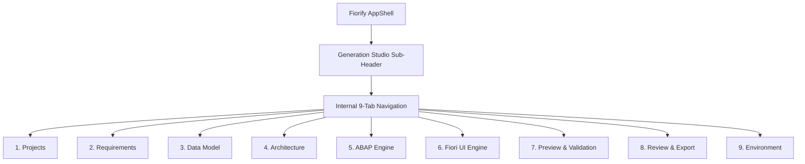

# Fiorify GENERATION STUDIO — UI/UX DESIGN SPECIFICATION
**Document ID:** SPEC-GEN-UX-2026-01  
**Project:** Fiorify — SAP Modernization Platform  
**Target Release:** Generation Milestone (Phase 0 Design)  
**Status:** COMPLETE DESIGN SPECIFICATION  
**Author:** Principal UX Architect & Design System Lead  

---

## 1. Design System & Principles

The Generation Studio UI adheres strictly to the **SAP Fiori Design Guidelines (Horizon / Morning Horizon theme)**, maintaining visual harmony with the rest of the Fiorify enterprise suite.

### 1.1 Core Design Principles
1. **Local-First Transparency:** System status clearly indicates local file storage, local mock services, and sandbox boundaries.
2. **Deterministic Confidence:** Every screen makes state explicit—showing generated versions, checksums, and validation status without ambiguous spinners.
3. **Guardrails Without Roadblocks:** Warnings for Clean Core or structural conflicts guide the developer to correct patterns without preventing creative experimentation.
4. **Permanent Mock Indicator:** All preview surfaces display a prominent, non-removable `LOCAL MOCK DATA` watermark.

---

## 2. Studio Layout & Navigation Hierarchy

Generation Studio operates as an enclosed, multi-view sub-application within Fiorify:
- **Global Header (AppShell):** Fiorify top navigation (Overview, Discovery, Catalogue, Generation Studio, Settings).
- **Studio Sub-Header:** Displays active Project Name, Source T-Code, Target Release, Lifecycle Stage Badge, and quick action buttons.
- **Studio Segmented Navigation (TabBar):** 9 distinct work areas arranged logically from concept to export:
  1. `Projects Dashboard`
  2. `Requirements Designer`
  3. `Data Model Designer`
  4. `Architecture Designer`
  5. `ABAP Generator`
  6. `Fiori UI Generator`
  7. `Preview & Validation`
  8. `Review & Export`
  9. `Environment & Toolchain`

---

## 3. Screen Specifications (9 Views)

### 3.1 Screen 1: Projects Dashboard (`GS-01`)
* **Purpose:** Portfolio view of all generation initiatives.
* **Layout:** Top action bar with "New Generation Project" button, search input, filter chips (Draft, Generated, Validated, Exported), and a responsive card grid.
* **Card Anatomy:**
  - Project ID and Display Title.
  - Source T-Code badge (e.g., `ME21N`, `FB01`, `VA01`) & Target System ID (`S21-200`).
  - Progress indicator showing completed stages (e.g., `4 of 8 stages complete`).
  - Last updated relative timestamp.
  - Action menu: *Open*, *Duplicate*, *Archive*, *Delete*.
* **Empty State:** Illustrated card prompting user to create a project from an approved assessment or start with a standard template.

---

### 3.2 Screen 2: Requirements Designer (`GS-02`)
* **Purpose:** Structure, prioritize, and categorize functional requirements.
* **Layout:** Two-column split layout:
  - *Left Column (Requirements List):* Grouped by category (CRUD Operations, Business Logic & Validations, Determinations, UI Interactions). Supports drag-and-drop prioritization (Must-Have, Should-Have, Nice-to-Have).
  - *Right Column (Requirement Detail / Editor):* Title, detailed user story, acceptance criteria, associated entity, Clean Core compliance impact, and confirmation toggle.
* **Key Controls:**
  - `+ Add Requirement` button.
  - `Import from Assessment` button (pre-populates from approved fit-gap findings).
  - Status indicator: `Confirmed` vs `Draft`.

---

### 3.3 Screen 3: Data Model Designer (`GS-03`)
* **Purpose:** Define entity relationships, fields, data types, and CDS associations.
* **Layout:** Entity hierarchy tree on left; detailed schema editor table on right.
* **Components:**
  - *Entity Structure Tree:* Shows Root Entity (`Z_I_PlantBillingDispute`) and composition children (`Z_I_PlantBillingItem`).
  - *Field Grid Table:*
    - Column 1: Field Name (ABAP UpperCamelCase).
    - Column 2: Data Element / CDS Type (`abap.char(10)`, `abap.dec(15,2)`, `abap.dats`).
    - Column 3: Key Field Toggle.
    - Column 4: Semantic Annotation (`@Semantics.amount.currencyCode`, etc.).
    - Column 5: Association (link to C1 released views like `I_Customer`, `I_Plant`).
    - Column 6: Delete / Options action.
  - *Association Drawer:* Panel to browse and bind approved standard SAP CDS views.

---

### 3.4 Screen 4: Architecture Designer (`GS-04`)
* **Purpose:** Formulate technical implementation profile and behavior parameters.
* **Layout:** Card-based configuration matrix divided into 3 sections:
  1. *RAP Scenario Profile:*
     - Radio group: `Managed with Draft (Strict 2)` [Recommended], `Unmanaged`, `Read-Only Query`.
     - Draft table prefix input (e.g., `ZDT_`).
  2. *Behavior & Capabilities Configuration:*
     - Checkbox controls for standard operations: `create`, `update`, `delete`.
     - Custom actions builder (Action Name, Instance/Static, Parameters, Result Entity).
     - Determination & Validation hooks definition.
  3. *Clean Core & Protocol Settings:*
     - OData Protocol: `OData V4 (SAP Fiori Elements)` [Default], `OData V2`.
     - Clean Core Extensibility Tier: `Tier 1 (ABAP Cloud / Developer Extensibility)`.

---

### 3.5 Screen 5: ABAP Generator (`GS-05`)
* **Purpose:** Generate, review, and fine-tune ABAP CDS and RAP artifacts.
* **Layout:** IDE-like master-detail layout:
  - *Artifact Sidebar:* Collapsible tree listing generated objects:
    - `CDS View Entities (Data Model)`
    - `CDS Projection Views (Consumption)`
    - `Behavior Definition (BDEF)`
    - `Behavior Implementation Class (Skeleton)`
    - `Service Definition (SRVD)`
    - `Service Binding (SRVB)`
    - `Metadata Extension (Annotations)`
  - *Code Editor / Viewer:* Monospace editor with syntax highlighting, copy-to-clipboard, dirty indicator (unsaved/manual edit tag), and diff comparison against base template.
  - *Generation Actions Bar:* `Generate All ABAP Artifacts`, `Re-generate Selected`, `Reset to Template`.

---

### 3.6 Screen 6: Fiori UI Generator (`GS-06`)
* **Purpose:** Generate SAP Fiori Elements frontend application and local mock assets.
* **Layout:** Interactive floorplan visualizer with side-by-side code pane:
  - *Floorplan Layout Preview:* Interactive wireframe showing Header Filters, List Report table columns, and Object Page sections.
  - *UI Property Inspector:* Configure column order, default filter fields, table personalization options, and action buttons.
  - *Artifact Viewer:* Tabs for `manifest.json`, `ui5.yaml`, `annotations.xml`, and `mockdata/*.json`.
  - *Mock Data Editor:* Tabular editor to view and edit realistic mock records that will populate the local preview.

---

### 3.7 Screen 7: Preview & Validation (`GS-07`)
* **Purpose:** Live interactive simulation of the generated Fiori application with simultaneous static compliance validation.
* **Layout:** 60/40 Split screen:
  - *Left / Main Pane (Live Fiori Preview):*
    - Embedded secure iframe rendering the generated Fiori Elements application powered by the local mock server.
    - Non-removable watermark banner across top: `LOCAL MOCK PREVIEW — SYNTHETIC DATA ONLY (NO SAP CONNECTION)`.
    - Server status badge (`Running on port 4055`) and `Restart Server` / `Inspect Requests` controls.
  - *Right Pane (Validation Findings Matrix):*
    - Real-time compliance score (e.g., `Score: 94/100 | Clean Core Compliant`).
    - Finding cards categorized by `CLEAN_CORE`, `RAP_CONSISTENCY`, `UI_METADATA`, `SYNTAX`.
    - Severity chips (`CRITICAL`, `WARNING`, `INFO`) with exact line citations and suggested fixes.

---

### 3.8 Screen 8: Review & Export (`GS-08`)
* **Purpose:** Final governance sign-off, integrity check, and deployable archive export.
* **Layout:** Three summary panels:
  1. *Project Integrity & Manifest Summary:* Total files generated, total lines of ABAP and UI5 code, cumulative package size, and master SHA-256 package checksum.
  2. *Specification Traceability Matrix:* Interactive table demonstrating that each approved business requirement is implemented by specific CDS views, actions, or UI facets.
  3. *Packaging & Download Center:*
     - Primary action button: `Export Deployable Project Archive (ZIP)`.
     - Secondary actions: `Export Developer Handover Document (PDF/MD)`, `Copy abapGit Repository Structure`.
     - Instructions card for importing into Eclipse ADT.

---

### 3.9 Screen 9: Environment & Toolchain (`GS-09`)
* **Purpose:** Transparency dashboard for developer workstation toolchain readiness.
* **Layout:** Grid of tool status cards:
  - Node.js & npm (Version, Status: Operational).
  - Java Development Kit (Version, Hotspot Vendor, Status: Operational).
  - Eclipse IDE & ADT (Eclipse Version: 4.41.0, ADT Status: Missing Plugins, Action: "View Setup Guide").
  - SAP GUI (Version: 800 64-bit, Connection File Status: Found).
  - Local Port Allocator (Port 4004: Backend Active, Port 4055: Mock Server Ready).
* **Modal Drawer:** Official SAP step-by-step ADT setup guide with copyable update site URL.
