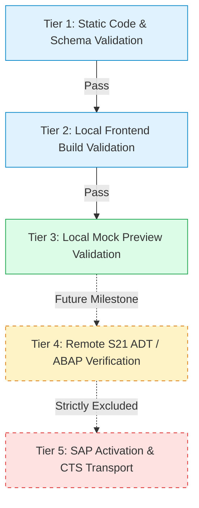

# Fiorify GENERATION VALIDATION STRATEGY & COMPLIANCE RULES
**Document ID:** STRAT-GEN-VAL-2026-01  
**Project:** Fiorify — SAP Modernization Platform  
**Target Release:** Fiorify v2.0.0  
**Status:** COMPLETE NORMATIVE SPECIFICATION  
**Author:** Principal Quality & SAP Governance Architect  

---

## 1. Five-Tier Validation Taxonomy

To prevent misleading claims and maintain rigorous engineering integrity, Fiorify categorizes all verification activities into **five distinct tiers**.

### Critical Governance Rule
> **MANDATORY POLICY:** A passing Tier 1 or Tier 3 static check **MUST NEVER** be reported as an "SAP Activation" or "Live System Deployment". All reports must clearly label results as *Offline Static Verification*.

---

## 2. Validation Tiers Explained

| Tier | Name | Execution Scope | Environment | Current Phase Status |
| :---: | :--- | :--- | :--- | :---: |
| **Tier 1** | **Static Validation** | Syntax parsing, AST structure, naming conventions, Clean Core compliance, and cross-artifact consistency. | Local Node.js engine | **In Scope (100%)** |
| **Tier 2** | **Frontend Build Validation** | TypeScript typechecking, UI5 manifest schema validation, JSON linting, and annotation syntax. | Local TypeScript/Vite | **In Scope (100%)** |
| **Tier 3** | **Mock Preview Validation** | Runtime validation of mock OData V4 responses, navigation, filtering, and CRUD simulation. | Local Mock Server | **In Scope (100%)** |
| **Tier 4** | **Remote S21 ADT Verification** | Future live ABAP compiler syntax check via ADT REST API in an isolated S4 sandbox. | Remote SAP S21 | **Future (Excluded)** |
| **Tier 5** | **SAP Activation & Transport** | Dictionary activation (`$TMP` / package) and CTS transport task assignment. | Production / Quality | **Strictly Excluded** |

---

## 3. Concrete Static Validation Rule Catalog (Tier 1)

The Static Validation Engine evaluates 20 concrete rules across 5 categories:

### 3.1 Category 1: Clean Core Compliance (`CC`)

| Rule ID | Rule Title | Severity | Validation Logic |
| :--- | :--- | :---: | :--- |
| `CC-001` | **Released C1 View Association Only** | `CRITICAL` | Asserts that every CDS view association references an officially released SAP C1 view (e.g. `I_Customer`, `I_Product`, `I_CompanyCode`). Flag direct database table joins (e.g. `MARA`, `VBAK`, `KNA1`) as Clean Core violations. |
| `CC-002` | **ABAP Cloud Strict Syntax (strict 2)** | `CRITICAL` | Behavior definitions must declare `strict ( 2 );` or `strict ( 1 );`. Legacy unmanaged direct database updates without strict mode trigger a critical finding. |
| `CC-003` | **Administrative Fields Mandatory** | `WARNING` | Root entities must include standard administrative fields: `created_by`, `created_at`, `last_changed_by`, `last_changed_at`, and `local_last_changed_at`. |
| `CC-004` | **Standard Customer Namespace** | `CRITICAL` | All created database tables, CDS views, and ABAP classes must start with `Z` or `Y` customer namespace. |

### 3.2 Category 2: RAP Consistency & Structure (`RAP`)

| Rule ID | Rule Title | Severity | Validation Logic |
| :--- | :--- | :---: | :--- |
| `RAP-001` | **Lock Master Defined on Root** | `CRITICAL` | Root entity behavior definition must define `lock master`. Child composition entities must define `lock dependent by <Parent>`. |
| `RAP-002` | **ETag Master / Total ETag Defined** | `CRITICAL` | Root entity must define `etag master LocalLastChangedAt` and `total etag LastChangedAt` for draft concurrency control. |
| `RAP-003` | **Draft Table Specification** | `CRITICAL` | When `with draft;` is enabled, every entity in the composition must specify a valid `draft table <TABLE_D>` limited to 16 characters. |
| `RAP-004` | **Draft Actions Consistency** | `WARNING` | Draft-enabled BO must declare standard draft actions: `Edit`, `Activate`, `Discard`, `Resume`, and `Prepare`. |
| `RAP-005` | **Composition Cardinality Match** | `CRITICAL` | Verifies bidirectional composition links: `composition of [0..*] ZR_Child` in root matches `association to parent ZR_Root` in child. |

### 3.3 Category 3: Service Exposure & OData V4 (`SRV`)

| Rule ID | Rule Title | Severity | Validation Logic |
| :--- | :--- | :---: | :--- |
| `SRV-001` | **Exposed Entities Must Exist** | `CRITICAL` | Service Definition (`.srvd`) must only expose projection views (`ZC_*`) that exist in the project artifact registry. |
| `SRV-002` | **Projection View Field Parity** | `WARNING` | Verifies that all fields exposed in the projection view exist in the underlying data model view entity. |
| `SRV-003` | **Service Binding Protocol Match** | `CRITICAL` | Verifies that the service binding specifies `UI - OData V4` when target floorplan is Fiori Elements List Report. |

### 3.4 Category 4: Fiori Elements UI & Metadata (`UI`)

| Rule ID | Rule Title | Severity | Validation Logic |
| :--- | :--- | :---: | :--- |
| `UI-001` | **Manifest Service URI Match** | `CRITICAL` | Verifies that the `dataSources.mainService.uri` in `manifest.json` matches the service binding and definition naming. |
| `UI-002` | **LineItem Annotations Defined** | `WARNING` | Verifies that at least 3 fields are annotated with `@UI.lineItem` for the List Report table display. |
| `UI-003` | **Identification Annotations Defined** | `WARNING` | Verifies that header fields are annotated with `@UI.identification` for Object Page header display. |
| `UI-004` | **MinUI5Version Compatibility** | `WARNING` | Verifies `sap.ui5.dependencies.minUI5Version` is `>= 1.118.0` for S/4HANA 2023 compatibility. |

### 3.5 Category 5: Security & Authorization (`SEC`)

| Rule ID | Rule Title | Severity | Validation Logic |
| :--- | :--- | :---: | :--- |
| `SEC-001` | **Authorization Check Required** | `CRITICAL` | All CDS View Entities must declare `@AccessControl.authorizationCheck: #CHECK`. Declaring `#NOT_REQUIRED` triggers a critical security warning. |
| `SEC-002` | **Instance Authorization in BDEF** | `WARNING` | Behavior definitions should declare `authorization master ( instance )` or `authorization master ( global )`. |

---

## 4. Reporting & Gate Enforcement

- **Score Calculation:**  
  $$\text{Score} = 100 - (\text{Critical} \times 25) - (\text{Warning} \times 5)$$ (bounded between 0 and 100).
- **Export Gate:**
  - `Score >= 80` AND `Critical == 0`: **PASS** (Export Ready).
  - `Critical > 0`: **BLOCKED** (Export button disabled with explanatory remediation guide).
