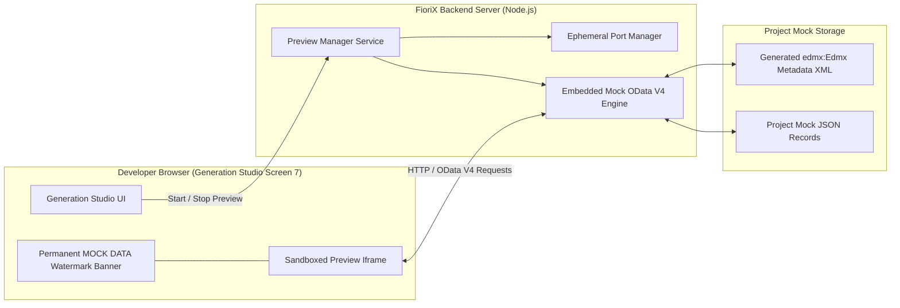

# FIORIX LOCAL PREVIEW & MOCK SERVER DESIGN
**Document ID:** SPEC-GEN-PREVIEW-2026-01  
**Project:** FioriX — SAP Modernization Platform  
**Target Release:** FioriX v2.0.0  
**Status:** COMPLETE ARCHITECTURAL SPECIFICATION  
**Author:** Principal Full-Stack Architect & Runtime Engineer  

---

## 1. Architectural Overview & Objective

The **FioriX Local Preview Subsystem** enables developers, functional leads, and enterprise architects to test, inspect, and interact with generated SAP Fiori Elements applications directly on their local workstation without requiring SAP deployment, Gateway activation, or live backend credentials.

### Key Architectural Pillars
1. **Local-First & Offline:** Powered entirely by a lightweight, embedded Node.js HTTP mock service.
2. **Standard OData V4 Emulation:** Serves dynamic `$metadata` (EDMX 4.0) and supports standard querying, filtering, sorting, pagination, and mock state modifications.
3. **Permanent Mock Watermark:** A prominent, non-removable visual watermark ensures synthetic data can never be mistaken for production or live S21 records.
4. **Sandboxed & Safe Lifecycle:** Process management guarantees safe port allocation, process termination, and strict containment with **zero exposure to arbitrary OS shell execution**.

---

## 2. Local Preview Architecture

---

## 3. Mock OData V4 Engine Specification

The embedded Mock OData engine is implemented as a lightweight protocol handler inside the native Node.js HTTP runtime (`backend/src/generation/preview/mockODataServer.js`).

### 3.1 Supported OData V4 Protocol Capabilities

| Protocol Feature | URI Example | Engine Behavior |
| :--- | :--- | :--- |
| **Service Document** | `GET /sap/opu/odata4/.../srvd/.../0001/` | Returns JSON service document listing exposed Entity Sets. |
| **Metadata Document**| `GET /sap/opu/odata4/.../$metadata` | Returns XML EDMX V4 schema matching generated CDS projection views. |
| **Entity Set Query** | `GET /sap/opu/odata4/.../PurchaseOrder` | Returns array of mock entities formatted with OData V4 JSON envelope (`@odata.context`, `value: [...]`). |
| **Entity Key Read**  | `GET /sap/opu/odata4/.../PurchaseOrder('4500000001')` | Returns single entity object or 404 if not found. |
| **Filtering**        | `?$filter=Supplier eq '100001' and NetAmount gt 500` | Evaluates simple comparison predicates against mock dataset. |
| **Sorting**          | `?$orderby=CreationDate desc, NetAmount asc` | Sorts collection in memory. |
| **Pagination**       | `?$top=20&$skip=40&$count=true` | Returns slice of collection with `@odata.count`. |
| **Composition Navigation** | `GET /.../PurchaseOrder('4500000001')/_Items` | Navigates composition relationship to return associated child items. |
| **Draft Actions**    | `POST /.../PurchaseOrder('4500000001')/DraftEdit` | Simulates RAP draft creation; duplicates record with active draft state. |
| **Create Entity**    | `POST /sap/opu/odata4/.../PurchaseOrder` | Validates mandatory fields; assigns key; stores in memory. |
| **Update Entity**    | `PATCH /sap/opu/odata4/.../PurchaseOrder('...')` | Updates fields in memory; returns updated entity with 200 OK. |
| **Delete Entity**    | `DELETE /sap/opu/odata4/.../PurchaseOrder('...')`| Removes entity from memory; returns 204 No Content. |

---

## 4. Visual Safeguards & Watermark Design

To eliminate any risk of confusing local simulation with live S21 system data, the preview surface incorporates two strict visual guards:

1. **Top Watermark Banner (Fixed Viewport Position):**
   - High-contrast warning banner: `⚠️ FIORIX LOCAL PREVIEW — SYNTHETIC MOCK DATA — NOT CONNECTED TO SAP S21`.
   - Displays simulated system profile: `Profile: S/4HANA 2023 Mock Sandbox | Memory-Only Store`.
2. **Watermark Background Tile:**
   - Semi-transparent CSS watermark repeating `LOCAL MOCK DATA — DO NOT USE FOR LIVE DECISIONS` across the application canvas.
3. **Simulated Records Banner:**
   - Every entity record automatically prefixes semantic IDs with `MOCK-` (e.g. `MOCK-PO-450001`, `MOCK-SUPP-01`).

---

## 5. Process Lifecycle & Security Containment

### 5.1 Safe Port Allocation
- The Preview Manager utilizes a dedicated ephemeral port range (`4050` to `4099`).
- Before starting, the engine probes available ports and dynamically binds to the first open socket.
- The allocated port is reported to the frontend for iframe mounting.

### 5.2 Clean Process Termination
- The mock server keeps an active handle to its HTTP listener.
- **Auto-Cleanup on Navigation:** When the user leaves Screen 7 or closes the browser tab, the frontend issues a beacon request (`POST /api/v1/generation/preview/stop`) or backend timeout triggers automatic shutdown after 15 minutes of inactivity.
- **Process Boundaries:** The mock server runs in-process on an isolated Node HTTP server instance or dedicated child worker, ensuring it can be closed instantly with `server.close()`.

### 5.3 Zero Arbitrary Shell Execution
- **Strict Architecture Rule:** No browser control, button, or API parameter is permitted to invoke `child_process.exec`, PowerShell, or command prompt strings.
- All preview endpoints take structured JSON parameters validated against rigid schemas.
