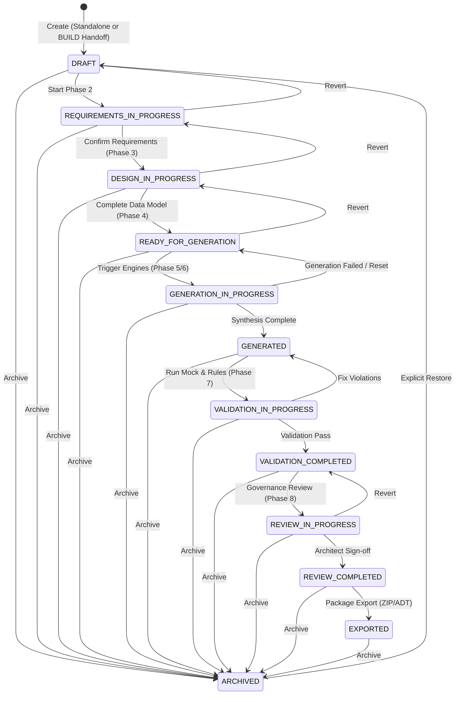

# FioriX Generation Studio — Project Lifecycle State Machine (Phase 1)

**Module:** Generation Studio  
**Target:** SAP S/4HANA 2023 On-Premise  
**Status:** Normative Lifecycle Specification  

---

## 1. Lifecycle Overview

The Generation Studio enforces a deterministic, 12-state finite state machine governing every custom modernization initiative. The lifecycle prevents arbitrary status skips, guarantees cryptographic auditability of all phase transitions, and protects Clean Core integrity by ensuring automated code synthesis cannot proceed without formal requirements and architectural approvals.



---

## 2. Canonical Lifecycle States

| State | Milestone | Description | Phase 1 Status |
| :--- | :--- | :--- | :--- |
| `DRAFT` | Phase 1 | Initial workspace creation. Context and canonical storage established. | **Active & Functional** |
| `REQUIREMENTS_IN_PROGRESS` | Phase 2 | Requirements catalog, categorization, user stories, and acceptance criteria in progress. | Future Milestone |
| `DESIGN_IN_PROGRESS` | Phase 3 | CDS entity modeling, field definitions, and C1 associations in progress. | Future Milestone |
| `READY_FOR_GENERATION` | Phase 4 | RAP Managed architecture profile, behavior definition, and actions confirmed. | Future Milestone |
| `GENERATION_IN_PROGRESS` | Phase 5/6 | Automated code generation synthesizing ABAP Cloud and UI5 artifacts. | Future Milestone |
| `GENERATED` | Phase 5/6 | Code synthesis completed. Artifacts registered in local project manifest. | Blocked in Phase 1 |
| `VALIDATION_IN_PROGRESS` | Phase 7 | Local mock server and static Clean Core validation executing. | Future Milestone |
| `VALIDATION_COMPLETED` | Phase 7 | Validation rules passed and scored against quality gate thresholds. | Blocked in Phase 1 |
| `REVIEW_IN_PROGRESS` | Phase 8 | Final architectural and governance sign-off in progress. | Future Milestone |
| `REVIEW_COMPLETED` | Phase 8 | Formal sign-off recorded with requirement traceability. | Future Milestone |
| `EXPORTED` | Phase 8 | Deployable ZIP archive exported for Eclipse ADT import. | Blocked in Phase 1 |
| `ARCHIVED` | All Phases | Project marked read-only and preserved for compliance/audit. | **Active & Functional** |

---

## 3. Phase 1 Guardrails

### 3.1 Blocked Future State Simulation
In Phase 1, automated generation, validation, and packaging engines are intentionally not yet implemented. To ensure system honesty and avoid deceptive dashboard states:
- Direct transitions to `GENERATED`, `VALIDATION_COMPLETED`, or `EXPORTED` are rejected with HTTP 400 (`INVALID_LIFECYCLE_TRANSITION`).
- Any attempt to forge completed generator milestones throws descriptive error messages referencing the roadmap.

### 3.2 Archival and Read-Only Protection
- Any active project can transition to `ARCHIVED`.
- Projects in `ARCHIVED` state reject all modifications (`PATCH`), specification updates, and deletions unless explicitly restored or confirmed.
- Projects are restored back to `DRAFT` via `POST /api/v1/generation/projects/:id/restore`.

### 3.3 Activity History & Audit Event Trail
Every lifecycle status change automatically appends an immutable event to the project's `activityHistory` array:
```json
{
  "eventId": "EVT-1794350123456-ABCDEF",
  "timestamp": "2026-11-11T03:30:00.000Z",
  "author": "Dr. Marcus Weber",
  "actorId": "USR-ARCH-001",
  "action": "STATUS_CHANGED",
  "details": {
    "previousStatus": "DRAFT",
    "newStatus": "ARCHIVED",
    "comment": "Project archived pending business requirements alignment"
  },
  "previousStatus": "DRAFT",
  "newStatus": "ARCHIVED"
}
```
